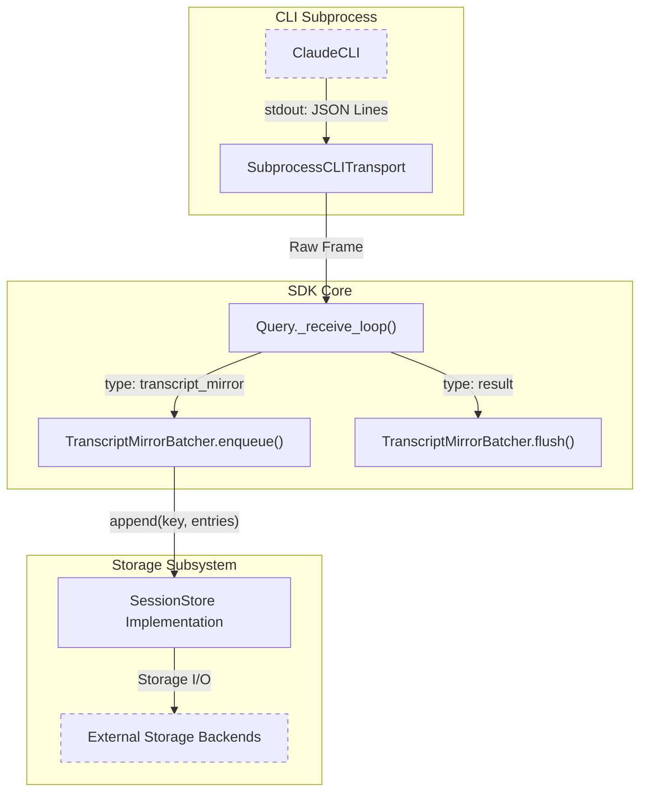
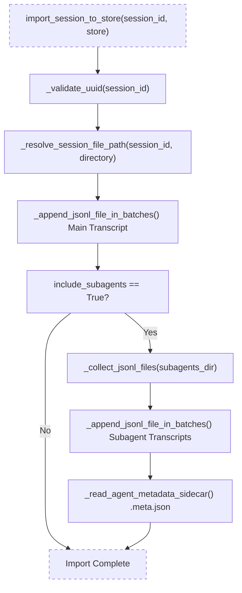
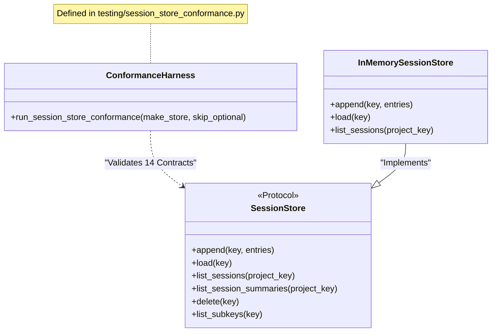

<!-- source: DeepWiki mcp.deepwiki.com · repo anthropics/claude-agent-sdk-python · page 6.2 SessionStore: Transcript Persistence · fetched 2026-10-26 -->

# SessionStore: Transcript Persistence

Relevant source files

The following files were used as context for generating this wiki page:

- [e2e-tests/test_agents_and_settings.py](e2e-tests/test_agents_and_settings.py)
- [e2e-tests/test_subagent_session_reads.py](e2e-tests/test_subagent_session_reads.py)
- [examples/session_stores/README.md](examples/session_stores/README.md)
- [examples/session_stores/__init__.py](examples/session_stores/__init__.py)
- [examples/session_stores/postgres_session_store.py](examples/session_stores/postgres_session_store.py)
- [examples/session_stores/redis_session_store.py](examples/session_stores/redis_session_store.py)
- [examples/session_stores/s3_session_store.py](examples/session_stores/s3_session_store.py)
- [src/claude_agent_sdk/_internal/session_import.py](src/claude_agent_sdk/_internal/session_import.py)
- [src/claude_agent_sdk/_internal/session_store.py](src/claude_agent_sdk/_internal/session_store.py)
- [src/claude_agent_sdk/_internal/session_summary.py](src/claude_agent_sdk/_internal/session_summary.py)
- [src/claude_agent_sdk/_internal/transcript_mirror_batcher.py](src/claude_agent_sdk/_internal/transcript_mirror_batcher.py)
- [src/claude_agent_sdk/testing/session_store_conformance.py](src/claude_agent_sdk/testing/session_store_conformance.py)
- [tests/test_session_import.py](tests/test_session_import.py)
- [tests/test_session_store_anyio.py](tests/test_session_store_anyio.py)
- [tests/test_session_summary.py](tests/test_session_summary.py)
- [tests/test_transcript_mirror.py](tests/test_transcript_mirror.py)

The purpose of this page is to document the `SessionStore` protocol and its associated subsystems for transcript persistence, live session mirroring, batching, migration, conformance testing, and reference adapters (`S3SessionStore`, `RedisSessionStore`, `PostgresSessionStore`).

---

## 1. Architecture and Data Flow

The SDK persistence mechanism uses a **transcript mirroring** strategy. While the Claude CLI subprocess remains the primary writer for local `.jsonl` files under `~/.claude/projects/`, it emits `transcript_mirror` frames over `stdout`. The SDK receive loop intercepts these frames, extracts file paths and entry lists, converts paths to composite keys via `file_path_to_session_key()`, and hands them to `TranscriptMirrorBatcher` for persistence into any implementation of the `SessionStore` protocol.

**Sources:** `src/claude_agent_sdk/_internal/transcript_mirror_batcher.py:1-10](), `src/claude_agent_sdk/_internal/session_store.py:149-165]()

---

## 2. The SessionStore Protocol and Data Structures

A session store is any class conforming to the `SessionStore` protocol defined in `src/claude_agent_sdk/types.py`. It manages two main entities: the primary session transcript and optional subagent transcripts (sidechains).

### Interface Definitions
The protocol specifies required methods for read/write operations and optional methods for enumeration, summary derivation, and deletion:

| Method | Role & Description |
| :--- | :--- |
| `append(key, entries)` | Appends a batch of `SessionStoreEntry` dicts to the given `SessionKey`. |
| `load(key)` | Retrieves all entries for a `SessionKey`, or returns `None` if not found. |
| `list_sessions(project_key)` | Returns a list of `SessionStoreListEntry` dicts containing `session_id` and `mtime`. |
| `list_session_summaries(project_key)` | Returns pre-folded `SessionSummaryEntry` objects for fast session listing. |
| `delete(key)` | Deletes a specific transcript key and cascades to subkeys if a main key. |
| `list_subkeys(key)` | Lists subpaths (such as subagent transcripts) associated with a session. |

**Sources:** `src/claude_agent_sdk/types.py:34-119](), `src/claude_agent_sdk/_internal/session_store.py:35-121]()

### Key and Entry Types
*   **`SessionKey`**: A TypedDict containing `project_key`, `session_id`, and an optional `subpath` for subagent transcripts.
*   **`SessionStoreEntry`**: A permissive TypedDict representing a single log line (user message, assistant message, tool use, metadata, etc.).
*   **`SessionSummaryEntry`**: A sidecar structure maintained incrementally via `fold_session_summary()` during `append()` calls to avoid full-transcript reads during `list_sessions()`.

**Sources:** `src/claude_agent_sdk/types.py:10-33](), `src/claude_agent_sdk/_internal/session_summary.py:112-146]()

---

## 3. TranscriptMirrorBatcher and Flush Modes

`TranscriptMirrorBatcher` acts as a buffering layer between CLI stdout frames and the `SessionStore`, preventing network I/O from blocking model streaming loops.

### Configuration and Thresholds
*   `max_pending_entries`: Defaults to `MAX_PENDING_ENTRIES` (500 entries).
*   `max_pending_bytes`: Defaults to `MAX_PENDING_BYTES` (1 MiB).
*   **Eager Flush**: When thresholds are exceeded, `enqueue()` spawns a detached background task via `spawn_detached(self._drain())` to flush entries without waiting for a result message.
*   **Explicit Flush**: When a `result` message arrives, an explicit `flush()` call drains remaining items.

### Resilience, Retries, and Error Handling
*   Failed `append()` calls undergo bounded retries up to `MIRROR_APPEND_MAX_ATTEMPTS` (3 attempts) with short backoff delays (`0.2s`, `0.8s`).
*   Timeouts (`send_timeout`) are not retried to prevent duplicate inflight writes.
*   If all retries fail, the batch is dropped, and the `on_error` callback is invoked. Persistence errors never raise exceptions to user code, ensuring conversation continuity.

**Sources:** `src/claude_agent_sdk/_internal/transcript_mirror_batcher.py:27-120](), `src/claude_agent_sdk/_internal/transcript_mirror_batcher.py:149-162]()

---

## 4. Session Migration and Import

The `import_session_to_store()` function allows migrating existing local JSONL transcripts into any `SessionStore`.

**Sources:** `src/claude_agent_sdk/_internal/session_import.py:29-120](), `src/claude_agent_sdk/_internal/session_import.py:121-146]()

---

## 5. Conformance Testing Harness

To ensure custom store implementations are robust and behave correctly, the SDK provides `run_session_store_conformance()`.

**Sources:** `src/claude_agent_sdk/testing/session_store_conformance.py:54-74](), `src/claude_agent_sdk/testing/session_store_conformance.py:81-136]()

---

## 6. Reference Adapters

The SDK includes reference implementations in `examples/session_stores/` for production-grade storage systems. These are intended to be copied and customized for specific project requirements.

| Adapter Module | Storage Strategy | Key Scheme / Structure |
| :--- | :--- | :--- |
| `s3_session_store.py` | JSONL Part Files on Amazon S3 | `s3://{bucket}/{prefix}{project_key}/{session_id}/part-{epochMs13}-{rand6}.jsonl` |
| `redis_session_store.py` | Redis Lists via `redis.asyncio` | `{prefix}:{project_key}:{session_id}` (or subpath suffix) |
| `postgres_session_store.py` | Relational Rows with `asyncpg` | Table schema storing `project_key`, `session_id`, `subpath`, `seq`, and `entry` (JSONB) |

### Key Production Considerations
*   **S3**: Use NTP to prevent clock skew across writers. Sorting relies on zero-padded millisecond timestamps and random hexadecimal suffixes.
*   **Redis**: Configure `maxmemory-policy noeviction` to prevent silent data loss on memory pressure.
*   **Postgres**: Size connection pools appropriately and use `jsonb` column types. Note that JSONB reorders dictionary keys, which is why the SDK performs deep-equal checks rather than byte-comparisons.

**Sources:** `examples/session_stores/README.md:51-90](), `examples/session_stores/s3_session_store.py:89-115]()

---

