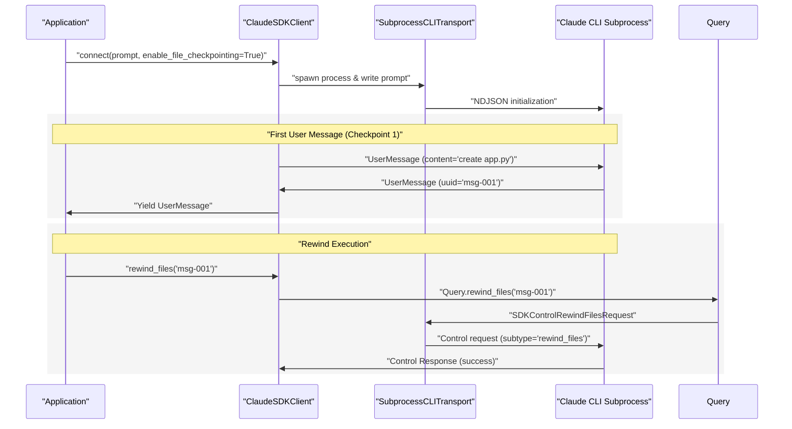
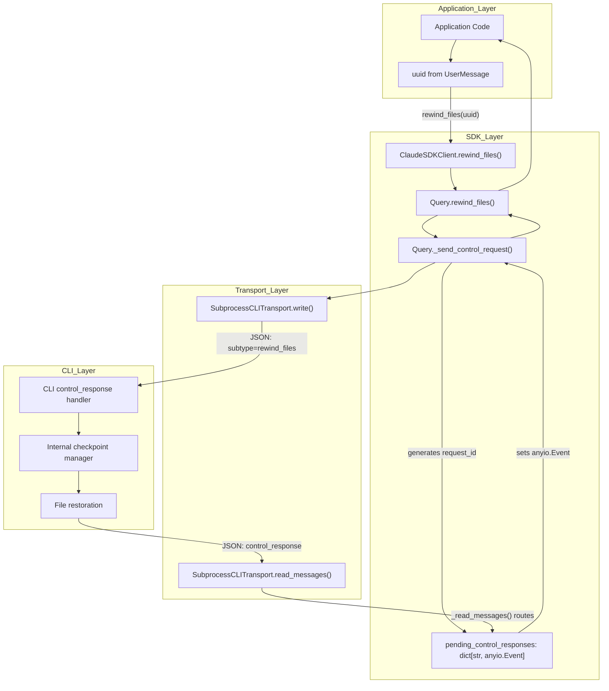

<!-- source: DeepWiki mcp.deepwiki.com · repo anthropics/claude-agent-sdk-python · page 6.3 File Checkpointing and Rewinding · fetched 2026-10-26 -->

# File Checkpointing and Rewinding

<details>
<summary>Relevant source files</summary>

The following files were used as context for generating this wiki page:

- [src/claude_agent_sdk/_internal/query.py](src/claude_agent_sdk/_internal/query.py)
- [src/claude_agent_sdk/client.py](src/claude_agent_sdk/client.py)

</details>


This document describes the file checkpointing system that allows reverting filesystem changes made during a Claude agent session back to a specific point in time. This feature enables exploring different approaches or recovering from unwanted modifications without manual file restoration.

For information about session continuation and forking, see [6.1 Session Management and Forking](). For general resource limits including budget controls, see [6.4 Resource Limits and Cost Control]().

Sources: [src/claude_agent_sdk/types.py:784-784](), [src/claude_agent_sdk/client.py:275-305]()

## Purpose and System Overview

File checkpointing tracks filesystem state at each user message during a session. When enabled, Claude Code creates snapshots of file contents, allowing applications to rewind all file changes back to any previous checkpoint. This is particularly useful for:

- Exploring alternative implementation approaches without losing progress.
- Recovering from unwanted file modifications.
- Testing different solutions to the same problem.
- Creating branching workflows where each branch starts from a known state.

The system operates through three primary components:
1. The `enable_file_checkpointing` configuration flag in `ClaudeAgentOptions` [src/claude_agent_sdk/types.py:784-784]().
2. The `UserMessage.uuid` field [src/claude_agent_sdk/types.py:642-650]() that identifies each checkpoint.
3. The `rewind_files()` method available on `ClaudeSDKClient` [src/claude_agent_sdk/client.py:275-305]() and `Query` [src/claude_agent_sdk/_internal/query.py:555-568]() classes.

Sources: [src/claude_agent_sdk/types.py:784-784](), [src/claude_agent_sdk/types.py:642-650](), [src/claude_agent_sdk/client.py:275-305](), [src/claude_agent_sdk/_internal/query.py:555-568]()

## Checkpoint Lifecycle

Title: "Checkpoint Creation and Rewinding Flow"


Each `UserMessage` echoed back from the CLI includes a `uuid` field that serves as the checkpoint identifier [src/claude_agent_sdk/types.py:642-650](). This requires `extra_args={"replay-user-messages": None}` to be set in `ClaudeAgentOptions` [src/claude_agent_sdk/client.py:275-305]() so that the CLI emits `UserMessage` objects into the response stream. Applications store these UUIDs and later use them to rewind file changes. The CLI maintains internal snapshots of file states at each checkpoint.

Sources: [src/claude_agent_sdk/client.py:275-305](), [src/claude_agent_sdk/types.py:642-650]()

## Enabling File Checkpointing

File checkpointing is disabled by default and must be explicitly enabled via the `enable_file_checkpointing` option in `ClaudeAgentOptions` [src/claude_agent_sdk/types.py:784-784](). There are two requirements for the feature to work end-to-end:

| Requirement | Purpose |
|-------------|---------|
| `enable_file_checkpointing=True` | Tells the CLI to snapshot file states at each user message boundary [src/claude_agent_sdk/types.py:784-784](). |
| `extra_args={"replay-user-messages": None}` | Causes the CLI to echo `UserMessage` objects (with `uuid`) back into the response stream [src/claude_agent_sdk/client.py:275-305](). |

Both must be set together. Without `extra_args`, `UserMessage` objects with `uuid` are not emitted and there is no way to obtain checkpoint identifiers to pass to `rewind_files()`.

```python
from claude_agent_sdk import ClaudeSDKClient, ClaudeAgentOptions
from claude_agent_sdk.types import UserMessage

options = ClaudeAgentOptions(
    enable_file_checkpointing=True,
    extra_args={"replay-user-messages": None},
    cwd="/path/to/project",
)

async with ClaudeSDKClient(options) as client:
    await client.connect("create main.py")
    async for message in client.receive_response():
        if isinstance(message, UserMessage) and message.uuid:
            checkpoint_id = message.uuid
            print(f"Checkpoint created: {checkpoint_id}")
```

The `enable_file_checkpointing` field is defined in `ClaudeAgentOptions` in `src/claude_agent_sdk/types.py` [src/claude_agent_sdk/types.py:784-784](). When enabled, the SDK communicates this during session initialization, instructing the CLI to track file modifications at each user message boundary.

Sources: [src/claude_agent_sdk/client.py:275-305](), [src/claude_agent_sdk/types.py:784-784]()

## UserMessage UUID Field

The `uuid` field in `UserMessage` [src/claude_agent_sdk/types.py:642-650]() serves as the checkpoint identifier:

| Field | Type | Description |
|-------|------|-------------|
| `content` | `str \| list[ContentBlock]` | User message content [src/claude_agent_sdk/types.py:645-645](). |
| `uuid` | `str \| None` | Checkpoint identifier for file rewinding [src/claude_agent_sdk/types.py:646-646](). |
| `parent_tool_use_id` | `str \| None` | Parent tool use context for subagents [src/claude_agent_sdk/types.py:647-647](). |
| `tool_use_result` | `dict[str, Any] \| None` | File edit metadata [src/claude_agent_sdk/types.py:648-648](). |

The UUID is generated by the CLI and returned as part of the echoed `UserMessage`. It uniquely identifies the filesystem state after all tool executions for that user message have completed. Applications should capture this value when processing user messages and store it for later use with `rewind_files()`.

> **Note:** `UserMessage` objects with a populated `uuid` are only emitted when `extra_args={"replay-user-messages": None}` is set in `ClaudeAgentOptions`. Without this flag, the CLI does not echo user messages back into the stream, so there is no source for checkpoint IDs.

Sources: [src/claude_agent_sdk/types.py:642-650](), [src/claude_agent_sdk/client.py:275-305]()

## Rewinding Files

The `rewind_files()` method reverts all filesystem changes back to a specific checkpoint. This method is available on both `ClaudeSDKClient` and `Query` classes:

### Method Signatures

`rewind_files()` is exposed at two levels of the SDK:

| Class | Method | Location |
|-------|--------|----------|
| `ClaudeSDKClient` | `rewind_files(user_message_id: str) -> None` | [src/claude_agent_sdk/client.py:275-305]() |
| `Query` | `rewind_files(user_message_id: str) -> None` | [src/claude_agent_sdk/_internal/query.py:555-568]() |

`ClaudeSDKClient.rewind_files()` delegates directly to `Query.rewind_files()`. The `Query` implementation sends a `rewind_files` control request via `_send_control_request()` [src/claude_agent_sdk/_internal/query.py:344-389]() and waits for the CLI response.

The single parameter is:
- `user_message_id: str` — The `uuid` value from a `UserMessage` received during the session.

The method raises an exception if:
- The control request times out (default 60 s) [src/claude_agent_sdk/_internal/query.py:103-103]().
- The CLI responds with `subtype: "error"`.
- The CLI process has terminated before the response is received.

Sources: [src/claude_agent_sdk/client.py:275-305](), [src/claude_agent_sdk/_internal/query.py:555-568](), [src/claude_agent_sdk/_internal/query.py:344-389]()

## Control Protocol Implementation

Title: "Code-Level Flow for rewind_files()"


Sources: [src/claude_agent_sdk/client.py:275-305](), [src/claude_agent_sdk/_internal/query.py:344-389](), [src/claude_agent_sdk/_internal/query.py:555-568]()

### SDKControlRewindFilesRequest

The `Query.rewind_files()` implementation [src/claude_agent_sdk/_internal/query.py:555-568]() constructs the following control request and passes it to `_send_control_request()`:

```python
# Internal request structure
{
    "subtype": "rewind_files",
    "user_message_id": user_message_id
}
```

This corresponds to the `SDKControlRewindFilesRequest` protocol message [src/claude_agent_sdk/types.py:1174-1178]() (aliased within `SDKControlRequest` [src/claude_agent_sdk/types.py:1212-1224]()). The dict is wrapped by `_send_control_request()` [src/claude_agent_sdk/_internal/query.py:344-389]() into a full `control_request` envelope with a unique `request_id` before being written to the CLI's stdin.

The CLI responds with a `control_response` message. `_send_control_request()` blocks on an `anyio.Event` keyed by `request_id` and either returns the response or raises an `Exception` if the CLI responds with an error or times out.

Sources: [src/claude_agent_sdk/_internal/query.py:344-389](), [src/claude_agent_sdk/_internal/query.py:555-568](), [src/claude_agent_sdk/types.py:1174-1178]()

## Limitations and Considerations

### Checkpoint Scope

Checkpoints are session-specific and only track changes made through Claude Code tools:
- File operations performed by `Edit`, `Write`, `MultiEdit` tools are tracked.
- Bash command modifications are tracked if they use tool-based file operations.
- Direct filesystem operations outside Claude Code are not captured.

### Session State

Rewinding files does **not** affect:
- Conversation history in the transcript.
- Model context or conversation state.
- System state outside the tracked filesystem (e.g., environment variables, external databases).

The conversation continues from its current point in the transcript, but with files reverted to the checkpoint state. This allows exploring different implementation paths while maintaining the conversational context.

Sources: [src/claude_agent_sdk/types.py:784-784](), [src/claude_agent_sdk/client.py:275-305]()

---

