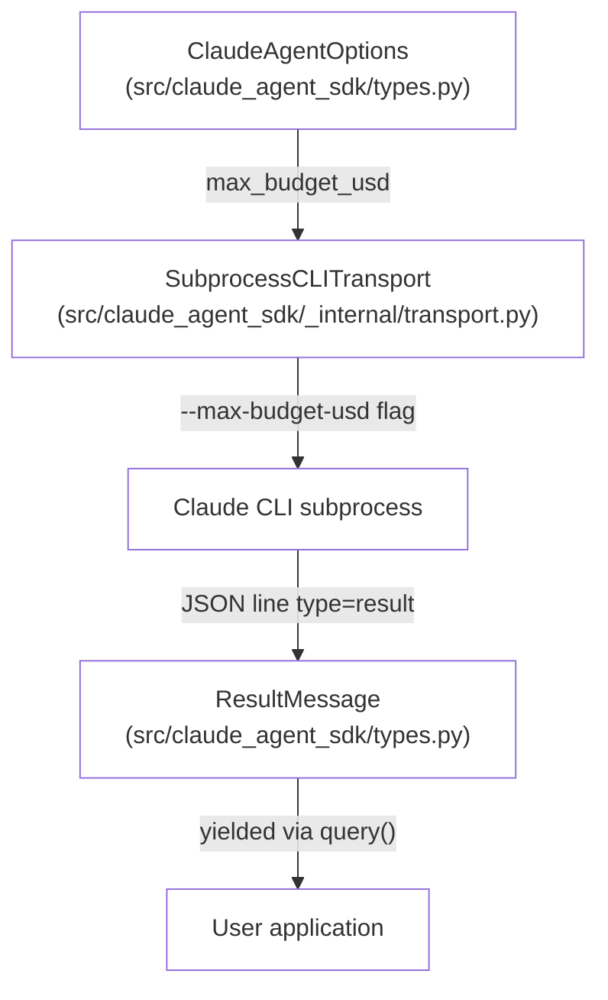
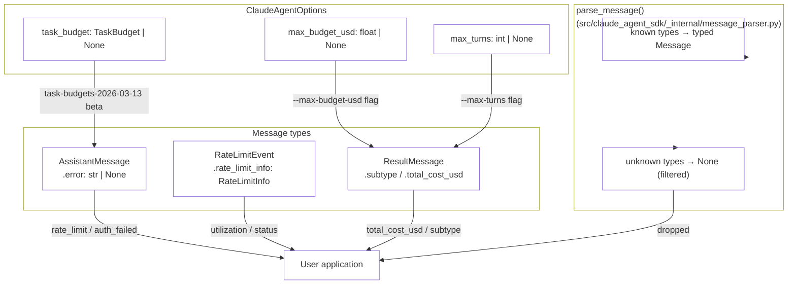

<!-- source: DeepWiki mcp.deepwiki.com · repo anthropics/claude-agent-sdk-python · page 6.4 Resource Limits and Cost Control · fetched 2026-10-26 -->

# Resource Limits and Cost Control

<details>
<summary>Relevant source files</summary>

The following files were used as context for generating this wiki page:

- [e2e-tests/test_error_results.py](e2e-tests/test_error_results.py)
- [examples/max_budget_usd.py](examples/max_budget_usd.py)
- [src/claude_agent_sdk/_errors.py](src/claude_agent_sdk/_errors.py)
- [src/claude_agent_sdk/_internal/message_parser.py](src/claude_agent_sdk/_internal/message_parser.py)
- [tests/test_client.py](tests/test_client.py)
- [tests/test_errors.py](tests/test_errors.py)
- [tests/test_integration.py](tests/test_integration.py)
- [tests/test_message_parser.py](tests/test_message_parser.py)
- [tests/test_rate_limit_event_repro.py](tests/test_rate_limit_event_repro.py)

</details>


This page covers the mechanisms the SDK provides for bounding session cost and turn count, tracking cumulative spend, detecting API-level errors (rate limits, authentication failures), and handling typed events like `RateLimitEvent`. For the full `ClaudeAgentOptions` reference see [2.3](). For session lifecycle and forking see [6.1]().

---

## Overview

The SDK exposes two primary resource-limiting levers on `ClaudeAgentOptions` defined in `src/claude_agent_sdk/types.py`:

| Field | Type | Effect |
|---|---|---|
| `max_budget_usd` | `float | None` | Hard spending cap passed via CLI flags; CLI terminates the session when exceeded |
| `max_turns` | `int | None` | Maximum number of conversation turns before the session ends |

In addition, several message types carry cost and error information at runtime:

| Message | Field | Purpose |
|---|---|---|
| `ResultMessage` | `total_cost_usd` | Cumulative USD cost of the session at completion |
| `ResultMessage` | `subtype` | Termination reason, e.g. `"success"` or `"error_max_budget_usd"` |
| `AssistantMessage` | `error` | Signals API errors such as `rate_limit` or `authentication_failed` |
| `RateLimitEvent` | `rate_limit_info` | Detailed quota and utilization info for subscription users |

Sources: [src/claude_agent_sdk/types.py:351-353](), [src/claude_agent_sdk/types.py:614-633](), [src/claude_agent_sdk/types.py:734-758](), [src/claude_agent_sdk/types.py:761-792]()

---

## Spending Cap: `max_budget_usd`

Setting `max_budget_usd` on `ClaudeAgentOptions` passes a `--max-budget-usd` flag to the bundled Claude CLI subprocess through `SubprocessCLITransport`. The CLI tracks cumulative token spend and stops the session when the threshold is crossed. 

Additionally, the SDK supports `TaskBudget` (via `task_budget` in `ClaudeAgentOptions`), which informs the model of its remaining token budget via the `task-budgets-2026-03-13` beta header so it can pace tool use.

**How the limit surfaces in messages**

When the budget is exceeded, the CLI emits a `ResultMessage` with:
- `subtype = "error_max_budget_usd"`
- `is_error = False` (the session terminated intentionally, not due to an internal fault)
- `total_cost_usd` set to the actual spend at termination

The integration test at [tests/test_integration.py:234-307]() demonstrates this flow, and the example in [examples/max_budget_usd.py:51-77]() shows how to handle the budget-exceeded state in application logic.

**Budget Cap Data Flow**

Title: Budget Limit Data Flow


Sources: [src/claude_agent_sdk/types.py:353-353](), [src/claude_agent_sdk/types.py:64-74](), [tests/test_integration.py:234-307](), [examples/max_budget_usd.py:51-77]()

---

## Turn Limit: `max_turns`

`max_turns` on `ClaudeAgentOptions` is passed to the CLI as `--max-turns`. When the number of agentic turns reaches the configured value, the CLI stops issuing further tool calls and returns a `ResultMessage`.

Unlike `max_budget_usd`, exceeding `max_turns` does not produce a distinct `subtype` in the `ResultMessage`; the session ends with `subtype = "success"` after the final turn completes.

Sources: [src/claude_agent_sdk/types.py:351-351](), [src/claude_agent_sdk/_internal/message_parser.py:188-210]()

---

## Cost Tracking: `ResultMessage`

Every session emits exactly one `ResultMessage` as its final message. The relevant cost fields are parsed by `parse_message()` in `src/claude_agent_sdk/_internal/message_parser.py`.

| Field | Type | Notes |
|---|---|---|
| `total_cost_usd` | `float | None` | Cumulative cost; `None` if the CLI did not report it |
| `subtype` | `str` | `"success"`, `"error_max_budget_usd"`, or other subtypes |
| `is_error` | `bool` | `True` for unexpected failures, `False` for planned terminations |
| `num_turns` | `int` | Total turns consumed |
| `duration_ms` | `int` | Wall-clock duration of the session |
| `usage` | `dict | None` | Raw token counts (`input_tokens`, `output_tokens`) if available |

**`ResultMessage` Subtype Logic**

Title: ResultMessage Subtype Logic
```mermaid
graph LR
    rm["ResultMessage\n(src/claude_agent_sdk/types.py)"]
    s["\"success\"\nnormal completion"]
    b["\"error_max_budget_usd\"\nspending cap reached"]
    e["other subtypes\nforward-compatible unknowns"]

    rm -->|"subtype=success"| s
    rm -->|"subtype=error_max_budget_usd"| b
    rm -->|"subtype=..."| e

    style rm fill:none
    style s fill:none
    style b fill:none
    style e fill:none
```

Sources: [src/claude_agent_sdk/types.py:734-758](), [src/claude_agent_sdk/_internal/message_parser.py:188-210]()

---

## API Error Detection: `AssistantMessage.error`

When the Anthropic API returns an error mid-session (e.g., a rate limit rejection or an authentication failure), the CLI surfaces it as an `AssistantMessage` with its `error` field populated.

The parser reads the field at `src/claude_agent_sdk/_internal/message_parser.py`:

```python
return AssistantMessage(
    content=content_blocks,
    model=data["message"]["model"],
    parent_tool_use_id=data.get("parent_tool_use_id"),
    error=data.get("error"),
    usage=data["message"].get("usage"),
    # ... other fields
)
```

**Typical `error` values**

| Value | Meaning |
|---|---|
| `"rate_limit"` | API rate limit hit; request was not completed |
| `"authentication_failed"` | Invalid or expired API key |
| `None` | No error; normal message |

Sources: [src/claude_agent_sdk/types.py:614-633](), [src/claude_agent_sdk/_internal/message_parser.py:170-185]()

---

## Rate Limit Events: `RateLimitEvent`

The CLI emits `rate_limit_event` messages when rate limit status changes for subscription users. The SDK parses these into typed `RateLimitEvent` objects containing `RateLimitInfo`.

**`RateLimitInfo` Structure**

| Field | Type | Description |
|---|---|---|
| `status` | `str` | `"allowed"`, `"allowed_warning"`, or `"rejected"` |
| `resets_at` | `int | None` | Unix timestamp for when the limit resets |
| `rate_limit_type` | `str | None` | Type of limit (e.g., `"five_hour"`, `"seven_day"`) |
| `utilization` | `float | None` | Usage fraction (0.0 to 1.0) |
| `overage_status` | `str | None` | Status of overage credits if applicable |

The parser logic at [src/claude_agent_sdk/_internal/message_parser.py:228-257]() maps these fields, including camelCase to snake_case conversion for fields like `resetsAt` and `rateLimitType`.

Sources: [src/claude_agent_sdk/types.py:761-792](), [src/claude_agent_sdk/_internal/message_parser.py:228-257](), [tests/test_rate_limit_event_repro.py:19-47]()

---

## Forward Compatibility: Unknown Message Types

CLI versions newer than the SDK may emit message types the SDK has no handler for. To prevent crashes, `parse_message()` in `src/claude_agent_sdk/_internal/message_parser.py` returns `None` for unrecognized types instead of raising `MessageParseError`.

```python
case _:
    # Forward-compatible: skip unrecognized message types
    logger.debug("Skipping unknown message type: %s", message_type)
    return None
```

The caller (in `InternalClient`) filters out `None` values, so unknown messages are silently dropped and never yielded to user code.

**`parse_message` Logic Flow**

Title: Message Parsing and Validation Flow
```mermaid
flowchart TD
    input["dict from CLI stdout\n{\"type\": \"...\"}"]
    pm["parse_message()\n(src/claude_agent_sdk/_internal/message_parser.py)"]
    known{"Known type?"}
    typed["Typed Message object\n(UserMessage, AssistantMessage,\nRateLimitEvent, ResultMessage)"]
    none["None\nsilently filtered"]
    error["MessageParseError\n(src/claude_agent_sdk/_errors.py)"]

    input --> pm
    pm --> known
    known -->|"yes, fields valid"| typed
    known -->|"yes, fields missing"| error
    known -->|"no (future types)"| none

    style input fill:none
    style pm fill:none
    style known fill:none
    style typed fill:none
    style none fill:none
    style error fill:none
```

Sources: [src/claude_agent_sdk/_internal/message_parser.py:261-265](), [tests/test_rate_limit_event_repro.py:85-94]()

---

## Summary: Resource Limit Mechanisms

Title: Resource Management and Message Routing


Sources: [src/claude_agent_sdk/_internal/message_parser.py:1-265](), [src/claude_agent_sdk/types.py:351-353](), [src/claude_agent_sdk/types.py:64-74](), [examples/max_budget_usd.py:1-95]()

---

