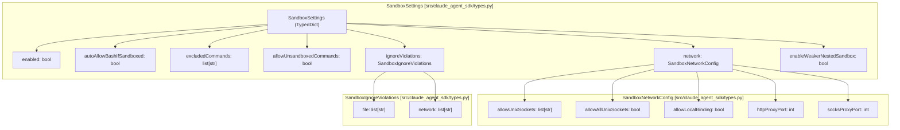
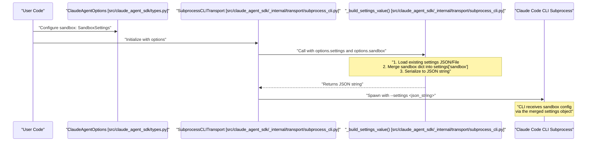

<!-- source: DeepWiki mcp.deepwiki.com · repo anthropics/claude-agent-sdk-python · page 6.5 Sandbox Settings · fetched 2026-10-26 -->

# Sandbox Settings

<details>
<summary>Relevant source files</summary>

The following files were used as context for generating this wiki page:

- [e2e-tests/test_verbatim_prompts.py](e2e-tests/test_verbatim_prompts.py)
- [src/claude_agent_sdk/types.py](src/claude_agent_sdk/types.py)
- [tests/test_types.py](tests/test_types.py)
- [tests/test_verbatim_prompts.py](tests/test_verbatim_prompts.py)

</details>


This page documents the `SandboxSettings` configuration system for controlling bash command sandboxing in Claude Code. Sandbox settings provide filesystem and network isolation for bash commands executed by the agent, enhancing security when running untrusted or potentially dangerous commands.

**Important**: Sandbox settings control *how* bash commands are sandboxed, not *what* resources are accessible. Filesystem and network access restrictions are configured separately via permission rules (see [Permission System and Callbacks](5.2)).

For related security features, see:
- [Permission System and Callbacks](5.2) — Tool permission callbacks and access control.
- [Resource Limits and Cost Control](6.4) — Budget and turn limits.

## Overview

The sandboxing system isolates bash commands executed by Claude Code using platform-level isolation mechanisms (available on macOS and Linux only). When enabled, bash commands run in a restricted environment that limits their access to the filesystem and network according to configured rules.

**Key Distinction**: Sandbox settings configure the *isolation mechanism* for bash commands. The *access rules* (which files can be read/written, which network hosts can be accessed) are configured through permission rules in the permission system, not through sandbox settings.

Sources: [src/claude_agent_sdk/types.py:466-510]()

## Configuration Structure

### SandboxSettings Type Hierarchy

The following diagram maps the relationship between the `SandboxSettings` TypedDict and its nested configuration objects.

**Diagram: Sandbox Configuration Entity Mapping**


Sources: [src/claude_agent_sdk/types.py:435-510]()

### SandboxSettings Field Reference

| Field | Type | Default | Description |
|-------|------|---------|-------------|
| `enabled` | `bool` | `False` | Enable bash command sandboxing (macOS/Linux only). |
| `autoAllowBashIfSandboxed` | `bool` | `True` | Auto-approve bash commands when sandboxing is enabled. |
| `excludedCommands` | `list[str]` | `[]` | Commands that run outside the sandbox (e.g., `["git", "docker"]`). |
| `allowUnsandboxedCommands` | `bool` | `True` | Allow commands to bypass sandbox via `dangerouslyDisableSandbox` flag. |
| `network` | `SandboxNetworkConfig` | `{}` | Network access configuration for sandboxed commands. |
| `ignoreViolations` | `SandboxIgnoreViolations` | `{}` | File and network violations to ignore. |
| `enableWeakerNestedSandbox` | `bool` | `False` | Enable weaker sandbox for unprivileged Docker environments (Linux only). |

Sources: [src/claude_agent_sdk/types.py:466-510]()

## Network Configuration

The `SandboxNetworkConfig` type [src/claude_agent_sdk/types.py:436-452]() controls network access for sandboxed bash commands:

| Field | Type | Description |
|-------|------|-------------|
| `allowUnixSockets` | `list[str]` | Unix socket paths accessible in sandbox (e.g., `["/var/run/docker.sock"]`). |
| `allowAllUnixSockets` | `bool` | Allow access to all Unix sockets (less secure). |
| `allowLocalBinding` | `bool` | Allow binding to localhost ports (macOS only). |
| `httpProxyPort` | `int` | HTTP proxy port if bringing your own proxy. |
| `socksProxyPort` | `int` | SOCKS5 proxy port if bringing your own proxy. |

Sources: [src/claude_agent_sdk/types.py:436-452]()

## Violation Ignoring

The `SandboxIgnoreViolations` type [src/claude_agent_sdk/types.py:454-464]() allows selective bypassing of sandbox violations for known-safe operations:

| Field | Type | Description |
|-------|------|-------------|
| `file` | `list[str]` | File paths for which violations should be ignored. |
| `network` | `list[str]` | Network hosts for which violations should be ignored. |

Sources: [src/claude_agent_sdk/types.py:454-464]()

## Data Flow: Sandbox Settings to CLI

The SDK merges the `sandbox` configuration into the CLI's `--settings` argument. This is handled within the transport layer during command construction.

**Diagram: Sandbox Settings Serialization Flow**


Sources: [src/claude_agent_sdk/_internal/transport/subprocess_cli.py:190-218](), [src/claude_agent_sdk/_internal/transport/subprocess_cli.py:270-273]()

## Integration with Permission Rules

**Critical Distinction**: Sandbox settings and permission rules serve different purposes:

### Sandbox Settings
- Control **how** bash commands are isolated.
- Configure the sandboxing mechanism itself.
- Platform-specific isolation features (Unix sockets, local binding, etc.).
- Defined in `ClaudeAgentOptions.sandbox` [src/claude_agent_sdk/types.py:734]().

### Permission Rules
- Control **what** resources are accessible.
- Define allowed/denied file paths for Read/Edit operations.
- Define allowed/denied network hosts for WebFetch operations.
- Enforced through permission callbacks and tool rules.

Sources: [src/claude_agent_sdk/types.py:467-477](), [src/claude_agent_sdk/types.py:732-735]()

## Usage Examples

### Basic Sandbox Configuration

```python
from claude_agent_sdk.types import ClaudeAgentOptions, SandboxSettings

# Enable basic sandboxing
sandbox_settings: SandboxSettings = {
    "enabled": True,
    "autoAllowBashIfSandboxed": True,
}

options = ClaudeAgentOptions(sandbox=sandbox_settings)
```

### Docker Development Environment

```python
# Configuration for Docker-based development
sandbox_settings: SandboxSettings = {
    "enabled": True,
    "autoAllowBashIfSandboxed": True,
    "excludedCommands": ["docker", "docker-compose"],
    "network": {
        "allowUnixSockets": ["/var/run/docker.sock"],
        "allowLocalBinding": True
    }
}

options = ClaudeAgentOptions(
    sandbox=sandbox_settings,
    cwd="/path/to/project"
)
```

Sources: [src/claude_agent_sdk/types.py:489-500]()

## Settings Merging Mechanism

The SDK automatically merges sandbox settings with other settings when creating the CLI subprocess. This logic is implemented in `_build_settings_value` within `subprocess_cli.py` [src/claude_agent_sdk/_internal/transport/subprocess_cli.py:190-218]().

1. **Load**: It checks `options.settings`. If it's a path, it reads the file; if it's a string, it parses it as JSON [src/claude_agent_sdk/_internal/transport/subprocess_cli.py:202-212]().
2. **Merge**: If `options.sandbox` is provided, it is inserted into the `sandbox` key of the settings dictionary [src/claude_agent_sdk/_internal/transport/subprocess_cli.py:214-216]().
3. **Serialize**: The final dictionary is serialized back to a JSON string [src/claude_agent_sdk/_internal/transport/subprocess_cli.py:218]().
4. **Invoke**: This string is passed to the CLI via the `--settings` flag [src/claude_agent_sdk/_internal/transport/subprocess_cli.py:270-273]().

Sources: [src/claude_agent_sdk/_internal/transport/subprocess_cli.py:190-218](), [src/claude_agent_sdk/_internal/transport/subprocess_cli.py:270-273]()

## Platform Considerations

### macOS and Linux
- Full sandbox support with filesystem and network isolation.
- `allowLocalBinding` enables localhost port binding (macOS only) [src/claude_agent_sdk/types.py:442-443]().
- `enableWeakerNestedSandbox` for unprivileged Docker containers (Linux only) [src/claude_agent_sdk/types.py:485-488]().

### Windows
- Sandbox settings are **not supported** on Windows.
- Setting `enabled: True` on Windows will have no effect.
- Use permission rules for access control on Windows instead.

### Docker Environments
For unprivileged Docker containers on Linux where standard sandboxing may fail:
```python
sandbox_settings: SandboxSettings = {
    "enabled": True,
    "enableWeakerNestedSandbox": True  # Reduces security but works in Docker
}
```

Sources: [src/claude_agent_sdk/types.py:479-488]()

## Command Exclusion

The `excludedCommands` field [src/claude_agent_sdk/types.py:479-480]() allows specific commands to run outside the sandbox:

```python
sandbox_settings: SandboxSettings = {
    "enabled": True,
    "excludedCommands": [
        "git",           # Version control operations
        "docker",        # Container management
        "kubectl"        # Kubernetes control
    ]
}
```

When `allowUnsandboxedCommands` is `False`, only commands in `excludedCommands` can bypass the sandbox. All other commands must run sandboxed.

Sources: [src/claude_agent_sdk/types.py:479-483]()

---

