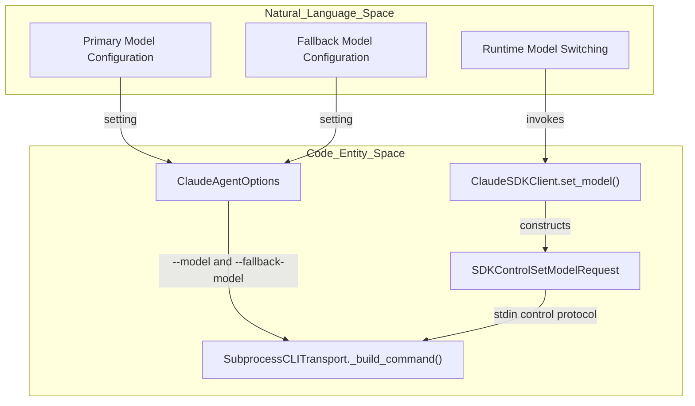
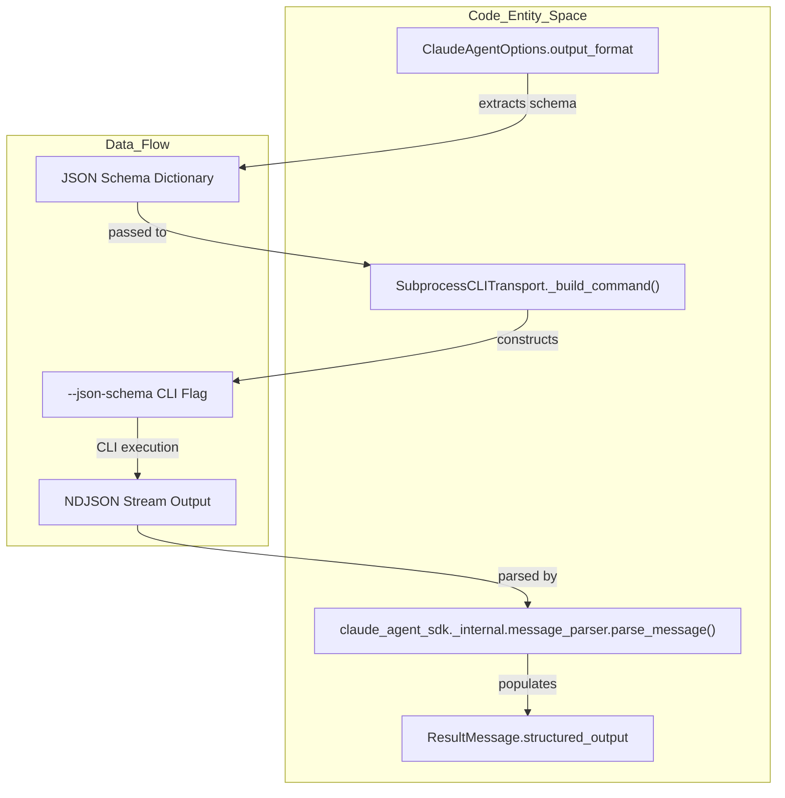

<!-- source: DeepWiki mcp.deepwiki.com · repo anthropics/claude-agent-sdk-python · page 6.6 Model Selection, Thinking, and Output Formats · fetched 2026-10-26 -->

# Model Selection, Thinking, and Output Formats

Relevant source files

The following files were used as context for generating this wiki page:

- [e2e-tests/conftest.py](e2e-tests/conftest.py)
- [e2e-tests/test_hook_events.py](e2e-tests/test_hook_events.py)
- [e2e-tests/test_structured_output.py](e2e-tests/test_structured_output.py)
- [src/claude_agent_sdk/types.py](src/claude_agent_sdk/types.py)

This page documents model selection, extended thinking configuration, effort levels, beta feature flags, and structured output formats in the Claude Agent SDK. It covers configuration-time options in `ClaudeAgentOptions` and dynamic model switching during active sessions via `ClaudeSDKClient.set_model()`.

For session management and continuation features, see page 6.1. For agent definitions and their configuration, see page 2.3.

## Overview

The SDK provides model and output control mechanisms as fields within `ClaudeAgentOptions` and through client-side control methods. The mapping between user configurations and CLI flags is handled by the transport layer.

| Field | Type | Purpose | CLI Flag |
|-------|------|---------|----------|
| `model` | `str | None` | Primary model identifier | `--model` |
| `fallback_model` | `str | None` | Fallback model when primary unavailable | `--fallback-model` |
| `thinking` | `ThinkingConfig | None` | Extended thinking behavior | `--max-thinking-tokens` |
| `effort` | `EffortLevel | int | None` | Thinking depth | `--effort` |
| `betas` | `list[SdkBeta]` | Anthropic API beta features | `--betas` |
| `output_format` | `dict[str, Any] | None` | Structured JSON output schema | `--json-schema` |
| `task_budget` | `TaskBudget | None` | API-side token budget awareness | `--task-budget` |

Sources: [src/claude_agent_sdk/types.py:756-815](), [src/claude_agent_sdk/_internal/transport/subprocess_cli.py:207-334]()

## Model Selection and Fallbacks

### Configuration-Time Model Selection

The `ClaudeAgentOptions` dataclass provides fields for model configuration. The `model` field accepts Claude model identifiers such as full version strings (`"claude-3-5-haiku-20241022"`, `"claude-sonnet-4-5"`) or short aliases (`"sonnet"`, `"opus"`, `"haiku"`). When `fallback_model` is specified, the underlying CLI automatically switches to it if the primary model becomes unavailable due to capacity or rate limits.

Sources: [src/claude_agent_sdk/types.py:756-761](), [src/claude_agent_sdk/_internal/transport/subprocess_cli.py:207-211]()

### Model Selection Flow

**Diagram: Model Selection and Dynamic Switching Code Mapping**

Sources: [src/claude_agent_sdk/_internal/transport/subprocess_cli.py:207-211](), [src/claude_agent_sdk/types.py:756-757](), [src/claude_agent_sdk/client.py:246-250]()

### Agent-Level Model Configuration

Individual agents defined in `ClaudeAgentOptions.agents` specify their own model preferences via `AgentDefinition.model`, supporting model aliases (`"sonnet"`, `"opus"`, `"haiku"`, `"inherit"`) or full model IDs.

Sources: [src/claude_agent_sdk/types.py:89-91]()

## Dynamic Model Switching

`ClaudeSDKClient.set_model()` changes the active model during a session without restarting the subprocess client. It accepts a model identifier string or `None` to restore the session default. The method sends an `SDKControlSetModelRequest` control request via the bidirectional control protocol [src/claude_agent_sdk/_internal/query.py:533-541]().

Sources: [src/claude_agent_sdk/client.py:246-250](), [src/claude_agent_sdk/_internal/query.py:533-541]()

## Extended Thinking Configuration

The `thinking` field in `ClaudeAgentOptions` controls extended thinking behavior, taking precedence over the deprecated `max_thinking_tokens` field [src/claude_agent_sdk/_internal/transport/subprocess_cli.py:307-320](). 

The SDK defines three `ThinkingConfig` types:
- `ThinkingConfigAdaptive`: type `"adaptive"`, defaults to a 32,000 token budget.
- `ThinkingConfigEnabled`: type `"enabled"` with an explicit `budget_tokens: int`.
- `ThinkingConfigDisabled`: type `"disabled"`.

The transport layer resolves these configurations into `--max-thinking-tokens` CLI flags during command construction [src/claude_agent_sdk/_internal/transport/subprocess_cli.py:307-320]().

Sources: [src/claude_agent_sdk/types.py:726-739](), [src/claude_agent_sdk/_internal/transport/subprocess_cli.py:307-320]()

## Effort Level

The `effort` field controls thinking depth and accepts an `EffortLevel` literal (`"low"`, `"medium"`, `"high"`, `"xhigh"`, `"max"`) or an integer [src/claude_agent_sdk/types.py:33](). It maps directly to the `--effort` CLI argument [src/claude_agent_sdk/_internal/transport/subprocess_cli.py:322-323]().

Sources: [src/claude_agent_sdk/types.py:33](), [src/claude_agent_sdk/_internal/transport/subprocess_cli.py:322-323]()

## Beta Features

The `betas` field enables Anthropic API beta features via a `list[SdkBeta]` (such as `"context-1m-2025-08-07"`), mapping to the `--betas` CLI argument [src/claude_agent_sdk/_internal/transport/subprocess_cli.py:213-214]().

Sources: [src/claude_agent_sdk/types.py:29](), [src/claude_agent_sdk/_internal/transport/subprocess_cli.py:213-214]()

## Output Formats and Structured JSON

### Structured Output Configuration

The `output_format` field in `ClaudeAgentOptions` configures structured JSON output conforming to a JSON Schema. The transport extracts the schema definition and supplies it to the CLI via `--json-schema` [src/claude_agent_sdk/_internal/transport/subprocess_cli.py:325-334]().

Sources: [src/claude_agent_sdk/types.py:809-810](), [src/claude_agent_sdk/_internal/transport/subprocess_cli.py:325-334]()

### Structured Output Message Flow

**Diagram: Structured Output Processing Code Mapping**

Sources: [src/claude_agent_sdk/_internal/transport/subprocess_cli.py:325-334](), [src/claude_agent_sdk/types.py:702-715](), [e2e-tests/test_structured_output.py:20-65]()

## Task Budgets

The `task_budget` field sets an API-side token budget, allowing the model to pace its tool use and token consumption. This configuration is transmitted as `output_config.task_budget` using the `task-budgets-2026-03-13` beta header [src/claude_agent_sdk/_internal/transport/subprocess_cli.py:336-340]().

Sources: [src/claude_agent_sdk/types.py:62-71](), [src/claude_agent_sdk/_internal/transport/subprocess_cli.py:336-340]()

---

