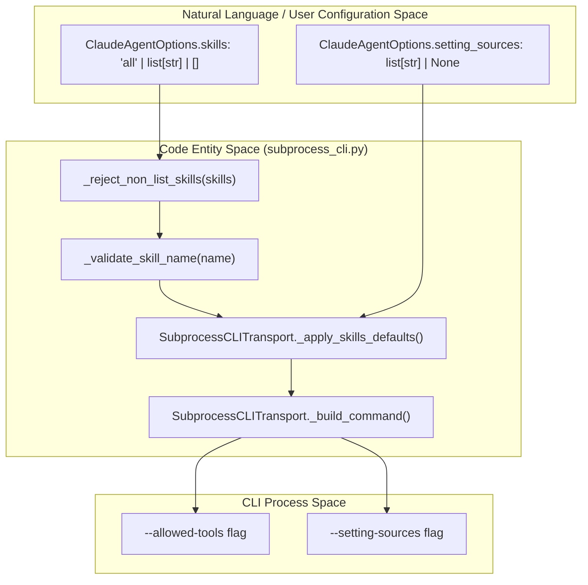
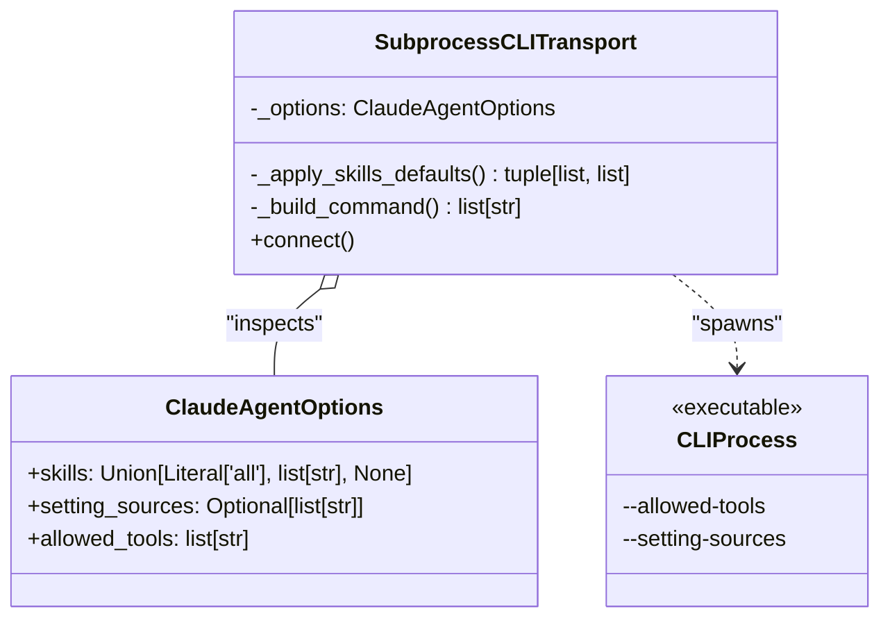

<!-- source: DeepWiki mcp.deepwiki.com · repo anthropics/claude-agent-sdk-python · page 6.7 Skills System · fetched 2026-10-26 -->

# Skills System

<details>
<summary>Relevant source files</summary>

The following files were used as context for generating this wiki page:

- [.claude/commands/commit.md](.claude/commands/commit.md)
- [examples/agents.py](examples/agents.py)
- [examples/setting_sources.py](examples/setting_sources.py)
- [src/claude_agent_sdk/_internal/transport/subprocess_cli.py](src/claude_agent_sdk/_internal/transport/subprocess_cli.py)
- [tests/test_subprocess_buffering.py](tests/test_subprocess_buffering.py)
- [tests/test_transport.py](tests/test_transport.py)

</details>


The Skills System in the `claude-agent-sdk` provides a high-level mechanism for enabling modular capabilities (skills) within a Claude session. This system simplifies the configuration of `allowed_tools` and `setting_sources` by providing a unified `skills` parameter in `ClaudeAgentOptions`, handling tool injection, and validating skill names.

Sources: [src/claude_agent_sdk/_internal/transport/subprocess_cli.py:1-161](), [src/claude_agent_sdk/types.py:307-310]()

## Overview

Skills represent specialized tools or sets of capabilities discovered by the Claude CLI. The SDK manages the injection of these skills into the agent's environment through `SubprocessCLITransport`, ensuring that allowed tools and configuration search paths are correctly configured.

Sources: [src/claude_agent_sdk/_internal/transport/subprocess_cli.py:183-214]()

## Configuration Options and Validation

The `skills` option in `ClaudeAgentOptions` accepts three distinct types of values, processed by `_reject_non_list_skills()` and validated via `_validate_skill_name()`:

| Value | Description | Tool Injection Behavior |
| :--- | :--- | :--- |
| `"all"` | Enables every discovered skill. | Injects the bare `Skill` tool into `allowed_tools`. |
| `list[str]` | Enables specific named skills (e.g., `['pdf', 'docx']`). | Injects `Skill(name)` for each validated entry in the list. |
| `[]` (Empty List) | Suppresses all skills. | No skill-related tools are injected. |

Skill names undergo strict validation in `_validate_skill_name()` to prevent malformed rules or tokenization exploits in the CLI's `--allowed-tools` parser.

Sources: [src/claude_agent_sdk/_internal/transport/subprocess_cli.py:82-161]()

## Technical Architecture and Data Flow

The following diagram illustrates how user-supplied configuration options in Natural Language Space are mapped to code entities and CLI arguments within `SubprocessCLITransport`.

### Skills Configuration to CLI Command Mapping



Sources: [src/claude_agent_sdk/_internal/transport/subprocess_cli.py:82-214](), [src/claude_agent_sdk/types.py:307-310]()

## Interaction with Setting Sources

The `setting_sources` parameter determines where the CLI loads configuration files from, including project and user-level skills.

*   **Default Behavior:** When `skills` are active and `setting_sources` is not explicitly provided (`None`), the SDK defaults `setting_sources` to `["user", "project"]` to ensure the Claude CLI discovers skill definitions.
*   **Disabled Behavior:** If an empty list `[]` is provided, setting sources are disabled.

### Component Relationship Diagram



Sources: [src/claude_agent_sdk/_internal/transport/subprocess_cli.py:82-214](), [src/claude_agent_sdk/types.py:307-310]()

## Usage Examples

Enabling all discovered skills while configuring allowed tools:

```python
from claude_agent_sdk.types import ClaudeAgentOptions

options = ClaudeAgentOptions(
    skills="all",
    allowed_tools=["Bash", "Read"]  # "Skill" will be automatically injected by the transport
)
```

Enabling a specific named skill:

```python
options = ClaudeAgentOptions(
    skills=["pdf"],  # Results in Skill(pdf) being added to effective allowed_tools
)
```

Sources: [src/claude_agent_sdk/_internal/transport/subprocess_cli.py:183-214](), [src/claude_agent_sdk/types.py:307-310]()

---

