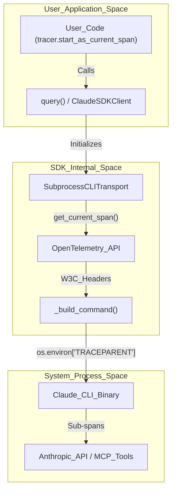
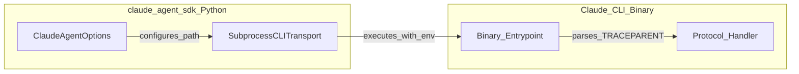

<!-- source: DeepWiki mcp.deepwiki.com · repo anthropics/claude-agent-sdk-python · page 6.8 Distributed Tracing (OpenTelemetry) · fetched 2026-10-26 -->

# Distributed Tracing (OpenTelemetry)

<details>
<summary>Relevant source files</summary>

The following files were used as context for generating this wiki page:

- [CHANGELOG.md](CHANGELOG.md)
- [pyproject.toml](pyproject.toml)
- [src/claude_agent_sdk/_cli_version.py](src/claude_agent_sdk/_cli_version.py)
- [src/claude_agent_sdk/_internal/transport/subprocess_cli.py](src/claude_agent_sdk/_internal/transport/subprocess_cli.py)
- [src/claude_agent_sdk/_version.py](src/claude_agent_sdk/_version.py)
- [tests/test_changelog.py](tests/test_changelog.py)
- [tests/test_subprocess_buffering.py](tests/test_subprocess_buffering.py)
- [tests/test_transport.py](tests/test_transport.py)

</details>


Distributed tracing allows developers to track the flow of requests across service boundaries. In the `claude-agent-sdk`, this feature enables the propagation of W3C trace context from the Python application into the Claude CLI subprocess, ensuring that spans generated by the SDK and the underlying CLI are connected in a single end-to-end trace.

## Overview

The SDK supports OpenTelemetry (OTEL) as an optional dependency via the `claude-agent-sdk[otel]` extra [pyproject.toml:43-45](). When enabled, the SDK automatically detects active OTEL spans and injects the corresponding trace context into the environment of the Claude CLI subprocess. This ensures that any operations performed by the CLI (such as tool calls or API requests to Anthropic) are attributed to the correct parent span in the SDK.

### Key Capabilities
- **W3C Context Propagation**: Automatically forwards `TRACEPARENT` and `TRACESTATE` headers.
- **Subprocess Integration**: Injects trace context into the environment variables of the `SubprocessCLITransport`.
- **Stale Context Scrubbing**: Ensures that outdated or irrelevant trace information does not pollute the subprocess environment.

Sources: [pyproject.toml:43-45]()

---

## Installation and Configuration

OpenTelemetry support is provided as an optional extra to keep the core SDK lightweight.

### Installation
To enable tracing, install the SDK with the `otel` extra:

```bash
pip install "claude-agent-sdk[otel]"
```

The `otel` extra installs the `opentelemetry-api` package [pyproject.toml:43-45]().

### Basic Configuration
Once installed, the SDK will automatically look for an active OpenTelemetry span. You must configure your OTEL exporter (e.g., Jaeger, Honeycomb, or OTLP) in your application code as you normally would for any Python project. Mypy type-checking overrides are provided for the optional `opentelemetry` module [pyproject.toml:103-107]().

```python
from opentelemetry import trace
from claude_agent_sdk import query

tracer = trace.get_tracer(__name__)

async def main():
    with tracer.start_as_current_span("agent-task"):
        # The trace context from this span will be propagated 
        # to the Claude CLI subprocess automatically.
        async for message in query("Help me refactor this code"):
            print(message)
```

Sources: [pyproject.toml:43-45](), [pyproject.toml:103-107]()

---

## Implementation Details

The tracing logic is encapsulated within the transport layer, specifically in the `SubprocessCLITransport` class. This class is responsible for managing the lifecycle and environment of the Claude CLI subprocess [src/claude_agent_sdk/_internal/transport/subprocess_cli.py:1-188]().

### Trace Context Injection Logic

The `SubprocessCLITransport` manages the execution environment for the CLI using `anyio` [src/claude_agent_sdk/_internal/transport/subprocess_cli.py:17-18]().

1.  **Span Detection**: The SDK checks for an active OpenTelemetry span in the current context using the `opentelemetry` API.
2.  **Header Generation**: If a span exists, it generates W3C-compliant `TRACEPARENT` and `TRACESTATE` strings.
3.  **Environment Injection**: These strings are added to the environment variables passed to the subprocess during initialization.

### Data Flow Diagram: Trace Propagation

This diagram illustrates how trace context moves from the "Natural Language Space" (User Prompt) through the "Code Entity Space" (SDK Transport) into the System Process.

Title: "Trace Context Propagation Flow"

Sources: [src/claude_agent_sdk/_internal/transport/subprocess_cli.py:1-188]()

---

## Technical Components

### SubprocessCLITransport
The `SubprocessCLITransport` is the primary entity that bridges the Python environment and the CLI. It handles the discovery of the CLI binary and the construction of the execution command [src/claude_agent_sdk/_internal/transport/subprocess_cli.py:1-188]().

| Feature | Implementation Detail |
| :--- | :--- |
| **Discovery** | Locates the CLI binary via absolute paths, environment overrides, or system lookup [src/claude_agent_sdk/_internal/transport/subprocess_cli.py:1-188](). |
| **Context Propagation** | Injects `TRACEPARENT` into the subprocess environment variables. |
| **Process Management** | Uses `anyio.abc.Process` to manage the lifecycle and I/O streams [src/claude_agent_sdk/_internal/transport/subprocess_cli.py:17-19](). |
| **Cleanup** | Uses an `atexit` handler `_kill_active_children` to terminate leaked processes [src/claude_agent_sdk/_internal/transport/subprocess_cli.py:61-68](). |

### Stale Context Scrubbing
To prevent the CLI from inheriting incorrect or "stale" trace contexts from the shell environment where the Python script was launched, the SDK explicitly manages environment variables, ensuring that current active OTEL contexts take precedence.

### Interaction with CLI Versions
The tracing feature requires a compatible version of the Claude CLI that can interpret W3C trace headers. The SDK defines a `MINIMUM_CLAUDE_CODE_VERSION` of `2.0.0` [src/claude_agent_sdk/_internal/transport/subprocess_cli.py:37-37](). The current bundled CLI version is tracked in `_cli_version.py` [src/claude_agent_sdk/_cli_version.py:3-3]().

Title: "SDK to CLI Entity Mapping"

Sources: [src/claude_agent_sdk/_internal/transport/subprocess_cli.py:37-37](), [src/claude_agent_sdk/_cli_version.py:3-3]()

---

## Troubleshooting

1.  **Missing Traces**: Ensure `claude-agent-sdk[otel]` is installed. If the `opentelemetry` package is not present, the SDK skips context injection safely [pyproject.toml:43-45]().
2.  **Version Mismatch**: If traces appear in the SDK but not the CLI, verify the CLI version meets the `MINIMUM_CLAUDE_CODE_VERSION` of `2.0.0` [src/claude_agent_sdk/_internal/transport/subprocess_cli.py:37-37](). The SDK version is tracked in `_version.py` [src/claude_agent_sdk/_version.py:3-3]() and the CLI version in `_cli_version.py` [src/claude_agent_sdk/_cli_version.py:3-3]().
3.  **Environment Overrides**: If you are manually setting `cli_path` in `ClaudeAgentOptions`, ensure the target binary supports OpenTelemetry propagation.
4.  **Buffer Limits**: For very large trace states, ensure payloads do not exceed `_DEFAULT_MAX_BUFFER_SIZE` (default 1MB) [src/claude_agent_sdk/_internal/transport/subprocess_cli.py:36-36]().

Sources: [src/claude_agent_sdk/_internal/transport/subprocess_cli.py:36-37](), [src/claude_agent_sdk/_version.py:3-3](), [src/claude_agent_sdk/_cli_version.py:3-3](), [pyproject.toml:43-45]()

---

