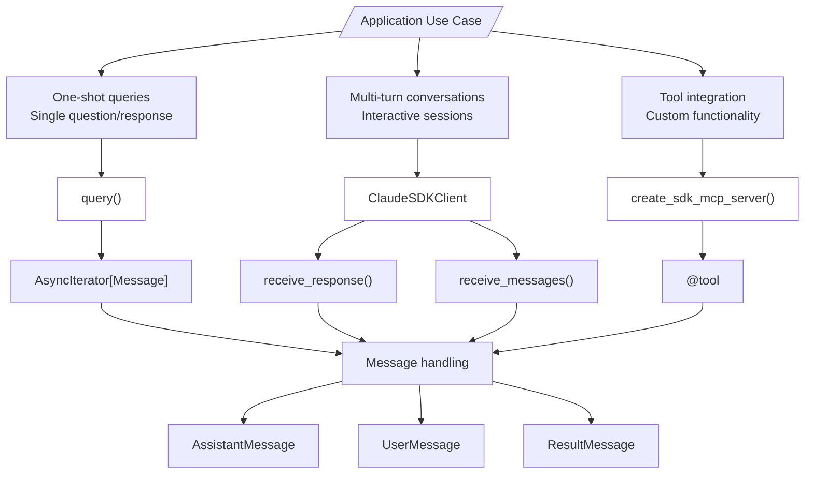
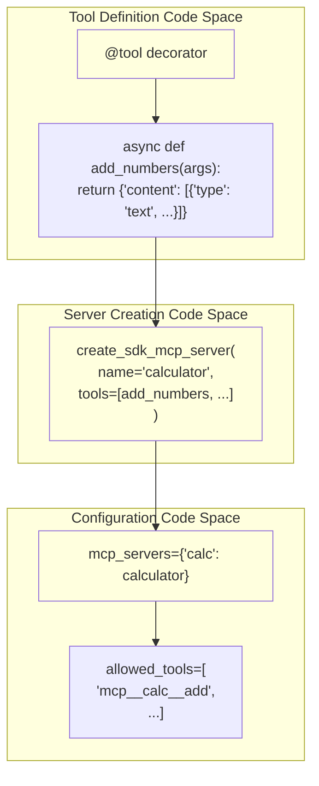

<!-- source: DeepWiki mcp.deepwiki.com · repo anthropics/claude-agent-sdk-python · page 7 Examples and Usage Patterns · fetched 2026-10-26 -->

# Examples and Usage Patterns

<details>
<summary>Relevant source files</summary>

The following files were used as context for generating this wiki page:

- [examples/streaming_mode.py](examples/streaming_mode.py)
- [examples/streaming_mode_ipython.py](examples/streaming_mode_ipython.py)
- [tests/test_streaming_client.py](tests/test_streaming_client.py)

</details>


This page provides concrete code examples and common patterns for building applications with the Claude Agent SDK. It demonstrates practical usage of the `query()` function [claude_agent_sdk/__init__.py:1-50](), `ClaudeSDKClient` [claude_agent_sdk/__init__.py:1-50](), custom tools, and error handling through real-world scenarios.

For foundational information on the public API interfaces, see [query() Function](#3.1) and [ClaudeSDKClient](#3.2). For details on creating custom tools, see [Custom Tools (SDK MCP Servers)](#5.1). For hook configuration, see [Lifecycle Hooks](#5.3).

## Overview of Usage Patterns

The SDK supports three primary interaction patterns, each suited to different use cases:


Sources: [examples/streaming_mode.py:59-130](), [examples/mcp_calculator.py:1-10]()

**Pattern Selection Guide:**

| Pattern | Use When | Example File |
|---------|----------|--------------|
| `query()` function | Simple one-shot queries without state | [examples/streaming_mode.py:59-71]() |
| `ClaudeSDKClient` with `receive_response()` | Multi-turn conversations with sequential turns | [examples/streaming_mode.py:74-94]() |
| `ClaudeSDKClient` with `receive_messages()` | Custom message processing logic or concurrent handling | [examples/streaming_mode.py:97-130]() |
| SDK MCP servers | Adding custom in-process tools | [examples/mcp_calculator.py:1-10]() |

Sources: [examples/streaming_mode.py:59-130](), [examples/mcp_calculator.py:1-10]()

## Interactive Streaming Examples

For a detailed walkthrough of all streaming patterns, including `streaming_mode.py`, IPython snippets, trio variants, and `include_partial_messages`, see [Interactive Streaming Examples](#7.1).

### Basic Streaming and Interrupts

The `ClaudeSDKClient` supports streaming responses and the ability to `interrupt()` active tasks. Interrupts require active message consumption to be processed by the underlying transport.

**Example Implementation:**

[examples/streaming_mode.py:133-173]() demonstrates interrupting a long-running task:

```python
async with ClaudeSDKClient() as client:
    await client.query("Count from 1 to 100 slowly")
    
    # Background task to consume messages (required for interrupt)
    consume_task = asyncio.create_task(consume_messages(client))
    
    await asyncio.sleep(2)
    await client.interrupt() # [examples/streaming_mode.py:160]()
    await consume_task
```

Sources: [examples/streaming_mode.py:133-173](), [examples/streaming_mode_ipython.py:87-139]()

### Multi-Turn Conversations

Multi-turn conversations maintain session state across multiple query-response cycles. The `ClaudeSDKClient` manages the stateful session internally, allowing follow-up questions to refer to previous context.

**Example Implementation:**

[examples/streaming_mode.py:74-94]() shows a two-turn conversation where the second query refers to "that city" mentioned in the first turn's response.

Sources: [examples/streaming_mode.py:74-94](), [examples/streaming_mode_ipython.py:54-84]()

## Tool Integration Examples

For detailed tool configuration, `@tool` decorators, SDK MCP server creation, and permission wiring (`allowed_tools`, `can_use_tool`), see [Tool Integration Examples](#7.2).

### SDK MCP Server Pattern

The SDK allows defining in-process tools using the `@tool` decorator, which are then bundled into an SDK MCP server and passed to `ClaudeAgentOptions` [claude_agent_sdk/_internal/types.py:1-100]().


Sources: [examples/mcp_calculator.py:24-30](), [examples/mcp_calculator.py:143-168]()

**Tool Definition:**

[examples/mcp_calculator.py:24-30]() shows how to define a tool that adds two numbers and returns a formatted result.

Sources: [examples/mcp_calculator.py:24-30](), [examples/mcp_calculator.py:143-168]()

### Lifecycle Hooks

Hooks provide a way to intercept and modify behavior at specific lifecycle events like `PreToolUse`, `PostToolUse`, or `UserPromptSubmit`.

**Example Implementation:**

[examples/hooks.py:156-192]() demonstrates using a `PreToolUse` hook to block specific bash commands based on string patterns:

```python
options = ClaudeAgentOptions(
    hooks={
        "PreToolUse": [
            HookMatcher(matcher="Bash", hooks=[check_bash_command]),
        ],
    }
)
```

Sources: [examples/hooks.py:46-70](), [examples/hooks.py:156-192](), [e2e-tests/test_hooks.py:17-70]()

## Error Handling Patterns

For comprehensive error documentation covering all public error types, when each is raised, and recommended handling strategies, see [Error Handling Patterns](#7.3).

### Handling CLI and Protocol Errors

The SDK raises specific exceptions for different failure modes, such as `CLIConnectionError` when the subprocess fails to start or `CLIJSONDecodeError` when the output is malformed [tests/test_streaming_client.py:13-24]().

**Example Implementation:**

[examples/streaming_mode_ipython.py:146-165]() shows a pattern for wrapping client interactions in try-except blocks, including handling `asyncio.TimeoutError`.

Sources: [examples/streaming_mode_ipython.py:146-165](), [claude_agent_sdk/__init__.py:1-50]()

## Stderr Callback and Agents Examples

For multi-agent workflows, sub-agent definitions via `AgentDefinition`, and the `filesystem_agents.py` multi-agent pattern, see [Stderr Callback and Agents Examples](#7.4).

### Capturing CLI Output

The `stderr_callback` option in `ClaudeAgentOptions` allows capturing low-level CLI output. This is useful for monitoring the underlying progress of the Claude CLI subprocess, such as internal tool logs or status updates not sent via the standard message protocol.

### Multi-Agent Workflows

The `agents` field in `ClaudeAgentOptions` allows defining `AgentDefinition` objects. These sub-agents can be invoked by the primary Claude instance to delegate specific tasks, enabling complex multi-agent orchestration.

Sources: [examples/hooks.py:18-28](), [e2e-tests/test_hooks.py:5-12]()

---

