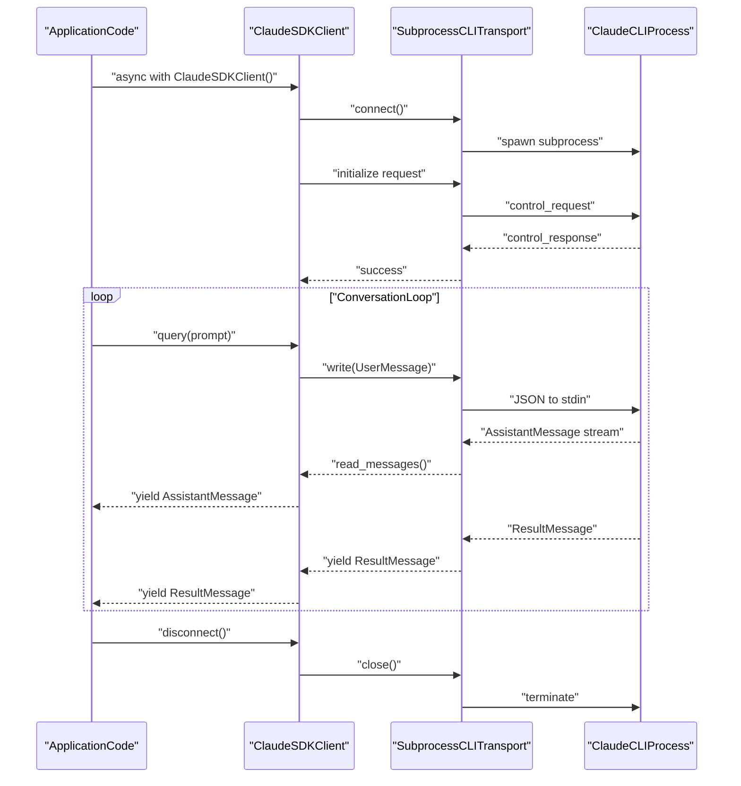
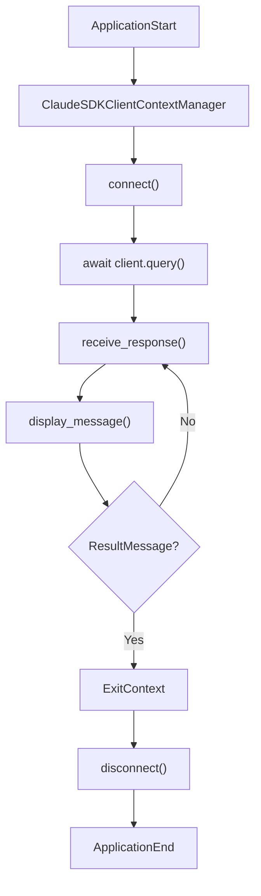
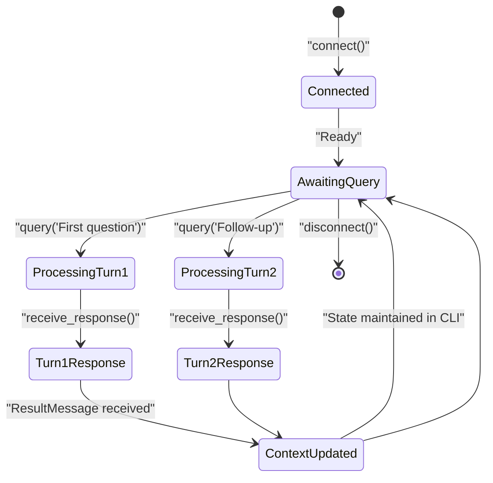
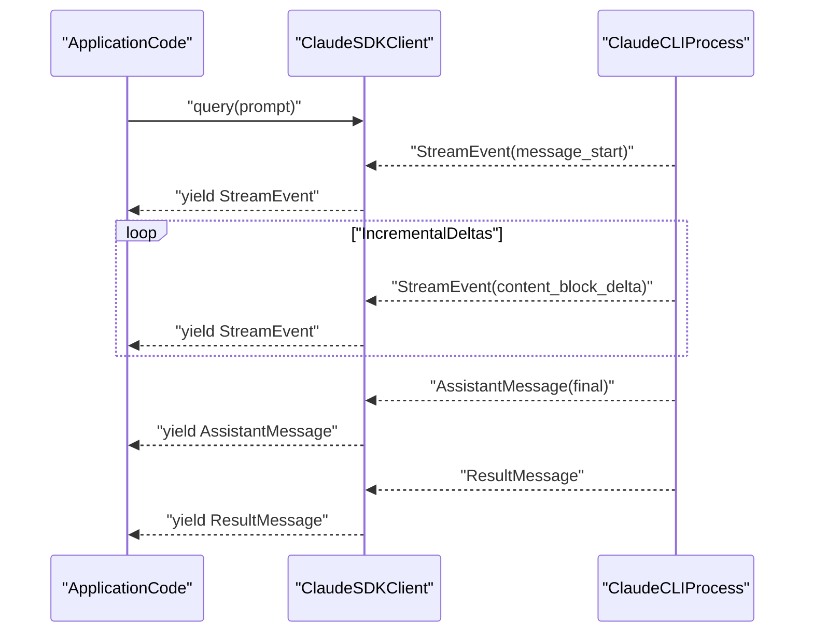
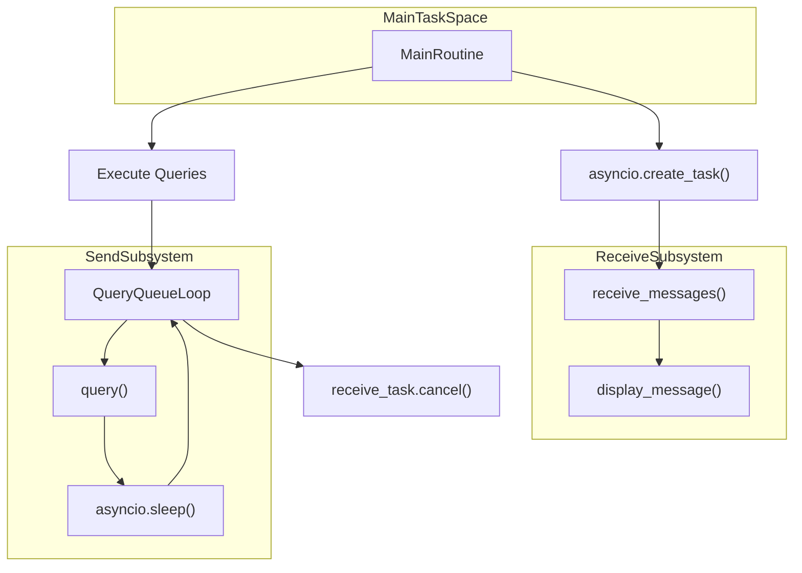
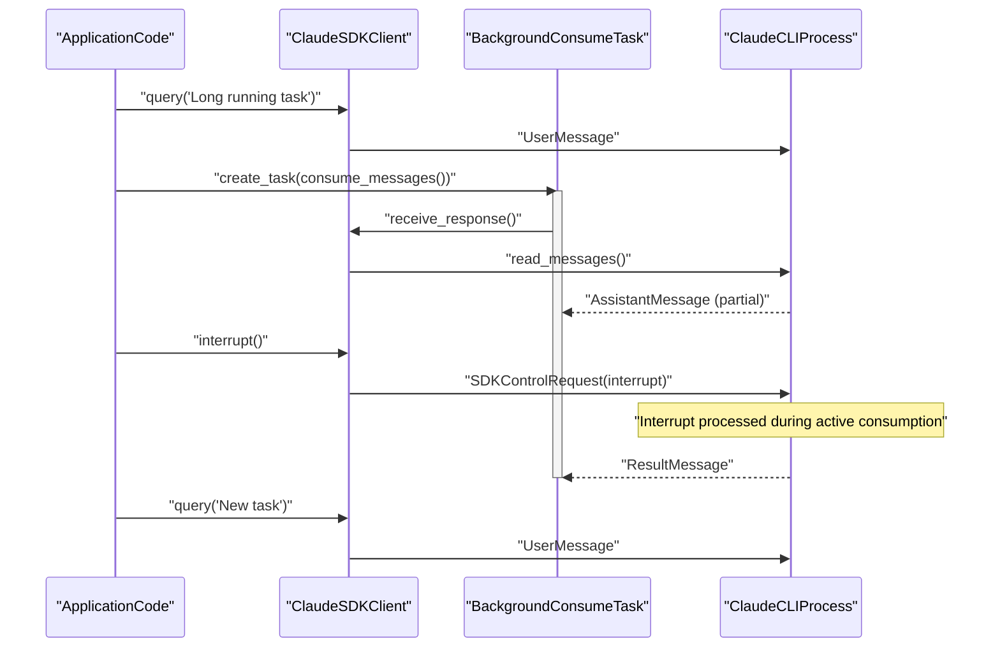

<!-- source: DeepWiki mcp.deepwiki.com · repo anthropics/claude-agent-sdk-python · page 7.1 Interactive Streaming Examples · fetched 2026-10-26 -->

# Interactive Streaming Examples

Relevant source files

The following files were used as context for generating this wiki page:

- [examples/include_partial_messages.py](examples/include_partial_messages.py)
- [examples/streaming_mode.py](examples/streaming_mode.py)
- [examples/streaming_mode_ipython.py](examples/streaming_mode_ipython.py)
- [examples/streaming_mode_trio.py](examples/streaming_mode_trio.py)
- [tests/test_streaming_client.py](tests/test_streaming_client.py)

This page provides practical examples, code walkthroughs, and architectural patterns for using the `ClaudeSDKClient` streaming interface. It demonstrates how to build interactive applications that maintain bidirectional communication with the Claude CLI subprocess, handle messages in real-time, and manage complex execution patterns like multi-turn conversations, concurrent operations, partial message streaming via `include_partial_messages`, CLI interrupts, and backend alternatives like Trio and IPython.

---

## Streaming Lifecycle Overview

The streaming architecture establishes a continuous bidirectional JSON-line communication channel over standard input/output streams between your application and the bundled Claude CLI subprocess.

Sources: [examples/streaming_mode.py:1-33](), [src/claude_agent_sdk/client.py:87-173]()

---

## Basic Streaming Pattern

The simplest streaming pattern uses an asynchronous context manager for automated resource allocation and connection cleanup, combined with `receive_response()` to collect all messages generated for a single prompt until a `ResultMessage` is encountered.

The basic pattern is implemented in [examples/streaming_mode.py:59-72](). It uses a standardized display function `display_message()` [examples/streaming_mode.py:36-57]() to filter and format `UserMessage` and `AssistantMessage` content blocks while ignoring internal control system messages.

Sources: [examples/streaming_mode.py:36-72](), [src/claude_agent_sdk/client.py:191-219](), [src/claude_agent_sdk/client.py:358-397]()

---

## Multi-Turn Conversations and Backend Variants

Multi-turn conversations allow sequential queries within a persistent client session. Because the underlying CLI process retains conversation state, subsequent prompts build directly on previous turns without requiring manual transcript history passing.

### Trio Variant
The SDK fully supports alternative async runtimes such as `trio`. The [examples/streaming_mode_trio.py:46-76]() script demonstrates multi-turn mathematical reasoning using `trio.run()` [examples/streaming_mode_trio.py:80]() instead of `asyncio`.

Sources: [examples/streaming_mode.py:74-94](), [examples/streaming_mode_trio.py:46-80](), [src/claude_agent_sdk/client.py:191-219]()

---

## Partial Message Streaming (`include_partial_messages`)

When building real-time user interfaces, waiting for a complete assistant block can introduce perceived latency. By setting `include_partial_messages=True` in `ClaudeAgentOptions`, the SDK yields incremental `StreamEvent` objects (such as `content_block_delta` and `thinking_delta`) as they are generated by the model.

As demonstrated in [examples/include_partial_messages.py:28-57](), enabling this option requires configuring `ClaudeAgentOptions` with `include_partial_messages=True` [examples/include_partial_messages.py:30-37]() before passing the options object to `ClaudeSDKClient`.

Sources: [examples/include_partial_messages.py:28-57](), [e2e-tests/test_include_partial_messages.py:25-130]()

---

## Concurrent Send and Receive Operations

The SDK architecture supports concurrent task execution where background routines consume message streams while the main application asynchronously injects new prompts or monitors operational tasks.

The concurrent pattern shown in [examples/streaming_mode.py:97-130]() uses `client.receive_messages()` within a background `asyncio.create_task()` worker to process messages continuously while the primary coroutine sequences queries with timed intervals [examples/streaming_mode.py:117-120]().

Sources: [examples/streaming_mode.py:97-130](), [src/claude_agent_sdk/client.py:179-189](), [src/claude_agent_sdk/client.py:358-397]()

---

## Interrupt Handling

Long-running agent executions can be cancelled using `client.interrupt()`. Because interrupts rely on the SDK control protocol, **active message consumption is strictly required** for the CLI subprocess to process and acknowledge the control request.

The requirements for safe interruption are shown in [examples/streaming_mode.py:133-173]() and the IPython counterpart [examples/streaming_mode_ipython.py:92-138]() (which emphasizes running a consumer background task prior to calling `await client.interrupt()` [examples/streaming_mode_ipython.py:124]()).

Sources: [examples/streaming_mode.py:133-173](), [examples/streaming_mode_ipython.py:92-138](), [src/claude_agent_sdk/client.py:284-301]()

---

## Manual Message Processing and Async Iterables

### Manual Message Processing
Applications requiring deep inspection of block-level contents use manual loops over `client.receive_messages()` or `client.receive_response()`, checking type attributes such as `AssistantMessage`, `TextBlock`, `ToolUseBlock`, and `ToolResultBlock` [examples/streaming_mode.py:176-210]().

### Async Iterable Prompts
Instead of passing a static string to `client.query()`, callers can supply an asynchronous generator yielding dictionary-formatted user messages [examples/streaming_mode_ipython.py:168-191](). Each yielded dictionary must include `type: "user"`, message content structures, `session_id`, and `parent_tool_use_id` [examples/streaming_mode_ipython.py:177-182]().

Sources: [examples/streaming_mode.py:176-210](), [examples/streaming_mode_ipython.py:168-207]()

---

## Message Collection Patterns Summary

| Pattern | Memory Overhead | Latency Profile | Concurrency Level | Reference Location |
|---------|-----------------|-----------------|-------------------|--------------------|
| **Immediate Streaming** | Low | Lowest | Sequential | [examples/streaming_mode.py:68-69]() |
| **List Accumulation** | High | Highest | Sequential | [examples/streaming_mode_ipython.py:152-160]() |
| **Background Accumulation** | Medium | Low | Concurrent | [examples/streaming_mode.py:147-152]() |
| **Persistent Client Session** | Low | Low | Sequential | [examples/streaming_mode_ipython.py:54-83]() |

Sources: [examples/streaming_mode.py:68-69](), [examples/streaming_mode_ipython.py:54-160](), [examples/streaming_mode.py:147-152]()

---

