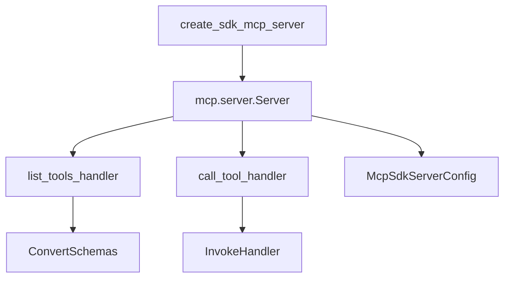
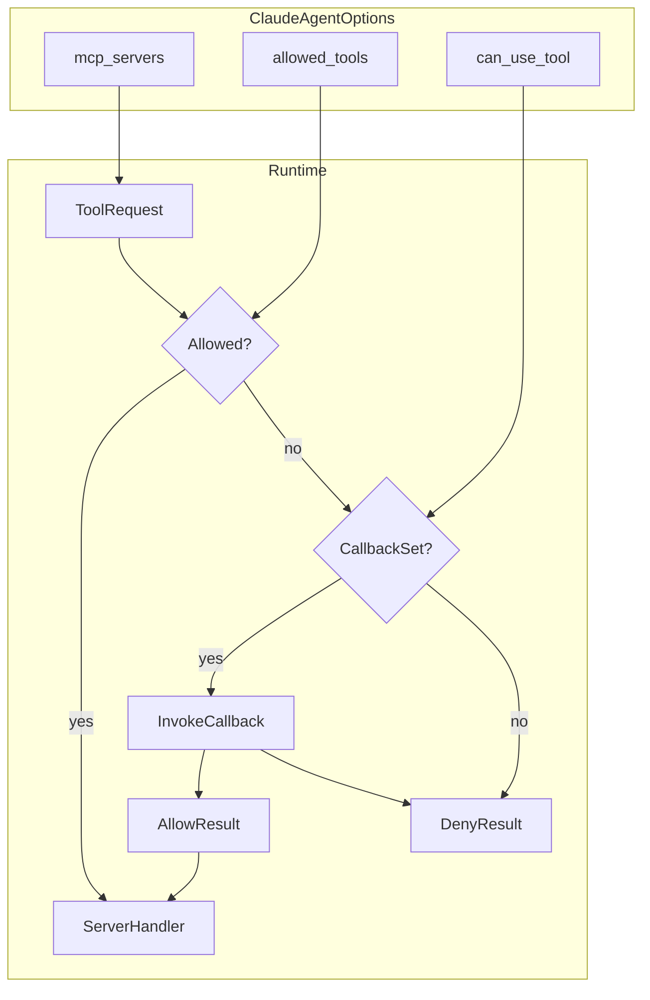

<!-- source: DeepWiki mcp.deepwiki.com · repo anthropics/claude-agent-sdk-python · page 7.2 Tool Integration Examples · fetched 2026-10-26 -->

# Tool Integration Examples

<details>
<summary>Relevant source files</summary>

The following files were used as context for generating this wiki page:

- [e2e-tests/test_sdk_mcp_tools.py](e2e-tests/test_sdk_mcp_tools.py)
- [e2e-tests/test_tool_permissions.py](e2e-tests/test_tool_permissions.py)
- [examples/mcp_calculator.py](examples/mcp_calculator.py)
- [examples/tool_permission_callback.py](examples/tool_permission_callback.py)
- [examples/tools_option.py](examples/tools_option.py)

</details>


This page covers end-to-end patterns for defining custom Python tools, registering them as in-process MCP servers, and controlling their invocation through `ClaudeAgentOptions`. It references the `mcp_calculator.py` example, tool permission callbacks, and the `tools_option.py` configuration patterns.

For conceptual background on the `@tool` decorator and `create_sdk_mcp_server()` internals, see the Custom Tools reference at [5.1](). For controlling permissions via hooks or callbacks, see [5.2]() and [5.3](). For configuring external MCP servers (subprocess-based), see [5.4]().

---

## Concepts at a Glance

The SDK provides an in-process alternative to external MCP subprocess servers. Rather than spawning a separate process, tools run as Python async functions in the same process as your application.

Title: "SDK Tool Integration Flow"


Sources: [src/claude_agent_sdk/__init__.py:156-226](), [examples/mcp_calculator.py:12-193]()

---

## Key Types and Functions

| Symbol | Location | Role |
|---|---|---|
| `tool()` | [src/claude_agent_sdk/__init__.py:170-223]() | Decorator that wraps an async function into an `SdkMcpTool` |
| `SdkMcpTool` | [src/claude_agent_sdk/__init__.py:159-167]() | Dataclass holding `name`, `description`, `input_schema`, `handler`, `annotations` |
| `create_sdk_mcp_server()` | [src/claude_agent_sdk/__init__.py:229-319]() | Builds an `mcp.server.Server` and returns a `McpSdkServerConfig` |
| `McpSdkServerConfig` | [src/claude_agent_sdk/types.py:1015-1019]() | TypedDict: `type="sdk"`, `name`, `instance` (the `mcp.server.Server`) |
| `ClaudeAgentOptions.mcp_servers` | [src/claude_agent_sdk/types.py:1200-1200]() | Dict mapping server key name → server config |
| `ClaudeAgentOptions.allowed_tools` | [src/claude_agent_sdk/types.py:1189-1189]() | List of tool names Claude is pre-authorized to use |
| `ClaudeAgentOptions.disallowed_tools` | [src/claude_agent_sdk/types.py:1190-1190]() | List of tool names Claude is blocked from using |
| `ClaudeAgentOptions.can_use_tool` | [src/claude_agent_sdk/types.py:1191-1191]() | Async callback invoked per tool call for dynamic permission |
| `PermissionResultAllow` | [src/claude_agent_sdk/types.py:375-378]() | Returned from `can_use_tool` to permit (optionally with `updated_input`) |
| `PermissionResultDeny` | [src/claude_agent_sdk/types.py:381-384]() | Returned from `can_use_tool` to block (with `message`) |
| `ToolPermissionContext` | [src/claude_agent_sdk/types.py:387-391]() | Passed to `can_use_tool`: contains `.signal` and `.suggestions` |

Sources: [src/claude_agent_sdk/__init__.py:156-319](), [src/claude_agent_sdk/types.py:375-1200]()

---

## Step 1 — Define Tools with `@tool`

The `@tool` decorator takes a name, description, and an `input_schema`, then wraps an `async def` function into an `SdkMcpTool` instance.

**`input_schema` accepts three forms:**

| Form | Example | How it is converted |
|---|---|---|
| Simple type dict | `{"a": float, "b": float}` | Auto-converted to JSON Schema object with required properties [src/claude_agent_sdk/__init__.py:263-272]() |
| Full JSON Schema dict | `{"type": "object", "properties": {...}}` | Used as-is [src/claude_agent_sdk/__init__.py:256-257]() |
| TypedDict class | `class MyInput(TypedDict): ...` | Produces a JSON Schema object based on TypedDict fields [src/claude_agent_sdk/__init__.py:258-261]() |

The handler must be `async def` and receive a single `dict` argument. It must return a dict with a `"content"` key containing a list of content items.

For errors, include `"is_error": True`:
```python
{
    "content": [{"type": "text", "text": "Error: Division by zero"}],
    "is_error": True
}
```

Sources: [examples/mcp_calculator.py:24-97](), [src/claude_agent_sdk/__init__.py:170-223]()

---

## Step 2 — Create an SDK MCP Server

`create_sdk_mcp_server()` instantiates an `mcp.server.Server`, registers `list_tools` and `call_tool` handlers on it, and returns a `McpSdkServerConfig` dict.

Title: "SDK MCP Server Internal Handlers"


Sources: [src/claude_agent_sdk/__init__.py:229-319](), [examples/mcp_calculator.py:143-154]()

---

## Step 3 — Wire into `ClaudeAgentOptions`

Pass the server config under a chosen key name in `mcp_servers`. That key name becomes part of every tool's canonical identifier following the naming convention `mcp__{server_key}__{tool_name}` [src/claude_agent_sdk/__init__.py:229-319]().

```python
options = ClaudeAgentOptions(
    mcp_servers={"calc": calculator},
    allowed_tools=["mcp__calc__add", "mcp__calc__subtract"],
)
```

Sources: [examples/mcp_calculator.py:158-168](), [src/claude_agent_sdk/__init__.py:229-319](), [examples/tools_option.py:22-30]()

---

## Step 4 — Run with `ClaudeSDKClient`

The client lifecycle manages connection, protocol initialization, and message streaming:
1. `async with ClaudeSDKClient(options=options) as client:` connects and initializes the session.
2. `await client.query(prompt)` sends the prompt.
3. `async for message in client.receive_response():` iterates through message blocks.

Sources: [examples/mcp_calculator.py:138-193](), [tests/test_sdk_mcp_integration.py:77-105]()

---

## Permission Control

### Option A — `allowed_tools` (Static Pre-Authorization)
List tool names in `ClaudeAgentOptions.allowed_tools` to permit execution without prompts [e2e-tests/test_sdk_mcp_tools.py:37-40](). Conversely, `disallowed_tools` blocks specific tools [e2e-tests/test_sdk_mcp_tools.py:79-80]().

### Option B — `can_use_tool` (Dynamic Per-Call Callback)
Provide a `can_use_tool` async callable for runtime evaluation [examples/tool_permission_callback.py:26-30]().

Title: "Permission and Tool Invocation Logic"


Sources: [src/claude_agent_sdk/types.py:375-391](), [e2e-tests/test_tool_permissions.py:32-40](), [examples/tool_permission_callback.py:26-30]()

---

## Mixed SDK and External Servers

`mcp_servers` accepts both `McpSdkServerConfig` (in-process) and external server configs (`McpStdioServerConfig`, `McpSSEServerConfig`, etc.) in the same dict [src/claude_agent_sdk/types.py:1015-1051]().

Sources: [README.md:173-185](), [src/claude_agent_sdk/types.py:1015-1051]()

---

## Reference: The `mcp_calculator.py` Example

`examples/mcp_calculator.py` demonstrates defining six mathematical tools using `@tool`, grouping them into an SDK MCP server, and executing queries against them via `ClaudeSDKClient`.

Sources: [examples/mcp_calculator.py:1-193]()

---

