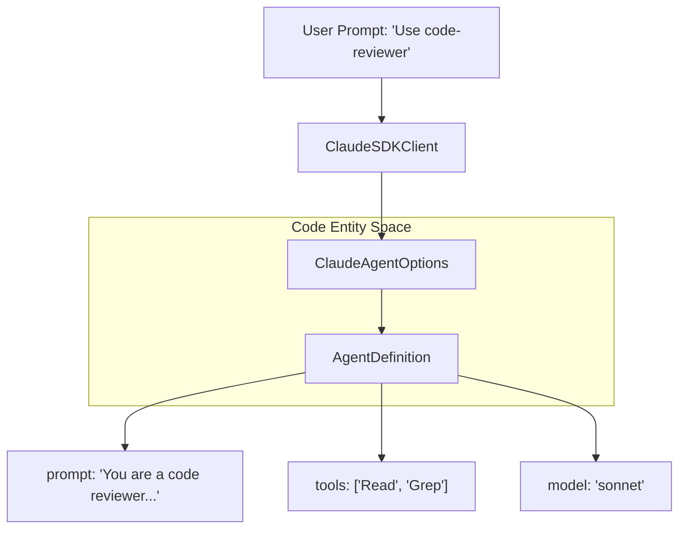
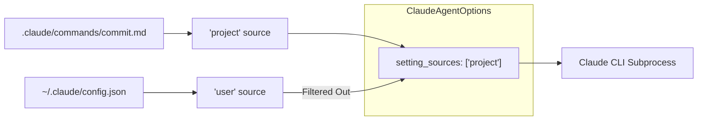

<!-- source: DeepWiki mcp.deepwiki.com · repo anthropics/claude-agent-sdk-python · page 7.4 Stderr Callback and Agents Examples · fetched 2026-10-26 -->

# Stderr Callback and Agents Examples

<details>
<summary>Relevant source files</summary>

The following files were used as context for generating this wiki page:

- [.claude/commands/commit.md](.claude/commands/commit.md)
- [e2e-tests/test_forward_subagent_text.py](e2e-tests/test_forward_subagent_text.py)
- [e2e-tests/test_stderr_callback.py](e2e-tests/test_stderr_callback.py)
- [examples/agents.py](examples/agents.py)
- [examples/setting_sources.py](examples/setting_sources.py)
- [examples/stderr_callback_example.py](examples/stderr_callback_example.py)

</details>


This page documents the mechanisms for capturing CLI diagnostic output via the `stderr_callback`, defining inline subagents using the `agents` option, and managing filesystem-based agents via `setting_sources`.

## Stderr Callback

The `stderr` option in `ClaudeAgentOptions` allows developers to provide a callback function that receives every line of output from the Claude CLI's `stderr` stream [examples/stderr_callback_example.py:14-25](). This is primarily used for logging, debugging, or monitoring the internal state of the CLI subprocess.

### Implementation and Data Flow

When a `ClaudeSDKClient` is initialized, it starts a subprocess. If a `stderr` callback is provided, the SDK monitors the subprocess's stderr pipe and executes the callback for each line. By default, without debug mode enabled, the CLI emits minimal output [e2e-tests/test_stderr_callback.py:12-35]().

| Component | Role |
| :--- | :--- |
| `ClaudeAgentOptions.stderr` | A callable `(line: str) -> None` that receives stderr lines [examples/stderr_callback_example.py:24](). |
| `extra_args` | Can be used to pass `debug-file` or other CLI flags to increase verbosity [examples/stderr_callback_example.py:21-23](). |
| `SubprocessCLITransport` | Responsible for reading the raw stderr stream from the spawned process and piping it to the callback. |

### Debugging Pattern

To capture detailed internal logs from the CLI, you can implement a callback that filters for specific log levels or keywords.

```python
def stderr_callback(message: str):
    """Callback that receives each line of stderr output."""
    if "[ERROR]" in message:
        print(f"Error detected: {message}")

options = ClaudeAgentOptions(stderr=stderr_callback)
```
Sources: [examples/stderr_callback_example.py:11-25](), [e2e-tests/test_stderr_callback.py:12-35]()

---

## Custom Agent Definitions

The `agents` option allows for the definition of inline subagents that Claude can delegate tasks to. These are defined using the `AgentDefinition` class [examples/agents.py:13-20]().

### AgentDefinition Structure

An `AgentDefinition` encapsulates the persona, capabilities, and constraints of a subagent:

*   **`description`**: A short summary used by the main model to decide when to call this agent [examples/agents.py:29-30]().
*   **`prompt`**: The system instructions specifically for this subagent [examples/agents.py:31-33]().
*   **`tools`**: A list of tools (e.g., `["Read", "Grep"]`) the subagent is permitted to use [examples/agents.py:34]().
*   **`model`**: The specific model to use for this agent's turns (e.g., `"sonnet"`) [examples/agents.py:35]().

### Code Entity Mapping: Inline Agents

This diagram bridges the Natural Language request for a subagent to the specific code entities in the SDK.

**Agent Delegation Flow**

Sources: [examples/agents.py:27-38](), [examples/agents.py:57-67]()

---

## Filesystem-based Agents and Setting Sources

In addition to inline definitions, agents can be loaded from the filesystem. This is controlled via the `setting_sources` option [examples/setting_sources.py:4-15]().

### Setting Sources Hierarchy

The SDK can load configurations (agents, slash commands, etc.) from three primary locations:

1.  **`user`**: Global settings in `~/.claude/` [examples/setting_sources.py:9]().
2.  **`project`**: Project-specific settings in `.claude/` within the current working directory [examples/setting_sources.py:10]().
3.  **`local`**: Git-ignored local settings in `.claude-local/` [examples/setting_sources.py:11]().

If `setting_sources` is `None`, the CLI loads all three by default [examples/setting_sources.py:13-15](). Passing an empty list `[]` disables all filesystem sources [examples/setting_sources.py:83-85]().

### Loading Filesystem Agents

Agents defined in Markdown files are automatically discovered if the corresponding source is enabled. These agents appear in the `SystemMessage` with subtype `init` during session startup [examples/setting_sources.py:39-44]().

**Example Filesystem Command / Agent Metadata (`.claude/commands/commit.md`)**
```markdown
---
allowed-tools: Bash(git add:*), Bash(git status:*), Bash(git commit:*)
description: Create a git commit
---
```
Sources: [.claude/commands/commit.md:1-4](), [examples/setting_sources.py:39-44]()

### Configuration Mapping

The following diagram shows how `setting_sources` filters which files are visible to the CLI subprocess.

**Setting Sources Data Flow**

Sources: [examples/setting_sources.py:104-116](), [examples/setting_sources.py:136-147]()

---

## Multi-Agent Workflow Summary

| Feature | Configuration Key | Use Case |
| :--- | :--- | :--- |
| **Inline Agents** | `agents` | Defining temporary, script-specific subagents programmatically [examples/agents.py:28-37](). |
| **Filesystem Agents** | `setting_sources` | Reusing complex agent personas shared across a team/project via `.md` files [examples/setting_sources.py:136-147](). |
| **Slash Commands** | `setting_sources` | Enabling project-specific commands like `/commit` defined in `.claude/commands/` [examples/setting_sources.py:136-147](). |

### Testing in Containerized Environments
For environments like Docker, ensure the `PATH` includes the Claude CLI and that `cwd` is set correctly so `setting_sources` can resolve project-level `.claude` directories. This helps prevent issues where project-level agents fail to load in isolated environments.

Sources: [examples/setting_sources.py:1-26](), [examples/agents.py:1-9](), [.claude/commands/commit.md:1-4]()

---

