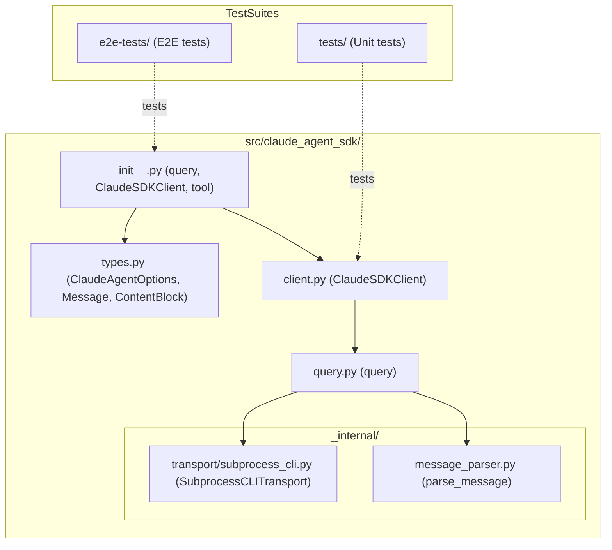
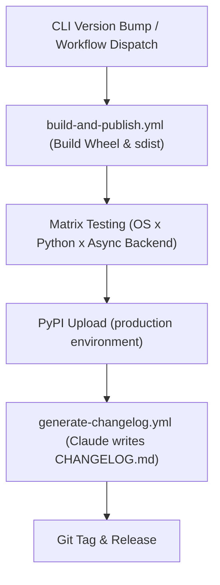

<!-- source: DeepWiki mcp.deepwiki.com · repo anthropics/claude-agent-sdk-python · page 8 Development Guide · fetched 2026-10-26 -->

# Development Guide

<details>
<summary>Relevant source files</summary>

The following files were used as context for generating this wiki page:

- [.github/workflows/generate-changelog.yml](.github/workflows/generate-changelog.yml)
- [CLAUDE.md](CLAUDE.md)

</details>


## Purpose and Scope

This document provides guidance for developers contributing to the Claude Agent SDK. It covers development environment setup, project organization, testing practices, release procedures, code quality standards, and CI integration. For information about using the SDK in your applications, see the [Core Concepts](2) and [Basic Usage](3) sections. 

Detailed treatment of each topic is covered in the child pages:
- **[Project Structure](#8.1)** — Repository layout, `src/claude_agent_sdk/` internals, tests, and configuration directories.
- **[Testing Strategy](#8.2)** — Test tiers (unit, e2e, Docker-based), mock transport patterns, pytest-asyncio setup, and conformance harnesses.
- **[Build and Release Process](#8.3)** — Release pipeline, auto-release on CLI bumps, build jobs, wheel building, and changelog generation.
- **[Code Quality Standards](#8.4)** — Linting and type-checking toolchain with `ruff`, `mypy` strict mode, and pre-push hooks.
- **[Claude AI Integration and CI Hardening](#8.5)** — Claude-powered GitHub Actions workflows, egress firewall protection, and authentication token setup.

Sources: [CLAUDE.md:1-84](), [pyproject.toml:1-126]()

## Prerequisites

### Required Tools

| Tool | Minimum Version | Purpose |
|------|----------------|---------|
| Python | 3.10 | Core runtime (tested through 3.13) [pyproject.toml:10]() |
| pip | Latest | Package management |
| pytest | 7.0.0 | Test framework [pyproject.toml:36]() |
| mypy | 1.0.0 | Static type checking (strict mode) [pyproject.toml:39]() |
| ruff | 0.1.0 | Linting and formatting [pyproject.toml:40]() |
| Claude CLI | Latest | E2E testing (auto-installed in CI) |

### Environment Setup

1. **Clone the repository** and enter the directory.

2. **Install development dependencies**:
   ```bash
   pip install -e ".[dev]"
   ```
   The `[dev]` extra includes `pytest`, `anyio[trio]`, `pytest-cov`, `mypy`, and `ruff` as defined in [pyproject.toml:35-41]().

3. **Install Git Hooks**:
   The repository includes a pre-push hook to ensure code quality before pushing to remote.
   ```bash
   ./scripts/initial-setup.sh
   ```
   This script copies [scripts/pre-push:1-30]() to your local `.git/hooks/` directory [scripts/initial-setup.sh:12-16]().

4. **Set up API credentials** (required for E2E tests):
   ```bash
   export ANTHROPIC_API_KEY=your_api_key_here
   ```

Sources: [pyproject.toml:35-41](), [CLAUDE.md:1-28](), [scripts/initial-setup.sh:1-21](), [scripts/pre-push:1-30]()

## Development Workflow

```mermaid
graph TB
    subgraph "NaturalLanguageSpace"
    Fork["Fork / Clone Repository"]
    Branch["Create Feature Branch"]
    end

    subgraph "CodeEntitySpace" [Local Development (CLAUDE.md)]
        Code["Write Code in src/claude_agent_sdk/"]
        UnitTest["python -m pytest tests/"]
        Lint["python -m ruff check src/ tests/ --fix"]
        Format["python -m ruff format src/ tests/"]
        Typecheck["python -m mypy src/"]
        PrePush["scripts/pre-push"]
    end

    subgraph "CIAutomation"
        Matrix["test job pytest py3.10-3.13"]
        E2E["e2e-tests/ @pytest.mark.e2e"]
        Docker["Docker-based e2e tests"]
        Review["Code Review (@claude)"]
    end

    Fork --> Branch
    Branch --> Code
    Code --> UnitTest
    UnitTest --> Lint
    Lint --> Format
    Format --> Typecheck
    Typecheck --> PrePush
    PrePush --> Matrix
    Matrix --> E2E
    E2E --> Docker
    Docker --> Review
```

This diagram maps the local development loop (commands from `CLAUDE.md`) to the CI validation stages. The `pre-push` hook ensures that `ruff check` and `ruff format` are validated before the code reaches CI [scripts/pre-push:8-26](). For details on child workflows, see [Project Structure](#8.1) and [Code Quality Standards](#8.4).

Sources: [CLAUDE.md:1-17](), [pyproject.toml:74-80](), [scripts/pre-push:1-30](), [scripts/initial-setup.sh:10-16]()

## Project Organization

The SDK separates public API from internal implementation layers. The following diagram maps module names to file paths:



For detailed directory layout, module responsibilities, and configuration directories, see [Project Structure](#8.1).

Sources: [CLAUDE.md:19-28](), [pyproject.toml:62-63](), [src/claude_agent_sdk/client.py:1-50](), [src/claude_agent_sdk/query.py:1-30]()

## Testing Overview

The SDK employs a multi-layered testing strategy, ensuring compatibility across different Python versions and async backends.

| Test Type | Location | Purpose | Requirements |
|-----------|----------|---------|--------------|
| **Unit Tests** | `tests/` | Fast, isolated component tests with mocking | None [CLAUDE.md:12-13]() |
| **E2E Tests** | `e2e-tests/` | Integration tests with real API calls | `ANTHROPIC_API_KEY` |
| **Docker Tests** | `e2e-tests/` | Container-specific validation | Docker, API key |
| **Conformance** | `tests/` | SessionStore adapter validation | `run_session_store_conformance()` |

For comprehensive testing documentation, test tiers, and mock transport patterns, see [Testing Strategy](#8.2).

Sources: [CLAUDE.md:1-17](), [pyproject.toml:74-80](), [scripts/pre-push:10-26]()

## Code Quality Standards

Code quality is enforced by `mypy` (strict mode) and `ruff` (lint + format). All functions require complete type annotations. The CI pipeline and the local `pre-push` hook fail on type errors or lint violations [scripts/pre-push:11-26]().

| Tool | Configuration | Scope |
|------|---------------|-------|
| **mypy** | `strict = true` [pyproject.toml:84]() | `src/` [CLAUDE.md:9-10]() |
| **ruff** | `target-version = "py310"` [pyproject.toml:105]() | `src/`, `tests/` [CLAUDE.md:4-7]() |

For detailed configuration, lint workflows, and the verify skill, see [Code Quality Standards](#8.4).

Sources: [pyproject.toml:82-126](), [CLAUDE.md:3-10](), [scripts/pre-push:1-30]()

## Build and Release Process

Version information is maintained in `pyproject.toml` [pyproject.toml:7]() and `src/claude_agent_sdk/_version.py`. The build backend is `hatchling` [pyproject.toml:1-3](). Releases are automated via GitHub Actions workflows like `build-and-publish.yml` and `generate-changelog.yml` [.github/workflows/generate-changelog.yml:1-97]().



For complete release documentation, PyPI quota checks, and version updates, see [Build and Release Process](#8.3).

Sources: [pyproject.toml:1-7](), [CLAUDE.md:54-62](), [.github/workflows/generate-changelog.yml:1-97]()

## Claude AI Integration and CI Hardening

The repository leverages Claude for automated maintenance tasks via GitHub Actions, supported by strict workflow hardening [CLAUDE.md:29-84]():
- **Egress Firewall**: Jobs calling Claude run on `ubuntu-24.04-firewall` with domain filtering defined in `.github/egress-firewall.yaml` [CLAUDE.md:34-40]().
- **Auto Permission Mode**: Steps running the Claude Code action pass `--permission-mode auto` [CLAUDE.md:41-48]().
- **Workload Identity Federation**: Authentication via OIDC tokens instead of static API keys [.github/workflows/generate-changelog.yml:52-58]().

For details on these integrations and workflow hardening rules, see [Claude AI Integration and CI Hardening](#8.5).

Sources: [CLAUDE.md:29-84](), [.github/workflows/generate-changelog.yml:1-97]()

---

