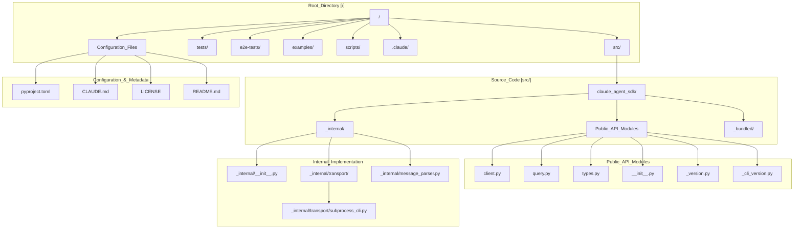
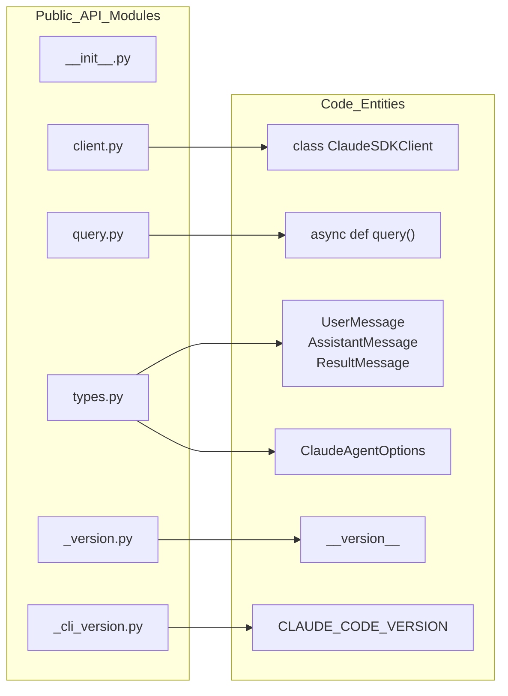
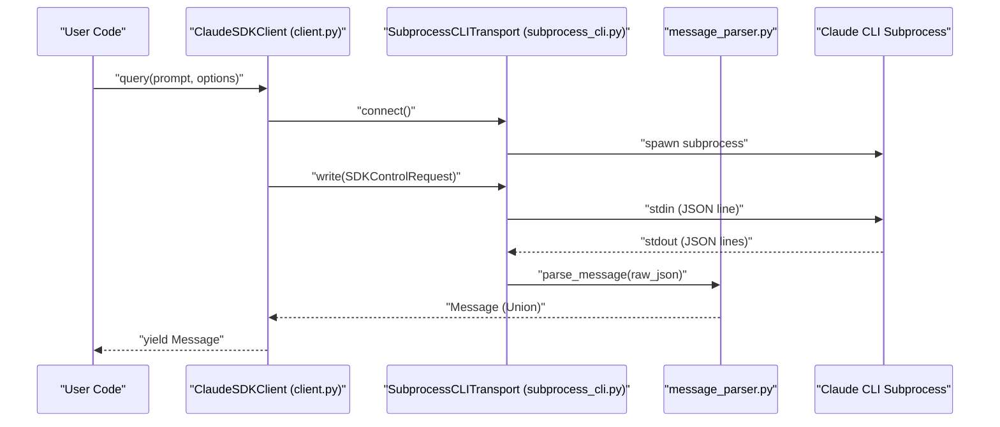

<!-- source: DeepWiki mcp.deepwiki.com · repo anthropics/claude-agent-sdk-python · page 8.1 Project Structure · fetched 2026-10-26 -->

# Project Structure

Relevant source files

The following files were used as context for generating this wiki page:

- [.claude/commands/label-issue.md](.claude/commands/label-issue.md)
- [.github/workflows/generate-changelog.yml](.github/workflows/generate-changelog.yml)
- [.gitignore](.gitignore)
- [CLAUDE.md](CLAUDE.md)
- [scripts/edit-issue-labels.sh](scripts/edit-issue-labels.sh)
- [scripts/gh.sh](scripts/gh.sh)
- [src/claude_agent_sdk/_internal/__init__.py](src/claude_agent_sdk/_internal/__init__.py)

This page documents the organization of the Claude Agent SDK codebase, including directory layout, module organization, configuration files, and build artifacts. For information about testing methodology and strategies, see [8.2 Testing Strategy](). For details on the build and release process, see [8.3 Build and Release Process]().

## Purpose and Scope

The Claude Agent SDK follows a clear separation between public API surface and internal implementation. The repository structure supports both development workflows and distribution packaging, with distinct areas for source code, tests, examples, and build configuration. The SDK primarily acts as a Python wrapper around the bundled Claude CLI binary.

Sources: [CLAUDE.md:1-28]()

## Repository Layout Overview

The repository is structured to separate the core SDK logic from supporting scripts, tests, and examples. The `src/` directory contains the distributable package, while other directories facilitate development and CI/CD.

### System Map: Repository Layout

**Directory Structure:**

| Directory/File | Purpose | Included in Distribution |
|---------------|---------|-------------------------|
| `src/claude_agent_sdk/` | Public API and core package. | Wheel & Source |
| `src/claude_agent_sdk/_internal/` | Internal transport and protocol logic. | Wheel & Source |
| `src/claude_agent_sdk/_bundled/` | Storage for downloaded CLI binaries. | Wheel & Source |
| `tests/` | Unit tests for SDK logic. | Source only |
| `e2e-tests/` | Integration tests requiring API keys. | Source only |
| `examples/` | Sample code and usage patterns. | Source only |
| `scripts/` | Build-time automation and CLI management. | Source only |
| `.claude/` | Custom commands, agents, and configuration for Claude-assisted development. | Source only |
| `CLAUDE.md` | Development workflow guide and codebase map. | Source only |
| `src/claude_agent_sdk/py.typed` | PEP 561 marker for type checking support. | Wheel & Source |

Sources: [CLAUDE.md:19-28](), [src/claude_agent_sdk/_internal/__init__.py:1]()

## Public API Surface (`src/claude_agent_sdk/`)

The public API is exposed through the top-level `claude_agent_sdk` package. All user-facing classes, functions, and types are defined or imported in this directory.

### Core Module Organization

### Key Public Modules

| Module | Primary Entities | Purpose |
|--------|------------------|---------|
| `client.py` | `ClaudeSDKClient` | Stateful session manager. Handles connections and resource management. |
| `query.py` | `query()` | Async generator for streaming messages from a session. |
| `types.py` | `Message`, `ClaudeAgentOptions` | Contract for all SDK data structures and configuration. |
| `_version.py` | `__version__` | SDK package version. |
| `_cli_version.py` | `CLAUDE_CODE_VERSION` | Single source of truth for the compatible bundled CLI version. |

Sources: [CLAUDE.md:21-24]()

## Internal Implementation (`src/claude_agent_sdk/_internal/`)

The `_internal` directory contains the machinery that drives the SDK. These modules are not intended for direct use by SDK consumers but provide the foundational logic for communication with the Claude CLI.

### Data Flow and Internal Entities

### Key Internal Modules

- **`_internal/transport/subprocess_cli.py`**: Manages the lifecycle of the Claude CLI subprocess. It handles CLI discovery and command construction from `ClaudeAgentOptions` [CLAUDE.md:26]().
- **`_internal/message_parser.py`**: Contains the logic to convert raw JSON strings received from the CLI stdout into the structured types defined in `types.py` [CLAUDE.md:27]().

| Component | Responsibility |
|-----------|----------------|
| `SubprocessCLITransport` | Process management, stdin/stdout piping, and version validation. |
| `message_parser.py` | Deserialization of the CLI's JSON-line protocol into SDK Type objects. |

Sources: [CLAUDE.md:25-28](), [src/claude_agent_sdk/_internal/__init__.py:1]()

## Supporting Directories and Extension Metadata

### `examples/`
Contains usage patterns demonstrating various SDK capabilities:
- Interactive streaming examples.
- Reference implementations for persistence adapters.
- Custom tool integration and SDK MCP server definitions.

Sources: [CLAUDE.md:12-16]()

### `tests/` and `e2e-tests/`
- **`tests/`**: Unit tests that typically mock the transport layer to verify SDK logic in isolation [CLAUDE.md:13-16]().
- **`e2e-tests/`**: Integration tests that execute against the real Claude CLI and Anthropic API, requiring valid authentication credentials.

Sources: [CLAUDE.md:12-16]()

### `scripts/`
Contains automation utilities for the development lifecycle, including CLI binary management, publishing scripts, and administrative wrappers like `scripts/gh.sh` and `scripts/edit-issue-labels.sh` [scripts/gh.sh:1-13](), [scripts/edit-issue-labels.sh:1-6]().

Sources: [scripts/gh.sh:1-13](), [scripts/edit-issue-labels.sh:1-6]()

### `.claude/` (Commands, Agents, and Skills)
The `.claude/` directory hosts custom definitions, agents, and instructions for Claude-assisted workflows within the repository. For instance, `.claude/commands/label-issue.md` defines issue triage behaviors and interacts with repo automation wrappers [.claude/commands/label-issue.md:1-10]().

Sources: [.claude/commands/label-issue.md:1-10]()

---

