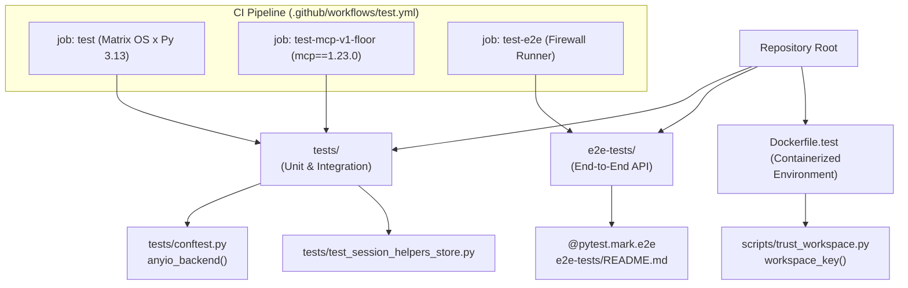
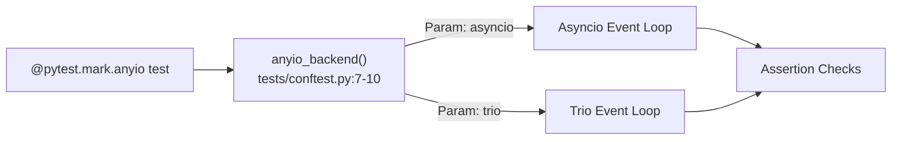
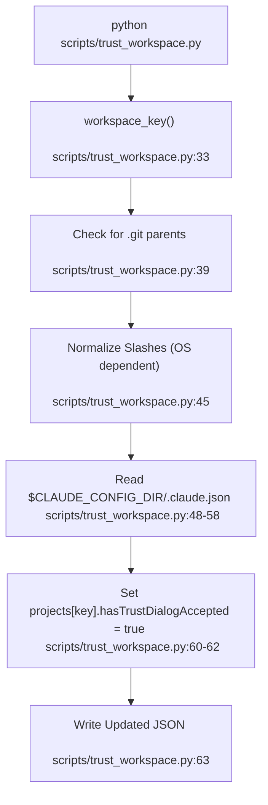
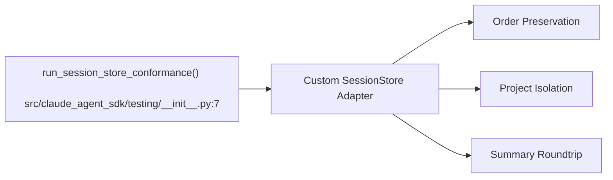

<!-- source: DeepWiki mcp.deepwiki.com · repo anthropics/claude-agent-sdk-python · page 8.2 Testing Strategy · fetched 2026-10-26 -->

# Testing Strategy

Relevant source files

The following files were used as context for generating this wiki page:

- [.claude/agents/test-agent.md](.claude/agents/test-agent.md)
- [.dockerignore](.dockerignore)
- [.github/workflows/test.yml](.github/workflows/test.yml)
- [Dockerfile.test](Dockerfile.test)
- [e2e-tests/README.md](e2e-tests/README.md)
- [examples/filesystem_agents.py](examples/filesystem_agents.py)
- [scripts/test-docker.sh](scripts/test-docker.sh)
- [scripts/trust_workspace.py](scripts/trust_workspace.py)
- [src/claude_agent_sdk/testing/__init__.py](src/claude_agent_sdk/testing/__init__.py)
- [tests/conftest.py](tests/conftest.py)

## Purpose and Scope

This document details the testing strategy for the `claude-agent-sdk-python` repository. The SDK implements a rigorous multi-tier testing architecture designed to guarantee correctness across isolated components, cross-backend async event loops, containerized setups, and live interactions with the Claude CLI subprocess and Anthropic API. 

The testing strategy spans three primary tiers: unit and integration tests (`tests/`), end-to-end checks against the live API (`e2e-tests/`), and containerized test executions (`Dockerfile.test`), augmented by strict version-compatibility floors (MCP v1) and automated workspace trust initialization (`scripts/trust_workspace.py`).

---

## Test Tiers and Organization

### Directory Structure and Execution Matrix

The testing suite is organized to separate isolated logic from end-to-end API validations.

**Test Architecture to Code Entity Mapping**

**Sources:** [.github/workflows/test.yml:1-80](), [tests/conftest.py:1-9](), [e2e-tests/README.md:1-45]()

| Directory / File | Purpose | Mocking / Dependencies | Execution Target |
|------------------|---------|-------------------------|------------------|
| `tests/` | Unit and internal integration tests | Subprocess / mock components | Standard `pytest` suite |
| `e2e-tests/` | Live integration against Claude API | None (Requires `ANTHROPIC_API_KEY`) | `@pytest.mark.e2e` |
| `Dockerfile.test` | Containerized regression testing | Isolated `python:3.12-slim` + CLI | Docker runner (`scripts/test-docker.sh`) |
| `scripts/trust_workspace.py` | Bypasses trust dialog restrictions in CI | Filesystem configuration | Pre-test initialization |

**Sources:** [.github/workflows/test.yml:34-80](), [Dockerfile.test:1-55](), [scripts/trust_workspace.py:1-68]()

---

## Unit Testing & Pytest-Asyncio Setup

Unit tests validate internal functions, parser mechanics, and storage managers without requiring network access. 

### Cross-Backend Async Execution
The SDK supports multiple asynchronous event loop backends (`asyncio` and `trio`). To ensure zero regressions across backends, `tests/conftest.py` defines a parameterized `anyio_backend` fixture that runs every `@pytest.mark.anyio` test under both loops [.github/workflows/test.yml:34-36](), [tests/conftest.py:1-9]().

**Async Execution Flow**

**Sources:** [tests/conftest.py:1-9]()

**Sources:** [tests/conftest.py:1-9](), [.github/workflows/test.yml:34-36]()

---

## MCP v1 Compatibility Floor Job

To guarantee backward compatibility with earlier major versions of the Model Context Protocol (`mcp`), the CI workflow includes a specialized job (`test-mcp-v1-floor`) alongside the main test job [.github/workflows/test.yml:44-80]().

- **Main Job**: Pins or resolves the newest supported `mcp` 2.x release [.github/workflows/test.yml:29-33]().
- **MCP v1 Floor Job**: Pins `mcp==1.23.0` and runs both `mypy` type checking (`mypy src/ scripts/`) and the full pytest suite (`pytest tests/`) to catch protocol deprecations or signature mismatches early [.github/workflows/test.yml:57-71]().

**Sources:** [.github/workflows/test.yml:44-80]()

---

## Workspace Trust Initialization (`scripts/trust_workspace.py`)

Claude Code enforces security checks that drop project-scoped permission grants from committed `.claude/settings.json` files unless the workspace is explicitly marked as trusted. Because CI workflows perform fresh checkouts on every run, the repository would otherwise be treated as untrusted, breaking permission tests [scripts/trust_workspace.py:1-26]().

### Implementation Mechanics
The script `scripts/trust_workspace.py` resolves the repository's physical path, derives the exact project trust key matching Claude Code's internal hashing rules, and updates the global configuration file (`.claude.json`) with `hasTrustDialogAccepted: true` [scripts/trust_workspace.py:33-64]().

**Workspace Trust Code Flow**

**Sources:** [scripts/trust_workspace.py:33-68]()

**Sources:** [.github/workflows/test.yml:148-149](), [Dockerfile.test:45-52](), [scripts/trust_workspace.py:1-68]()

---

## SessionStore Conformance Testing Harness

The SDK provides a conformance test runner in `src/claude_agent_sdk/testing/` to validate custom `SessionStore` implementations (such as Redis, S3, or Postgres adapters) [src/claude_agent_sdk/testing/__init__.py:1-9]().

### `run_session_store_conformance()`
The `run_session_store_conformance` function executes behavioral contract verifications covering:
1. **Append and Load Consistency**: Verifies chronological ordering and persistence integrity.
2. **Project and Subpath Isolation**: Ensures distinct tenant/project keys and subagent keys do not leak data.
3. **Summary Verbatim Round-tripping**: Asserts session summaries fold and unfold cleanly through the store interface.

**Conformance Harness Integration**

**Sources:** [src/claude_agent_sdk/testing/__init__.py:1-9]()

**Sources:** [src/claude_agent_sdk/testing/__init__.py:1-9]()

---

## Containerized Testing (`Dockerfile.test` and `test-docker.sh`)

To prevent platform-specific bugs (such as Issue #406 related to container environments and filesystem agent paths), the repository includes a dedicated Docker container setup [Dockerfile.test:1-55](), [scripts/test-docker.sh:1-77]().

- **Container Image (`Dockerfile.test`)**: Uses `python:3.12-slim`, installs system utilities (`curl`, `git`), installs the bundled Claude CLI, copies source code, and invokes `scripts/trust_workspace.py` during build time [Dockerfile.test:4-53]().
- **Runner Script (`scripts/test-docker.sh`)**: Orchestrates running unit tests (`unit`), live API checks (`e2e`), or both (`all`) within ephemeral containers [scripts/test-docker.sh:1-77]().

**Sources:** [Dockerfile.test:1-55](), [scripts/test-docker.sh:1-77]()

---

