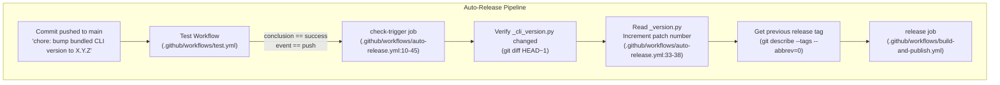
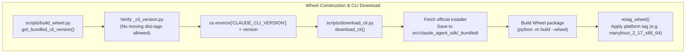
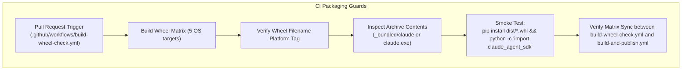

<!-- source: DeepWiki mcp.deepwiki.com · repo anthropics/claude-agent-sdk-python · page 8.3 Build and Release Process · fetched 2026-10-26 -->

# Build and Release Process

Relevant source files

The following files were used as context for generating this wiki page:

- [.claude/commands/generate-changelog.md](.claude/commands/generate-changelog.md)
- [.github/workflows/auto-release.yml](.github/workflows/auto-release.yml)
- [.github/workflows/build-and-publish.yml](.github/workflows/build-and-publish.yml)
- [.github/workflows/build-wheel-check.yml](.github/workflows/build-wheel-check.yml)
- [.github/workflows/publish.yml](.github/workflows/publish.yml)
- [.github/workflows/pypi-quota-check.yml](.github/workflows/pypi-quota-check.yml)
- [.github/workflows/release-alert.yml](.github/workflows/release-alert.yml)
- [.github/workflows/slack-issue-notification.yml](.github/workflows/slack-issue-notification.yml)
- [RELEASING.md](RELEASING.md)
- [scripts/build_wheel.py](scripts/build_wheel.py)
- [scripts/check_pypi_quota.py](scripts/check_pypi_quota.py)
- [scripts/download_cli.py](scripts/download_cli.py)
- [scripts/requirements-build.in](scripts/requirements-build.in)
- [scripts/requirements-build.txt](scripts/requirements-build.txt)
- [scripts/requirements-recompress.txt](scripts/requirements-recompress.txt)
- [scripts/update_cli_version.py](scripts/update_cli_version.py)
- [scripts/update_version.py](scripts/update_version.py)
- [src/claude_agent_sdk/_bundled/.gitignore](src/claude_agent_sdk/_bundled/.gitignore)
- [tests/test_build_wheel.py](tests/test_build_wheel.py)

This page covers the full CI/CD pipeline for building, verifying, and publishing the `claude-agent-sdk` Python package. It details the two release triggers (automatic CLI version bumps and manual dispatch), the shared build and publish workflow (`build-and-publish.yml`), platform-specific wheel construction, CLI downloading scripts, version updates, PyPI quota pre-flight checks, trusted publishing via OIDC, and packaging verification guards.

---

## 1. Release Overview and Triggers

Releases for `claude-agent-sdk` converge on a single reusable workflow: `.github/workflows/build-and-publish.yml` `[.github/workflows/build-and-publish.yml:1-5]`, `[RELEASING.md:3-5]`. There are two distinct paths to trigger this pipeline:

| Trigger Type | Workflow File | Initiation Mechanism |
|---|---|---|
| **Automatic Release** | `.github/workflows/auto-release.yml` `[.github/workflows/auto-release.yml:1-8]` | Automated `workflow_run` upon a commit message starting with `chore: bump bundled CLI version to` `[.github/workflows/auto-release.yml:14-15]` |
| **Manual Release** | `.github/workflows/publish.yml` `[.github/workflows/publish.yml:1-10]` | Developer dispatch via GitHub Actions UI with a version input `[RELEASING.md:49-55]` |

### Auto-Release Flow

The auto-release workflow `.github/workflows/auto-release.yml` listens to the completion of the `Test` workflow on the `main` branch `[.github/workflows/auto-release.yml:4-8]`. It evaluates whether the triggering commit message matches the CLI bump pattern `[.github/workflows/auto-release.yml:15-15]`, verifies that `src/claude_agent_sdk/_cli_version.py` was modified in `HEAD~1` `[.github/workflows/auto-release.yml:24-29]`, computes the next SDK patch version by incrementing the patch component of `src/claude_agent_sdk/_version.py` `[.github/workflows/auto-release.yml:31-38]`, and invokes the reusable `build-and-publish.yml` workflow `[.github/workflows/auto-release.yml:46-56]`.

Sources: [.github/workflows/auto-release.yml:1-56](), [RELEASING.md:30-47]()

### Manual Release Flow

Manual releases are handled by `.github/workflows/publish.yml` `[.github/workflows/publish.yml:1-10]`. Before triggering the build and publish workflow, it runs a full quality gate consisting of test matrices across Python 3.10 through 3.13 and strict lint/type checks (`ruff` and `mypy`) `[.github/workflows/publish.yml:11-59]`.

Sources: [.github/workflows/publish.yml:1-85](), [RELEASING.md:49-59]()

---

## 2. Shared Build and Publish Workflow (`build-and-publish.yml`)

The reusable workflow `.github/workflows/build-and-publish.yml` accepts `version` and `previous_tag` inputs `[.github/workflows/build-and-publish.yml:4-14]`. It executes in two primary phases: parallel wheel builds across five target operating systems, followed by sequence validation, sdist creation, PyPI quota checking, trusted publishing via OIDC, and release tagging.

### Build Matrix

The `build-wheels` job runs across five distinct runner configurations to produce platform-specific wheels containing the bundled Claude CLI binary `[.github/workflows/build-and-publish.yml:16-44]`, `[RELEASING.md:7-16]`:

| Runner Environment | Target Platform Tag | Output Artifact Name |
|---|---|---|
| `ubuntu-latest` `[.github/workflows/build-and-publish.yml:21]` | `manylinux_2_17_x86_64` `[.github/workflows/build-wheel-check.yml:30]` | `wheel-ubuntu-latest` `[.github/workflows/build-and-publish.yml:41]` |
| `ubuntu-24.04-arm` `[.github/workflows/build-and-publish.yml:21]` | `manylinux_2_17_aarch64` `[.github/workflows/build-wheel-check.yml:32]` | `wheel-ubuntu-24.04-arm` `[.github/workflows/build-and-publish.yml:41]` |
| `macos-latest` `[.github/workflows/build-and-publish.yml:21]` | `macosx_11_0_arm64` `[.github/workflows/build-wheel-check.yml:34]` | `wheel-macos-latest` `[.github/workflows/build-and-publish.yml:41]` |
| `macos-15-intel` `[.github/workflows/build-and-publish.yml:21]` | `macosx_11_0_x86_64` `[.github/workflows/build-wheel-check.yml:36]` | `wheel-macos-15-intel` `[.github/workflows/build-and-publish.yml:41]` |
| `windows-latest` `[.github/workflows/build-and-publish.yml:21]` | `win_amd64` `[.github/workflows/build-wheel-check.yml:38]` | `wheel-windows-latest` `[.github/workflows/build-and-publish.yml:41]` |

```mermaid
flowchart TD
    subgraph BuildPublishSpace ["Shared Build & Publish Pipeline"]
        entry["workflow_call\n(.github/workflows/build-and-publish.yml:4)"] --> build_wheels["build-wheels job (Matrix)\nscripts/build_wheel.py"]
        build_wheels --> upload_arts["Upload Artifacts\nwheel-{os} -> dist/*.whl"]
        upload_arts --> publish_job["publish job (ubuntu-latest)\nid-token: write (OIDC)"]
        publish_job --> update_ver["scripts/update_version.py\n(pyproject.toml, _version.py)"]
        update_ver --> dl_arts["Download all wheel-* artifacts"]
        dl_arts --> verify_wheels["Verify 5 expected wheels present\n(.github/workflows/build-and-publish.yml:73-91)"]
        verify_wheels --> build_sdist["python -m build --sdist"]
        build_sdist --> quota_check["Pre-flight PyPI Quota Check\n(50 GiB project, 250 MiB file limits)"]
        quota_check --> twine_upload["twine upload dist/* sdist/*\n(Trusted Publishing via OIDC)"]
        twine_upload --> git_commit["git commit\n'chore: release vVERSION'"]
        git_commit --> changelog["anthropics/claude-code-action@v1\n/generate-changelog prompt"]
        changelog --> push_tag["git push origin main & tag release"]
    end
```

Sources: [.github/workflows/build-and-publish.yml:1-210](), [RELEASING.md:7-16]()

### Trusted Publishing and Credentials

Publishing to PyPI requires no static API token secrets. Instead, the `publish` job requests an OpenID Connect (OIDC) `id-token: write` permission `[.github/workflows/build-and-publish.yml:49-52]`. PyPI utilizes trusted publishing, mapping the GitHub Actions workflow environment (`production`) and repository to PyPI's project configuration `[RELEASING.md:78-84]`. Git commits and tags back to the repository are performed via SSH using `DEPLOY_KEY` `[RELEASING.md:73-77]`.

Sources: [.github/workflows/build-and-publish.yml:45-55](), [RELEASING.md:71-84]()

---

## 3. Wheel Building and CLI Download Subsystem

Building platform wheels is managed by `scripts/build_wheel.py` in coordination with `scripts/download_cli.py` and version pins in `src/claude_agent_sdk/_cli_version.py` `[scripts/build_wheel.py:1-28]`, `[scripts/download_cli.py:1-15]`.

### Wheel Building Logic (`scripts/build_wheel.py`)

The wheel building script performs the following sequence:
1. Validates the bundled CLI version pin from `src/claude_agent_sdk/_cli_version.py` via `get_bundled_cli_version()` `[scripts/build_wheel.py:104-127]`. Dist-tags like `latest` or `stable` are strictly disallowed during builds to ensure reproducible binaries across parallel runner architectures `[scripts/build_wheel.py:104-110]`.
2. Sets `CLAUDE_CLI_VERSION` in the environment and calls `scripts/download_cli.py` to fetch the binary into `src/claude_agent_sdk/_bundled/` `[scripts/build_wheel.py:128-144]`.
3. Invokes the standard build backend to build the wheel and retags the output artifact using `wheel tags --platform-tag` with compatibility tags such as `macosx_11_0_arm64` or `manylinux_2_17_x86_64` `[scripts/build_wheel.py:157-216]`.

Sources: [scripts/build_wheel.py:1-218](), [scripts/download_cli.py:1-63]()

---

## 4. Version Management, Tagging, and Changelog Generation

The SDK tracks version identifiers across multiple files, while git tags reflect the SDK version `[RELEASING.md:21-29]`.

### Version Files

| Component | File Path | Code Representation |
|---|---|---|
| **SDK Version** | `pyproject.toml` and `src/claude_agent_sdk/_version.py` `[RELEASING.md:25]` | `__version__ = "X.Y.Z"` `[scripts/update_version.py:27-41]` |
| **Bundled CLI Version** | `src/claude_agent_sdk/_cli_version.py` `[RELEASING.md:26]` | `__cli_version__ = "X.Y.Z"` `[scripts/build_wheel.py:84-87]` |

`scripts/update_version.py` updates both `pyproject.toml` and `src/claude_agent_sdk/_version.py` atomically during release execution `[scripts/update_version.py:9-41]`. Changelog generation is performed via `anthropics/claude-code-action@v1` using the prompt template in `.claude/commands/generate-changelog.md` `[.github/workflows/build-and-publish.yml:186-198]`.

Sources: [scripts/update_version.py:1-49](), [.github/workflows/build-and-publish.yml:64-66,186-198]()

---

## 5. PyPI Quota Pre-Flight and Monitoring

To prevent upload failures due to storage constraints, the pipeline enforces strict pre-flight checks and continuous daily quota monitoring `[scripts/check_pypi_quota.py:1-22]`, `[.github/workflows/pypi-quota-check.yml:1-22]`.

### Quota Thresholds and Limits

- **Project Storage Limit**: `50 GiB` (`PYPI_PROJECT_LIMIT_BYTES = 50 * 1024**3`) `[scripts/check_pypi_quota.py:20]`
- **Per-File Size Limit**: `250 MiB` (`PYPI_FILE_LIMIT_BYTES = 250 * 1024**2`) `[scripts/check_pypi_quota.py:21]`
- **Warning Threshold**: `80%` (`--warn-threshold 0.80`) `[scripts/check_pypi_quota.py:62-66]`

During the publish workflow, `scripts/check_pypi_quota.py` queries PyPI's JSON API. If any built artifact or project total exceeds limits, the script logs warnings or halts upload to ensure system resilience without corrupting partial releases `[.github/workflows/build-and-publish.yml:101-165]`. A scheduled workflow (`.github/workflows/pypi-quota-check.yml`) runs daily at 13:23 UTC to post Slack notifications if storage usage crosses warning bounds `[.github/workflows/pypi-quota-check.yml:1-72]`.

Sources: [.github/workflows/build-and-publish.yml:101-170](), [scripts/check_pypi_quota.py:1-125](), [.github/workflows/pypi-quota-check.yml:1-71]()

---

## 6. Packaging Verification and CI Guards

To catch build regressions prior to merging pull requests, `.github/workflows/build-wheel-check.yml` dry-runs the entire wheel building matrix on PRs touching packaging scripts or version pins `[.github/workflows/build-wheel-check.yml:1-21]`.

### Verification Steps
1. **Platform Tag Validation**: Confirms that the generated wheel filename contains the expected platform tag (`win_amd64`, `manylinux_2_17_x86_64`, etc.) `[.github/workflows/build-wheel-check.yml:60-70]`.
2. **Binary Bundle Inspection**: Inspects the wheel archive via `python -m zipfile -l` to verify that the CLI executable (`_bundled/claude` or `_bundled/claude.exe`) is present inside the package structure `[.github/workflows/build-wheel-check.yml:72-90]`.
3. **Smoke Testing**: Installs the built wheel locally and executes an import and path verification test `[.github/workflows/build-wheel-check.yml:92-98]`.
4. **Matrix Synchronization Check**: Automatically checks that `build-wheel-check.yml` remains synchronized with `build-and-publish.yml` `[.github/workflows/build-wheel-check.yml:105-121]`.

Sources: [.github/workflows/build-wheel-check.yml:1-120](), [RELEASING.md:17-20]()

---

