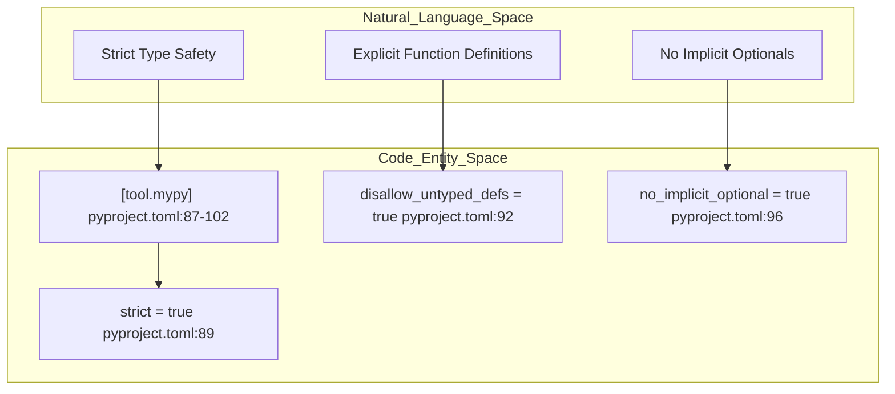
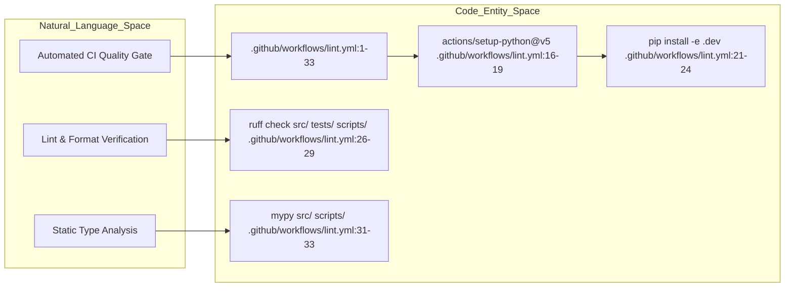

<!-- source: DeepWiki mcp.deepwiki.com · repo anthropics/claude-agent-sdk-python · page 8.4 Code Quality Standards · fetched 2026-10-26 -->

# Code Quality Standards

Relevant source files

The following files were used as context for generating this wiki page:

- [.claude/settings.json](.claude/settings.json)
- [.claude/skills/verify/SKILL.md](.claude/skills/verify/SKILL.md)
- [.github/workflows/lint.yml](.github/workflows/lint.yml)
- [CHANGELOG.md](CHANGELOG.md)
- [pyproject.toml](pyproject.toml)
- [scripts/_cli_version_validation.py](scripts/_cli_version_validation.py)
- [scripts/initial-setup.sh](scripts/initial-setup.sh)
- [scripts/pre-push](scripts/pre-push)
- [src/claude_agent_sdk/_cli_version.py](src/claude_agent_sdk/_cli_version.py)
- [src/claude_agent_sdk/_version.py](src/claude_agent_sdk/_version.py)
- [tests/test_changelog.py](tests/test_changelog.py)

This document details the code quality standards and enforcement mechanisms used in the `claude-agent-sdk` repository. The project maintains rigorous standards through strict static type checking with `mypy`, comprehensive linting and formatting via `ruff`, automated CI pipelines, local git hooks, and specialized verification skills.

---

## Purpose and Scope

The code quality toolchain ensures that all contributions adhere to PEP 8, adopt modern Python 3.10+ idioms, and remain fully type-safe. Quality checks are enforced at multiple checkpoints: locally via git hooks and Claude agent settings, during pull requests and pushes via GitHub Actions, and through dedicated verification skills.

---

## 1. Type Checking with mypy

The SDK runs `mypy` in **strict mode** to eliminate type-related runtime errors and provide precise type signatures for IDE autocompletion and API consumption.

### Strict Mode Configuration

The type checking parameters are centralized under `[tool.pyproject.toml]` [pyproject.toml:87-102](). 

Title: Mypy Strict Enforcement Flow

### Key Type Rules and Overrides
*   **Strict Mode**: `strict = true` enforces comprehensive checking across the entire codebase [pyproject.toml:89]().
*   **Definition Constraints**: `disallow_untyped_defs = true` and `disallow_incomplete_defs = true` require complete type annotations on all functions and methods [pyproject.toml:92-93]().
*   **Optional Handling**: `no_implicit_optional = true` mandates explicit `Optional` or union syntax (`T | None`) [pyproject.toml:96]().
*   **Optional Dependencies**: Special module overrides handle untyped or optional packages such as `opentelemetry`, `jsonschema`, `twine`, and `zopfli` [pyproject.toml:103-126]().

**Sources:** [pyproject.toml:87-126]()

---

## 2. Linting and Formatting with ruff

The SDK utilizes `ruff` for fast linting and formatting, targeting Python 3.10 syntax [pyproject.toml:127-149]().

### Rule Sets and Linter Categories

The linter enables rules covering error checking, code style simplification, and import sorting:
*   **E, W**: `pycodestyle` errors and warnings [pyproject.toml:132-134]()
*   **F**: `pyflakes` logical error detection [pyproject.toml:135]()
*   **I**: `isort` import ordering [pyproject.toml:136]()
*   **N**: `pep8-naming` conventions [pyproject.toml:137]()
*   **UP**: `pyupgrade` modern syntax transformations [pyproject.toml:138]()
*   **B**: `flake8-bugbear` design flaw identification [pyproject.toml:139]()
*   **PTH**: `flake8-use-pathlib` path modernization [pyproject.toml:141]()
*   **SIM**: `flake8-simplify` code simplification [pyproject.toml:142]()

Line lengths are capped at 88 characters, with `E501` ignored in favor of `ruff format` [pyproject.toml:128-146]().

**Sources:** [pyproject.toml:127-149]()

---

## 3. CI/CD Quality Gates

Automated quality gates run on every pull request and push to `main` via the GitHub Actions lint workflow [.github/workflows/lint.yml:1-33]().

### The Lint Workflow

Title: CI Quality Pipeline

The workflow provisions Python 3.12, installs development requirements (`.[dev]`), and executes `ruff check`, `ruff format --check`, and `mypy` [.github/workflows/lint.yml:16-33]().

**Sources:** [.github/workflows/lint.yml:1-33]()

---

## 4. Local Development and Git Hooks

Contributors maintain code quality locally using installation scripts and git pre-push hooks.

### Initial Setup and Pre-Push Enforcement
*   **Setup Script**: Running `scripts/initial-setup.sh` copies the pre-push hook into `.git/hooks/pre-push` and marks it executable [scripts/initial-setup.sh:1-22]().
*   **Pre-Push Hook**: `scripts/pre-push` runs `ruff check` and `ruff format --check` across source, test, and script directories, aborting pushes if checks fail [scripts/pre-push:1-33]().

**Sources:** [scripts/initial-setup.sh:1-22](), [scripts/pre-push:1-33]()

---

## 5. IDE and Assistant Integration

The repository integrates quality controls directly into agentic workflows via Claude settings and specialized verification skills.

### Settings and Verification Skill
*   **Local Claude Settings**: `.claude/settings.json` pre-authorizes bash commands for `ruff`, `mypy`, and `pytest`, and defines a `PostToolUse` hook to automatically check and format edited files [/.claude/settings.json:1-24]().
*   **Verify Skill**: The `.claude/skills/verify/SKILL.md` file defines a sandboxed verification workflow for release and build scripts (`scripts/download_cli.py`, `scripts/build_wheel.py`, `scripts/update_cli_version.py`) [.claude/skills/verify/SKILL.md:1-50]().

**Sources:** [.claude/settings.json:1-24](), [.claude/skills/verify/SKILL.md:1-50]()

---

