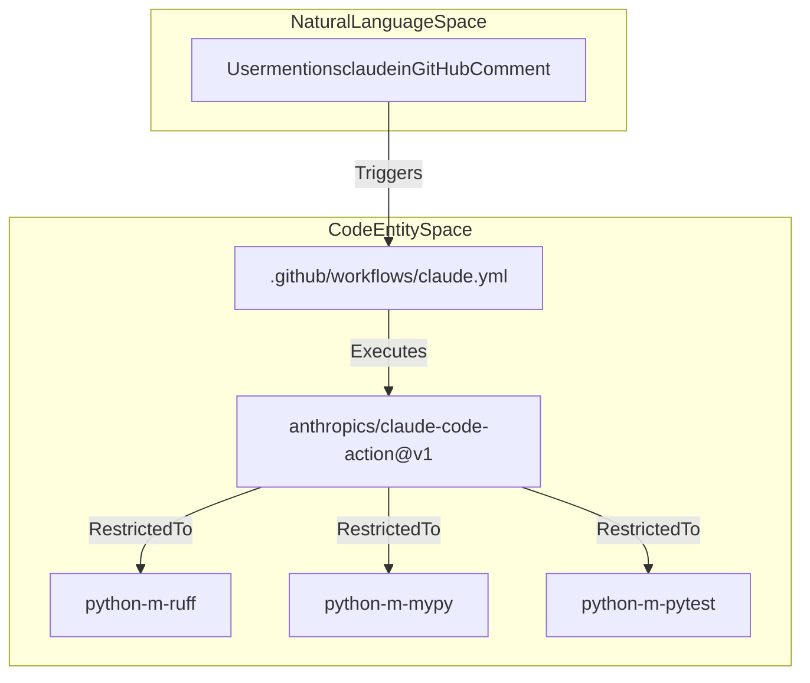
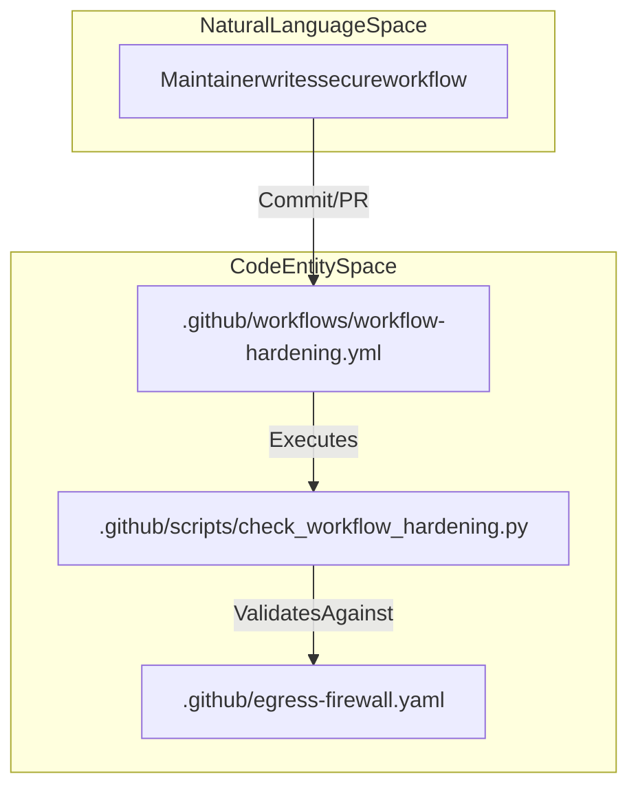

<!-- source: DeepWiki mcp.deepwiki.com · repo anthropics/claude-agent-sdk-python · page 8.5 Claude AI Integration and CI Hardening · fetched 2026-10-26 -->

# Claude AI Integration and CI Hardening

Relevant source files

The following files were used as context for generating this wiki page:

- [.github/actions/setup-claude-auth/action.yml](.github/actions/setup-claude-auth/action.yml)
- [.github/actions/setup-claude-auth/refresh-identity-token.js](.github/actions/setup-claude-auth/refresh-identity-token.js)
- [.github/egress-firewall.yaml](.github/egress-firewall.yaml)
- [.github/scripts/check_workflow_hardening.py](.github/scripts/check_workflow_hardening.py)
- [.github/scripts/run-e2e-firewalled-windows.ps1](.github/scripts/run-e2e-firewalled-windows.ps1)
- [.github/workflows/claude-code-review.yml](.github/workflows/claude-code-review.yml)
- [.github/workflows/claude-issue-triage.yml](.github/workflows/claude-issue-triage.yml)
- [.github/workflows/claude.yml](.github/workflows/claude.yml)
- [.github/workflows/workflow-hardening.yml](.github/workflows/workflow-hardening.yml)

This page details the CI/CD integration of Claude AI within the `claude-agent-sdk` repository. It covers the automated GitHub Actions workflows (`@claude` on-demand interactions, automated PR reviews, and issue triage), the comprehensive security hardening infrastructure (including network egress firewalls, automated policy checking, and Windows firewalled test runners), and OIDC-based Workload Identity Federation via the `setup-claude-auth` action.

---

## Workflows and Infrastructure at a Glance

| Component | File / Path | Purpose / Trigger | Key Security Features |
|---|---|---|---|
| **On-Demand Claude** | [.github/workflows/claude.yml]() | Responds to `@claude` mentions in issues, PRs, and comments | Egress firewall runner, OIDC federation, `--permission-mode auto` |
| **PR Code Review** | [.github/workflows/claude-code-review.yml]() | Automatically reviews PRs on open/synchronize | Egress firewall runner, OIDC federation, fork filtering |
| **Issue Triage** | [.github/workflows/claude-issue-triage.yml]() | Triage and labels new issues | Script capabilities caps (`CLAUDE_CODE_SCRIPT_CAPS`), disallowed tools |
| **Egress Firewall Policy** | [.github/egress-firewall.yaml]() | Enforces outbound network restrictions for AI jobs | Strict host allowlisting (`api.anthropic.com`, etc.) |
| **Workflow Hardening Check** | [.github/workflows/workflow-hardening.yml]() & [.github/scripts/check_workflow_hardening.py]() | CI check ensuring all Claude-invoking workflows adhere to security policies | Automated AST/YAML policy validation |
| **Auth Setup Action** | [.github/actions/setup-claude-auth/action.yml]() | Mints GitHub OIDC tokens and handles background refreshing | Short-lived token exchange, detached refresh process |

Sources: [.github/workflows/claude.yml:1-72](), [.github/workflows/claude-code-review.yml:1-58](), [.github/workflows/claude-issue-triage.yml:1-43](), [.github/egress-firewall.yaml:1-40](), [.github/workflows/workflow-hardening.yml:1-23](), [.github/scripts/check_workflow_hardening.py:1-166](), [.github/actions/setup-claude-auth/action.yml:1-35]()

---

## 1. Core Workflows

### On-Demand Claude Interaction (`claude.yml`)
Maintains developer velocity by allowing users to invoke Claude directly via `@claude` mentions in issues, review comments, and PR reviews [.github/workflows/claude.yml:4-19](). 

- **Runner Environment:** Executes on GitHub's hardened `ubuntu-24.04-firewall` runner [.github/workflows/claude.yml:22]().
- **Permissions:** Requires `contents: read`, `pull-requests: read`, `issues: read`, and `id-token: write` for OIDC token minting [.github/workflows/claude.yml:23-27]().
- **Execution Arguments:** Configures `--model claude-opus-4-6`, `--permission-mode auto`, and restricts allowed tools to project quality control scripts (`ruff`, `mypy`, `pytest`) [.github/workflows/claude.yml:69-71]().

**Diagram: On-Demand Interaction Flow**

Sources: [.github/workflows/claude.yml:1-72]()

### Automated PR Code Review (`claude-code-review.yml`)
Automatically evaluates code quality, security, potential bugs, performance, and test coverage whenever a pull request is opened or synchronized [.github/workflows/claude-code-review.yml:4-5, 49-57]().

- **Fork Isolation:** Skipped for external forks (`if: github.event.pull_request.head.repo.full_name == github.repository`) to protect repository secrets [.github/workflows/claude-code-review.yml:16]().
- **Execution Arguments:** Runs model `claude-opus-4-6` under `--permission-mode auto` [.github/workflows/claude-code-review.yml:46]().

Sources: [.github/workflows/claude-code-review.yml:1-58]()

### Automated Issue Triage (`claude-issue-triage.yml`)
Triggers upon the opening of a new issue, utilizing specialized command definitions (`.claude/commands/label-issue.md`) and shell wrappers to apply appropriate labels [.github/workflows/claude-issue-triage.yml:3-5, 30]().

- **Security Limits:** Restricts script capabilities using `CLAUDE_CODE_SCRIPT_CAPS: '{"edit-issue-labels.sh":2}'` [.github/workflows/claude-issue-triage.yml:28]().
- **Tool Restrictions:** Disables potentially dangerous file mutation tools via `--disallowedTools "WebFetch,WebSearch,Write,Edit,MultiEdit,NotebookEdit"` [.github/workflows/claude-issue-triage.yml:41]().

Sources: [.github/workflows/claude-issue-triage.yml:1-43]()

---

## 2. CI Hardening and Egress Firewall

To prevent exfiltration of sensitive build data or unauthorized network calls, all jobs invoking Claude are heavily isolated.

### Network Egress Firewall Policy
The repository enforces strict outbound network restrictions using `ubuntu-24.04-firewall` runners [claude.github/workflows/claude.yml:22](). The policy file [.github/egress-firewall.yaml]() defines an explicit allow-list of reachable external hosts:

- **Anthropic API:** `api.anthropic.com` [.github/egress-firewall.yaml:9]()
- **GitHub API & Assets:** `api.github.com`, `release-assets.githubusercontent.com` [.github/egress-firewall.yaml:12, 20]().
- **Tool Registries & Downloads:** `claude.ai`, `downloads.claude.ai`, `registry.npmjs.org`, `pypi.org`, `files.pythonhosted.org` [.github/egress-firewall.yaml:15-25]().

Sources: [.github/egress-firewall.yaml:1-40]()

### Automated Workflow Hardening Enforcement
To guarantee that newly added workflows or modifications do not bypass security constraints, [.github/workflows/workflow-hardening.yml]() runs `.github/scripts/check_workflow_hardening.py` on pull requests and pushes [.github/workflows/workflow-hardening.yml:1-23]().

The checking script validates:
1. That any job calling Claude runs on the `ubuntu-24.04-firewall` runner.
2. That proper permission modes (`--permission-mode auto`) are specified.
3. That models meet minimum version thresholds (`AUTO_MODE_MIN_VERSION = (4, 6)`) required for safe autonomous execution [.github/scripts/check_workflow_hardening.py:14-22]().
4. The absence of dangerous flags like `--dangerously-skip-permissions` [.github/scripts/check_workflow_hardening.py:127-131]().

Sources: [.github/workflows/workflow-hardening.yml:1-23](), [.github/scripts/check_workflow_hardening.py:1-166]()

**Diagram: Hardening Validation Pipeline**

Sources: [.github/workflows/workflow-hardening.yml:1-23](), [.github/scripts/check_workflow_hardening.py:1-166](), [.github/egress-firewall.yaml:1-40]()

---

## 3. Authentication and Identity Token Management

Workflows avoid long-lived static API keys by utilizing GitHub OIDC tokens exchanged for short-lived Anthropic API access tokens via Workload Identity Federation [.github/workflows/claude.yml:48-50]().

### The `setup-claude-auth` Action
Managed via [.github/actions/setup-claude-auth/action.yml](), this composite action performs the initial OIDC token request and establishes background maintenance:

1. **Mint Identity Token:** Calls `core.getIDToken("https://api.anthropic.com")` to acquire a GitHub OIDC token with the correct audience [.github/actions/setup-claude-auth/action.yml:23]().
2. **File Persistence:** Writes the token to a secure temporary file (`claude-identity-token` with mode `0o600`) and exports `ANTHROPIC_IDENTITY_TOKEN_FILE` [.github/actions/setup-claude-auth/action.yml:26-28]().
3. **Background Refreshing:** Spawns a detached Node.js process (`refresh-identity-token.js`) that periodically fetches new OIDC tokens every 4 minutes to prevent expiration during long-running CI jobs [.github/actions/setup-claude-auth/action.yml:30-35](), [.github/actions/setup-claude-auth/refresh-identity-token.js:1-31]().

Sources: [.github/actions/setup-claude-auth/action.yml:1-35](), [.github/actions/setup-claude-auth/refresh-identity-token.js:1-31]()

---

## 4. Firewalled E2E Testing on Windows

Because GitHub offers native `ubuntu-24.04-firewall` runners only for Linux, Windows test execution requires a custom local sandboxing script: [.github/scripts/run-e2e-firewalled-windows.ps1]() [.github/scripts/run-e2e-firewalled-windows.ps1:1-15]().

- **Isolated Standard User:** Creates a restricted local user (`claude-e2e`) to execute end-to-end tests, ensuring tests cannot tamper with administrator privileges or firewall rules [.github/scripts/run-e2e-firewalled-windows.ps1:18-43]().
- **Windows Firewall Rules:** Applies strict outbound blocking rules for the `claude-e2e` user account, blocking all IP ranges except the official published ranges for `api.anthropic.com` [.github/scripts/run-e2e-firewalled-windows.ps1:23-33, 70-74]().
- **Secure File ACLs:** Denies write access to the runner workspace, tool cache, and temporary directories for the e2e user to maintain workspace integrity [.github/scripts/run-e2e-firewalled-windows.ps1:52-66]().

Sources: [.github/scripts/run-e2e-firewalled-windows.ps1:1-127]()

---

