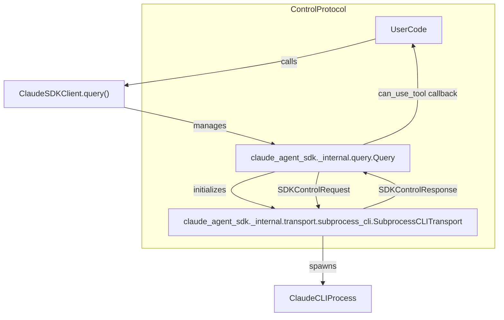
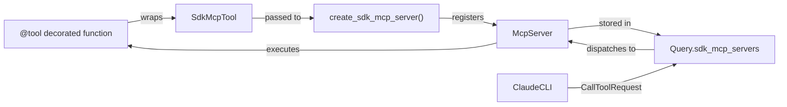

<!-- source: DeepWiki mcp.deepwiki.com · repo anthropics/claude-agent-sdk-python · page 9 Glossary · fetched 2026-10-26 -->

# Glossary

Relevant source files

The following files were used as context for generating this wiki page:

- [e2e-tests/test_parallel_tool_session_reads.py](e2e-tests/test_parallel_tool_session_reads.py)
- [e2e-tests/test_verbatim_prompts.py](e2e-tests/test_verbatim_prompts.py)
- [src/claude_agent_sdk/_internal/query.py](src/claude_agent_sdk/_internal/query.py)
- [src/claude_agent_sdk/_internal/sessions.py](src/claude_agent_sdk/_internal/sessions.py)
- [src/claude_agent_sdk/types.py](src/claude_agent_sdk/types.py)
- [tests/test_session_helpers_store.py](tests/test_session_helpers_store.py)
- [tests/test_sessions.py](tests/test_sessions.py)
- [tests/test_types.py](tests/test_types.py)
- [tests/test_verbatim_prompts.py](tests/test_verbatim_prompts.py)

## Purpose and Scope

This page provides definitions for codebase-specific terms, jargon, and architectural concepts used within the `claude-agent-sdk`. It is intended to help onboarding engineers navigate the relationship between the Python SDK, the bundled Claude CLI, and the underlying Model Context Protocol (MCP).

Sources: [src/claude_agent_sdk/types.py:1-40]()

## Core Concepts & Jargon

### MCP (Model Context Protocol)
A standard protocol that allows AI models to interact with external tools and data sources. In this SDK, MCP is used in two ways:
1.  **External MCP Servers**: Independent processes (stdio, SSE, HTTP) configured via the `mcp_servers` dictionary or file path in `ClaudeAgentOptions`.
2.  **SDK MCP Servers**: In-process Python servers created using the `@tool` decorator and `create_sdk_mcp_server`. These allow Python functions to be exposed as tools to the Claude CLI without a separate process, managed internally via `Query.sdk_mcp_servers` [src/claude_agent_sdk/_internal/query.py:167]().

Sources: [src/claude_agent_sdk/types.py:388-399](), [src/claude_agent_sdk/_internal/query.py:157-175]()

### Control Protocol
The bidirectional JSON-RPC-like communication layer managed by the `Query` class [src/claude_agent_sdk/_internal/query.py:146-155](). It sits on top of the transport and handles high-level coordination such as:
*   **Initialize Handshake**: Exchanging capabilities, registering hooks, and passing agent definitions at session start [src/claude_agent_sdk/_internal/query.py:146-176]().
*   **Permission Requests**: The CLI asking the SDK if a tool execution is allowed via `SDKControlPermissionRequest` [src/claude_agent_sdk/types.py:20-25]().
*   **Hook Callbacks**: Executing SDK-side logic in response to CLI lifecycle events using `SDKHookCallbackRequest` [src/claude_agent_sdk/_internal/query.py:23]().

Sources: [src/claude_agent_sdk/_internal/query.py:146-176](), [src/claude_agent_sdk/types.py:20-25]()

### Transport & NDJSON Line Framing
The low-level communication mechanism. The primary implementation is `SubprocessCLITransport`, which spawns the Claude CLI as a subprocess and communicates via `stdin` and `stdout`. Messages are framed as newline-delimited JSON (NDJSON) lines, handled via line framers and buffers to parse streaming output.

Sources: [src/claude_agent_sdk/_internal/query.py:146-176]()

### Permission Modes
A configuration setting (`PermissionMode`) that determines how the CLI handles tool execution requests [src/claude_agent_sdk/types.py:25-27]().
*   `default`: Standard interactive prompts.
*   `acceptEdits`: Automatically allows file modifications.
*   `plan`: Allows planning but asks for execution.
*   `bypassPermissions`: Grants all tool requests without checking.
*   `auto`: Automatic permission handling [src/claude_agent_sdk/types.py:26]().
*   `dontAsk`: Suppresses permission prompts [src/claude_agent_sdk/types.py:26]().

Sources: [src/claude_agent_sdk/types.py:24-27]()

### Thinking Config
Configuration for Claude's internal reasoning capabilities ("thinking"). Managed via `ThinkingConfig` types. It allows users to control the depth and budget of model reasoning through the `effort` and `thinking` fields in `ClaudeAgentOptions` [src/claude_agent_sdk/types.py:37-37]().

Sources: [src/claude_agent_sdk/types.py:37-37]()

### Skills & Verbatim Prompts
*   **Skills**: A system for enabling discovered capabilities. `ClaudeAgentOptions.skills` supports `"all"`, a list of named skills, or `[]` to suppress all skills [src/claude_agent_sdk/types.py:35-36]().
*   **Verbatim Prompts**: Controlled via `verbatim_prompts=True`, which sets `client_composed: true` on user messages via `stamp_user_message()`, instructing the CLI to deliver the prompt as written without expanding `@path` file mentions or executing slash commands [src/claude_agent_sdk/_internal/query.py:133-144]().

Sources: [src/claude_agent_sdk/types.py:35-36](), [src/claude_agent_sdk/_internal/query.py:133-144]()

### SessionStore & Transcript Mirroring
A mechanism for external transcript persistence. The CLI emits `transcript_mirror` frames interleaved with normal messages.
*   **TranscriptMirrorBatcher**: Accumulates these frames and flushes them to a `SessionStore`.
*   **SessionStore**: A protocol for storage adapters (InMemory, S3, Redis, Postgres) to persist and resume sessions [src/claude_agent_sdk/types.py:23-24]().

Sources: [src/claude_agent_sdk/types.py:23-24](), [src/claude_agent_sdk/_internal/sessions.py:1-25]()

---

## Architectural Mapping

### Data Flow: From User Query to Subprocess

Title: "Data Flow from User Query to Subprocess CLI"

Sources: [src/claude_agent_sdk/_internal/query.py:146-176]()

### Extension Point: SDK MCP Tools

Title: "Extension Point SDK MCP Tools Architecture"

Sources: [src/claude_agent_sdk/_internal/query.py:146-176]()

---

## Terminology Table

| Term | Code Pointer | Description |
| :--- | :--- | :--- |
| **AgentDefinition** | [src/claude_agent_sdk/types.py:108-127]() | Metadata for a sub-agent, including system prompt, tools, skills, and memory settings. |
| **PermissionUpdate** | [src/claude_agent_sdk/types.py:146-162]() | Object used to modify tool permissions dynamically (e.g., `addRules`, `setMode`, `addDirectories`). |
| **ResultMessage** | [tests/test_types.py:137-147]() | A message indicating the completion of a turn, containing duration, cost, and session ID. |
| **SandboxSettings** | [tests/test_types.py:19-19]() | Configuration for restricted execution (network, commands), merged into CLI `--settings`. |
| **SettingSource** | [src/claude_agent_sdk/types.py:33-33]() | Indicates where a configuration is stored: `user`, `project`, or `local`. |
| **TaskBudget** | [src/claude_agent_sdk/types.py:88-98]() | API-side token budget that makes the model aware of its remaining limits to pace tool use. |
| **Distributed Tracing** | [src/claude_agent_sdk/_internal/query.py:1-30]() | Propagation of W3C trace context to the CLI subprocess for end-to-end observability. |
| **Conformance Testing** | [tests/test_session_helpers_store.py:1-30]() | A standardized test suite used to validate that custom `SessionStore` adapters behave correctly. |

Sources: [src/claude_agent_sdk/types.py:1-199](), [tests/test_types.py:1-187]()

## Technical Abbreviations

*   **CWD**: Current Working Directory. Configurable via options.
*   **JSONL**: JSON Lines. The format used by session transcripts and storage [src/claude_agent_sdk/_internal/sessions.py:3-5]().
*   **OTEL**: OpenTelemetry. Supported for distributed tracing.
*   **SDK**: Software Development Kit. Refers to the Python package `claude-agent-sdk`.
*   **CLI**: Command Line Interface. Refers to the `claude` binary.

Sources: [src/claude_agent_sdk/_internal/sessions.py:1-25]()