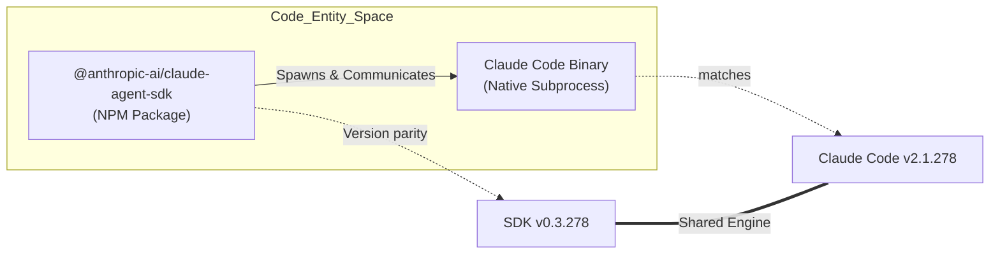
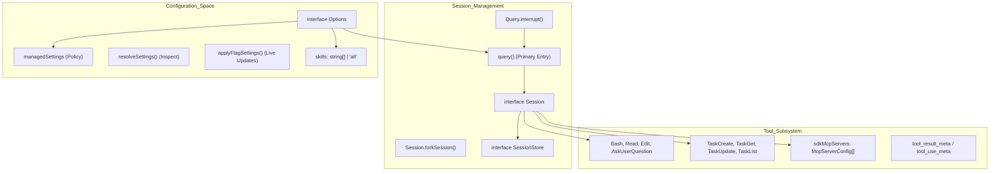
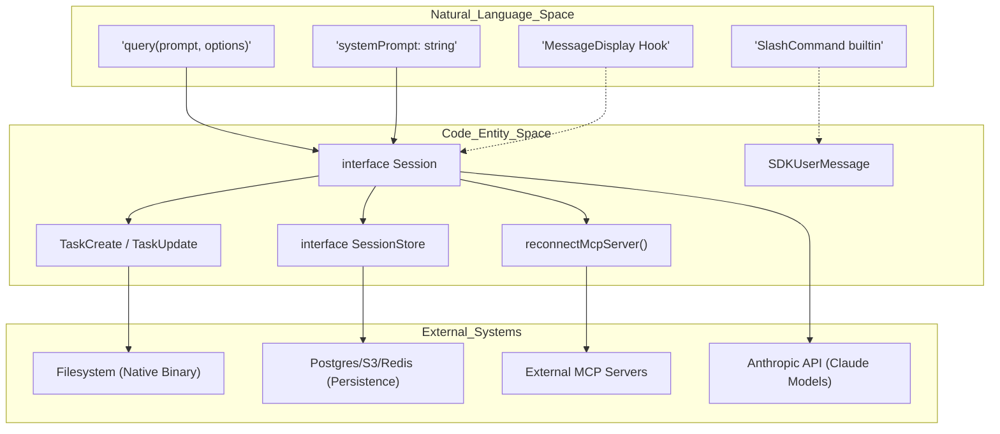

<!-- source: DeepWiki mcp.deepwiki.com · repo anthropics/claude-agent-sdk-typescript · page 1 Overview · fetched 2026-10-26 -->

# Overview

Relevant source files

The following files were used as context for generating this wiki page:

- [CHANGELOG.md](CHANGELOG.md)
- [LICENSE.md](LICENSE.md)
- [README.md](README.md)

## Purpose and Scope

This page introduces the Claude Agent SDK (`@anthropic-ai/claude-agent-sdk`), a TypeScript library designed for building autonomous AI agents with Claude Code's native capabilities [README.md:1-7](). It covers the core value proposition, the underlying host-guest subprocess architecture, integration with the Claude Code binary, and high-level platform capabilities.

**Sources:** [README.md:1-7]()

## What is the Claude Agent SDK?

The Claude Agent SDK is a Node.js library published under `@anthropic-ai/claude-agent-sdk` that enables developers to programmatically instantiate AI agents, control tool execution, manage session persistence, and execute complex workflows [README.md:1-7](). The SDK relies on Node.js 18+ and spawns a native Claude Code binary subprocess via per-platform optional dependencies, communicating securely using a JSON-RPC control protocol over standard input/output streams [README.md:3]().

**Sources:** [README.md:1-17]()

## Relationship to Claude Code

The Claude Agent SDK maintains strict version parity with the Claude Code platform backend and CLI releases [CHANGELOG.md:3-5](). Each SDK release corresponds to a specific underlying Claude Code engine version to ensure cross-environment consistency [CHANGELOG.md:3-5]().

| SDK Version | Claude Code Version | Notable Features |
|-------------|---------------------|------------------|
| 0.3.278 | v2.1.278 | Parity update with Claude Code v2.1.278 [CHANGELOG.md:3-6]() |
| 0.3.277 | v2.1.277 | Added `builtin` slash commands, `pasted_content` in `SDKUserMessage`, and `userSettings` source in `updateSettings()` [CHANGELOG.md:7-16]() |
| 0.3.274 | v2.1.274 | Added `startup_failure_reason`, `CLAUDE_CODE_MCP_STARTUP_WAIT_MS`, and per-phase startup timing [CHANGELOG.md:30-41]() |
| 0.3.268 | v2.1.268 | Added `result_index`, `local_command`, `hold_on_cache_impact` reload control, and `canUseTool` prompt hints [CHANGELOG.md:76-89]() |

**Sources:** [CHANGELOG.md:3-16](), [CHANGELOG.md:30-41](), [CHANGELOG.md:76-89]()

### SDK-to-Platform Version Mapping

**Sources:** [README.md:3-7](), [CHANGELOG.md:3-6]()

## SDK Architecture

The SDK centers around the `query()` function and the `Session` interface, managing the agent lifecycle, streaming message queues, and bidirectional RPC communication [CHANGELOG.md:3-89]().

**Sources:** [CHANGELOG.md:3-89]()

## Core Agent Capabilities

### Modern Session Management
The SDK exposes robust session handling via `query()` and session control methods:
- **Session Persistence**: The `SessionStore` interface (supporting S3, Postgres, and Redis backends) mirrors session transcripts and message sequences.
- **Lifecycle Tracking**: `command_lifecycle` frames track message states across execution phases.
- **Interrupts and Cancellation**: `Query.interrupt()` handles session interruption, while `cancel_queued` allows clearing pending queued operations [CHANGELOG.md:3-89]().

**Sources:** [CHANGELOG.md:3-89]()

### Tool and Skill System
Agents interact with environments through a structured tool registry:
- **Task Tools**: Sessions utilize `TaskCreate`, `TaskGet`, `TaskUpdate`, and `TaskList` for managing task-based workflows [CHANGELOG.md:76-89]().
- **Sidecar Metadata**: `tool_result_meta` and `tool_use_meta` provide sidecar diagnostic payloads for tool execution [CHANGELOG.md:3-89]().
- **MCP Integration**: External Model Context Protocol (MCP) servers can be integrated with per-server timeouts and startup controls [CHANGELOG.md:30-41]().

**Sources:** [CHANGELOG.md:30-41](), [CHANGELOG.md:76-89]()

## Integration Ecosystem

This integration diagram bridges natural language configuration and invocation to the underlying TypeScript code entities and external runtime systems.

**Sources:** [README.md:1-7](), [CHANGELOG.md:3-16](), [CHANGELOG.md:30-41](), [CHANGELOG.md:76-89]()

## Data Collection and Privacy

The SDK operates under structured telemetry and data handling policies:
- **Usage Data**: Collection of code acceptance, rejections, and conversation logs [README.md:31-34]().
- **User Feedback**: Feedback submitted via `/bug` commands is gathered for platform improvement [README.md:31-34]().
- **Privacy Safeguards**: Enforces restricted access policies, limited retention periods, and guarantees that user data is not used for model training [README.md:39-43]().

**Sources:** [README.md:31-43]()

## Next Steps

- **Getting Started**: Set up the npm package and run a first query [README.md:11-17]().
- **Core Concepts**: Review system architecture, session management, and configuration [README.md:9]().
- **Advanced Features**: Explore session persistence adapters and structured outputs [README.md:9]().
- **Reference**: Consult the configuration options and API reference [README.md:9]().

**Sources:** [README.md:9-17]()

---

