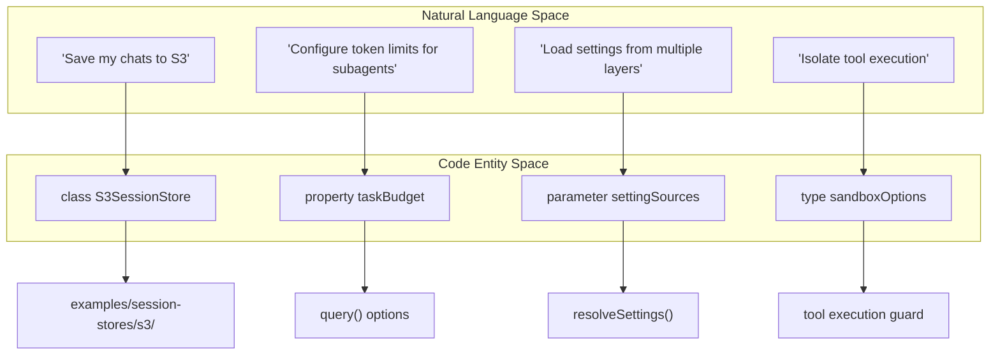
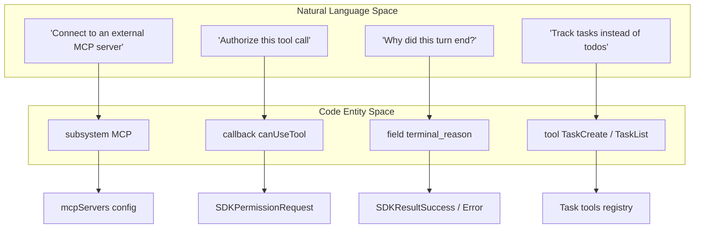
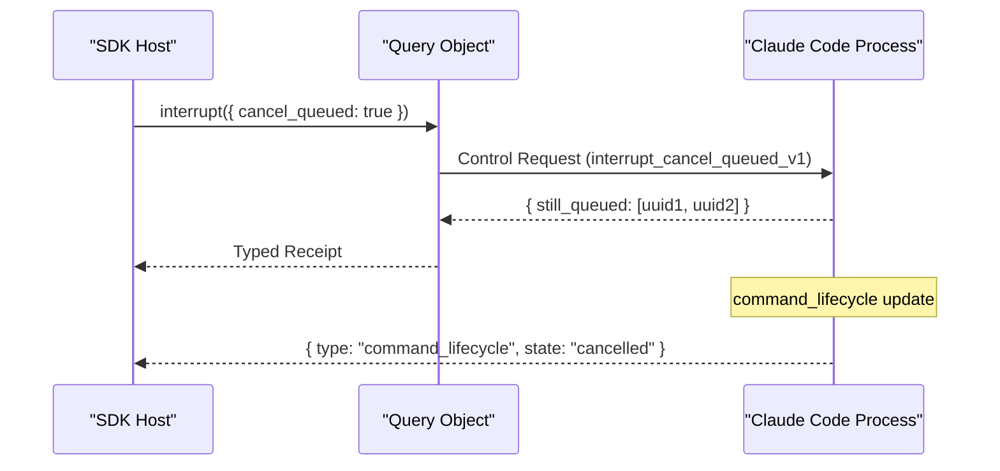

<!-- source: DeepWiki mcp.deepwiki.com · repo anthropics/claude-agent-sdk-typescript · page 10 Glossary · fetched 2026-10-26 -->

# Glossary

<details>
<summary>Relevant source files</summary>

The following files were used as context for generating this wiki page:

- [CHANGELOG.md](CHANGELOG.md)
- [examples/session-stores/README.md](examples/session-stores/README.md)

</details>


This page defines codebase-specific terms, jargon, abbreviations, and domain concepts used throughout the Claude Agent SDK. It serves as a comprehensive technical reference for understanding the underlying implementation, data flow, and architectural terminology of the system.

## Core Entities and Subsystems

### query()
The modern primary entry point for interacting with the SDK, replacing legacy `unstable_v2_*` session APIs [CHANGELOG.md:90-90](). 
* **Implementation**: Invoked as an asynchronous generator `query({ prompt, options })` that yields a stream of `SDKMessage` objects.
* **Key Capabilities**: Manages subprocess communication with the native Claude Code binary, stream buffering, error recovery via `reinitialize()`, and interrupt handling [CHANGELOG.md:108-108]().

### SessionStore
An interface for mirroring session transcripts and state to external persistent storage systems.
* **Implementation**: Defines contracts for loading, appending, and deleting session data (`SessionKey`, `SessionStoreEntry`).
* **Adapters**: Reference implementations are provided for S3, Redis, and PostgreSQL (`S3SessionStore`, `RedisSessionStore`, `PostgresSessionStore`) under `examples/session-stores/` [examples/session-stores/README.md:5-8]().

### Subagent
A specialized, isolated agent instance spawned by the primary agent or user prompt to execute focused workflows.
* **Implementation**: Controlled via internal task-tracking mechanisms, supporting execution limits like depth caps (`CLAUDE_CODE_MAX_SUBAGENT_SPAWN_DEPTH`) and concurrency caps (`CLAUDE_CODE_MAX_CONCURRENT_SUBAGENTS`) [CHANGELOG.md:24-25]().
* **Streaming**: Supports real-time text streaming to consumers via options like `forwardSubagentText` [CHANGELOG.md:48-48]().

Sources: [CHANGELOG.md:24-90](), [examples/session-stores/README.md:5-8]().

---

## Configuration and Tool Jargon

### settingSources
An array or configuration specifier that determines the precedence and source layers for loading user, project, and managed settings (e.g., `'userSettings'`, project-level configuration files).
* **Implementation**: Governs how properties like `effortLevel` and environment variables are resolved at session startup.

### taskBudget
A token-limit and turn-budget awareness control option passed during task execution to prevent runaway subagent loops or excessive resource utilization.

### Task tools
A suite of structured task-management tools (`TaskCreate`, `TaskGet`, `TaskUpdate`, `TaskList`) that replaced the legacy `TodoWrite` tool for tracking objective completion [CHANGELOG.md:87-87]().

### canUseTool
A security and authorization callback hook invoked prior to tool execution.
* **Implementation**: Allows hosts to inspect tool arguments, apply path-scoped rules, or trigger out-of-band approvals using a unique `requestId`. Supports flags like `defaultToNo` and `suppressAlwaysAllowRule` [CHANGELOG.md:83-83]().

### sandbox options
Configuration parameters that isolate tool execution (such as Bash commands or file edits) within restricted process or filesystem environments, ensuring secure multi-tenant or containerized operation.

Sources: [CHANGELOG.md:83-87](), [CHANGELOG.md:92-92]().

---

## Protocol, Persistence, and Execution Concepts

### MCP (Model Context Protocol)
A standardized client-server protocol enabling the agent to interface with external tool providers and data sources.
* **Implementation**: Managed via the `mcpServers` configuration option, supporting non-blocking background connection defaults, per-server timeouts, and elicitation flows (`SDKElicitationCompleteMessage`).

### Remote Control
A control protocol and channel enabling distributed or cross-host session management, telemetry reporting, and worker lifecycle signaling (e.g., `worker_shutting_down`) [CHANGELOG.md:178-178]().

### part-file
The storage format utilized by `S3SessionStore` where transcripts are written as individual JSONL part files named using a timestamp and random suffix pattern:
```
s3://{bucket}/{prefix}{projectKey}/{sessionId}/part-{epochMs13}-{rand6}.jsonl
```
[examples/session-stores/README.md:128-129]()

### conformance suite
A shared behavioral test suite (`shared/conformance.ts`) containing 13 mandatory contracts that validate the correctness of any `SessionStore` storage adapter implementation [examples/session-stores/README.md:13-14]().

### terminal_reason
A field on `SDKResult` messages that describes why a turn or session terminated (e.g., `api_error`, `budget_exhausted`, `tool_deferred_unavailable`) [CHANGELOG.md:98-101]().

Sources: [CHANGELOG.md:98-101](), [examples/session-stores/README.md:13-129]().

---

## Architectural Diagrams

### Natural Language to Code Entity Mapping (Configuration and Persistence)
Maps user intents and system configuration requests to concrete SDK classes, functions, and configuration properties.


Sources: [CHANGELOG.md:90-91](), [examples/session-stores/README.md:123-124]().

### Natural Language to Code Entity Mapping (Execution and Tools)
Relates runtime observations and security requests to code primitives.


Sources: [CHANGELOG.md:83-87](), [CHANGELOG.md:98-101]().

### Session Control and Lifecycle
Illustrates command state tracking, interruption signaling, and queued message management.


Sources: [CHANGELOG.md:9-9](), [CHANGELOG.md:89-89](), [CHANGELOG.md:93-93]().

---

## Key Terms Reference Table

| Term | Reference Symbol | Description |
| :--- | :--- | :--- |
| **query()** | `function query()` | Primary asynchronous generator entry point for executing SDK sessions. |
| **SessionStore** | `interface SessionStore` | Storage abstraction interface for transcript mirroring and resumption. |
| **MCP** | `subsystem MCP` | Model Context Protocol integration for external tools and servers. |
| **subagent** | `class Subagent` | Isolated background or nested agent instance. |
| **taskBudget** | `property taskBudget` | Resource and token usage limits assigned to agent tasks. |
| **settingSources** | `type SettingSource` | Priority layers for resolving configuration (e.g., user, project). |
| **terminal_reason** | `SDKResult.terminal_reason` | Explicit classification of why a execution turn concluded. |
| **Task tools** | `tools: TaskCreate/Get/Update/List` | Structured task-tracking suite replacing legacy todo lists. |
| **part-file** | `S3SessionStore` | JSONL part file storage format used in S3 transcript adapters. |
| **conformance suite** | `file shared/conformance.ts` | 13-contract behavioral suite validating `SessionStore` correctness. |
| **Remote Control** | `subsystem RemoteControl` | Protocol governing multi-host session coordination and telemetry. |
| **canUseTool** | `callback canUseTool` | Security authorization hook evaluated prior to tool execution. |
| **sandbox options** | `type SandboxOptions` | Configuration governing process and filesystem isolation boundaries. |
| **command_lifecycle** | `frame command_lifecycle` | Frame reporting state transitions (`queued`, `started`, `cancelled`). |

Sources: [CHANGELOG.md:5-220](), [examples/session-stores/README.md:13-201]().