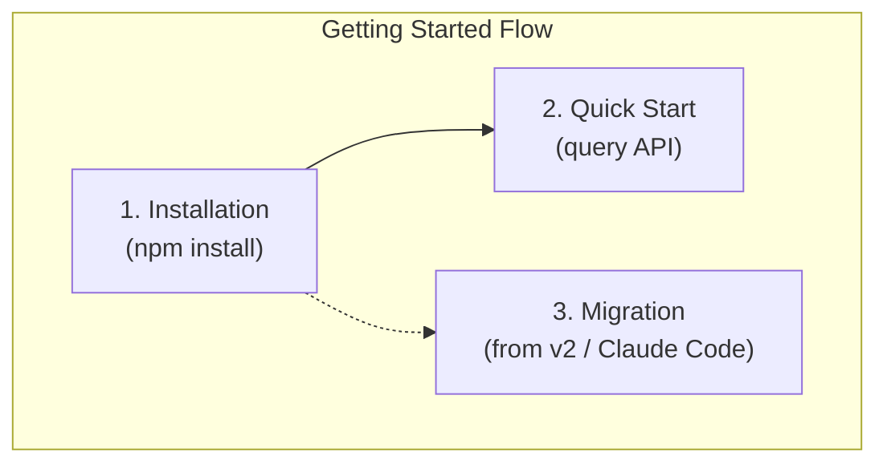

<!-- source: DeepWiki mcp.deepwiki.com · repo anthropics/claude-agent-sdk-typescript · page 2 Getting Started · fetched 2026-10-26 -->

# Getting Started

Relevant source files

The following files were used as context for generating this wiki page:

- [CHANGELOG.md](CHANGELOG.md)
- [LICENSE.md](LICENSE.md)
- [README.md](README.md)

This page serves as the entry point for developers adopting the Claude Agent SDK. It provides a high-level overview of installation requirements, basic usage patterns through the `query()` API, and crucial migration paths from legacy versions. 

For detailed technical references, please consult the child pages:
- **[Installation](#2.1)** — npm package installation, runtime requirements, and environment setup.
- **[Quick Start](#2.2)** — Minimal working examples demonstrating `query()` usage, options, and event streaming.
- **[Migration Guide](#2.3)** — Comprehensive upgrade paths from the deprecated Claude Code SDK, `unstable_v2_*` session APIs, and legacy tool configurations.

Sources: [README.md:1-21]()

## Getting Started Workflow

Sources: [README.md:11-21]()

## Installation Overview

The Claude Agent SDK is distributed via npm as `@anthropic-ai/claude-agent-sdk` [README.md:3](). It requires Node.js 18.0.0 or higher [README.md:3]() and manages a native subprocess under the hood to execute agent capabilities.

For full details on package installation, runtime considerations, and environment verification, see [Installation](#2.1).

Sources: [README.md:3](), [README.md:15-17]()

## Quick Start Overview

Agent execution is centered around the primary `query()` function. Developers supply a prompt and an optional configuration object to initialize a session and stream responses.

For minimal working code examples, event handling, and streaming output patterns, see [Quick Start](#2.2).

Sources: [README.md:7-9](), [CHANGELOG.md:97-98]()

## Migration Guide Overview

The SDK has evolved significantly, superseding the legacy Claude Code SDK [README.md:19-21](), replacing unstable session endpoints with `query()` [CHANGELOG.md:97-98](), and transitioning task management from `TodoWrite` to native `Task` tools [CHANGELOG.md:87-88](). 

For step-by-step instructions on updating your codebase, addressing breaking changes, and adapting configuration flags, see [Migration Guide](#2.3).

Sources: [README.md:19-21](), [CHANGELOG.md:87-88](), [CHANGELOG.md:97-98]()

---

