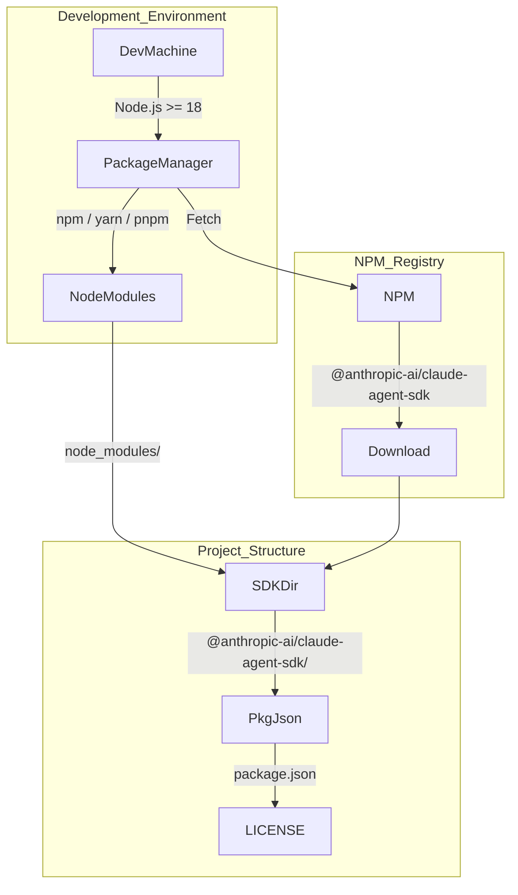
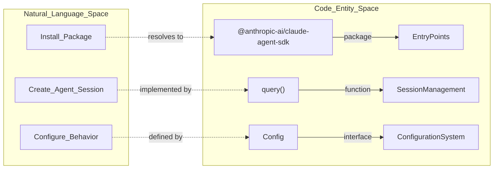

<!-- source: DeepWiki mcp.deepwiki.com · repo anthropics/claude-agent-sdk-typescript · page 2.1 Installation · fetched 2026-10-26 -->

# Installation

<details>
<summary>Relevant source files</summary>

The following files were used as context for generating this wiki page:

- [LICENSE.md](LICENSE.md)
- [README.md](README.md)

</details>


This page covers the installation process for the Claude Agent SDK, including package installation via npm, Node.js version requirements, and environment setup. For usage examples after installation, see **Quick Start (2.2)**. For migrating from the deprecated Claude Code SDK to the Claude Agent SDK, see **Migration Guide (2.3)**.

---

## Prerequisites

The Claude Agent SDK requires Node.js version 18 or higher to run. This version is required to support the modern asynchronous patterns and streaming capabilities used throughout the SDK.

| Requirement | Version | Notes |
|------------|---------|-------|
| Node.js | ≥18 | Required for runtime execution and ESM support |
| npm | Any compatible | Used for package installation |

**Sources:** [README.md:3-3]()

---

## Package Installation

The Claude Agent SDK is distributed as an npm package under the name `@anthropic-ai/claude-agent-sdk`.

```bash
npm install @anthropic-ai/claude-agent-sdk
```

### Installation Flow

The following diagram illustrates the relationship between the developer environment, the npm registry, and the installed SDK structure.



**Sources:** [README.md:13-17](), [LICENSE.md:1]()

---

## Implementation Details

The SDK is designed to provide a programmatic interface to Claude Code's capabilities. When installed, it provides access to core session management and tool execution subsystems.

### Package Entry Points
The package provides access to several critical namespaces and functions used to initialize the agent environment:
- **Session Management**: Primary interface for lifecycle control (e.g., `query()`).
- **Configuration**: Interfaces for `systemPrompt`, `tools`, and `agents`.

### Code Entity Mapping

The following diagram bridges the natural language concept of "Installation & Setup" to the actual code entities provided by the SDK package.



**Sources:** [README.md:1-17]()

---

## Versioning and Migration

The Claude Agent SDK was previously known as the **Claude Code SDK**. Users should ensure they are using the new package name to receive the latest updates and features.

### Migration Overview
If your project currently depends on the legacy Claude Code SDK, you must update your `package.json` and import statements.

| Legacy Package | New Package |
|----------------|-------------|
| `@anthropic-ai/claude-code-sdk` | `@anthropic-ai/claude-agent-sdk` |

**Sources:** [README.md:19-21]()

---

## Verification

To verify that the installation was successful and your environment meets the requirements, you can check the installed version.

```typescript
// Example verification check
import { version } from '@anthropic-ai/claude-agent-sdk/package.json';

console.log(`Claude Agent SDK version ${version} installed.`);
```

### Common Issues

| Symptom | Cause | Resolution |
|---------|-------|------------|
| `Unsupported engine` | Node.js version < 18 | Upgrade Node.js to 18.x or higher. |
| `Module not found` | Package not installed in local `node_modules` | Run `npm install` in your project root. |
| `Type '...' is not assignable` | Version mismatch | Ensure you are using the latest version of the SDK and TypeScript. |

**Sources:** [README.md:3-3](), [README.md:15-17]()

---

## Legal and Licensing

Use of this SDK is governed by Anthropic's Commercial Terms of Service.

*   **Copyright**: © Anthropic PBC. All rights reserved. [LICENSE.md:1-1]()
*   **License**: Anthropic Commercial Terms of Service. [README.md:45-48]()

**Sources:** [LICENSE.md:1](), [README.md:45-48]()

---

## Next Steps

Once installed, proceed to the following sections to begin building:
- **Quick Start (2.2)**: Create your first agent session using the `query()` function.
- **System Architecture (3.1)**: Understand how the Session, Tool, and Task subsystems interact.
- **Configuration System (3.3)**: Learn how to customize the agent's behavior and environment.

---

