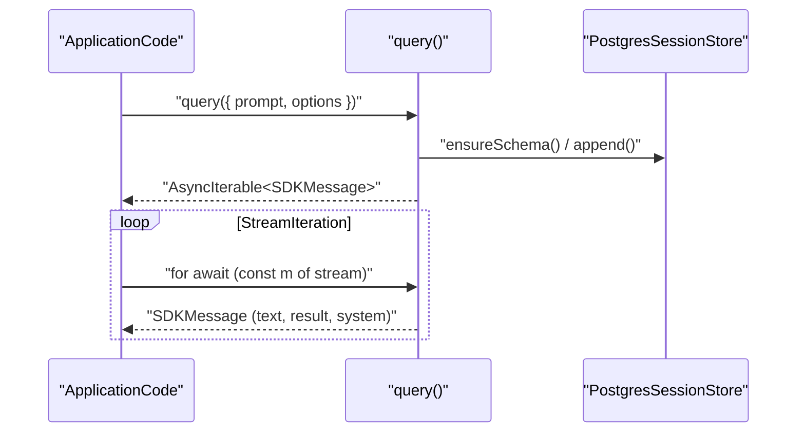
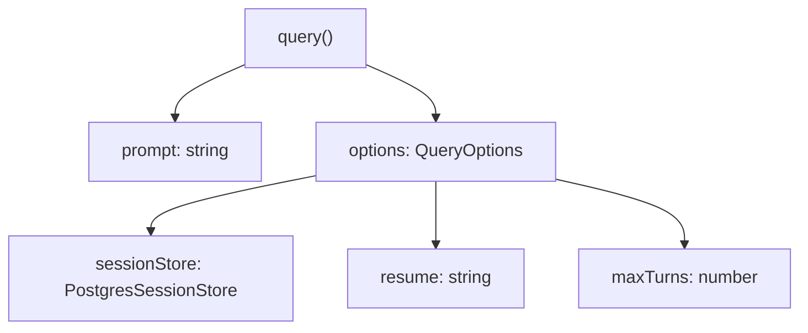

<!-- source: DeepWiki mcp.deepwiki.com · repo anthropics/claude-agent-sdk-typescript · page 2.2 Quick Start · fetched 2026-10-26 -->

# Quick Start

<details>
<summary>Relevant source files</summary>

The following files were used as context for generating this wiki page:

- [LICENSE.md](LICENSE.md)
- [README.md](README.md)
- [examples/session-stores/postgres/demo.ts](examples/session-stores/postgres/demo.ts)

</details>


## Purpose and Scope

This page provides a minimal working example to help you start building with the Claude Agent SDK quickly. It demonstrates the basic pattern of creating a session and conducting a conversation using the `query()` API, which is the primary interface for interacting with the SDK [README.md:7-9]().

Sources: [README.md:7-9]()

## Minimal Working Example

The following example demonstrates how to import the `query()` function and execute a basic prompt. This pattern is commonly used across SDK integrations and demonstrations [examples/session-stores/postgres/demo.ts:13-39]().

```typescript
import { query } from '@anthropic-ai/claude-agent-sdk'

async function run() {
  for await (const message of query({
    prompt: 'Reply with exactly the word: pineapple',
    options: { maxTurns: 1 },
  })) {
    if (message.type === 'result') {
      console.log(message)
    }
  }
}

await run()
```

Sources: [examples/session-stores/postgres/demo.ts:13-39]()

## Data Flow and Execution Architecture

The following sequence diagram illustrates how application code invokes `query()` to initialize communication with the underlying runtime and process message streams.



Sources: [examples/session-stores/postgres/demo.ts:23-39]()

## Configuration and Options

When calling `query()`, you can supply various options to configure session behavior, environment variables, or external storage integrations such as a `PostgresSessionStore` [examples/session-stores/postgres/demo.ts:13-31]().



Sources: [examples/session-stores/postgres/demo.ts:27-31]()

## Multi-Turn Conversations and Session Resumption

To maintain conversational state across multiple turns, capture the session identifier emitted during initialization or pass a `resume` token alongside your `sessionStore` configuration [examples/session-stores/postgres/demo.ts:27-44]().

```typescript
import { query } from '@anthropic-ai/claude-agent-sdk'
import { PostgresSessionStore } from './src/PostgresSessionStore.ts'

// Session persistence and resumption flow
const store = new PostgresSessionStore({ pool })

// First turn captures session ID
let sessionId: string | undefined
for await (const m of query({
  prompt: 'Remember this number: 42',
  options: { sessionStore: store, maxTurns: 1 },
})) {
  if (m.type === 'system' && m.subtype === 'init') {
    sessionId = m.session_id
  }
}

// Subsequent turn resumes the session
for await (const m of query({
  prompt: 'What number did I ask you to remember?',
  options: { sessionStore: store, resume: sessionId, maxTurns: 1 },
})) {
  // Process streamed response
}
```

Sources: [examples/session-stores/postgres/demo.ts:13-45]()

---

