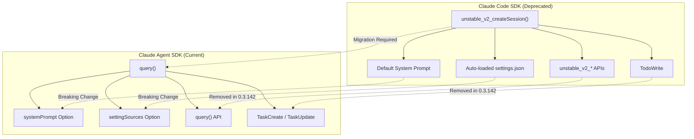
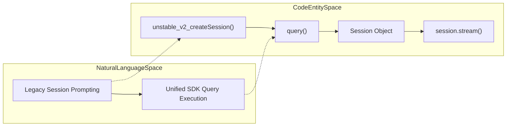
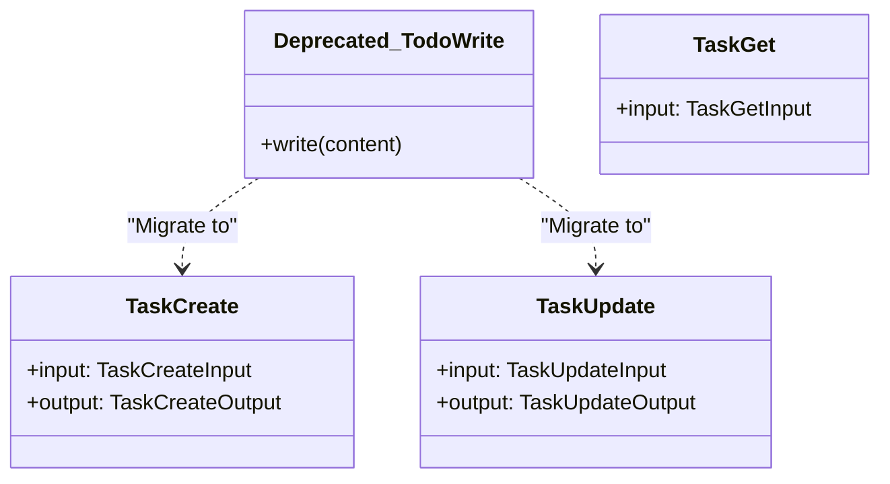

<!-- source: DeepWiki mcp.deepwiki.com · repo anthropics/claude-agent-sdk-typescript · page 2.3 Migration Guide · fetched 2026-10-26 -->

# Migration Guide

<details>
<summary>Relevant source files</summary>

The following files were used as context for generating this wiki page:

- [CHANGELOG.md](CHANGELOG.md)
- [LICENSE.md](LICENSE.md)
- [README.md](README.md)

</details>


This guide documents the breaking changes when migrating from the deprecated Claude Code SDK to the Claude Agent SDK, as well as transitions from deprecated internal APIs and tools. The SDK has been redesigned to provide explicit control over agent behavior, eliminate implicit filesystem dependencies, and improve predictability in production environments.

---

## Overview of Breaking Changes

The migration from Claude Code SDK to Claude Agent SDK introduces major architectural shifts. The SDK has moved from a bundled JavaScript model to spawning a native Claude Code binary via per-platform optional dependencies [README.md:19-22]().

Title: SDK Evolution: Implicit to Code Entities


Sources: [README.md:19-22](), [CHANGELOG.md:88-92]()

---

## Migration 1: Removal of `unstable_v2_*` APIs

As of version **0.3.142**, the `unstable_v2_createSession`, `unstable_v2_resumeSession`, `unstable_v2_prompt`, `SDKSession`, and `SDKSessionOptions` APIs have been **removed** [CHANGELOG.md:88-92](). These were previously deprecated in 0.2.133.

Title: Migration from unstable_v2 to query() Data Flow


**Migration Example:**

```typescript
// REMOVED in 0.3.142
// import { unstable_v2_createSession } from '@anthropic-ai/claude-agent-sdk';

// RECOMMENDED
import { query } from '@anthropic-ai/claude-agent-sdk';

// For multi-turn or simple prompts:
const session = await query({
  prompt: "Hello",
  // Use options.resume to continue a session
});
```

Sources: [CHANGELOG.md:88-92]()

---

## Migration 2: Task Tools Replacing `TodoWrite`

The `TodoWrite` tool was deprecated in 0.2.136 and **removed** in version **0.3.142** for Headless and SDK sessions [CHANGELOG.md:88-92](). It is replaced by the Task toolset: `TaskCreate`, `TaskGet`, `TaskUpdate`, and `TaskList`.

Title: TodoWrite to Task Tools Mapping


**Key Difference:** Tool consumers should now accumulate state by task ID instead of replacing a snapshot list [CHANGELOG.md:88-92](). Types for these tools are exported from `@anthropic-ai/claude-agent-sdk/sdk-tools` [CHANGELOG.md:85-88]().

Sources: [CHANGELOG.md:85-92]()

---

## Migration 3: MCP Connection Behavior

In version **0.3.142**, the default behavior for MCP server connections changed to be **non-blocking** [CHANGELOG.md:88-92]().

*   **New Default:** Sessions start immediately. Slow servers report `status: "pending"` in the `init` event until ready.
*   **Restoring Old Behavior:** Set the environment variable `MCP_CONNECTION_NONBLOCKING=0` to force the SDK to wait up to 5 seconds before the first query.
*   **Per-Server Override:** Mark a specific server with `alwaysLoad: true` in configuration to require it to be connected before Turn 1 begins.
*   **Timeouts:** The MCP tool-call timeout can be configured via the `MCP_TOOL_TIMEOUT` environment variable.

Sources: [CHANGELOG.md:78-80](), [CHANGELOG.md:88-92]()

---

## Migration 4: Environment and Settings Clarifications

### Environment Variable Behavior
Version **0.3.149** clarified that `options.env` **replaces** the subprocess environment rather than merging with the host's `process.env`. 

**Correct Migration Pattern:**
```typescript
const sdk = await query({
  prompt: "...",
  // Explicitly merge if host environment variables are needed
  env: { ...process.env, CUSTOM_VAR: "value" }
});
```

### Search Tool Defaults (Native Builds)
As of **0.3.162**, sessions on native builds default to fast embedded `find`/`grep` search within the `Bash` tool, matching the Claude Code CLI.
*   **Impact:** Dedicated `Grep` and `Glob` tools are no longer registered by default.
*   **Migration:** If you rely on intercepting these via `canUseTool` or hooks, you must explicitly name them in the `tools` option or `allowedTools`.

Sources: [README.md:1-25]()

---

## Summary of Version Milestones

| Version | Key Migration Impact |
|---------|----------------------|
| **0.2.113** | SDK spawns native binary. `options.env` replaces `process.env`. |
| **0.2.133** | Deprecated `unstable_v2_*` APIs in favor of `query()`. Deprecated `'Skill'` in `allowedTools`. |
| **0.3.142** | **Major Breaking**: Removed `unstable_v2_*` APIs. Removed `TodoWrite` in favor of Task tools. MCP connections now non-blocking by default [CHANGELOG.md:88-92](). |
| **0.3.149** | Clarified `options.env` replaces subprocess environment. |
| **0.3.162** | Native builds default to embedded search; `Grep`/`Glob` tools not registered by default. |

Sources: [CHANGELOG.md:88-92](), [README.md:1-25]()

---

