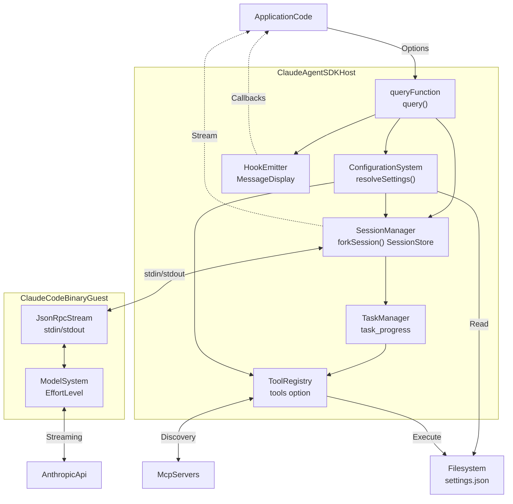
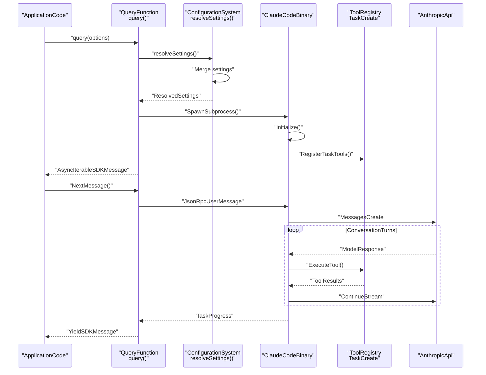
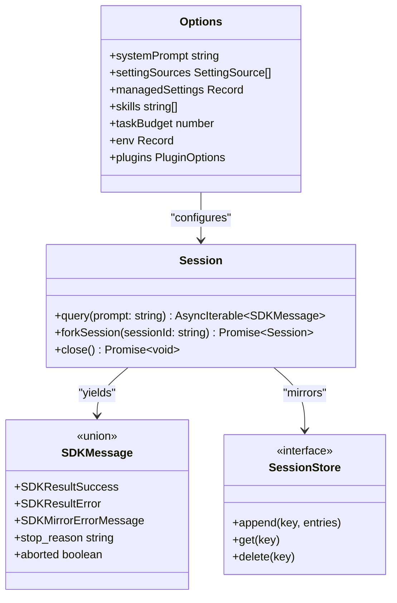

<!-- source: DeepWiki mcp.deepwiki.com · repo anthropics/claude-agent-sdk-typescript · page 3 Core Concepts · fetched 2026-10-26 -->

# Core Concepts

Relevant source files

The following files were used as context for generating this wiki page:

- [CHANGELOG.md](CHANGELOG.md)

This page provides a high-level introduction to the fundamental architectural concepts and subsystems of the Claude Agent SDK. It explains how major components interact and their roles in building autonomous AI agents.

For detailed information about specific subsystems:
- **System Architecture**: High-level architecture and subsystem interactions, including the Host-Guest subprocess model. See [System Architecture](#3.1).
- **Session Management**: Lifecycle, resumption, forking, and streaming. See [Session Management](#3.2).
- **Configuration System**: Hierarchical settings, `settingSources`, and resolved values. See [Configuration System](#3.3).
- **Agent Configuration**: Inline agent definitions, skills, and progress summaries. See [Agent Configuration](#3.4).
- **Tool System**: Tool registry, built-in tools, and MCP integration. See [Tool System](#3.5).
- **Hook System and Events**: Lifecycle hooks, event emitters, and exit reasons. See [Hook System and Events](#3.6).

Sources: [CHANGELOG.md:1-1611]()

---

## The SDK as a Coordination Layer

The Claude Agent SDK functions as a coordination layer that orchestrates interactions between application code and multiple external systems using unified interfaces:

- **Anthropic API**: Streaming conversations with Claude models (`query()`). [CHANGELOG.md:90-94]()
- **MCP Servers**: Dynamic tool discovery and execution via the Model Context Protocol. [CHANGELOG.md:33-38]()
- **Filesystem**: Configuration loading from multiple sources and file-based tool operations. [CHANGELOG.md:58-60]()
- **Native Binary**: Execution of a per-platform native Claude Code binary for core logic via a Host-Guest subprocess model. [CHANGELOG.md:82-88]()

Sources: [CHANGELOG.md:33-38](), [CHANGELOG.md:58-60](), [CHANGELOG.md:82-88](), [CHANGELOG.md:90-94]()

---

## Six Major Subsystems

The SDK architecture is organized into six semi-independent subsystems that share a common lifecycle:

| Subsystem | Core Responsibility | Key Types/Functions |
|-----------|-------------------|---------------------|
| **Session Management** | Conversation lifecycle and streaming | `query()`, `forkSession()`, `listSessions()`, `SessionStore` [CHANGELOG.md:24-28](), [CHANGELOG.md:58-60]() |
| **Tool System** | Tool registry and execution | `tools`, `disallowedTools`, `mcpServerStatus`, `TaskCreate` [CHANGELOG.md:33-33](), [CHANGELOG.md:87-87]() |
| **Configuration** | Hierarchical settings and prompts | `settingSources`, `systemPrompt`, `resolveSettings()`, `managedSettings` [CHANGELOG.md:105-106](), [CHANGELOG.md:119-119]() |
| **Hook System** | Event-driven lifecycle interception | `MessageDisplay`, `PermissionRequest`, `SessionStart`, `UserPromptSubmit` [CHANGELOG.md:46-47](), [CHANGELOG.md:208-208]() |
| **Task & Agent** | Multi-agent coordination | `task_started`, `task_progress`, `agentProgressSummaries`, `taskBudget` [CHANGELOG.md:39-39](), [CHANGELOG.md:72-72]() |
| **Model System** | AI capability discovery | `supportsEffort`, `supportedEffortLevels`, `supportsFastMode`, `EffortLevel` [CHANGELOG.md:12-12]() |

Sources: [CHANGELOG.md:12-12](), [CHANGELOG.md:24-28](), [CHANGELOG.md:33-33](), [CHANGELOG.md:39-39](), [CHANGELOG.md:46-47](), [CHANGELOG.md:58-60](), [CHANGELOG.md:72-72](), [CHANGELOG.md:87-87](), [CHANGELOG.md:105-106](), [CHANGELOG.md:119-119](), [CHANGELOG.md:208-208]()

---

## Subsystem Relationships

The following diagram bridges natural language subsystem descriptions to code entities like `query()`, `resolveSettings()`, and JSON-RPC streams.

Subsystem Interaction Diagram

Sources: [CHANGELOG.md:33-38](), [CHANGELOG.md:58-60](), [CHANGELOG.md:82-88](), [CHANGELOG.md:90-94]()

---

## SDK Initialization and Data Flow

This sequence diagram details the initialization sequence using the `query()` API and data flow across internal code entities.

Initialization and Runtime Flow

Sources: [CHANGELOG.md:39-39](), [CHANGELOG.md:82-88](), [CHANGELOG.md:90-94](), [CHANGELOG.md:119-119]()

---

## Session Management

The Session Management subsystem handles multi-turn conversations via `query()`, guest subprocess lifecycles, and `SessionStore` transcript mirroring. For details, see [Session Management](#3.2).

Sources: [CHANGELOG.md:24-28](), [CHANGELOG.md:90-94](), [CHANGELOG.md:126-127]()

---

## Tool System

The Tool System manages tool registration, execution, and MCP discovery. For details, see [Tool System](#3.5).

Sources: [CHANGELOG.md:33-38](), [CHANGELOG.md:87-87](), [CHANGELOG.md:162-162]()

---

## Configuration System

The Configuration System hierarchical model resolves settings via `resolveSettings()`. For details, see [Configuration System](#3.3).

Sources: [CHANGELOG.md:105-106](), [CHANGELOG.md:119-119]()

---

## Agent Configuration

Agent configuration covers inline agent definitions, skills options, and max turns. For details, see [Agent Configuration](#3.4).

Sources: [CHANGELOG.md:57-57]()

---

## Hook System and Events

The Hook System enables intercepting lifecycle events using event emitters. For details, see [Hook System and Events](#3.6).

Sources: [CHANGELOG.md:46-47](), [CHANGELOG.md:208-208]()

---

## Task System and Subagents

The Task System enables hierarchical coordination, depth/concurrency caps, and subagent history tracking. For details, see [Task System and Subagents](#4.1).

Sources: [CHANGELOG.md:72-72](), [CHANGELOG.md:141-141](), [CHANGELOG.md:217-217]()

---

## Key SDK Types and Interfaces

Type Mapping Diagram

Sources: [CHANGELOG.md:90-94](), [CHANGELOG.md:126-127](), [CHANGELOG.md:172-172](), [CHANGELOG.md:214-214]()

---

