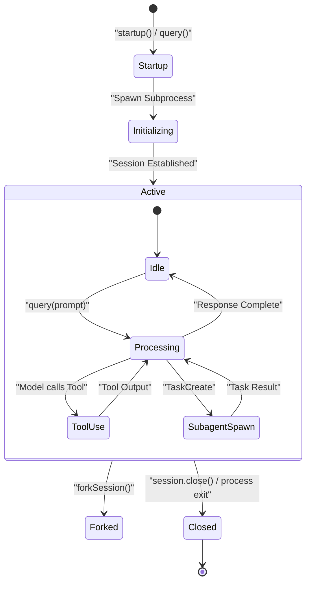
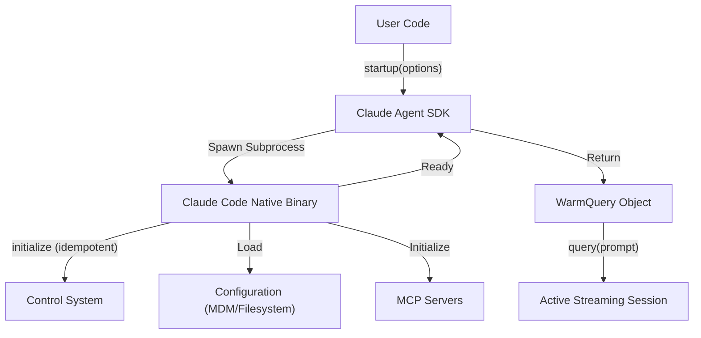

<!-- source: DeepWiki mcp.deepwiki.com · repo anthropics/claude-agent-sdk-typescript · page 3.2 Session Management · fetched 2026-10-26 -->

# Session Management

Relevant source files

The following files were used as context for generating this wiki page:

- [CHANGELOG.md](CHANGELOG.md)

## Purpose and Scope

The Session Management subsystem handles the lifecycle of agentic conversations within the SDK. This includes session initialization, persistence, resumption, forking, transcript retrieval, subagent history tracking, and performance pre-warming. The SDK utilizes a Host-Guest subprocess model where a native binary manages the agent's state, tool execution, and conversation history.

This page covers:
*   The `query()` API and its associated `Query` control methods (`interrupt()`, `cancel_queued`, `reinitialize()`, `reloadPlugins()`).
*   Session lifecycle operations: Creation, resumption, forking, and metadata management.
*   Subagent visibility, history retrieval (`getSessionMessages()`), and concurrency controls.
*   Performance optimizations via `startup()` and the `WarmQuery` API.
*   Remote Control protocols, signals, and message metadata (`command_lifecycle` frames, sidecars, and `resume_reason`).

Sources: [CHANGELOG.md:3-91]()

---

## Session Lifecycle and `query()`

The `query()` function serves as the primary execution entry point for agentic interactions. It manages the underlying session lifecycle automatically while returning a `Query` handle for real-time control.

### The `Query` Control Interface
The `Query` object exposes several methods for session manipulation and runtime signaling:
*   **`interrupt(options?)`**: Aborts the current turn. It returns a typed receipt containing `still_queued` UUIDs for asynchronous messages [CHANGELOG.md:93-94](). Passing the `cancel_queued: true` flag allows aborting pending-dispatch messages alongside the active turn [CHANGELOG.md:9-9]().
*   **`reinitialize()`**: Re-synchronizes the SDK state with the underlying native subprocess following transport gaps or network interruptions [CHANGELOG.md:126-126]().
*   **`reloadPlugins({ holdOnCacheImpact: true })`**: Triggers a plugin reload while optionally holding reloads that would invalidate the session's prompt cache [CHANGELOG.md:80-80]().

### Lifecycle State Machine

Sources: [CHANGELOG.md:9-9](), [CHANGELOG.md:80-80](), [CHANGELOG.md:93-94](), [CHANGELOG.md:126-126]()

---

## Session Operations: Resumption, Forking, and Metadata

Sessions can be persisted, resumed, and branched into child forks while retaining cumulative accounting metrics.

### Resumption and Forking Mechanics
*   **Resumption**: Passing an existing `sessionId` to `options.resume` in `query()` resumes conversation history. Resumed or forked sessions correctly maintain cumulative metrics such as `total_cost_usd` and `modelUsage` from earlier turns rather than resetting to zero [CHANGELOG.md:13-13]().
*   **Forking (`forkSession`)**: Creates a new session branched from a specific point in transcript history. `forkSession({ upToMessageId })` validates client-supplied UUIDs and ensures assistant messages and queued background notifications are preserved correctly without duplication [CHANGELOG.md:24-26]().

### Metadata and Transcript Management
Core methods available for session introspection and metadata operations include:
*   `listSessions()`: Enumerates stored sessions (robustly resolved across mapped network drives and SUBST volumes on Windows) [CHANGELOG.md:58-60]().
*   `getSessionMessages(sessionId)`: Retrieves transcript history, ensuring user messages sent during background tool execution are placed at the exact turn index where Claude read them [CHANGELOG.md:27-28]().
*   `getSessionInfo(id)`: Fetches metadata for a given session.
*   `tagSession(id, tag)` / `renameSession(id, title)` / `deleteSession(id)`: State and labeling utilities.

Sources: [CHANGELOG.md:13-13](), [CHANGELOG.md:24-28](), [CHANGELOG.md:58-60]()

---

## Subagent and Task Visibility

The SDK supports hierarchical agent coordination via the Task tool suite (`TaskCreate`, `TaskUpdate`, `TaskGet`, `TaskList`).

### History Retrieval and Concurrency
*   **Subagent Transcripts**: `listSubagents(sessionId)` and `getSubagentMessages(sessionId, subagentId)` provide isolation and inspection of nested agent runs.
*   **Parent-Child Linkage**: Messages carry `parent_agent_id` fields to maintain deep execution trees [CHANGELOG.md:105-105]().
*   **Concurrency Caps**: Subagent nesting depth defaults to a cap of 1 (`CLAUDE_CODE_MAX_SUBAGENT_SPAWN_DEPTH`), and concurrent subagents are capped at 20 (`CLAUDE_CODE_MAX_CONCURRENT_SUBAGENTS`) [CHANGELOG.md:24-25]().

Sources: [CHANGELOG.md:24-25](), [CHANGELOG.md:105-105]()

---

## Performance and Pre-warming (`startup()` / `WarmQuery`)

The `startup()` function initializes the background native process without immediately evaluating a prompt, returning a `WarmQuery` handle.

*   **Idempotency**: The `initialize` control handshake executed during startup is fully idempotent [CHANGELOG.md:10-11]().
*   **Startup Timing**: Setting `CLAUDE_CODE_EMIT_STARTUP_TIMING=1` causes the first `system/init` frame to emit per-phase timing breakdowns [CHANGELOG.md:35-35](). Known startup failures are caught and written to error streams via `startup_failure_reason` [CHANGELOG.md:32-32]().

Sources: [CHANGELOG.md:10-11](), [CHANGELOG.md:32-32](), [CHANGELOG.md:35-35]()

---

## Message Metadata, Sidecars, and `command_lifecycle`

Messages and execution frames incorporate detailed tracking metadata:
*   **`command_lifecycle` Frames**: Report terminal states for UUID-stamped messages (`queued`, `started`, `completed`, `cancelled`, or `discarded`) [CHANGELOG.md:88-89]().
*   **`resume_reason` and `user_message_uuid`**: Stamped on assistant messages, stream events, and results during automatic re-runs triggered by host restarts or interruptions [CHANGELOG.md:69-69](), [CHANGELOG.md:81-81]().
*   **`result_index`**: Indicates the result's position in delivery order within a run, starting from `0` [CHANGELOG.md:78-78]().
*   **Sidecars**: `tool_result_meta` captures execution sidecars such as non-execution kinds (e.g., denied, cancelled) without relying on prose parsing [CHANGELOG.md:31-31]().

Sources: [CHANGELOG.md:31-31](), [CHANGELOG.md:69-69](), [CHANGELOG.md:78-78](), [CHANGELOG.md:81-81](), [CHANGELOG.md:88-89]()

---

