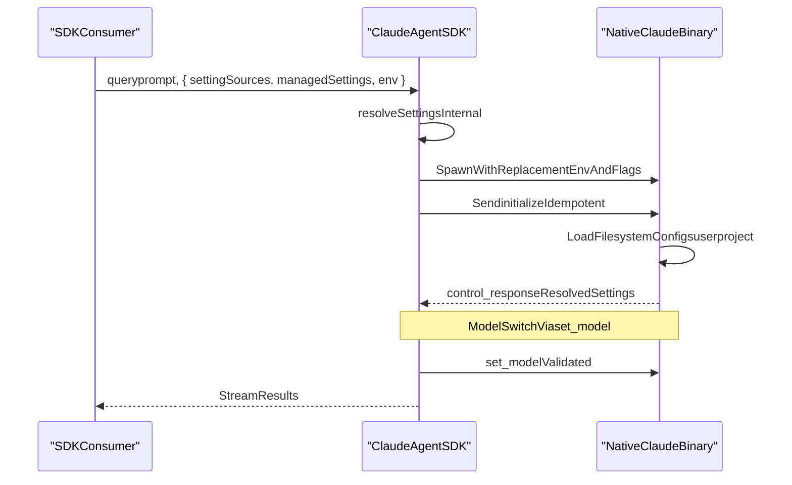

<!-- source: DeepWiki mcp.deepwiki.com · repo anthropics/claude-agent-sdk-typescript · page 3.3 Configuration System · fetched 2026-10-26 -->

# Configuration System

<details>
<summary>Relevant source files</summary>

The following files were used as context for generating this wiki page:

- [CHANGELOG.md](CHANGELOG.md)

</details>


## Purpose and Scope

The Configuration System manages SDK initialization parameters, agent capabilities, and runtime behavior. It employs a hierarchical model that merges programmatic options, filesystem-based settings, and enterprise policy-tier configurations. This page documents the `Options` interface, the `settingSources` control model, and specialized functions like `resolveSettings()` and `applyFlagSettings()` for inspecting and overriding effective configurations.

Related pages: [3.5 Tool System]() for tool configuration, [3.2 Session Management]() for session APIs, [3.4 Agent Configuration]() for subagent definitions.

Sources: [CHANGELOG.md:11-12](), [CHANGELOG.md:103-106](), [CHANGELOG.md:138-139](), [CHANGELOG.md:470-473]()

## Hierarchical Configuration Model

The SDK resolves settings by merging multiple layers of configuration. Later layers in the resolution order override earlier ones.

| Layer | Source | Description |
|-------|--------|-------------|
| 1. Managed | `managedSettings` | Policy-tier settings for embedders, honored below IT-controlled managed sources [CHANGELOG.md:103-106](). |
| 2. Filesystem | `settingSources` | User, project, and local configuration files (e.g., `settings.json`, `CLAUDE.md`) [CHANGELOG.md:472-473](). |
| 3. Programmatic | `Options` | Explicit fields passed to `query()` or session creation functions [CHANGELOG.md:470-471](). |
| 4. Flags | `applyFlagSettings()` | Programmatic CLI flag overrides for specific runtime adjustments, including live agent switching [CHANGELOG.md:11-12](), [CHANGELOG.md:138-139](). |

Sources: [CHANGELOG.md:11-12](), [CHANGELOG.md:103-106](), [CHANGELOG.md:138-139](), [CHANGELOG.md:470-473]()

## Configuration Architecture

The following diagram illustrates how the `Options` object and filesystem sources are processed by the SDK to configure internal components.

```mermaid
graph TB
    subgraph "OptionsSpaceCodeEntities"
    Opts["OptionsquerySession"]
    Managed["managedSettings Recordstring, any"]
    Sources["settingSources 'user'project'local'[]"]
    Flags["applyFlagSettingsflags Recordstring, any"]
    Env["Options.env Recordstring, string"]
    Workflow["workflowSizeGuideline number"]
    end

    subgraph "FilesystemSpace"
    UserCfg "~/.claude/settings.json"
    ProjCfg ".claude/settings.json"
    LocalCfg "./settings.json"
    MDM "MDM plist/HKLM/HKCU"
    end

    subgraph "ProcessingLogic"
    resolveSettings "resolveSettings Alpha"
    ConfigMerger "ConfigurationMerger"
    end

    subgraph "RuntimeComponents"
    Subprocess "ClaudeCodeNativeBinary"
    SystemPrompt "SystemPromptBuilder"
    ToolRegistry "ToolRegistry"
    ModelCtrl "set_modelControlRequest"
    end

    Opts --> Managed
    Opts --> Sources
    Opts --> Env
    Opts --> Workflow
    Managed --> ConfigMerger
    Sources -->|"'user'"| UserCfg
    Sources -->|"'project'"| ProjCfg
    Sources -->|"'local'"| LocalCfg
    
    UserCfg --> ConfigMerger
    ProjCfg --> ConfigMerger
    LocalCfg --> ConfigMerger
    MDM --> resolveSettings
    
    ConfigMerger --> Subprocess
    Flags --> Subprocess
    Env -->|"(Replaces Environment)"| Subprocess
    SystemPrompt --> Subprocess
    ToolRegistry --> Subprocess
    ModelCtrl --> Subprocess
```

Sources: [CHANGELOG.md:11-12](), [CHANGELOG.md:14-14](), [CHANGELOG.md:61-62](), [CHANGELOG.md:103-106](), [CHANGELOG.md:119-121](), [CHANGELOG.md:472-473]()

## Core Configuration Options

### systemPrompt
The `systemPrompt` field provides the primary instructions for the agent. Unlike legacy versions, the SDK does not include a default prompt; it must be explicitly provided or loaded via `settingSources` [CHANGELOG.md:470-471]().

Sources: [CHANGELOG.md:470-471]()

### settingSources
Controls which filesystem configuration locations to load.
- `'user'`: Loads from `~/.claude/settings.json`.
- `'project'`: Loads from `.claude/settings.json`, `.mcp.json`, and `CLAUDE.md`.
- `'local'`: Loads from `./settings.json` in the current working directory.

Sources: [CHANGELOG.md:472-473](), [CHANGELOG.md:474-477]()

### managedSettings
Allows embedders to pass policy-tier settings to the spawned CLI in-memory. These are honored below IT-controlled managed sources (like MDM) but can be used to enforce organizational defaults without writing to the user's filesystem [CHANGELOG.md:103-106]().

Sources: [CHANGELOG.md:103-106]()

### Environment (`options.env`)
The `env` option allows consumers to provide a custom environment for the spawned subprocess.
- **Behavior:** This value **replaces** the subprocess environment entirely; it does not merge with `process.env` [CHANGELOG.md:61-62]().
- **Telemetry:** The SDK automatically ensures `CLAUDE_AGENT_SDK_VERSION` is preserved for User-Agent and telemetry purposes [CHANGELOG.md:61-62]().

Sources: [CHANGELOG.md:61-62]()

## Inspection and Overrides

### resolveSettings() (Alpha)
The `resolveSettings()` function allows developers to inspect the effective merged settings without spawning the Claude CLI subprocess. It reads from MDM sources (plist on macOS, HKLM/HKCU on Windows) for parity with the CLI startup sequence [CHANGELOG.md:119-121]().

Sources: [CHANGELOG.md:119-121]()

### applyFlagSettings()
This function provides a way to programmatically apply CLI flag overrides. 
- **Live Switching:** Since version 0.3.161, `applyFlagSettings` can live-apply `agent` changes. Switching the active agent (or passing `null` to reset) takes effect on the next turn in a running session [CHANGELOG.md:11-12]().
- **Clearing Overrides:** It supports passing `null` to top-level keys to clear existing flag-settings overrides [CHANGELOG.md:138-139]().
- **Effort Levels:** Supports setting `effortLevel` to `'max'` (added in 0.3.214) [CHANGELOG.md:42-42]().

Sources: [CHANGELOG.md:11-12](), [CHANGELOG.md:42-42](), [CHANGELOG.md:138-139]()

## Data Flow for Settings Loading

The SDK spawns a native Claude Code binary and communicates configuration via environment variables and JSON-RPC control requests.



Sources: [CHANGELOG.md:10-11](), [CHANGELOG.md:61-62](), [CHANGELOG.md:103-106](), [CHANGELOG.md:119-121](), [CHANGELOG.md:100-100]()

## Key Configuration Fields

| Option | Type | Description |
|--------|------|-------------|
| `skills` | `string[] \| 'all'` | Controls which Skills (complex tool-use sequences) are loaded. Pass `'all'` to load all available [CHANGELOG.md:133-134](). |
| `env` | `Record<string, string>` | Replaces the subprocess environment (does not merge) [CHANGELOG.md:61-62](). |
| `taskBudget` | `number` | Sets a token-limit awareness for the model to pace tool usage [CHANGELOG.md:5-6](). |
| `forwardSubagentText` | `boolean` | If true, streams subagent text deltas to the SDK consumer [CHANGELOG.md:97-98](). |
| `agentProgressSummaries` | `boolean` | Enables periodic AI-generated progress summaries during long tasks. |
| `workflowSizeGuideline` | `number` | Sets the advisory dynamic-workflow size guideline (0.3.219) [CHANGELOG.md:14-14](). |
| `sandbox.network.strictAllowlist` | `boolean` | Deterministically denies non-allowlisted hosts in sandboxed commands (0.3.219) [CHANGELOG.md:13-13](). |

Sources: [CHANGELOG.md:5-6](), [CHANGELOG.md:13-14](), [CHANGELOG.md:61-62](), [CHANGELOG.md:97-98](), [CHANGELOG.md:133-134]()

---

