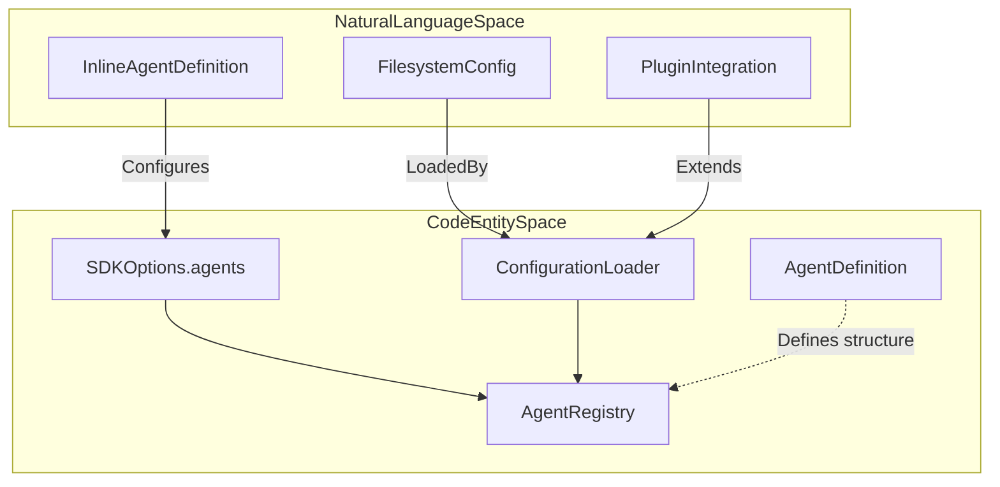
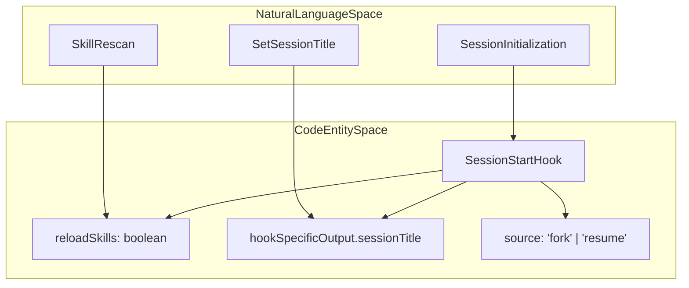

<!-- source: DeepWiki mcp.deepwiki.com · repo anthropics/claude-agent-sdk-typescript · page 3.4 Agent Configuration · fetched 2026-10-26 -->

# Agent Configuration

Relevant source files

The following files were used as context for generating this wiki page:

- [CHANGELOG.md](CHANGELOG.md)

## Purpose and Scope

This document details how agents, subagents, and specialized AI teammates are configured, structured, and initialized within the Claude Agent SDK. Agents provide isolated operational contexts with dedicated system prompts, custom capability loading, and turn limits.

Agent configuration encompasses:
- Programmatic agent definitions via the `agents` option containing `AgentDefinition` structures.
- Capability control via the `skills` option (`string[] | 'all'`).
- Turn-based execution boundaries (`maxTurns`).
- Periodic status reporting via `agentProgressSummaries`.
- Dynamic lifecycle hooks (`SessionStart` handling `reloadSkills` and `sessionTitle`).
- External plugin integration with MCP server isolation (`skipMcpDiscovery`).
- Subagent nesting depth and concurrency boundaries.

For broader configuration options, see [Configuration System](3.3). For subagent runtime behavior, see [Task System and Subagents](4.1).

---

## Agent Definition Architecture

The SDK supports defining agents through programmatic inline options or via filesystem-based discovery (`CLAUDE.md` and `settings.json` files).

### Diagram: Agent Definition to Code Entities

**Sources:** [CHANGELOG.md:131-133](), [CHANGELOG.md:405-407](), [CHANGELOG.md:473-474]()

---

## Programmatic Agent Definitions

Agents are configured via the `agents` option during initialization, mapping unique agent names to specialized behaviors.

### Agent Properties

| Property | Type | Description |
|----------|------|-------------|
| `name` | `string` | Unique identifier for the agent registry lookup. |
| `description` | `string` | Narrative overview utilized by the parent agent for task routing. |
| `systemPrompt` | `string` | Custom behavioral instructions overriding or extending the base prompt. |
| `skills` | `string[] \| 'all'` | Allowed capability set available to the agent context. |
| `maxTurns` | `number` | Hard stop limit on conversation turns before forced termination. |
| `omitClaudeMd` | `boolean` | When true, runs without user, project, and local `CLAUDE.md` files [CHANGELOG.md:57](). |

**Sources:** [CHANGELOG.md:57](), [CHANGELOG.md:93-95](), [CHANGELOG.md:473-474]()

---

## Plugins and MCP Discovery Isolation

When loading extensions via the `plugins` configuration option, individual plugins can restrict automated tool discovery.

- **`skipMcpDiscovery`**: Setting this flag on a plugin configuration prevents the SDK from scanning for Model Context Protocol (MCP) servers within that plugin's boundaries, optimizing startup performance and enforcing security boundaries [CHANGELOG.md:172-173]().

**Sources:** [CHANGELOG.md:172-173]()

---

## Dynamic Reconfiguration and Hooks

The SDK permits runtime modification of agent configurations and session metadata through specialized hook handlers.

### Diagram: Hook Lifecycle to Code Entities

**Sources:** [CHANGELOG.md:152-153](), [CHANGELOG.md:214-215]()

---

## Execution Constraints and Environment Limits

Subagent spawning is governed by strict structural and concurrency constraints to prevent resource exhaustion.

- **Subagent Depth Cap**: Configured via `CLAUDE_CODE_MAX_SUBAGENT_SPAWN_DEPTH` (default: `1`) [CHANGELOG.md:22-24]().
- **Concurrency Cap**: Governed by `CLAUDE_CODE_MAX_CONCURRENT_SUBAGENTS` (default: `20`) [CHANGELOG.md:25-26]().
- **Progress Summaries**: Enabled via `agentProgressSummaries`, emitting periodic status updates through `task_progress` events [CHANGELOG.md:258-259]().

**Sources:** [CHANGELOG.md:22-26](), [CHANGELOG.md:258-259]()

---

