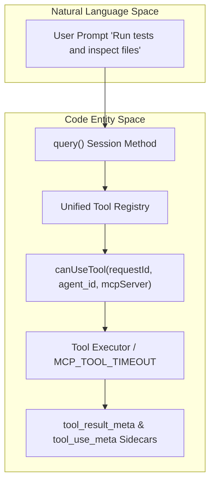
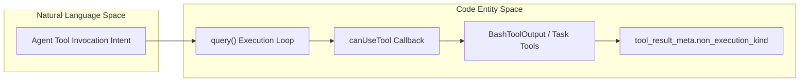

<!-- source: DeepWiki mcp.deepwiki.com · repo anthropics/claude-agent-sdk-typescript · page 3.5 Tool System · fetched 2026-10-26 -->

# Tool System

Relevant source files

The following files were used as context for generating this wiki page:

- [CHANGELOG.md](CHANGELOG.md)

The Tool System is the primary mechanism for extending agent capabilities beyond text generation. It manages tools from multiple sources (built-in, custom, and MCP servers), enforces access controls through permission callbacks and hooks, and provides runtime introspection and control over tool availability.

For details on built-in tools and `askUserQuestion` configuration, see [Built-in Tools](#3.5.1). For MCP server management and elicitation hooks, see [MCP Server Integration](#3.5.2).

## Overview

The tool system provides a unified registry that aggregates tools from multiple sources, applies visibility filters based on configuration, and gates execution through permission callbacks. All tools—whether built-in, custom, or MCP-provided—flow through the same execution pipeline and are subject to timeout, deferred tool execution handling, and error management mechanisms [CHANGELOG.md:23-23](), [CHANGELOG.md:38-40]().

Starting in version 0.3.162, native builds default to fast embedded `find` and `grep` search functionality within the `Bash` tool, matching the interactive CLI behavior, rather than always registering dedicated `Grep`/`Glob` tools [CHANGELOG.md:144-145](). Furthermore, task-tracking tools (`TaskCreate`, `TaskGet`, `TaskUpdate`, `TaskList`, and `TodoWrite`) are default tools only on specific model versions such as Claude 3.x, Opus 4.0–4.7, Sonnet 4.0–4.6, and Haiku 4.5; elsewhere they are explicitly listed in `tools` or `allowedTools` [CHANGELOG.md:87-88]().

### Tool System Subsystem Architecture

Sources: [CHANGELOG.md:23-23](), [CHANGELOG.md:33-33](), [CHANGELOG.md:117-119]()

## Tool Configuration Options

The tool system provides several mechanisms for controlling tool availability and behavior.

### `tools` and `disallowedTools`

The `tools` option defines the base set of available built-in tools (e.g., `['Bash', 'Read']`), while `disallowedTools` acts as a global blocklist. `disallowedTools` supports server-level specs (e.g., `mcp__server__*`) to remove all tools from a named MCP server [CHANGELOG.md:118-119]().

| Option | Description |
|--------|-------------|
| `tools` | Allowlist of built-in tools or presets. |
| `allowedTools` | Explicitly name tools (like `Grep` or `Glob`) to keep them registered on native builds [CHANGELOG.md:144-145](). |
| `disallowedTools` | Blocklist that removes tools from visibility, supporting wildcard server specs [CHANGELOG.md:118-119](). |
| `skills` | Controls which Skills (custom tool definitions) are loaded into the session [CHANGELOG.md:214-215](). |
| `taskBudget` | Allows the model to pace tool use within a token limit. |

Sources: [CHANGELOG.md:118-119](), [CHANGELOG.md:144-145](), [CHANGELOG.md:214-215]()

## Tool Execution Pipeline

### Permission Enforcement and `canUseTool`

The `canUseTool` callback is the primary mechanism for out-of-band permission responses. 
*   **`requestId`**: `canUseTool` receives a `requestId` to correlate out-of-band responses [CHANGELOG.md:82-84]().
*   **`agent_id`**: Includes an `agent_id` field for background agent permission forwarding [CHANGELOG.md:103-105]().
*   **`mcpServer`**: Includes `{name, source}` metadata in options, enabling hosts to key trust when `source === "sdk"` [CHANGELOG.md:33-33]().
*   **Permission Denials**: Path-scoped deny rules are properly tracked and reported in `result.permission_denials`, covering operations like `Read`, `Edit`, and `Write` [CHANGELOG.md:70-70]().

### Tool Execution and Sidecars

Deferred tool call results are correctly emitted with `tool_use_result` keys upon session resumption [CHANGELOG.md:23-23](). The SDK uses sidecar metadata to enhance tool observability:
*   **`tool_use_meta`**: Provides display-friendly tool names [CHANGELOG.md:117-117]().
*   **`tool_result_meta`**: Includes `non_execution_kind` and `user_feedback`, allowing consumers to classify denied, interrupted, or cancelled tool calls without string-matching result prose [CHANGELOG.md:30-32]().

### Tool Execution and Permission Flow

Sources: [CHANGELOG.md:30-32](), [CHANGELOG.md:70-70](), [CHANGELOG.md:87-88]()

---

- For details on built-in tools and `askUserQuestion` configuration, see [Built-in Tools](#3.5.1).
- For details on MCP server lifecycle, status, reconnection, and elicitation, see [MCP Server Integration](#3.5.2).

---

