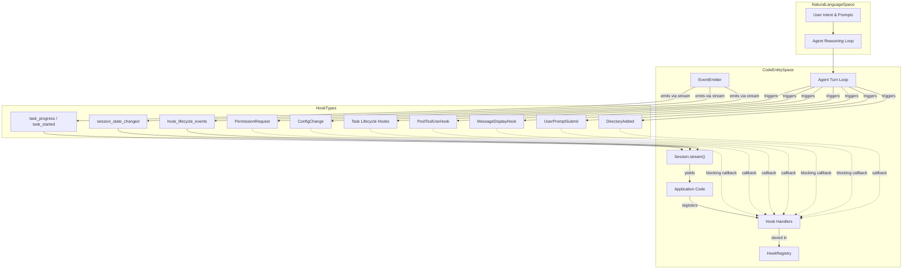
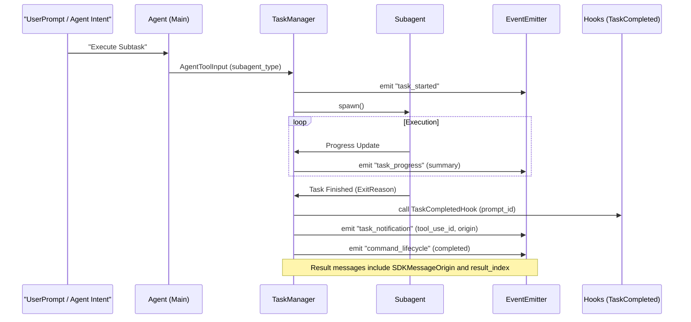

<!-- source: DeepWiki mcp.deepwiki.com · repo anthropics/claude-agent-sdk-typescript · page 3.6 Hook System and Events · fetched 2026-10-26 -->

# Hook System and Events

Relevant source files

The following files were used as context for generating this wiki page:

- [CHANGELOG.md](CHANGELOG.md)

This page documents the SDK's hook system and event emission architecture. The hook system provides extension points for observing configuration changes, task lifecycle events, permission requests, message display transformations, and tool execution results. Events are emitted through `Session.stream()` to notify applications of task state changes, including progress updates and session state transitions.

## Overview

The SDK implements an event-driven architecture with two primary mechanisms:

1.  **Hook System**: Callback functions that intercept lifecycle events. Some hooks are **blocking** (e.g., `PermissionRequest`, `UserPromptSubmit`) and can pause execution for approval or processing.
2.  **Event Emission**: System messages and state change notifications emitted through `Session.stream()`.

### Hook Categories

| Hook Type | Blocking | Purpose |
| :--- | :--- | :--- |
| `SessionStart` | Yes | Runs at session initialization; can trigger skill re-scans and set titles. |
| `ConfigChange` | No | Monitor configuration file changes for security auditing. |
| `TeammateIdle` | No | Observe when subagent tasks become idle. |
| `TaskCompleted` | No | Receive notification when subagent tasks complete. |
| `PermissionRequest` | Yes | Control tool execution through approval/denial. |
| `PostToolUse` | No | Inspect or replace tool outputs globally via `updatedToolOutput`. |
| `MessageDisplay` | Yes | Transform or hide assistant message text before display. |
| `UserPromptSubmit`| Yes | Intercept user prompts before they are sent to the model. |
| `DirectoryAdded` | No | Fired when a new working directory is registered mid-session. |

### Event Types

| Event Type | Format | Purpose |
| :--- | :--- | :--- |
| `task_started` | System message | Notify when a subagent task is registered. |
| `task_progress` | System message | Real-time progress with `summary`, usage, and tool counts. |
| `task_notification` | System message | Correlate task completions with originating tool calls. |
| `session_state_changed` | Opt-in Event | Notify when session metadata (tags, title) changes. |
| `hook_started` | Lifecycle Event | Opt-in notification that a hook has begun. |
| `hook_progress` | Lifecycle Event | Opt-in notification of hook execution progress. |
| `hook_response` | Lifecycle Event | Opt-in notification of the final hook result. |
| `command_lifecycle` | Lifecycle Event | Reports message terminal states (`queued`, `started`, `completed`, `cancelled`, `discarded`). |

Sources: [CHANGELOG.md:8-14](), [CHANGELOG.md:46-47](), [CHANGELOG.md:73-76](), [CHANGELOG.md:88-89]()

## Hook System Architecture

The following diagram illustrates how the SDK bridges the "Natural Language Space" (user intents and agent reasoning) to the "Code Entity Space" (specific hook handlers, `HookRegistry`, and `Session.stream()`).

**Diagram: Hook and Event System Architecture**

Sources: [CHANGELOG.md:8-14](), [CHANGELOG.md:73-76](), [CHANGELOG.md:88-89]()

## Hook Types and Features

### SessionStart and Stop Hook Timeouts
The `SessionStart` hook executes when a session begins. 
*   **`reloadSkills: true`**: Triggers a re-scan of available skills.
*   **`hookSpecificOutput.sessionTitle`**: Programmatically sets the session title.
*   **Timeouts**: If a `Stop`, `SubagentStop`, or `SessionStart` hook callback exceeds its timeout, it counts as no decision rather than discarding other hooks' decisions or failing the session [CHANGELOG.md:46-47]().

### PermissionRequest and Tool Hooks
The `PermissionRequest` hook implements a blocking approval gate for tool invocations. Tool hook inputs now carry `mcp_server` metadata (`{name, source}`), allowing hosts to key trust verification accordingly [CHANGELOG.md:33-33]().

### Post-Tool Use Hook and Output Replacement
The `PostToolUse` hook allows developers to intercept the output of any tool before it is returned to the model.
*   **`PostToolUseHookSpecificOutput.updatedToolOutput`**: This field allows the hook to replace the tool output for all tools.
*   **Abort Signal Handling**: Hook callbacks correctly propagate abort signals during `PostToolUse`.

### MessageDisplay Hook
The `MessageDisplay` hook allows consumers to transform or hide assistant message text as it is being processed for display.

### UserPromptSubmit Hook
This hook intercepts user prompts before execution. If a callback exceeds its timeout, it blocks the prompt with a feedback message emitted to the SDK event stream while allowing the session to continue.

### DirectoryAdded Hook
Fired when a new working directory is registered mid-session, enabling dynamic context and project switching.

### Telemetry and Correlation
Hook input payloads include a `prompt_id` field to facilitate OpenTelemetry correlation across the agent lifecycle.

Sources: [CHANGELOG.md:33-33](), [CHANGELOG.md:46-47](), [CHANGELOG.md:73-76]()

## Event System

The SDK emits real-time updates through the `Session.stream()` generator.

### Task Progress and Notifications
*   **`task_progress`**: Emitted for real-time background agent progress. Includes retry states when agents wait out API rate-limit retries.
*   **`task_notification`**: Correlates background task completion with the originating tool call via `tool_use_id`.
*   **`origin`**: Result messages include an `origin` field to distinguish user-prompted results from task-notification followups.

### Session and System Events
*   **`session_state_changed`**: Opt-in events notified when session metadata (such as titles or tags) changes.
*   **`command_lifecycle`**: Reports message states: `queued`, `started`, `completed`, `cancelled`, or `discarded`.
*   **`result_index`**: Stamped on result messages to denote their exact delivery order position within the run starting from `0` [CHANGELOG.md:78-78]().

Sources: [CHANGELOG.md:78-78](), [CHANGELOG.md:88-89]()

## Data Flow: Task Execution to Event Emission

The following diagram traces the lifecycle of a subagent task and how events are propagated through the SDK's internal code entities (`TaskManager`, `EventEmitter`, and `Session.stream()`).

**Diagram: Task Lifecycle and Event Flow**

Sources: [CHANGELOG.md:44-45](), [CHANGELOG.md:78-78](), [CHANGELOG.md:88-89]()

## Summary of Hook and Event Metadata

| Field | Location | Description |
| :--- | :--- | :--- |
| `updatedToolOutput` | `PostToolUse` Hook | Replaces the result of a tool execution. |
| `origin` | `SDKResultSuccess/Error` | The `SDKMessageOrigin` of the message that triggered this result. |
| `result_index` | Result Message | Position of the result in delivery order within the run, from `0` [CHANGELOG.md:78-78](). |
| `reloadSkills` | `SessionStart` Hook | Triggers a re-scan of skills when true. |
| `prompt_id` | Hook Payloads | Used for OpenTelemetry correlation. |
| `ExitReason` | `TaskCompleted` | Reason for termination (e.g., `success`, `error`, `resume`). |
| `mcp_server` | Tool Hook Inputs | Carries `{name, source}` for MCP trust verification [CHANGELOG.md:33-33](). |

Sources: [CHANGELOG.md:33-33](), [CHANGELOG.md:78-78]()

---

