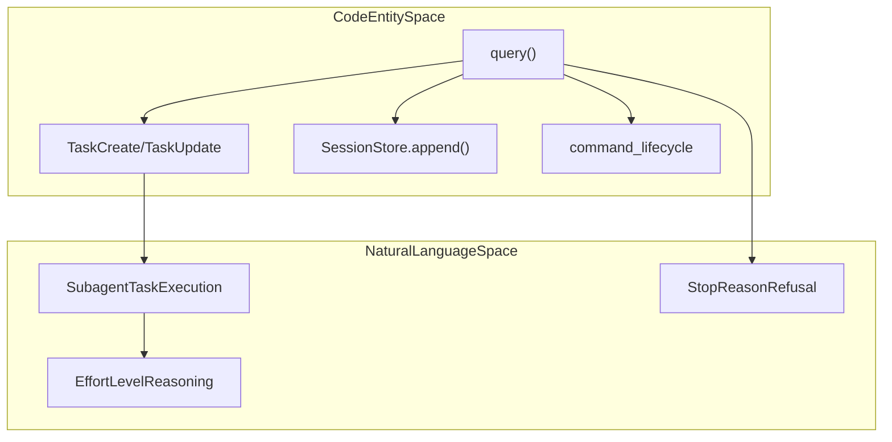
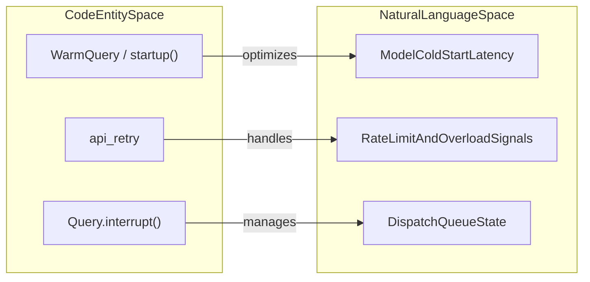

<!-- source: DeepWiki mcp.deepwiki.com · repo anthropics/claude-agent-sdk-typescript · page 4 Advanced Features · fetched 2026-10-26 -->

# Advanced Features

Relevant source files

The following files were used as context for generating this wiki page:

- [CHANGELOG.md](CHANGELOG.md)

## Purpose and Scope

The Claude Agent SDK provides advanced capabilities for building complex, autonomous agentic workflows. This page serves as a high-level entry point for sophisticated features that go beyond basic session management and tool usage.

The following specialized topics are covered in detail on their respective child pages:

*   **[Task System and Subagents](#4.1)**: Hierarchical agent coordination, task lifecycle events, background execution, `taskBudget`, depth/concurrency caps, `parent_agent_id`, and `command_lifecycle` frames.
*   **[Session Persistence with SessionStore](#4.2)**: `SessionStore` interface for mirroring transcripts to external storage (S3, Redis, PostgreSQL), types, `InMemorySessionStore`, `importSessionToStore()`, `mirror_error`, and retry behavior.
*   **[Structured Outputs](#4.3)**: JSON schema validation, empty message handling, validation error reporting, and `structured_output_retry_exhausted`.
*   **[Model Capabilities and Beta Features](#4.4)**: Model capability discovery, `EffortLevel`, fast mode, refusal `stop_reason`, rate limit info, model fallback, and extended context betas.
*   **[Performance and Debugging](#4.5)**: Startup pre-warming, memory behavior, debug options, budget control, `api_retry` messages, sandbox options, and Remote Control diagnostics.

Sources: [CHANGELOG.md:1-91]()

---

## Task System and Subagents

The SDK supports a sophisticated task management system that allows a primary agent to delegate work to specialized subagents. This system includes lifecycle events such as `task_started` and `task_progress`, enabling hierarchical coordination and real-time reporting.

Key features include origin tracking via `SDKMessageOrigin`, subagent depth and concurrency caps [CHANGELOG.md:24-25](), `command_lifecycle` frames tracking message states [CHANGELOG.md:88-89](), and background task execution.

For details, see **[Task System and Subagents](#4.1)**.

Sources: [CHANGELOG.md:24-25](), [CHANGELOG.md:88-89](), [CHANGELOG.md:162-163]()

---

## Session Persistence with SessionStore

To support high-availability deployments where session state must survive beyond local disk storage, the SDK provides the `SessionStore` interface. This allows mirroring session transcripts to external backends such as S3, Redis, or PostgreSQL.

The SDK implements automatic retry behavior on persistence failures and emits an `SDKMirrorErrorMessage` (`mirror_error`) if retries are exhausted. Existing local sessions can be migrated using `importSessionToStore()`.

For details, see **[Session Persistence with SessionStore](#4.2)**.

Sources: [CHANGELOG.md:89-90]()

---

## Structured Outputs

The SDK supports structured output generation, enforcing JSON schema validation on model responses. When structured outputs are configured, the system handles empty message responses, provides detailed validation error reporting, and manages fallback behavior when schema validation limits or `structured_output_retry_exhausted` states are reached.

For details, see **[Structured Outputs](#4.3)**.

Sources: [CHANGELOG.md:1-91]()

---

## Model Capabilities and Beta Features

Developers can programmatically discover and utilize advanced model features, including adaptive thinking and reasoning effort levels. The `EffortLevel` type defines the intensity of the model's reasoning process (such as `'low'`, `'medium'`, `'high'`, or `'max'`) [CHANGELOG.md:42-42](). 

Additional capabilities include fast mode execution, refusal detection via `stop_reason: 'refusal'` [CHANGELOG.md:139-140](), rate limit inspection, model fallback handling, and extended context window betas.

For details, see **[Model Capabilities and Beta Features](#4.4)**.

Sources: [CHANGELOG.md:42-42](), [CHANGELOG.md:139-140]()

---

## Performance and Debugging

For long-running or high-throughput production environments, the SDK provides comprehensive tools for performance optimization and debugging:
*   **Startup Optimization**: Pre-warming sessions using `startup()` and `WarmQuery` to reduce cold-start latency.
*   **Resource Management**: Budget enforcement via `maxBudgetUsd` and resident set size (RSS) memory safeguards.
*   **Resilience**: `api_retry` messaging distinguishing between server overload (529) and rate limit (429) errors [CHANGELOG.md:19-19]().
*   **Diagnostics**: Remote Control telemetry and strict sandbox network controls [CHANGELOG.md:13-13]().

For details, see **[Performance and Debugging](#4.5)**.

Sources: [CHANGELOG.md:13-13](), [CHANGELOG.md:19-19]()

---

## System Integration and Architecture

### Task and Model Coordination Architecture

**Caption:** Mapping SDK code entities (`query()`, `SessionStore`) to natural language execution spaces (subagent delegation, reasoning effort, and refusal handling).

Sources: [CHANGELOG.md:24-25](), [CHANGELOG.md:42-42](), [CHANGELOG.md:88-89](), [CHANGELOG.md:139-140]()

### Performance and Reliability Subsystems

**Caption:** Associating performance code entities (`WarmQuery`, `api_retry`, `Query.interrupt()`) with runtime natural language processing constraints and queue states.

Sources: [CHANGELOG.md:9-9](), [CHANGELOG.md:19-19](), [CHANGELOG.md:81-82](), [CHANGELOG.md:93-93]()

---

