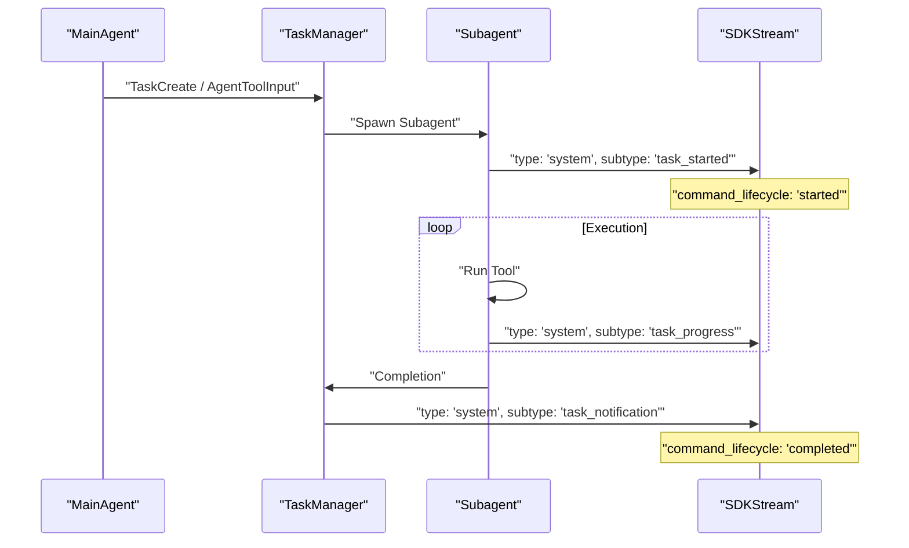
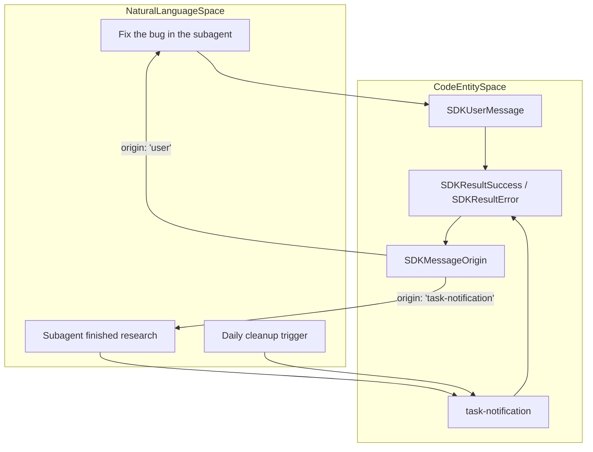
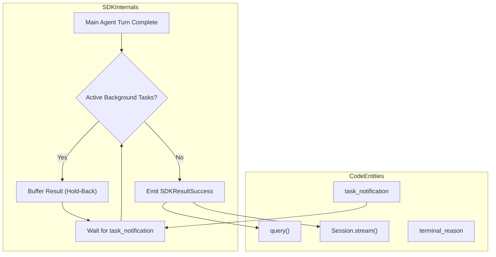

<!-- source: DeepWiki mcp.deepwiki.com · repo anthropics/claude-agent-sdk-typescript · page 4.1 Task System and Subagents · fetched 2026-10-26 -->

# Task System and Subagents

<details>
<summary>Relevant source files</summary>

The following files were used as context for generating this wiki page:

- [CHANGELOG.md](CHANGELOG.md)

</details>


## Purpose and Scope

This document explains the task system and hierarchical agent coordination capabilities in the Claude Agent SDK. It covers how the main agent spawns subagents to execute work asynchronously, task lifecycle events, background execution models, resource management through concurrency limits and `taskBudget`, parent-agent tracking via `parent_agent_id`, and `command_lifecycle` frames. It also details how to distinguish between user-prompted results and background task follow-ups using `SDKMessageOrigin`.

**Sources**: [CHANGELOG.md:37-37](), [CHANGELOG.md:45-45](), [CHANGELOG.md:72-72]()

---

## Overview

The task system implements **hierarchical agent coordination** where a main agent delegates work to subagents that execute asynchronously. Subagents can spawn their own subagents, creating agent trees of configurable depth.

Key capabilities:
- **Asynchronous Execution**: Subagents run in the background while the main agent continues or waits for results [CHANGELOG.md:37-37]().
- **Task Lifecycle Events**: `task_started`, `task_progress`, and `task_notification` events track execution states [CHANGELOG.md:72-72]().
- **Depth & Concurrency Caps**: Configurable limits on how deep subagent trees can go and how many run concurrently.
- **Progress Summaries**: AI-generated periodic summaries via `agentProgressSummaries`.
- **Result Hold-Back**: `Session.stream()` buffers responses until background tasks reach completion states.
- **Token Budgeting**: `taskBudget` allows the model to pace tool use within defined token limits.
- **Message Origin Tracking**: `SDKMessageOrigin` allows distinguishing between user-initiated turns and background task notifications [CHANGELOG.md:37-37]().

**Sources**: [CHANGELOG.md:37-37](), [CHANGELOG.md:45-45](), [CHANGELOG.md:72-72]()

---

## Task Lifecycle and Events

The SDK provides real-time visibility into subagent execution through system events and `command_lifecycle` frames.

### Task Event Flow



### Event Definitions

1. **`task_started`**: Emitted when a subagent is registered and begins execution, carrying `tool_use_id` and metadata [CHANGELOG.md:72-72]().
2. **`task_progress`**: Emitted periodically to report progress and optional summaries.
3. **`task_notification`**: Emitted when a task finishes or encounters a worker restart (e.g., `reason: "worker_restart"`) [CHANGELOG.md:45-45]().
4. **`command_lifecycle`**: Frames reporting the terminal state of a message UUID: `queued`, `started`, `completed`, `cancelled`, or `discarded`.
5. **`background_tasks_changed`**: A system message used to track aggregate background activity levels.

**Sources**: [CHANGELOG.md:37-37](), [CHANGELOG.md:45-45](), [CHANGELOG.md:72-72]()

---

## Subagent Constraints and Configuration

The SDK enforces limits to prevent infinite agent spawning and resource exhaustion.

| Setting | Default | Description |
|---------|---------|-------------|
| `CLAUDE_CODE_MAX_SUBAGENT_SPAWN_DEPTH` | 1 | Maximum depth of the agent tree. |
| `CLAUDE_CODE_MAX_CONCURRENT_SUBAGENTS` | 20 | Maximum number of subagents running across the session. |

When spawning subagents, the `parent_agent_id` field tracks relationships in the hierarchy.

**Sources**: [CHANGELOG.md:45-45](), [CHANGELOG.md:72-72]()

---

## Message Origin and Result Correlation

The `SDKResultSuccess` and `SDKResultError` messages include an `origin` field of type `SDKMessageOrigin` to distinguish the trigger for the result.

### Natural Language to Code Entity Mapping



**Sources**: [CHANGELOG.md:37-37](), [CHANGELOG.md:45-45]()

---

## Result Hold-Back Mechanism

The SDK ensures that applications do not receive a final response while background tasks are still active and might require immediate follow-up.

### Hold-Back Flow



**Sources**: [CHANGELOG.md:37-37](), [CHANGELOG.md:45-45]()

---

## Subagent Tools (Task API)

The SDK provides specialized Task tools for subagent management, exported from `@anthropic-ai/claude-agent-sdk/sdk-tools`. These replaced legacy todo mechanisms [CHANGELOG.md:87-87]().

| Tool | Purpose |
|------|---------|
| `TaskCreate` | Spawns a new subagent task [CHANGELOG.md:87-87](). |
| `TaskGet` | Retrieves status and output [CHANGELOG.md:87-87](). |
| `TaskUpdate` | Modifies instructions or state [CHANGELOG.md:87-87](). |
| `TaskList` | Lists tasks in the current session [CHANGELOG.md:87-87](). |

**Sources**: [CHANGELOG.md:72-72](), [CHANGELOG.md:87-87]()

---

## Task Budgeting and Token Awareness

The `taskBudget` configuration option provides token budget awareness, allowing models to pace tool usage. If a subagent exhausts its budget, it returns a `terminal_reason: 'budget_exhausted'`.

```typescript
// Example configuration with budget and progress summaries
const session = await query({
  prompt: "Perform extensive research",
  taskBudget: 50000, 
  agentProgressSummaries: true
});
```

**Sources**: [CHANGELOG.md:45-45](), [CHANGELOG.md:72-72]()

---

