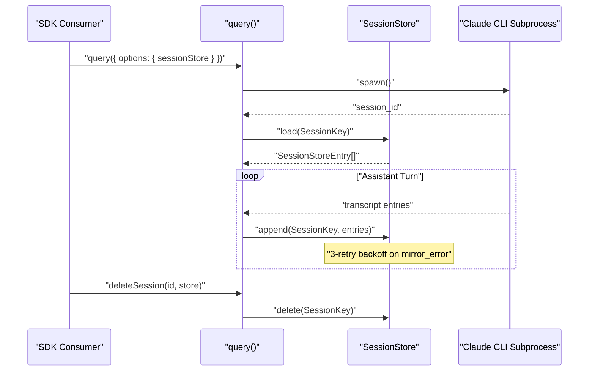
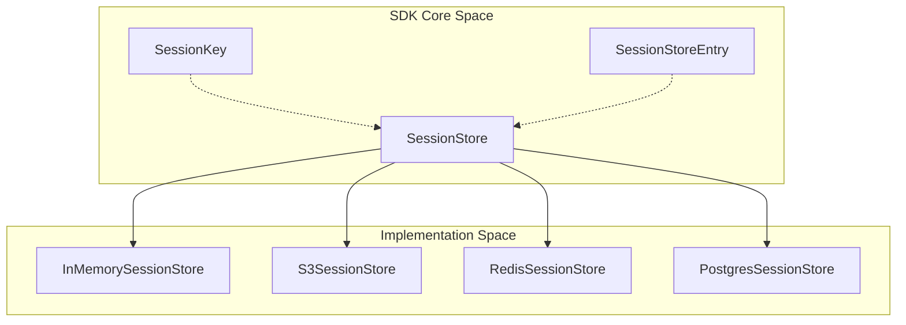

<!-- source: DeepWiki mcp.deepwiki.com · repo anthropics/claude-agent-sdk-typescript · page 4.2 Session Persistence with SessionStore · fetched 2026-10-26 -->

# Session Persistence with SessionStore

Relevant source files

The following files were used as context for generating this wiki page:

- [CHANGELOG.md](CHANGELOG.md)
- [examples/session-stores/README.md](examples/session-stores/README.md)

The Claude Agent SDK provides a robust mechanism for mirroring session transcripts to external storage via the `SessionStore` interface. This allows developers to persist conversation history, tool outputs, and session metadata in centralized databases or object stores, enabling session resumption across different compute instances or long-term archival. As a parent page, this section introduces the core interfaces and types, while detailed backend configurations and conformance testing are covered in dedicated child pages.

---

### Architectural Overview

The `SessionStore` acts as a write-ahead mirror. When a session is active, the SDK asynchronously appends new transcript entries to the store. If a session is resumed using a `sessionId` that exists in the store, the SDK loads the historical transcript to reconstruct the agent's state.

**Session Mirroring Sequence**

Sources: [examples/session-stores/README.md:81-85]()

---

### Core Interfaces and Types

The persistence system is built around three primary types defined in the SDK:

| Type | Description |
| :--- | :--- |
| `SessionKey` | A composite identifier consisting of a `projectKey` (usually a hash of the CWD) and a `sessionId`. |
| `SessionStoreEntry` | A single unit of the transcript, containing the message content and an optional `subpath` for subagent history. |
| `SessionStore` | The interface that backends must implement, requiring `append`, `load`, `list`, and optionally `delete`. |

#### Error Handling and Retries
To ensure reliability against transient network issues, the SDK implements a **3-retry backoff behavior** for `append()` operations. If all retries fail, the SDK emits an error message containing a `mirror_error` subtype to the message stream so the consumer can monitor for gaps in the mirror. `append()` failures are logged but never block the conversation.

Sources: [examples/session-stores/README.md:81-85]()

---

### Reference Implementations

The SDK repository includes reference adapters for common backends. These are provided as source code in the `examples/` directory to avoid bloating the core SDK with heavy optional dependencies.

**Session Store Entity Map**

Sources: [examples/session-stores/README.md:1-21]()

#### InMemorySessionStore
A built-in reference implementation that stores transcripts in a local JavaScript `Map`. This is useful for testing or short-lived processes but does not provide persistence across process restarts.

#### S3 Session Store
Stores transcripts as JSONL "part files" in Amazon S3 or MinIO. For details on configuration, path formatting, IAM considerations, and live tests, see [S3 Session Store](#4.2.1).

#### Redis Session Store
Backed by `ioredis`, this adapter uses Redis Lists for transcript entries and Sets/ZSets for session indexing. For details on key schemes, atomicity, and cluster compatibility, see [Redis Session Store](#4.2.2).

#### PostgreSQL Session Store
Uses the `pg` client to store entries in a `jsonb` column with idempotent table creation. For schema details and live tests, see [PostgreSQL Session Store](#4.2.3).

Sources: [examples/session-stores/README.md:1-21](), [examples/session-stores/README.md:93-120]()

---

### Utility Functions

*   `importSessionToStore()`: Used to migrate existing local sessions (stored on disk in the Claude config directory) into an external `SessionStore`. This is essential when moving from a local CLI-based workflow to a cloud-hosted SDK deployment.
*   `deleteSession()`: Removes a session's data. If a `SessionStore` is provided, it calls the store's `delete` method; otherwise, it removes the session from the local filesystem.

Sources: [CHANGELOG.md:131-132]()

---

### Validation and Conformance

When implementing a custom `SessionStore`, developers should use the **SessionStore Conformance Suite**. This is a shared test harness that runs behavioral contracts to ensure correct handling of isolation, ordering, subagent retrieval, and pagination.

For details, see [SessionStore Conformance Suite](#4.2.4).

Sources: [examples/session-stores/README.md:34-36](), [examples/session-stores/README.md:57-69]()

---

