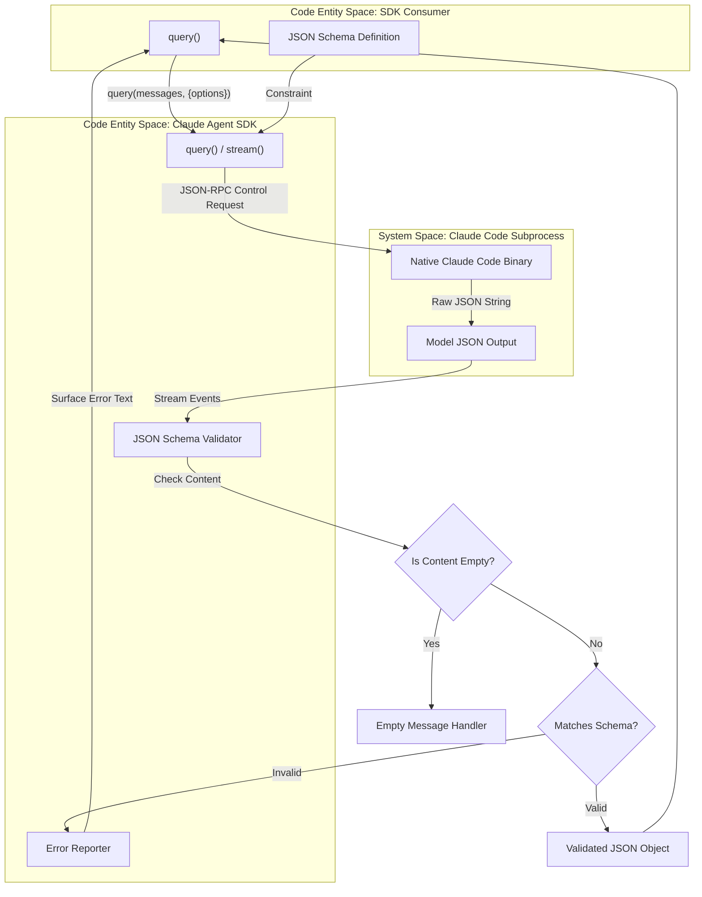
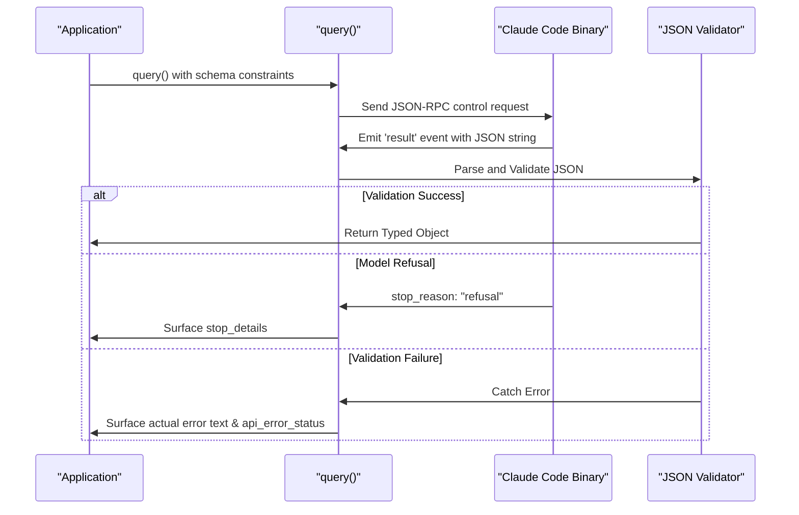

<!-- source: DeepWiki mcp.deepwiki.com · repo anthropics/claude-agent-sdk-typescript · page 4.3 Structured Outputs · fetched 2026-10-26 -->

# Structured Outputs

Relevant source files

The following files were used as context for generating this wiki page:

- [CHANGELOG.md](CHANGELOG.md)

## Purpose and Scope

This page documents the structured outputs feature of the Claude Agent SDK, which enables agents to return validated JSON responses that conform to a specified schema. This capability ensures type-safe, predictable outputs from agent interactions, with automatic validation and error reporting. It specifically covers the handling of schema validation, empty message handling, validation error reporting, and terminal states such as `structured_output_retry_exhausted`.

For information about general session management and streaming responses, see [3.2 Session Management](). For details on tool system integration, see [3.5 Tool System]().

Sources: [CHANGELOG.md:1-91]()

---

## Overview

Structured outputs allow SDK consumers to define a JSON schema for agent responses and receive validated, type-safe data structures. The SDK handles schema validation, empty message edge cases, and provides detailed error reporting when validation fails.

**Key Capabilities:**
- **JSON Schema Validation**: Validation of agent responses against a provided schema.
- **Empty Message Handling**: Automatic handling of empty assistant messages to prevent validation crashes.
- **Validation Error Reporting**: Detailed reporting surfacing actual error text and API status codes.
- **Terminal State Tracking**: Specific `terminal_reason` values like `structured_output_retry_exhausted` identify when the agent fails to produce valid JSON after repeated attempts. [CHANGELOG.md:1-91]()
- **Refusal Detection**: Refusals are explicitly flagged with `stop_reason: "refusal"` and `stop_details`, allowing consumers to distinguish between validation errors and model refusals. [CHANGELOG.md:1-91]()

Sources: [CHANGELOG.md:1-91]()

---

## Architecture and Data Flow

The following diagram illustrates how structured outputs integrate into the SDK's session streaming architecture, specifically highlighting the interaction between the `query()` function and the underlying native Claude Code binary.

### Structured Output Pipeline

Sources: [CHANGELOG.md:1-91]()

---

## JSON Schema Validation

The structured outputs feature uses JSON schema specifications to validate agent responses. When a schema is provided, the SDK ensures that all returned data conforms to the specified structure.

### Validation Process

### Validation Error Reporting

The SDK surfaces specific error metadata and terminal reasons to help consumers diagnose issues with structured outputs.

| Error Component | Description |
|----------------|-------------|
| **Actual Error Text** | The specific validation failure message from the subprocess validation layer. |
| **api_error_status** | Surfaced in result messages (e.g., 529 for overloaded, 429 for rate limit). [CHANGELOG.md:1-91]() |
| **stop_reason: "refusal"** | Explicitly indicates the model refused the request, accompanied by `stop_details`. [CHANGELOG.md:1-91]() |
| **terminal_reason** | Includes `structured_output_retry_exhausted` when retries fail. [CHANGELOG.md:1-91]() |

Sources: [CHANGELOG.md:1-91]()

---

## Terminal Reasons and Lifecycle

The SDK provides granular `terminal_reason` values for structured outputs. This allows the `command_lifecycle` tracking system to accurately report the state of messages that fail validation.

### Terminal Reason: `structured_output_retry_exhausted`
When an agent is asked to provide a structured output but fails to generate a valid JSON response after the internal retry limit is reached, the turn concludes with `terminal_reason: "structured_output_retry_exhausted"`. [CHANGELOG.md:1-91]()

### Message State Tracking
Messages that terminate due to exhaustion or setup failures are reported in the `command_lifecycle` frames with a state of `cancelled` or `discarded` depending on where the failure occurred in the batch. [CHANGELOG.md:1-91]()

Sources: [CHANGELOG.md:1-91]()

---

## Integration with Task System

Structured outputs are often the final result of subagent tasks. The SDK tracks these via `task_progress` and `task_notification` events.

1.  **Task Tool Types**: Types such as `TaskCreateInput`, `TaskGetOutput`, `TaskUpdateInput`, and `TaskListOutput` are exported to assist in defining structured tool interactions.
2.  **Agent Tool Output**: The Agent tool's structured result uses the published output types matching the emitted object exactly. [CHANGELOG.md:1-91]()
3.  **Subagent Metadata**: `tool_progress` messages include subagent metadata fields, allowing clients to show when a subagent is waiting out a rate-limit retry while attempting to generate a result. [CHANGELOG.md:1-91]()

Sources: [CHANGELOG.md:1-91]()

---

## Error Handling Best Practices

### Handling Validation and API Failures
The SDK provides comprehensive error handling for structured output generation.

1.  **Detect Refusals**: Check for `stop_reason: "refusal"` in the assistant message or session transcript to handle cases where the model refuses to generate the requested JSON. [CHANGELOG.md:1-91]()
2.  **Monitor Status Codes**: Use `api_error_status` (reporting 429/529 even for mid-stream errors) to implement custom backoff. [CHANGELOG.md:1-91]()
3.  **Check Terminal Reasons**: Inspect the `terminal_reason` field in the final result. If it is `structured_output_retry_exhausted`, the model was unable to meet the schema constraints. [CHANGELOG.md:1-91]()

Sources: [CHANGELOG.md:1-91]()

---

