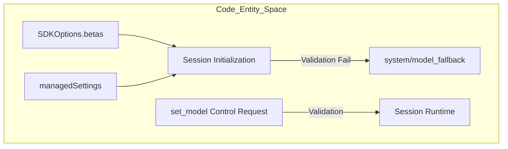

<!-- source: DeepWiki mcp.deepwiki.com · repo anthropics/claude-agent-sdk-typescript · page 4.4 Model Capabilities and Beta Features · fetched 2026-10-26 -->

# Model Capabilities and Beta Features

<details>
<summary>Relevant source files</summary>

The following files were used as context for generating this wiki page:

- [CHANGELOG.md](CHANGELOG.md)

</details>


This document explains how to discover and use model-specific capabilities, handle model refusals programmatically, configure effort levels and reasoning options, and opt into beta features (such as extended context windows) in the Claude Agent SDK. Model capability discovery allows applications to query what features a particular Claude model supports (such as effort levels and adaptive thinking), while beta features provide access to experimental functionality.

---

## Model Capability Discovery

The SDK exposes model capabilities through metadata fields that enable runtime detection of available features. This allows applications to adapt their behavior based on model-specific features without hardcoding model names. Furthermore, `setModel()` handles model confirmation with the API when a model ID is not locally cached [CHANGELOG.md:84-84]().

### Capability Fields

The SDK model information includes primary capability fields that describe the feature set of the active model:

| Field | Type | Description |
|-------|------|-------------|
| `supportsEffort` | `boolean` | Indicates whether the model supports effort level configuration. |
| `supportedEffortLevels` | `EffortLevel[]` | Array of effort level values: `'low' \| 'medium' \| 'high' \| 'max'`. |
| `supportsAdaptiveThinking` | `boolean` | Indicates whether the model supports adaptive thinking mode. |
| `supportsFastMode` | `boolean` | Indicates whether the model supports "fast mode" for lower latency. |

Sources: [CHANGELOG.md:5-7](), [CHANGELOG.md:139-139]()

### Fast Mode and Usage Metadata

The SDK provides transparency into why fast mode might be unavailable via `fast_mode_disabled_reason` on result and init messages. Additionally, `modelUsage` entries include `canonicalModel` and `provider` fields to facilitate accurate billing rate lookups and cost tracking.

Sources: [CHANGELOG.md:8-10](), [CHANGELOG.md:16-20]()

### Capability Detection Architecture

The following diagram illustrates how model capabilities, settings, and billing metadata flow through SDK code entities.

```mermaid
graph TB
    subgraph "Natural_Language_Space"
        "UserPrompt"
        "ModelResponse"
    end

    subgraph "Code_Entity_Space"
        SessionInstance["Session Instance"]
        AppliedSettings["Applied Settings"]
        ModelUsageEntry["modelUsage Entry"]
        FastModeReason["fast_mode_disabled_reason"]
        SetModel["setModel()"]
        
        SessionInstance --> AppliedSettings
        AppliedSettings -->|"supportsEffort"| EffortLevelType["EffortLevel"]
        SessionInstance -->|"SDKResultSuccess"| ModelUsageEntry
        ModelUsageEntry -->|"canonicalModel"| BillingLookup["Billing Lookup"]
        ModelUsageEntry -->|"provider"| BillingLookup
        SetModel -->|"API Confirmation"| SessionInstance
    end

    UserPrompt --> SessionInstance
    SessionInstance --> ModelResponse
    ModelResponse -.-> FastModeReason
```

**Diagram: Model Capability and Usage Mapping**

Sources: [CHANGELOG.md:8-10](), [CHANGELOG.md:16-20](), [CHANGELOG.md:84-84](), [CHANGELOG.md:139-139]()

---

## Programmatic Refusal Detection

The SDK provides a robust way to detect when a model refuses to perform a task (e.g., due to safety guardrails) without resorting to fragile string matching on message content.

### Refusal Metadata

When a refusal occurs, the `SDKAssistantMessage` is populated with specific machine-readable fields:

| Field | Value | Description |
|-------|-------|-------------|
| `stop_reason` | `'refusal'` | Explicit indicator that the model stopped due to a refusal. |
| `stop_details` | `object` | Detailed information about why the refusal occurred. |

Sources: [CHANGELOG.md:162-162]()

---

## Rate Limits and Usage Windows

The SDK includes enhanced metadata for managing usage limits, rate limiting states, and billing.

### SDKRateLimitInfo
`SDKRateLimitInfo` provides detailed state for rate-limited sessions:
- `errorCode`: Specific error code for the limit hit.
- `canUserPurchaseCredits`: Boolean indicating if the user can resolve the limit via purchase.
- `hasChargeableSavedPaymentMethod`: Indicates if a payment method is already on file.

### Model-Scoped Limits
The SDK supports a `model_scoped` array in limit messages, allowing for per-model weekly limit windows. Developers can use the `@alpha` export `USAGE_LIMIT_ERROR_PREFIXES` to classify rate-limit messages programmatically.

Sources: [CHANGELOG.md:58-61](), [CHANGELOG.md:152-153](), [CHANGELOG.md:180-182]()

---

## Beta Features

Beta features are experimental functionalities opted into via the `betas` configuration array.

| Beta Feature ID | Description |
|----------------|-------------|
| `context-1m-2025-08-07` | Extended 1M token context window for supported models. |

### Configuration and Fallbacks
Beta features can be configured in `SDKOptions` or via `managedSettings`. If a model fails or a beta feature is unavailable, the SDK emits a `system/model_fallback` message which covers all fallback triggers.



**Diagram: Beta and Model Control Flow**

Sources: [CHANGELOG.md:129-129](), [CHANGELOG.md:139-141](), [CHANGELOG.md:169-169]()

---

## Model Effort and Thinking

The SDK provides control over reasoning depth through the `effort` setting and `updateSettings()`.

### Effort Levels and User Settings
The `EffortLevel` type defines reasoning depth:
- `low`: Minimal reasoning, optimized for speed.
- `medium`: Balanced reasoning.
- `high`: Deep reasoning.
- `max`: Maximum reasoning depth.

Additionally, `'userSettings'` is supported as an `updateSettings()` source, accepting `effortLevel` which is saved for the session's current model as `/effort` saves it.

### Dynamic Workflow Size
The `workflowSizeGuideline` property in SDK settings provides an advisory dynamic-workflow size guideline to help the model manage complex tasks within context and performance constraints.

Sources: [CHANGELOG.md:12-12](), [CHANGELOG.md:39-42](), [CHANGELOG.md:139-141]()

---

## Version History (Capabilities & Beta)

| Version | Key Feature |
|---------|-------------|
| 0.3.277 | Added `'userSettings'` as an `updateSettings()` source for `effortLevel`. |
| 0.3.268 | Changed `setModel()` to confirm unrecognized local model IDs with the API. |
| 0.3.219 | Added `fast_mode_disabled_reason` and `workflowSizeGuideline`. |
| 0.3.218 | Added `canonicalModel` and `provider` to `modelUsage`. |
| 0.3.211 | Exported `USAGE_LIMIT_ERROR_PREFIXES`. |
| 0.3.191 | Added `model_scoped` array for per-model weekly limits. |
| 0.3.181 | Enhanced `SDKRateLimitInfo` with payment/credit metadata. |
| 0.3.174 | Added `system/model_fallback` message for all fallback triggers. |
| 0.3.162 | Added `stop_reason: 'refusal'`. |

Sources: [CHANGELOG.md:12-12](), [CHANGELOG.md:16-20](), [CHANGELOG.md:39-42](), [CHANGELOG.md:58-61](), [CHANGELOG.md:84-84](), [CHANGELOG.md:129-129](), [CHANGELOG.md:139-141](), [CHANGELOG.md:152-153](), [CHANGELOG.md:162-162](), [CHANGELOG.md:180-182]()

---

