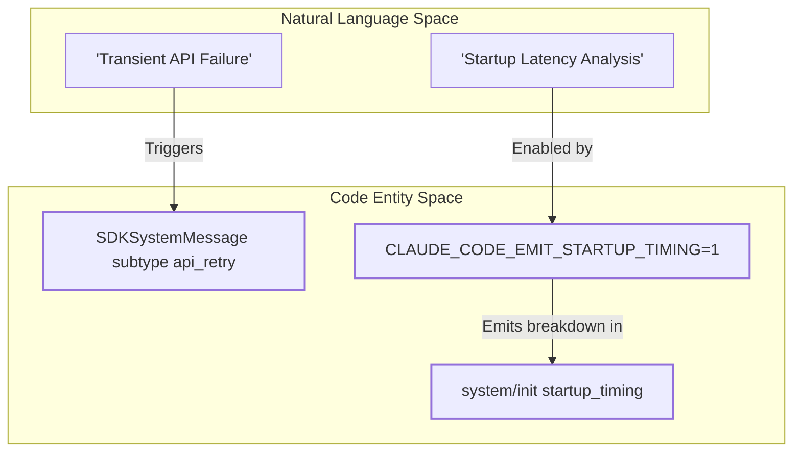
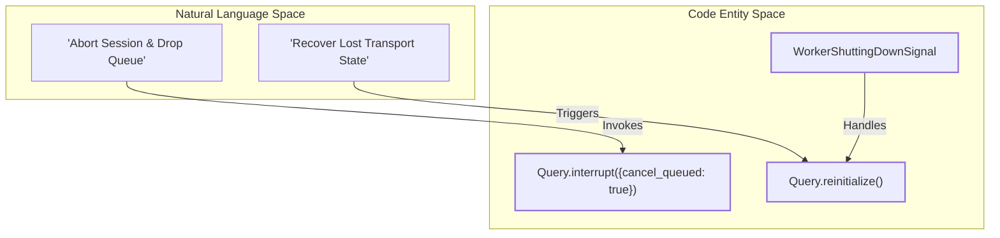

<!-- source: DeepWiki mcp.deepwiki.com · repo anthropics/claude-agent-sdk-typescript · page 4.5 Performance and Debugging · fetched 2026-10-26 -->

# Performance and Debugging

Relevant source files

The following files were used as context for generating this wiki page:

- [CHANGELOG.md](CHANGELOG.md)

This page documents performance optimizations, debugging capabilities, memory management strategies, budget controls, sandbox options, and Remote Control diagnostics implemented in the Claude Agent SDK.

## Debugging and Diagnostic Options

The SDK provides programmatic control over diagnostic logging, error classification, and runtime tracing to assist in isolating issues within the Host-Guest subprocess model.

### Debug Logging Configuration

Diagnostic verbosity and output destinations are configured via options passed to the session or query runners.

| Option | Type | Description |
| :--- | :--- | :--- |
| `debug` | `boolean` | If true, enables comprehensive debug logging directed to `stderr`. |
| `debugFile` | `string` | Redirects debug logs to the specified file path for persistent auditing. |

**Sources**: [CHANGELOG.md:213-214]()

### API Retry Mechanics and System Messages

When transient network partitions or upstream provider errors occur, the SDK manages retries transparently while emitting structured telemetry.

*   **`api_retry` System Messages**: Emitted upon encountering recoverable upstream errors, detailing the current attempt, maximum allowable retries, and error context.
*   **Error Classification**: Differentiates between transient server load (`api_error_status: 'overloaded'` for HTTP 529) and quota exhaustion (`'rate_limit'` for HTTP 429).
*   **Startup Timing Telemetry**: Setting `CLAUDE_CODE_EMIT_STARTUP_TIMING=1` forces the initial `system/init` frame to carry phase-by-phase startup latency breakdowns (`startup_timing`).

**Sources**: [CHANGELOG.md:34-35](), [CHANGELOG.md:163-165]()

---

## Performance Optimizations

The SDK employs several architectural strategies to reduce time-to-first-token, minimize Resident Set Size (RSS) memory bloat, and streamline initialization.

### Startup Pre-warming and MCP Concurrency

*   **`startup()` and `WarmQuery`**: Initializes the underlying Claude Code binary subprocess ahead of user interaction, pre-populating model caches and warming tool registries.
*   **MCP Startup Bounding**: The SDK parallelizes MCP server capability discovery and honors `CLAUDE_CODE_MCP_STARTUP_WAIT_MS` to bound or disable the first-turn wait interval for connecting servers.

### Memory Behavior and State Seeding

*   **UUID Tracking Eviction**: Implements eviction policies for message UUID tracking structures to prevent unbounded memory growth during long-lived agent interactions.
*   **History Compaction**: Optimizes `getSessionMessages()` by compacting history buffers for massive sessions.
*   **Context State Seeding (`seed_read_state`)**: Persists metadata such as file paths and modification timestamps (`mtime`) even when file content is evicted from the context window, preserving differential update capabilities for the `Edit` tool.

**Sources**: [CHANGELOG.md:34-38](), [CHANGELOG.md:141-142](), [CHANGELOG.md:219-220](), [CHANGELOG.md:274-275]()

---

## Budget and Resource Control

Hard ceilings prevent runaway operational costs and execution loops.

| Configuration | Type | Description |
| :--- | :--- | :--- |
| `maxBudgetUsd` | `number` | A hard monetary ceiling in USD; session terminates immediately if exceeded. |
| `taskBudget` | `number` | Token-limit awareness indicator passed to the model to pace tool usage. |
| `workflowSizeGuideline` | `number` | Advisory guideline informing dynamic workflow sizing. |

### Subagent Depth and Concurrency Caps

Subagent execution is bounded by default thresholds:
*   **Depth Cap**: Defaults to `1`, adjustable via `CLAUDE_CODE_MAX_SUBAGENT_SPAWN_DEPTH`.
*   **Concurrency Cap**: Defaults to `20`, adjustable via `CLAUDE_CODE_MAX_CONCURRENT_SUBAGENTS`.

**Sources**: [CHANGELOG.md:14-14](), [CHANGELOG.md:24-25](), [CHANGELOG.md:127-128](), [CHANGELOG.md:501]()

---

## Sandbox and Security Options

Execution sandboxes isolate tool invocations from the host environment.

*   **`failIfUnavailable`**: Defaults to `true`, ensuring the SDK fails fast if the containerized or restricted execution sandbox cannot be provisioned.
*   **`sandbox.credentials`**: Enforces masking (`mask`) mode to strip sensitive environment variables and credentials from sandboxed commands.
*   **`sandbox.network.strictAllowlist`**: Deterministically blocks network hosts not explicitly enumerated in the strict outbound allowlist.

**Sources**: [CHANGELOG.md:13-13](), [CHANGELOG.md:110-111](), [CHANGELOG.md:119-120](), [CHANGELOG.md:218-219]()

---

## Remote Control and Session Diagnostics

Remote Control diagnostics manage cross-host coordination, process lifecycles, and recovery states.

*   **`worker_shutting_down`**: A control signal emitted when a host worker is terminating, prompting immediate cleanup routines.
*   **`Query.reinitialize()`**: Resyncs local SDK state with the remote subprocess following transport drops or network interruptions.
*   **Interrupt with Queue Cancellation**: The `interrupt()` method accepts `cancel_queued: true` to purge pending messages and returns a typed receipt containing `still_queued` UUIDs.

**Sources**: [CHANGELOG.md:9-9](), [CHANGELOG.md:93-93](), [CHANGELOG.md:113-113](), [CHANGELOG.md:129-130]()

### Performance & Lifecycle Architecture

**Sources**: [CHANGELOG.md:9-9](), [CHANGELOG.md:113-113](), [CHANGELOG.md:129-130]()

---

