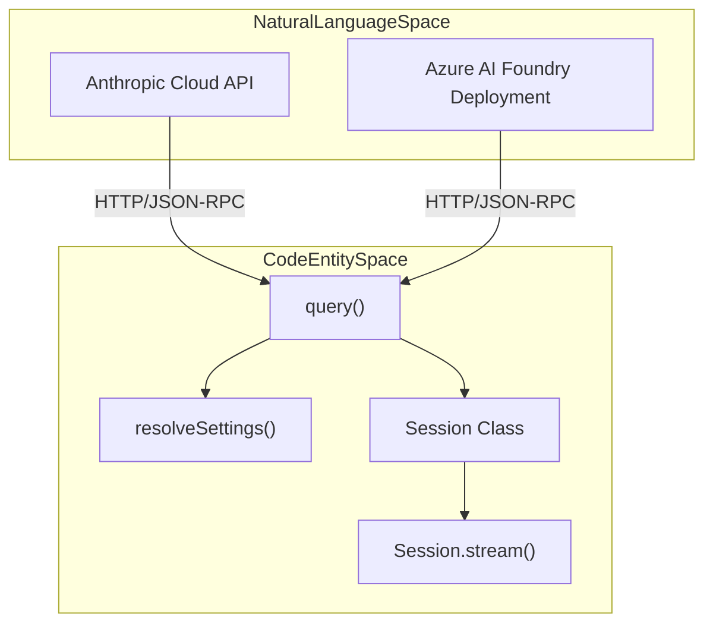
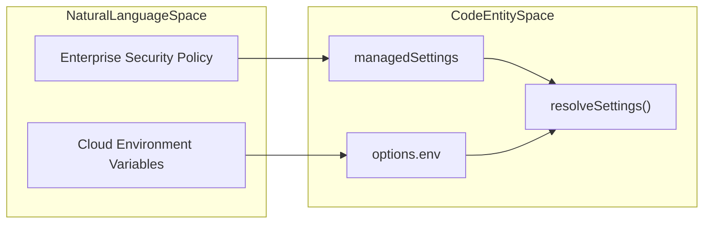

<!-- source: DeepWiki mcp.deepwiki.com · repo anthropics/claude-agent-sdk-typescript · page 5 Platform Integration · fetched 2026-10-26 -->

# Platform Integration

Relevant source files

The following files were used as context for generating this wiki page:

- [CHANGELOG.md](CHANGELOG.md)
- [LICENSE.md](LICENSE.md)
- [README.md](README.md)

This document serves as a parent overview for integrating the Claude Agent SDK with external AI platforms and services. The SDK abstracts underlying platform protocols while offering flexible configuration options for authentication, model selection, and execution environments.

For detailed information, see the child pages:
- [Anthropic API](#5.1) — Integration with the Claude Code backend, API authentication, and supported models.
- [Microsoft Azure AI Foundry](#5.2) — Azure AI Foundry support for SDK deployment.

---

## Overview and Architecture

The Claude Agent SDK acts as a client-side coordination framework. It spawns a native execution backend and communicates via JSON-RPC streaming, translating platform responses into unified `SDKMessage` events [CHANGELOG.md:118-120]().

Sources: [CHANGELOG.md:118-120]()

---

## Anthropic API Integration

The default execution pathway uses the Anthropic API backend. The SDK manages authentication credentials via environment variables such as `ANTHROPIC_API_KEY` and handles rate-limiting and service overloads automatically through built-in retry logic and `api_retry` messages.

For exhaustive details on authentication flows, API versions, and native model support, see [Anthropic API](#5.1).

Sources: [CHANGELOG.md:81-83]()

---

## Microsoft Azure AI Foundry Integration

For enterprise environments requiring Azure-hosted infrastructure, the SDK supports deployment via Azure AI Foundry. Configuration involves setting Azure-specific endpoints and authentication parameters within the execution environment.

For detailed configuration steps and enterprise deployment patterns, see [Microsoft Azure AI Foundry](#5.2).

Sources: [CHANGELOG.md:3-5]()

---

## Platform Configuration and Settings

Platform selection, environment isolation, and operational policies are governed by the configuration subsystem. The `options.env` parameter replaces the subprocess environment rather than merging with `process.env`, ensuring clean boundary isolation between host applications and the agent runtime.

Sources: [CHANGELOG.md:59-61](), [CHANGELOG.md:137-138]()

---

## Next Steps

- [Anthropic API](#5.1) — Claude Code backend integration, model support, and API patterns.
- [Microsoft Azure AI Foundry](#5.2) — Azure deployment configuration and enterprise features.

---

