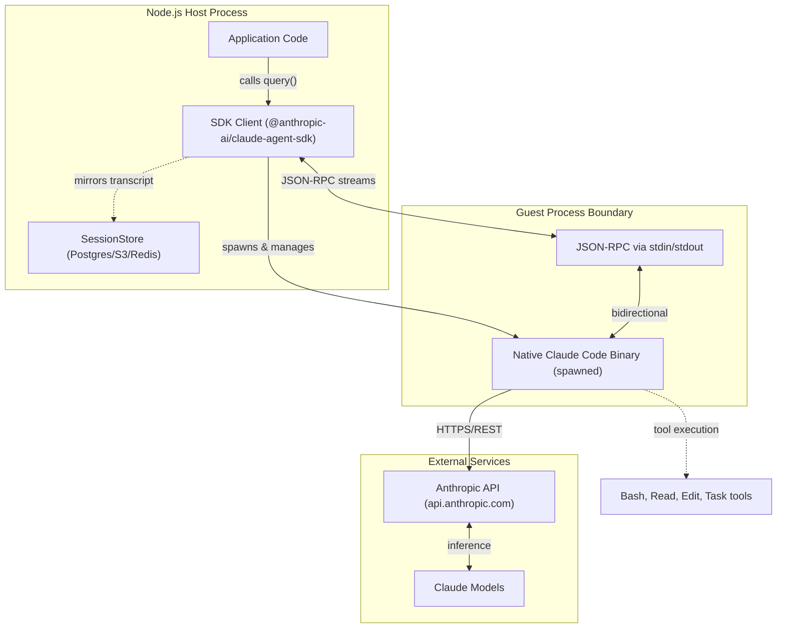
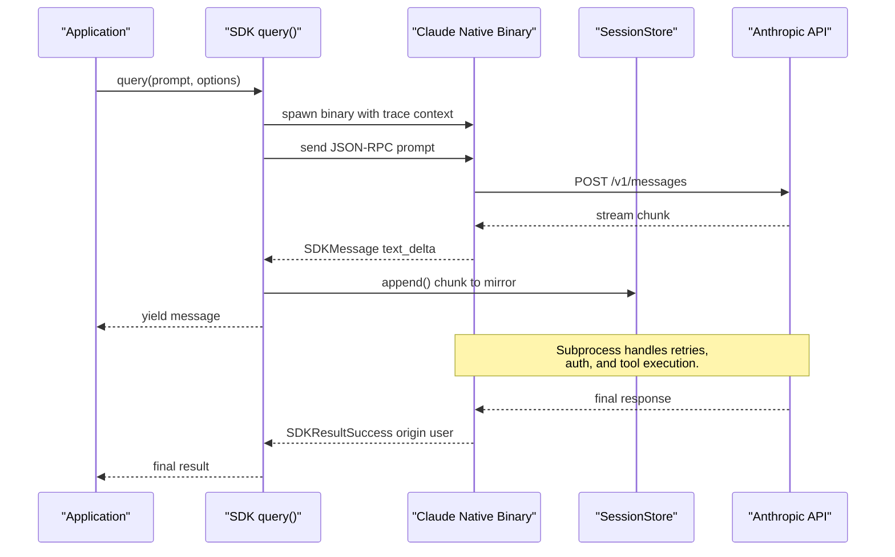

<!-- source: DeepWiki mcp.deepwiki.com · repo anthropics/claude-agent-sdk-typescript · page 5.1 Anthropic API · fetched 2026-10-26 -->

# Anthropic API

Relevant source files

The following files were used as context for generating this wiki page:

- [CHANGELOG.md](CHANGELOG.md)

## Purpose and Scope

This page documents how the Claude Agent SDK integrates with Anthropic's API to provide Claude model access. It covers the native subprocess architecture, API authentication, model support, session cost continuity, and advanced API controls like task budgeting, retry visibility, and model verification.

The SDK serves as a programmatic wrapper around the Claude Code backend, ensuring that agentic behaviors, tool use, and safety guardrails remain consistent between the Claude Code CLI and the SDK.

Sources: [CHANGELOG.md:1-15]()

## Architecture Overview

The SDK utilizes a "Host-Guest" subprocess model. Instead of making direct HTTP calls to `api.anthropic.com`, the SDK spawns a native Claude Code binary as a guest process and communicates with it via JSON-RPC over standard input/output streams [CHANGELOG.md:1-15]().

### Subprocess Communication Model

Sources: [CHANGELOG.md:1-15]()

### API Call Flow and Persistence

The SDK provides a high-level `query()` API that abstracts the lifecycle of the subprocess, maintaining state across resumed and forked sessions [CHANGELOG.md:13-13]().

Sources: [CHANGELOG.md:13-13]()

## Version Parity and Compatibility

The SDK maintains strict version alignment with the Claude Code CLI, reflecting backend API updates and protocol extensions [CHANGELOG.md:1-15]().

### Notable Milestone Parity

| SDK Version | Key API/Model Update |
|------------|----------------------|
| **0.3.277** | Added `'userSettings'` update source for `effortLevel` [CHANGELOG.md:12-12](); fixed resumed/forked session usage totals to continue from prior turns [CHANGELOG.md:13-13](); added `severity` and `is_active` to `SDKUsageReport` rows [CHANGELOG.md:14-14](). |
| **0.3.268** | Added `setModel()` model auto-confirmation against the API for unrecognized local IDs [CHANGELOG.md:84-84](). |

Sources: [CHANGELOG.md:1-15](), [CHANGELOG.md:84-84]()

## Authentication and Configuration

The SDK handles authentication by passing credentials and configuration contexts to the native subprocess.

### Configuration Hierarchy
The SDK resolves settings across multiple sources, allowing session-level overrides (such as updating `effortLevel` via `userSettings`) while maintaining environment isolation [CHANGELOG.md:12-12]().

### Key Authentication Variables
*   `ANTHROPIC_API_KEY`: The primary key for Anthropic API access.
*   `CLAUDE_AGENT_SDK_VERSION`: Used for `User-Agent` headers and telemetry.

Sources: [CHANGELOG.md:12-12]()

## Model Support, Cost Tracking, and Capabilities

The SDK integrates deeply with Claude's specialized model capabilities, offering programmatic tracking of usage, cost, and effort levels.

### Model Discovery and Effort
The SDK supports configurable effort levels. Updates via `updateSettings()` accept a `'userSettings'` source specifically for saving `effortLevel` per session, mirroring `/effort` CLI commands [CHANGELOG.md:12-12](). When a session uses a model ID not locally recognized by the CLI, `setModel()` verifies and confirms the model with the API upon first use [CHANGELOG.md:84-84]().

### Cost and Usage Continuity
When resuming or forking sessions, metrics such as `total_cost_usd`, `modelUsage`, and `get_usage` totals properly continue accumulating from earlier turns rather than resetting to zero [CHANGELOG.md:13-13](). Furthermore, `SDKUsageReport` includes session totals and live usage rows carrying `severity` and `is_active` states as reported by the server [CHANGELOG.md:14-14]().

Sources: [CHANGELOG.md:12-14](), [CHANGELOG.md:84-84]()

## Error Handling and Resilience

The SDK subprocess implements robust error detection and recovery mechanisms for API interactions.

### Model Availability and Failures
If a model switch fails or a custom model ID requires API confirmation, the CLI validates the model parameters against the backend during initialization or via `setModel()` [CHANGELOG.md:84-84](). Usage reporting ensures that inactive or failing telemetry rows do not pollute usage calculations by enforcing `is_active` and `severity` metadata fields on `SDKUsageReport` [CHANGELOG.md:14-14]().

Sources: [CHANGELOG.md:12-15](), [CHANGELOG.md:84-84]()

---

