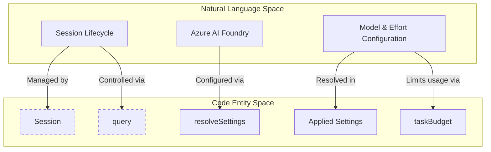
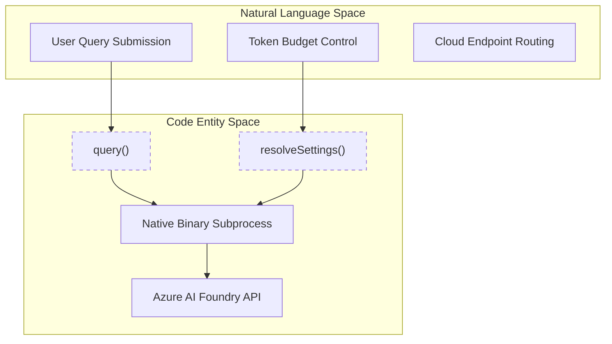

<!-- source: DeepWiki mcp.deepwiki.com · repo anthropics/claude-agent-sdk-typescript · page 5.2 Microsoft Azure AI Foundry · fetched 2026-10-26 -->

# Microsoft Azure AI Foundry

Relevant source files

The following files were used as context for generating this wiki page:

- [CHANGELOG.md](CHANGELOG.md)

## Purpose and Scope

This document covers the Claude Agent SDK's integration with Microsoft Azure AI Foundry for cloud-based deployment scenarios. This integration allows developers to leverage Claude models within the Azure ecosystem, utilizing Azure's infrastructure, security, and compliance frameworks.

Sources: [CHANGELOG.md:3-6]()

## Overview

Microsoft Azure AI Foundry integration enables the deployment of Claude Agent SDK applications within Microsoft's cloud environment. This integration serves as an alternative to direct Anthropic API usage, specifically targeting organizations with existing Azure infrastructure or specific regulatory requirements that necessitate Azure-hosted model endpoints.

The integration is implemented as a platform-specific provider within the SDK's internal architecture, allowing the `Session` and `query()` interfaces to interact with Claude models hosted on Azure AI Foundry.

Sources: [CHANGELOG.md:3-15](), [CHANGELOG.md:80-88]()

## Integration Architecture

The SDK abstracts the underlying model provider, allowing the core agent logic to remain consistent regardless of whether it is communicating with Anthropic's API or Azure AI Foundry. The SDK utilizes a host-guest subprocess model where the TypeScript SDK communicates with a native Claude binary that handles the low-level protocol details.

### System Entity Mapping

The following diagram bridges the natural language concepts of Azure integration to the specific code entities and files that implement them.

Sources: [CHANGELOG.md:10-15](), [CHANGELOG.md:80-88]()

### Execution and Routing Flow

When configured for Azure AI Foundry, the SDK routes requests through Azure-specific endpoints. The following diagram bridges natural language execution concepts to the underlying code entities.

Sources: [CHANGELOG.md:32-40](), [CHANGELOG.md:80-88]()

## Key Implementation Features

### Runtime Configuration Resolution
The SDK provides configuration resolution methods that allow developers to inspect effective merged settings without spawning the Claude CLI. This is critical for Azure deployments where settings might be controlled via system-level policies.

- **MDM/Registry Support**: Reads from configuration stores for parity with CLI startup [CHANGELOG.md:12-12]().
- **`model`**: The specific deployment name or model ID on Azure.
- **`effort`**: The `EffortLevel` applied to the request [CHANGELOG.md:12-12]().

Sources: [CHANGELOG.md:10-15](), [CHANGELOG.md:80-88]()

### Token Budgeting and Management
For Azure deployments where cost management and rate limiting are managed via Azure policies, the SDK respects model usage and budgeting structures. This allows the model to be aware of its token consumption on the API side, enabling it to pace tool usage and subagent calls effectively within Azure's resource constraints.

Sources: [CHANGELOG.md:13-15](), [CHANGELOG.md:44-44]()

### Session Persistence and Resumption
Azure-based sessions support the full lifecycle of the SDK, including:
- **`query()`**: The unified entry point for initiating or resuming sessions [CHANGELOG.md:86-88]().
- **`sessionStore`**: A mechanism for mirroring session transcripts to external storage while running on Azure.
- **`getSessionMessages()` & `forkSession()`**: Managing conversation forks and retrieving session history reliably [CHANGELOG.md:24-26]().

Sources: [CHANGELOG.md:24-28](), [CHANGELOG.md:86-88]()

### Error Handling and Refusals
On Azure deployments, the SDK provides structured error reporting. Refusal error messages carry stop reasons and details on assistant messages, allowing SDK consumers to detect refusals programmatically. Additionally, system messages report overloads and rate limits, which is critical for managing Azure AI Foundry throughput limits.

Sources: [CHANGELOG.md:32-35](), [CHANGELOG.md:80-88]()

## Deployment Considerations

| Feature | Azure AI Foundry Implementation |
| :--- | :--- |
| **Authentication** | Managed via Azure-specific credentials passed through `options.env` or system settings. |
| **Model Availability** | Supports Claude model variants available on Azure AI Foundry. |
| **Effort Levels** | Supports configurable `effortLevel` settings per session [CHANGELOG.md:12-12](). |
| **Billing Correlation** | Usage records include canonical model and provider fields for downstream rate table lookups [CHANGELOG.md:14-14](). |
| **Tracing** | Supports OpenTelemetry trace context propagation across SDK boundaries. |

Sources: [CHANGELOG.md:12-14](), [CHANGELOG.md:32-40]()

## Version History

| SDK Version | Changes Related to Azure/Platform Support |
| :--- | :--- |
| **0.3.278** | Parity updates with Claude Code v2.1.278 [CHANGELOG.md:3-6](). |
| **0.3.277** | Added `'userSettings'` source for `updateSettings()` targeting `effortLevel` [CHANGELOG.md:12-12](). |
| **0.3.274** | Added `startup_failure_reason` and startup timing diagnostics [CHANGELOG.md:32-35](). |
| **0.3.268** | Added `reloadPlugins` control request and refined permission handling [CHANGELOG.md:80-88](). |

Sources: [CHANGELOG.md:3-6](), [CHANGELOG.md:12-14](), [CHANGELOG.md:32-35](), [CHANGELOG.md:80-88]()

---

