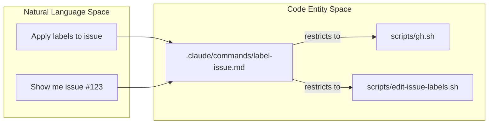

<!-- source: DeepWiki mcp.deepwiki.com · repo anthropics/claude-agent-sdk-typescript · page 6 Examples and Tutorials · fetched 2026-10-26 -->

# Examples and Tutorials

Relevant source files

The following files were used as context for generating this wiki page:

- [.claude/commands/label-issue.md](.claude/commands/label-issue.md)
- [.github/workflows/issue-triage.yml](.github/workflows/issue-triage.yml)
- [scripts/gh.sh](scripts/gh.sh)

This page provides an overview of real-world automation examples implemented in this repository using the Claude Agent SDK TypeScript. It covers high-level integration patterns, tool restrictions, and production workflows. 

For deep technical details on specific implementations, see the child pages:
- **[GitHub Issue Triage Automation](#6.1)**
- **[Slack Integration for Notifications](#6.2)**

---

## Common Integration Patterns

The SDK enables programmatic control of Claude agents for various automation tasks. Applications typically follow structured lifecycles from initialization to session termination, supporting both single-turn execution (such as automated CI/CD jobs) and multi-turn interactive chat sessions.

| Stage | Code Entity / Action | Purpose |
| :--- | :--- | :--- |
| **Initialization** | `createAgent` | Define system prompts, tools, and capabilities. |
| **Session Creation** | `query()` | Initialize a stateful conversation context and send the first prompt. |
| **Execution** | `Session.stream()` | Process streaming text and tool call events. |
| **Termination** | `Session.close()` | Clean up resources and finalize logs. |

Sources: [.github/workflows/issue-triage.yml:1-38](), [.claude/commands/label-issue.md:1-61]()

---

## Tool Integration Patterns

In production environments, powerful built-in tools like `Bash`, `Read`, and `Edit` are restricted using explicit allowlists inside command definitions to maintain security and focus.

### Natural Language to Code Entity Mapping

Sources: [.claude/commands/label-issue.md:1-4](), [.claude/commands/label-issue.md:17-28]()

---

## Production Examples

### GitHub Issue Triage Automation

The repository provides an automated issue triage workflow triggered when new GitHub issues are opened [.github/workflows/issue-triage.yml:3-5](). The workflow invokes Claude via `anthropics/claude-code-action` [.github/workflows/issue-triage.yml:25]() and executes the `/label-issue` command [.claude/commands/label-issue.md:1-4]() using a secure `gh` CLI wrapper [scripts/gh.sh:1-36]().

For complete implementation details, workflow configuration using Workload Identity Federation, and wrapper security, see **[GitHub Issue Triage Automation](#6.1)**.

Sources: [.github/workflows/issue-triage.yml:1-38](), [.claude/commands/label-issue.md:1-61](), [scripts/gh.sh:1-96]()

### Slack Integration for Notifications

GitHub events can be bridged to Slack channels to deliver real-time notifications of agent actions and repository events. This pattern emphasizes secure payload construction using `jq` escaping and authentication via `SLACK_BOT_TOKEN`.

For details on Block Kit payload construction, self-tests, and security audit workflows, see **[Slack Integration for Notifications](#6.2)**.

Sources: [.github/workflows/issue-triage.yml:1-38]()

---

## Integration Points Summary

| System | Integration Method | Purpose |
| :--- | :--- | :--- |
| **GitHub Actions** | `claude-code-action` | Automated execution environment for agents [.github/workflows/issue-triage.yml:25](). |
| **GitHub CLI (`gh`)** | `Bash` Tool | Allows agents to read issues and manage labels via `gh.sh` [.claude/commands/label-issue.md:17-27](). |
| **Custom Scripts** | `Bash` Tool | Domain-specific logic like `edit-issue-labels.sh` [.claude/commands/label-issue.md:28](). |

Sources: [.github/workflows/issue-triage.yml:25](), [.claude/commands/label-issue.md:2-28](), [scripts/gh.sh:29-36]()

---

