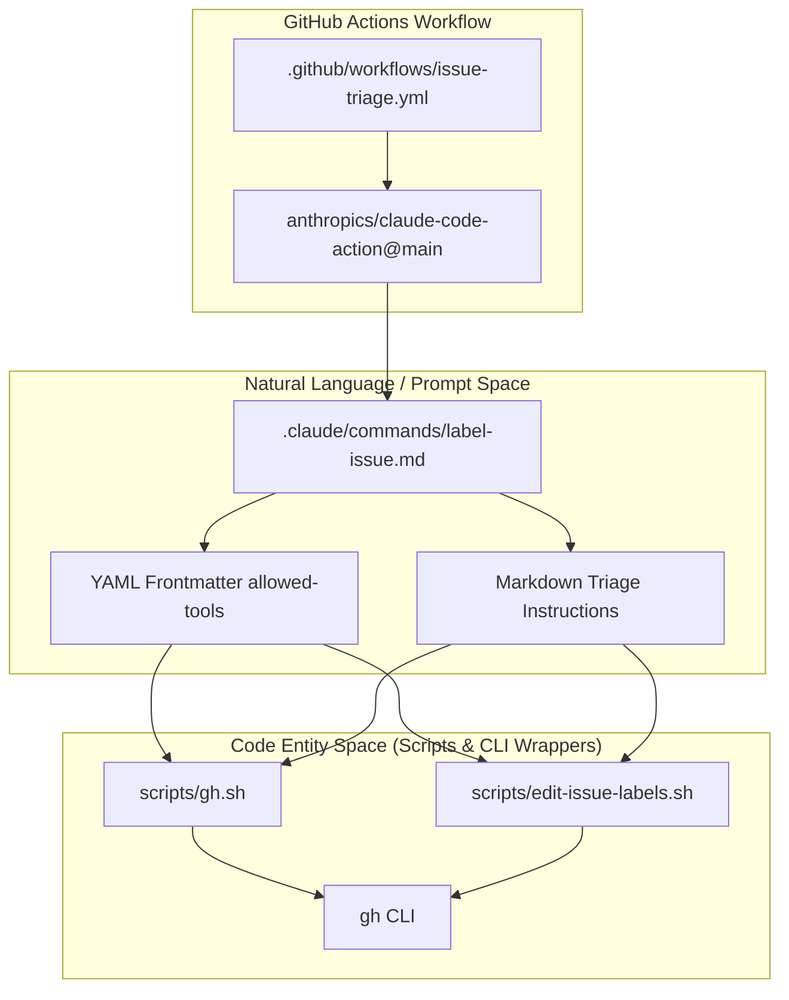
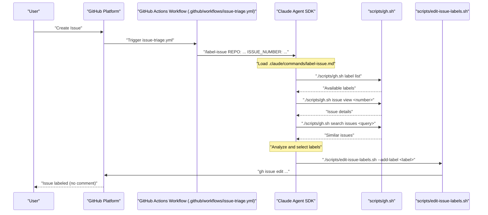

<!-- source: DeepWiki mcp.deepwiki.com · repo anthropics/claude-agent-sdk-typescript · page 6.1 GitHub Issue Triage Automation · fetched 2026-10-26 -->

# GitHub Issue Triage Automation

<details>
<summary>Relevant source files</summary>

The following files were used as context for generating this wiki page:

- [.claude/commands/label-issue.md](.claude/commands/label-issue.md)
- [.github/workflows/issue-triage.yml](.github/workflows/issue-triage.yml)
- [scripts/edit-issue-labels.sh](scripts/edit-issue-labels.sh)
- [scripts/gh.sh](scripts/gh.sh)

</details>


## Purpose and Scope

This page demonstrates a complete automation workflow that uses the Claude Agent SDK to automatically triage and label GitHub issues. The example consists of a Claude command file that defines the triage task ([.claude/commands/label-issue.md:1-61]()), a GitHub Actions workflow that triggers the automation ([.github/workflows/issue-triage.yml:1-38]()), and supporting shell scripts that wrap the GitHub CLI ([scripts/gh.sh:1-96](); [scripts/edit-issue-labels.sh:1-83]()). This example illustrates practical SDK usage including tool restrictions, command-based prompting, and integration with GitHub's API through the `gh` CLI.

For information about the SDK's core configuration system used in this example, see [Configuration System](3.3). For details on the built-in Bash tool used here, see [Built-in Tools](3.5.1).

Sources: [.github/workflows/issue-triage.yml:1-38](), [.claude/commands/label-issue.md:1-61](), [scripts/gh.sh:1-96](), [scripts/edit-issue-labels.sh:1-83]()

## System Overview

The GitHub Issue Triage Automation is a self-contained system that runs as a GitHub Action whenever a new issue is opened in a repository. It uses the Claude Agent SDK (via the `anthropics/claude-code-action` wrapper) to analyze the issue, search for similar issues, determine appropriate labels, and apply them automatically without posting any comments.

### Component Architecture: Natural Language Space to Code Entity Space



Sources: [.github/workflows/issue-triage.yml:1-38](), [.claude/commands/label-issue.md:1-61](), [scripts/gh.sh:1-96](), [scripts/edit-issue-labels.sh:1-83]()

### Workflow Execution Flow



Sources: [.github/workflows/issue-triage.yml:18-38](), [.claude/commands/label-issue.md:15-52]()

## Workflow Configuration

The GitHub Actions workflow file defines when and how the automation runs.

### Workflow File Structure

| Configuration | Value | Purpose |
|--------------|-------|---------|
| **Trigger** | `issues.types: [opened]` | Runs only when new issues are created ([.github/workflows/issue-triage.yml:3-5]()) |
| **Runner** | `ubuntu-latest` | Execution environment ([.github/workflows/issue-triage.yml:9]()) |
| **Timeout** | `10 minutes` | Maximum execution time ([.github/workflows/issue-triage.yml:10]()) |
| **Permissions** | `contents: read`, `issues: write`, `id-token: write` | Required permissions for GitHub API and OIDC authentication ([.github/workflows/issue-triage.yml:11-16]()) |

Sources: [.github/workflows/issue-triage.yml:3-16]()

### Claude Code Action Configuration

The workflow invokes the Claude Agent SDK through the `anthropics/claude-code-action@main` wrapper:

```yaml
- name: Run Claude Code for Issue Triage
  uses: anthropics/claude-code-action@main
  env:
    CLAUDE_CODE_SCRIPT_CAPS: '{"edit-issue-labels.sh":2}'
  with:
    prompt: "/label-issue REPO: ${{ github.repository }} ISSUE_NUMBER: ${{ github.event.issue.number }}"
    anthropic_federation_rule_id: ${{ vars.ANTHROPIC_FEDERATION_RULE_ID }}
    anthropic_organization_id: ${{ vars.ANTHROPIC_ORGANIZATION_ID }}
    anthropic_service_account_id: ${{ vars.ANTHROPIC_SERVICE_ACCOUNT_ID }}
    anthropic_workspace_id: ${{ vars.ANTHROPIC_WORKSPACE_ID }}
    allowed_non_write_users: "*" 
    github_token: ${{ secrets.GITHUB_TOKEN }}
```

**Action Parameters**:

| Parameter | Description |
|-----------|-------------|
| `CLAUDE_CODE_SCRIPT_CAPS` | Environment variable defining script capabilities (level 2) for the agent ([.github/workflows/issue-triage.yml:27]()) |
| `prompt` | Invokes the `/label-issue` command with repository and issue context ([.github/workflows/issue-triage.yml:29]()) |
| `anthropic_federation_*` | Authenticates via Workload Identity Federation (OIDC) instead of static keys ([.github/workflows/issue-triage.yml:33-36]()) |
| `allowed_non_write_users` | Set to `"*"` to allow triage of issues from any user ([.github/workflows/issue-triage.yml:37]()) |
| `github_token` | Provides `gh` CLI authentication for GitHub API calls ([.github/workflows/issue-triage.yml:38]()) |

Sources: [.github/workflows/issue-triage.yml:24-38]()

## Command File Structure

The command file ([.claude/commands/label-issue.md:1-61]()) defines the agent's behavior using a structured format with frontmatter configuration and markdown instructions.

### Frontmatter Configuration

The YAML frontmatter configures SDK behavior, specifically tool restrictions:

```yaml
---
allowed-tools: Bash(./scripts/gh.sh:*),Bash(./scripts/edit-issue-labels.sh:*)
description: Apply labels to GitHub issues
---
```

**Tool Restriction Patterns**:

| Pattern | Allowed Commands | Purpose |
|---------|-----------------|---------|
| `Bash(./scripts/gh.sh:*)` | Any call to the `gh.sh` wrapper | Fetch labels, view issues, search issues ([.claude/commands/label-issue.md:2]()) |
| `Bash(./scripts/edit-issue-labels.sh:*)` | Any call to the label editor script | Apply selected labels ([.claude/commands/label-issue.md:2]()) |

Sources: [.claude/commands/label-issue.md:1-4]()

### Task Instructions

The markdown content provides a 5-step process that becomes the agent's objective:

1.  **Fetch Labels**: Run `./scripts/gh.sh label list` ([.claude/commands/label-issue.md:17]()).
2.  **Get Context**: Use `issue view` and `search issues` to understand the current issue and history ([.claude/commands/label-issue.md:19-27]()).
3.  **Analyze Content**: Consider title, type, technical areas, severity, and impact ([.claude/commands/label-issue.md:30-37]()).
4.  **Select Labels**: Choose specific labels, including a required priority label (P1, P2, or P3) based on descriptions ([.claude/commands/label-issue.md:39-45]()).
5.  **Apply Labels**: Execute `./scripts/edit-issue-labels.sh` ([.claude/commands/label-issue.md:47-52]()).

Sources: [.claude/commands/label-issue.md:15-52]()

## Supporting Scripts

The automation uses two shell scripts to provide a secure and controlled interface for the agent to interact with GitHub.

### `scripts/gh.sh`: Security Wrapper

This script acts as a gatekeeper for the `gh` CLI, enforcing strict subcommand and flag validation.

- **Environment Validation**: Ensures `GH_REPO` or `GITHUB_REPOSITORY` is set in `owner/repo` format ([scripts/gh.sh:16-21]()).
- **Subcommand Whitelist**: Only allows `issue view`, `issue list`, `search issues`, and `label list` ([scripts/gh.sh:29-36]()).
- **Flag Whitelist**: Only allows `--comments`, `--state`, `--limit`, and `--label` ([scripts/gh.sh:23]()).
- **Search Sanitization**: Prevents the agent from searching outside the target repository by blocking `repo:`, `org:`, or `user:` qualifiers in search queries ([scripts/gh.sh:76-82]()).

Sources: [scripts/gh.sh:1-96]()

### `scripts/edit-issue-labels.sh`: Label Logic

This script handles the actual modification of issue labels.

- **Event Context**: Automatically reads the issue number from the GitHub Actions event payload file at `GITHUB_EVENT_PATH` ([scripts/edit-issue-labels.sh:12-16]()).
- **Argument Parsing**: Supports `--add-label` and `--remove-label` ([scripts/edit-issue-labels.sh:21-37]()).
- **Validation**:
    - Fetches the current valid labels from the repository using `gh label list --json name` ([scripts/edit-issue-labels.sh:44]()).
    - **Filters labels**: It cross-references requested labels against valid repository labels, silently ignoring any that do not exist ([scripts/edit-issue-labels.sh:47-59]()).
- **Execution**: Constructs and runs the `gh issue edit` command with the filtered list of labels ([scripts/edit-issue-labels.sh:66-76]()).

Sources: [scripts/edit-issue-labels.sh:1-83]()

## Safety Guidelines and Constraints

The command file includes explicit behavioral constraints to ensure the agent acts purely as a triager:

| Constraint | Implementation | Line Reference |
|------------|---------------|----------------|
| **No Comments** | `IMPORTANT: Don't post any comments or messages to the issue.` | [.claude/commands/label-issue.md:8]() |
| **No Direct Communication** | `DO NOT communicate directly with users` | [.claude/commands/label-issue.md:50]() |
| **Tool Limitation** | `Your ONLY action should be to apply labels using ./scripts/edit-issue-labels.sh` | [.claude/commands/label-issue.md:58]() |
| **Label Source** | `Only select labels from the provided list above` | [.claude/commands/label-issue.md:56]() |
| **Duplicate Logic** | Only use "duplicate" label if the other issue is **OPEN** | [.claude/commands/label-issue.md:45]() |

Sources: [.claude/commands/label-issue.md:8-59]()

---

