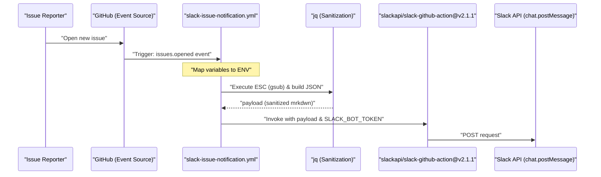
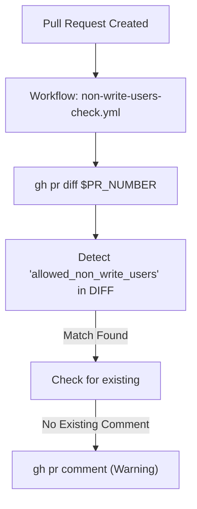

<!-- source: DeepWiki mcp.deepwiki.com · repo anthropics/claude-agent-sdk-typescript · page 6.2 Slack Integration for Notifications · fetched 2026-10-26 -->

# Slack Integration for Notifications

Relevant source files

The following files were used as context for generating this wiki page:

- [.github/workflows/non-write-users-check.yml](.github/workflows/non-write-users-check.yml)
- [.github/workflows/slack-issue-notification.yml](.github/workflows/slack-issue-notification.yml)

## Purpose

This document describes the GitHub Actions workflow that automatically posts notifications to Slack when new issues are opened in the `claude-agent-sdk-typescript` repository. This integration demonstrates how to bridge GitHub events with external communication platforms using Block Kit payloads, robust data escaping, and secure secret management.

This is a deployment automation example. For SDK-based automation examples involving the Claude Agent SDK directly, see [6.1 GitHub Issue Triage Automation]().

Sources: [.github/workflows/slack-issue-notification.yml:1-69]()

## Architecture Overview

The notification system uses GitHub Actions as an event listener for repository activity, specifically focusing on the `issues` event. It employs a two-step process: first constructing a sanitized JSON payload using `jq`, and then dispatching it via the Slack API.

### Notification Flow

The following diagram illustrates the lifecycle of a notification from the initial GitHub event to the final Slack message delivery, mapping GitHub event data to the Slack `chat.postMessage` API.

Sources: [.github/workflows/slack-issue-notification.yml:1-69]()

### Security Audit Workflow

Because GitHub Actions can be sensitive, the repository includes a security check to monitor changes to workflow permissions. This workflow uses the `gh` CLI to inspect PR diffs for high-risk configuration changes.

Sources: [.github/workflows/non-write-users-check.yml:1-47]()

## Workflow Implementation

### Trigger Mechanism
The workflow is configured to trigger specifically when an issue is first created using the `opened` type. To minimize the attack surface, the job explicitly sets `permissions: {}` as it does not require a `GITHUB_TOKEN`.

Sources: [.github/workflows/slack-issue-notification.yml:3-9]()

### Payload Construction and Escaping
To prevent injection attacks and ensure message rendering, the workflow uses `jq` to perform `mrkdwn` escaping.

*   **Escaping Logic**: The workflow defines a `jq` function `esc` that handles HTML entities (`&`, `<`, `>`) and removes control characters [.github/workflows/slack-issue-notification.yml:34-38]().
*   **Self-Test**: Before building the final payload, a "probe" test is executed to verify that the escaping logic correctly transforms `<&>` to `&lt;&amp;&gt;`. If this fails, the job terminates to prevent posting malformed or unescaped content [.github/workflows/slack-issue-notification.yml:40-46]().
*   **Environment Injection**: Attacker-controlled values (issue title, author) are passed to the `run` step via environment variables rather than direct `${{ }}` interpolation to prevent shell injection [.github/workflows/slack-issue-notification.yml:17-23]().

Sources: [.github/workflows/slack-issue-notification.yml:15-62]()

## Slack API Integration

The integration utilizes the `chat.postMessage` method via `slackapi/slack-github-action@v2.1.1` [.github/workflows/slack-issue-notification.yml:64-69]().

### Configuration Parameters

| Parameter | Value / Source | Description |
| :--- | :--- | :--- |
| `method` | `chat.postMessage` | The Slack Web API method to invoke [.github/workflows/slack-issue-notification.yml:67]() |
| `token` | `${{ secrets.SLACK_BOT_TOKEN }}` | Authenticates the bot via GitHub Secrets [.github/workflows/slack-issue-notification.yml:68]() |
| `payload` | `${{ steps.build.outputs.payload }}` | The sanitized Block Kit JSON [.github/workflows/slack-issue-notification.yml:69]() |

Sources: [.github/workflows/slack-issue-notification.yml:64-69]()

### Block Kit Payload Structure
The payload is generated as a single-line JSON string using `jq -c` to ensure safety when writing to `$GITHUB_OUTPUT`.

1.  **Issue Link Section**: Combines the repository name, issue number, and escaped title into a markdown link [.github/workflows/slack-issue-notification.yml:50-57]().
2.  **Author Section**: Displays the escaped `ISSUE_AUTHOR` [.github/workflows/slack-issue-notification.yml:58-59]().

Sources: [.github/workflows/slack-issue-notification.yml:50-69]()

## Security and Audit Controls

### Secret Management
The `SLACK_BOT_TOKEN` is managed as a GitHub Secret. The workflow is designed so that no step uses the default `GITHUB_TOKEN`, reducing the risk of token leakage [.github/workflows/slack-issue-notification.yml:7-9]().

Sources: [.github/workflows/slack-issue-notification.yml:7-9]()

### Non-write Users Check
The `non-write-users-check.yml` workflow monitors modifications to `.github/` YAML files. It specifically flags the addition of `allowed_non_write_users`, a configuration that permits users without write access to trigger Claude Code workflows.

*   **Diff Analysis**: Uses `gh pr diff` and `grep` to detect the sensitive string in the PR changes [.github/workflows/non-write-users-check.yml:18-24]().
*   **Idempotency**: Before commenting, it queries existing PR comments for the `<!-- non-write-users-check -->` hidden tag to avoid spamming the PR [.github/workflows/non-write-users-check.yml:30-35]().
*   **Warning Message**: Alerts the developer that modifying these permissions may introduce security risks and suggests contacting the AppSec team [.github/workflows/non-write-users-check.yml:37-44]().

Sources: [.github/workflows/non-write-users-check.yml:1-47]()

## GitHub Context Variables Reference

| Variable | Mapping in Workflow | Purpose |
| :--- | :--- | :--- |
| `github.event.issue.title` | `ISSUE_TITLE` | Subject of the Slack notification [.github/workflows/slack-issue-notification.yml:20]() |
| `github.event.issue.user.login` | `ISSUE_AUTHOR` | Crediting the reporter [.github/workflows/slack-issue-notification.yml:21]() |
| `github.event.issue.html_url` | `ISSUE_URL` | Link to the issue on GitHub [.github/workflows/slack-issue-notification.yml:22]() |
| `github.event.issue.number` | `ISSUE_NUMBER` | Unique identifier for the issue [.github/workflows/slack-issue-notification.yml:23]() |

Sources: [.github/workflows/slack-issue-notification.yml:20-23]()

---

