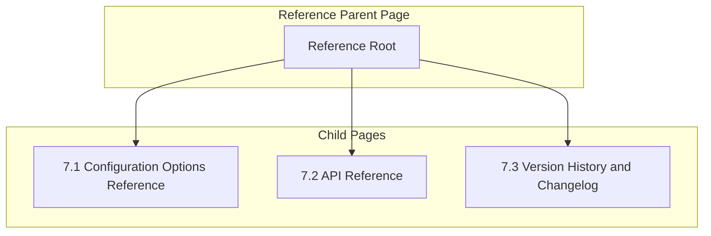
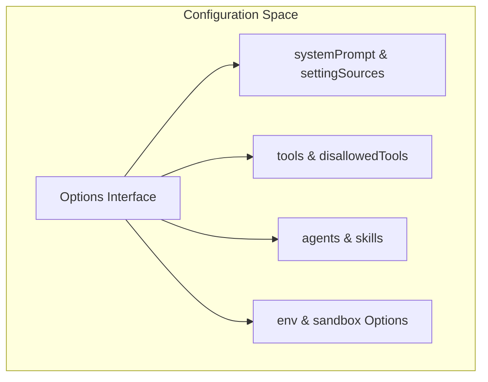
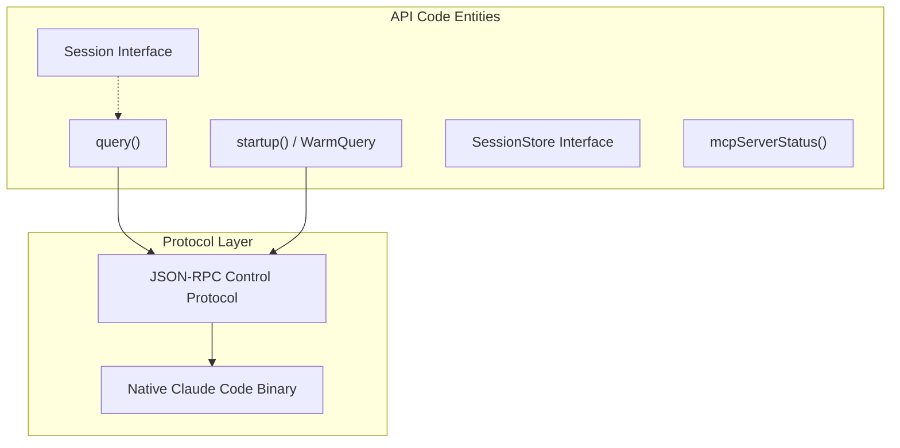
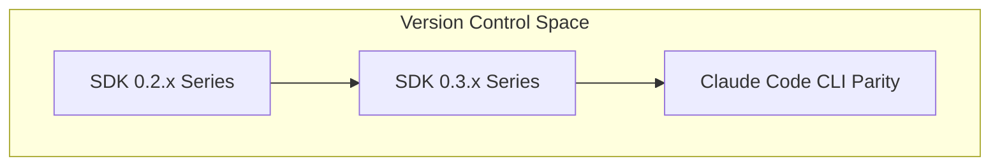

<!-- source: DeepWiki mcp.deepwiki.com · repo anthropics/claude-agent-sdk-typescript · page 7 Reference · fetched 2026-10-26 -->

# Reference

Relevant source files

The following files were used as context for generating this wiki page:

- [CHANGELOG.md](CHANGELOG.md)

This page provides an overview of the reference documentation for the Claude Agent SDK TypeScript. It outlines the scope of the configuration options, core API endpoints, and version history, linking directly to the exhaustive child pages for detailed technical specs.

For conceptual explanations, see [Core Concepts](#3). For practical usage examples, see [Examples and Tutorials](#6).

## Reference Page Navigation

The reference documentation is organized into three child pages, covering configuration, API interfaces, and release histories.

**Sources:** [CHANGELOG.md:1-5]()

---

## 1. Configuration Options Reference

The configuration system provides hierarchical control over SDK behavior, environment isolation, agent definitions, and security policies. Options can be passed programmatically to `query()` or managed via setting sources [CHANGELOG.md:11-12](). Key subsystems include `systemPrompt`, `settingSources`, tool registries, subagents, and environment definitions [CHANGELOG.md:57-61]().

For exhaustive details on all parameters, defaults, and type definitions, see [Configuration Options Reference](#7.1).

**Sources:** [CHANGELOG.md:11-12](), [CHANGELOG.md:57-61]()

---

## 2. API Reference

The SDK exposes core execution primitives, session management functions, MCP management utilities, and hook definitions. The primary entry point is the `query()` function, which interfaces with the native Claude Code binary over a JSON-RPC control protocol [CHANGELOG.md:123-125](). Auxiliary functions include `startup()`, `resolveSettings()`, and `SessionStore` integration adapters.

For complete method signatures, type definitions, and interface contracts, see [API Reference](#7.2).

**Sources:** [CHANGELOG.md:123-125](), [CHANGELOG.md:131-135]()

---

## 3. Version History and Changelog

The SDK maintains strict version parity with the Claude Code CLI. Release versions track breaking changes, feature additions (such as `fast_mode_disabled_reason` or usage reporting), bug fixes, and deprecations across the `0.2.x` and `0.3.x` release series [CHANGELOG.md:3-15]().

For a full chronological log of changes, breaking updates, and version migrations, see [Version History and Changelog](#7.3).

**Sources:** [CHANGELOG.md:3-15]()

---

