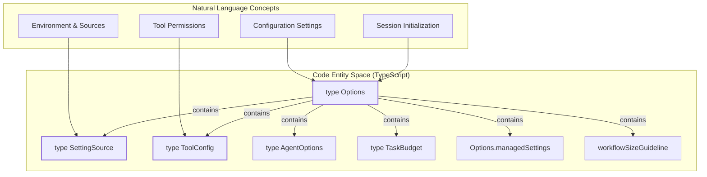
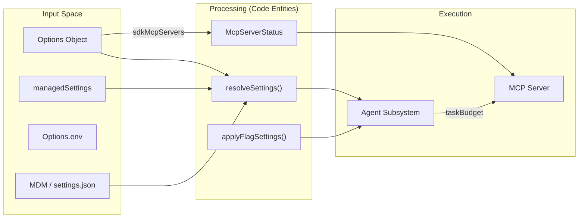

<!-- source: DeepWiki mcp.deepwiki.com · repo anthropics/claude-agent-sdk-typescript · page 7.1 Configuration Options Reference · fetched 2026-10-26 -->

# Configuration Options Reference

Relevant source files

The following files were used as context for generating this wiki page:

- [CHANGELOG.md](CHANGELOG.md)

This page provides an exhaustive technical reference for all configuration options available in the Claude Agent SDK. It documents the `Options` type and related configuration interfaces used when invoking `query()` or initializing sessions.

The SDK's configuration system uses a hierarchical model where programmatic options can override or complement settings loaded from the filesystem and managed policy sources [CHANGELOG.md:118-121]().

## Configuration System Overview

The following diagram maps the relationship between natural language configuration concepts and the specific code entities defined in the SDK.

### Configuration Entity Mapping

**Sources:** [CHANGELOG.md:14-14](), [CHANGELOG.md:118-121]()

## Core Configuration Options

### `tools`
Controls which built-in tools are available to the agent.

**Type:** `string[] | { type: 'preset', preset: string } | undefined`

**Behavior:**
- **Allowlist mode** (`string[]`): Only specified tools are available (e.g., `['Bash', 'Read', 'Edit']`) [CHANGELOG.md:3-6]().
- **Native Search Optimization**: On native builds, the SDK defaults to fast embedded `find`/`grep` search in `Bash`. To keep dedicated `Grep`/`Glob` tools (e.g., for interception via `canUseTool`), they must be explicitly named in `tools` or `allowedTools` [CHANGELOG.md:3-6]().
- **Task Tools**: Headless and SDK sessions now use Task tools (`TaskCreate`, `TaskUpdate`, `TaskGet`, `TaskList`) as default tools on supported model tiers, replacing legacy `TodoWrite` [CHANGELOG.md:87-88]().

### `settingSources`
Specifies which filesystem configuration locations to load.

**Type:** `Array<'user' | 'project' | 'local'> | undefined`

**Source Locations:**
- `'user'`: User-level config directory (`~/.claude/settings.json`).
- `'project'`: Project `.claude/` directory.

### `managedSettings`
Allows embedders to pass policy-tier settings to the spawned CLI in-memory. These are honored below IT-controlled managed sources (like MDM) but above user settings [CHANGELOG.md:118-121]().

### `systemPrompt`
Unified system prompt configuration.

**Behavior:**
- When specified, this is the complete system prompt sent to the agent.
- The SDK provides `resolveSettings()` (alpha) to inspect how these settings merge with MDM (plist/HKLM/HKCU) without spawning the CLI [CHANGELOG.md:118-121]().

### `taskBudget`
Provides API-side token budget awareness to the model.

**Type:** `TaskBudget | undefined`

**Behavior:**
- Allows the model to pace tool use within a specific token limit.
- Prevents runaway loops by providing the agent with "remaining budget" context.

### `workflowSizeGuideline`
Sets the advisory dynamic-workflow size guideline for the agent's internal planning [CHANGELOG.md:14-14]().

**Sources:** [CHANGELOG.md:3-6](), [CHANGELOG.md:14-14](), [CHANGELOG.md:87-88](), [CHANGELOG.md:118-121]()

## Agent & Subagent Configuration

### `agents`
Programmatic subagent definition. Enables defining subagents inline without filesystem dependencies. 

- **`omitClaudeMd`**: Subagents defined in `agents` can specify optional `omitClaudeMd` to run without user, project, and local `CLAUDE.md` files, while managed policy files still load [CHANGELOG.md:57-58]().

### `skills`
Controls which Skills (slash commands) are loaded into the main session.

**Type:** `string[] | 'all'` [CHANGELOG.md:131-133]()

**Behavior:**
- Replaces the deprecated practice of passing `'Skill'` in `allowedTools` [CHANGELOG.md:131-133]().
- `SessionStart` hooks can return `reloadSkills: true` to trigger a re-scan of available skills [CHANGELOG.md:46-47]().

### `agentProgressSummaries`
Enables periodic AI-generated progress summaries for running subagents.

**Type:** `boolean | undefined`

**Behavior:**
- Emitted on `task_progress` events via the `summary` field [CHANGELOG.md:41-43]().

### `forwardSubagentText`
When enabled, streams subagent text deltas directly to SDK consumers.

**Sources:** [CHANGELOG.md:41-43](), [CHANGELOG.md:46-47](), [CHANGELOG.md:57-58](), [CHANGELOG.md:131-133]()

## Tool & MCP Configuration

### `toolConfig`
Advanced configuration for specific tool behaviors.

**Sub-options:**
- `askUserQuestion.previewFormat`: Configures the content format (`'markdown'` or `'html'`) for the `preview` field.

### `sdkMcpServers`
Registration for SDK-mode MCP servers.

**Behavior:**
- **Background Connection**: By default, MCP servers now connect in the background. Use `alwaysLoad: true` on a server entry to require it to be ready before the first turn [CHANGELOG.md:91-91]().
- **Persistence**: Supports automatic reconnection of `claude.ai`-proxied MCP servers after transport-stream aborts.
- **Remote Policy**: Remote entries can carry per-tool `permission_policy` values via `mcp_set_servers`.

### `plugins`
Configuration for SDK plugins. Supports `skipMcpDiscovery: true` per plugin to optimize startup when MCP capabilities are not needed from a specific plugin [CHANGELOG.md:45-45]().

### `sandbox`
Configures the environment for tool execution. Defaults to `failIfUnavailable: true`.

**Advanced Sandbox Settings:**
- `sandbox.credentials`: Configures credential file and environment variable denial in sandboxed commands. Supports "mask" mode.
- `sandbox.network.strictAllowlist`: Deterministically denies access to any host not explicitly allowlisted in sandboxed commands [CHANGELOG.md:13-13]().

**Sources:** [CHANGELOG.md:13-13](), [CHANGELOG.md:45-45](), [CHANGELOG.md:91-91]()

## Session Control Options

### `title`
Sets the session title and skips auto-generation. Can also be set dynamically via `SessionStart` hooks using `hookSpecificOutput.sessionTitle` [CHANGELOG.md:46-47]().

### `shouldQuery`
Optional field on `SDKUserMessage`. Set to `false` to append a user message without triggering an assistant turn.

### `includeHookEvents`
Opt-in to receive hook lifecycle messages (`hook_started`, `hook_progress`, `hook_response`).

**Sources:** [CHANGELOG.md:46-47]()

## Data Flow and Configuration Resolution

The following diagram illustrates how configuration options flow from the SDK user into the core Agent system and interact with external MCP servers, mapping natural language specifications to code entities.

### Configuration Data Flow

**Sources:** [CHANGELOG.md:10-11](), [CHANGELOG.md:118-121](), [CHANGELOG.md:137-138]()

## Advanced Options Reference Table

| Option | Type | Description | Added/Updated |
| :--- | :--- | :--- | :--- |
| `betas` | `string[]` | Enables experimental features (e.g., extended context). | |
| `env` | `Record<string, string>` | Environment variables for the CLI subprocess. **Replaces** the subprocess environment (does not merge with `process.env`). | [CHANGELOG.md:59-62]() |
| `sessionStore` | `SessionStore` | Interface for mirroring session transcripts to external storage. | |
| `taskBudget` | `object` | Token limit for the task to prevent excessive usage. | |
| `agentProgressSummaries` | `boolean` | Enables the `summary` field in `task_progress` events. | [CHANGELOG.md:41-43]() |
| `forwardSubagentText` | `boolean` | Streams subagent text deltas to SDK consumers. | |
| `includeHookEvents` | `boolean` | Enables hook lifecycle event messages in the stream. | |
| `workflowSizeGuideline` | `number` | Advisory dynamic-workflow size guideline. | [CHANGELOG.md:14-14]() |
| `sandbox.network.strictAllowlist` | `string[]` | Deterministic network denial for non-allowlisted hosts. | [CHANGELOG.md:13-13]() |

**Sources:** [CHANGELOG.md:13-13](), [CHANGELOG.md:14-14](), [CHANGELOG.md:41-43](), [CHANGELOG.md:59-62]()

## Environment Variables
The SDK behavior can also be modified via environment variables passed in `options.env`. Note that `options.env` replaces the environment of the spawned process entirely [CHANGELOG.md:59-62]().

- `CLAUDE_CODE_MCP_STARTUP_WAIT_MS`: Pass via `env` to bound or disable (`0`) the first-turn wait for connecting MCP servers [CHANGELOG.md:34-34]().
- `CLAUDE_CODE_EMIT_STARTUP_TIMING`: Set to `1` for stream-json hosts to emit per-phase `startup_timing` breakdown in `system/init` [CHANGELOG.md:35-35]().
- `MCP_CONNECTION_NONBLOCKING`: Set to `0` to restore the old behavior of waiting up to 5s for MCP connections before the first query [CHANGELOG.md:91-91]().
- `CLAUDE_CODE_EMIT_SESSION_STATE_EVENTS`: Set to `1` to opt-in to `session_state_changed` events.
- `CLAUDE_CODE_MAX_SUBAGENT_SPAWN_DEPTH`: Sets the cap for nested subagents (default 1).
- `CLAUDE_CODE_MAX_CONCURRENT_SUBAGENTS`: Sets the cap on concurrent subagents (default 20).
- `MCP_TOOL_TIMEOUT`: Configures the timeout for MCP tool calls [CHANGELOG.md:79-79]().

**Sources:**
- [CHANGELOG.md:34-35]()
- [CHANGELOG.md:59-62]()
- [CHANGELOG.md:79-79]()
- [CHANGELOG.md:91-91]()

---

