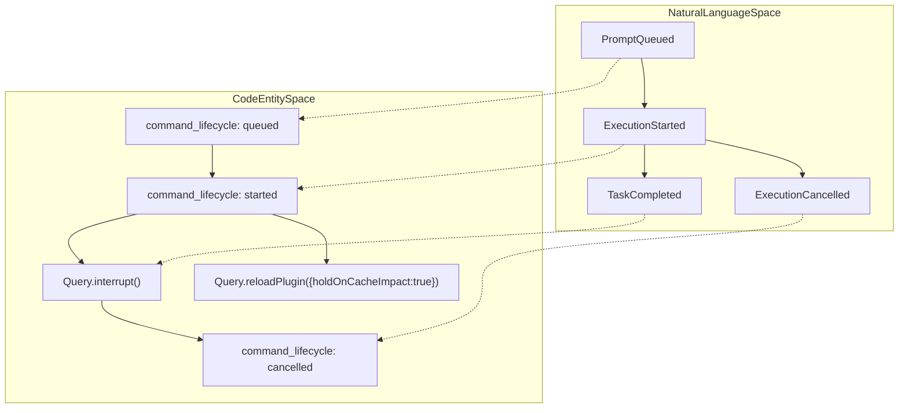
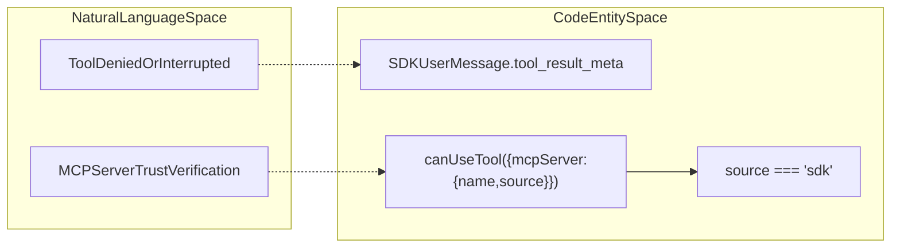

<!-- source: DeepWiki mcp.deepwiki.com · repo anthropics/claude-agent-sdk-typescript · page 7.3 Version History and Changelog · fetched 2026-10-26 -->

# Version History and Changelog

Relevant source files

The following files were used as context for generating this wiki page:

- [CHANGELOG.md](CHANGELOG.md)

This page documents the Claude Agent SDK's version history, including feature additions, bug fixes, breaking changes, and deprecations across all releases. This reference tracks parity with Claude Code CLI versions and helps developers plan migrations.

---

## Versioning Scheme and Parity

The SDK follows semantic versioning principles with a `0.x.y` version scheme. As the project is in a pre-1.0 state, minor versions (x) may introduce breaking changes, while patch versions (y) typically contain bug fixes and parity updates with the Claude Code backend.

| SDK Version Range | Claude Code CLI Parity | Focus |
|:---|:---|:---|
| `0.1.x` | `v2.0.x` | Initial release, configuration overhaul, basic MCP support. |
| `0.2.x` | `v2.1.x` | Native binary migration, SessionStore persistence, and Task system. |
| `0.3.x` | `v2.1.x` | Major API cleanup, removal of legacy session APIs, and Task tool migration. |

Most releases include parity updates with the primary CLI tool [CHANGELOG.md:5](). This ensures that the SDK's internal logic for tool handling, context management, and model interaction stays aligned with the underlying engine.

Sources: [CHANGELOG.md:1-15]()

---

## Recent Releases and Milestones (0.3.268 – 0.3.278)

### Version 0.3.278
- **Parity**: Updated to parity with Claude Code v2.1.278 [CHANGELOG.md:3-5]().

### Version 0.3.277
- **Slash Commands**: Added an optional `builtin` field to `SlashCommand`, set when a command is built into Claude Code [CHANGELOG.md:9]().
- **User Messages**: Added `pasted_content` to `SDKUserMessage` for text the user pasted rather than typed [CHANGELOG.md:10]().
- **Remote Telemetry**: Added remote-session latency fields (`first_text_post_ms`, `first_text_post_wall_ms`, `first_stream_post_queue_wait_ms`, `first_stream_post_queued_behind`) to success result messages [CHANGELOG.md:11]().
- **Settings**: Added `'userSettings'` as an `updateSettings()` source, accepting `effortLevel` [CHANGELOG.md:12]().
- **Bug Fixes**: Fixed resumed or forked session totals (`total_cost_usd`, `modelUsage`, `get_usage`) starting at zero instead of continuing from earlier turns [CHANGELOG.md:13](). Updated `SDKUsageReport` usage rows to always carry `severity` and `is_active` [CHANGELOG.md:14]().

### Version 0.3.275
- **Tool Results**: Fixed deferred tool call results emitting internal keys (`toolUseResult`) instead of `tool_use_result` when re-running at turn start [CHANGELOG.md:23]().
- **Session APIs**: Fixed `getSessionMessages()` and `forkSession()` message omission bugs and UUID validation [CHANGELOG.md:24-26]().

### Version 0.3.274
- **Startup Diagnostics**: Added `startup_failure_reason` to error results and `CLAUDE_CODE_EMIT_STARTUP_TIMING=1` for stream-json hosts [CHANGELOG.md:32-35]().
- **MCP Security**: Added `mcpServer: {name, source}` to `canUseTool` options and `mcp_server` to tool hook inputs, allowing hosts to verify `source === "sdk"` [CHANGELOG.md:33](). Added `CLAUDE_CODE_MCP_STARTUP_WAIT_MS` to bound or disable first-turn MCP wait times [CHANGELOG.md:34]().

### Version 0.3.273
- **Usage Reporting**: Added a `usage_report` sibling (`SDKUsageReport`) on assistant messages delivering headless `/usage` results [CHANGELOG.md:44]().
- **Task Notifications**: Added `reason: "worker_restart"` to `task_notification` messages when background tasks are interrupted by worker restarts [CHANGELOG.md:45]().
- **Hook Timeouts**: Added transcript notices and graceful timeout handling for `Stop`, `SubagentStop`, and `SessionStart` hook callbacks [CHANGELOG.md:46-47]().

### Version 0.3.271
- **Agent Options**: Added optional `omitClaudeMd` to `AgentDefinition` in the `agents` option to run subagents without user, project, or local `CLAUDE.md` files [CHANGELOG.md:57]().
- **Session Store**: Fixed `sessionStore` resume losing global configuration stored under legacy names [CHANGELOG.md:59]().

### Version 0.3.268
- **Control Requests**: Added `hold_on_cache_impact` to `Query.reloadPlugins()` control requests to protect prompt caches [CHANGELOG.md:80]().
- **Context Usage**: Added `kind` (`used`, `free`, `buffer`, `deferred`) to `get_context_usage` control responses [CHANGELOG.md:82]().
- **Tool Configuration**: Added `defaultToNo` and `suppressAlwaysAllowRule` hints to `canUseTool` options [CHANGELOG.md:83]().

Sources: [CHANGELOG.md:3-88]()

---

## Feature Evolution Diagrams

### Message Lifecycle and State Tracking (Code Entity Space)
The SDK maps abstract prompt states to specific control protocol frames and method calls like `Query.interrupt()` and `Query.reloadPlugins()`.

Sources: [CHANGELOG.md:80](), [CHANGELOG.md:89]()

### Tool Result Classification and MCP Trust
Transitioning from unstructured error prose to structured metadata (`tool_result_meta`) and verified MCP server sources (`canUseTool`).

Sources: [CHANGELOG.md:31](), [CHANGELOG.md:33]()

---

## Notable Bug Fixes and Improvements

| Version | Category | Description |
|:---|:---|:---|
| `0.3.275` | Session | Fixed `getSessionMessages()` and `forkSession()` omitting assistant turns right after results [CHANGELOG.md:24](). |
| `0.3.269` | Permissions | Fixed `result.permission_denials` omitting Read, Edit, and Write calls blocked by path-scoped deny rules [CHANGELOG.md:70](). |
| `0.3.268` | Model Resolution | Changed `setModel()` to confirm unknown local model IDs directly with the API [CHANGELOG.md:84](). |
| `0.3.218` | Performance | Fixed `api_error_status` reporting null for mid-stream rate limits [CHANGELOG.md:19](). |
| `0.3.208` | Reliability | Fixed abort-listener leak where `AbortController` accumulated listeners [CHANGELOG.md:78](). |

Sources: [CHANGELOG.md:19](), [CHANGELOG.md:24](), [CHANGELOG.md:70](), [CHANGELOG.md:78](), [CHANGELOG.md:84]()

---

## Deprecations and Breaking Changes

### Breaking Changes
- **Subagent Depth (0.3.217)**: Depth cap lowered from 5 to 1 by default [CHANGELOG.md:24]().
- **Permission Validation (0.3.214)**: `set_permission_mode` now rejects unrecognized modes with an error [CHANGELOG.md:40]().
- **V2 Session API Removal (0.3.142)**: Legacy `unstable_v2_*` functions are removed in favor of `query()` [CHANGELOG.md:282]().
- **Environment Handling (0.3.149)**: `options.env` replaces the subprocess environment rather than merging [CHANGELOG.md:253]().

### Deprecations
- **TodoWrite (0.2.136)**: Deprecated in favor of the Task toolset (`TaskCreate`, `TaskUpdate`, `TaskGet`, `TaskList`) [CHANGELOG.md:312]().
- **Skill Tool Option (0.2.133)**: Passing `'Skill'` in `allowedTools` is deprecated in favor of the `skills` option [CHANGELOG.md:325]().

Sources: [CHANGELOG.md:24](), [CHANGELOG.md:40](), [CHANGELOG.md:253](), [CHANGELOG.md:282-325]()

---

