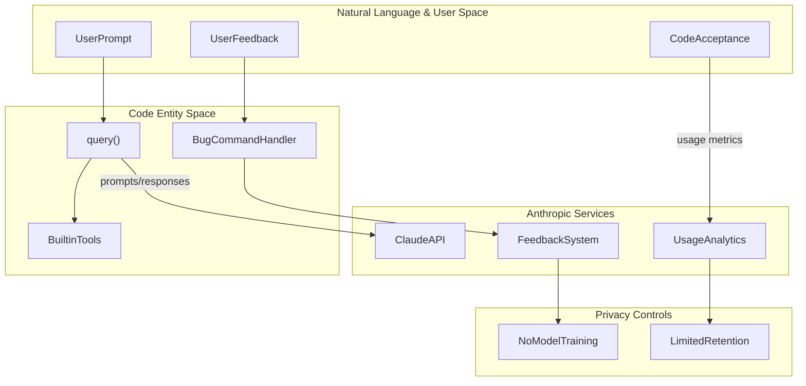
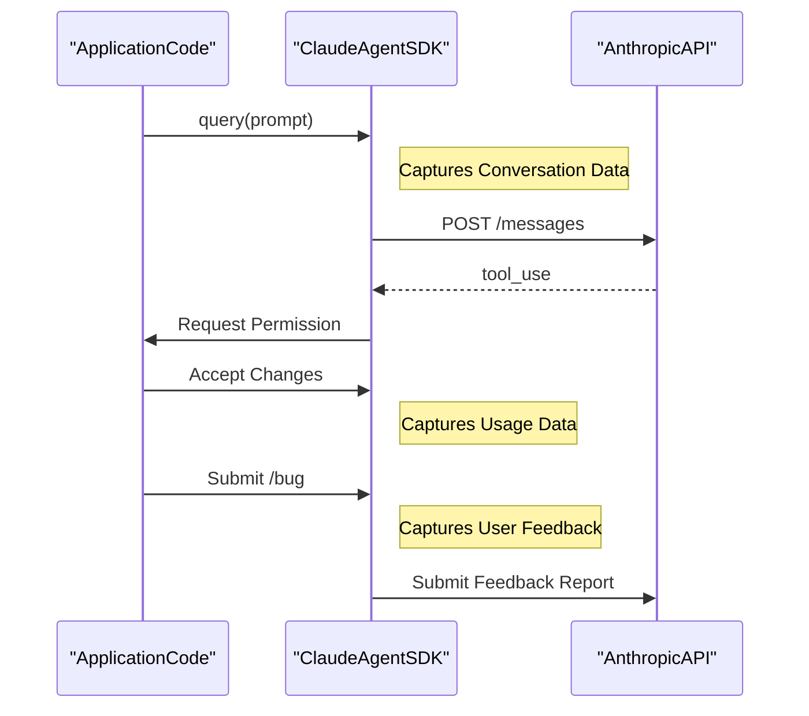

<!-- source: DeepWiki mcp.deepwiki.com · repo anthropics/claude-agent-sdk-typescript · page 8 Privacy and Legal · fetched 2026-10-26 -->

# Privacy and Legal

<details>
<summary>Relevant source files</summary>

The following files were used as context for generating this wiki page:

- [LICENSE.md](LICENSE.md)
- [README.md](README.md)

</details>


This section documents the privacy practices, data collection policies, and legal terms governing the use of the Claude Agent SDK. It covers what data is collected during SDK usage, how that data is processed and protected, and the licensing terms that apply to the SDK and its components.

For detailed API configuration options that affect data handling, see [Configuration Options Reference](#7.1). For information about SDK integration with external services, see [Platform Integration](#5).

## Overview

The Claude Agent SDK operates under Anthropic's legal framework while implementing specific privacy safeguards for developer data. Understanding these policies is essential for compliance, especially when building production applications that serve end users.

Sources: [README.md:31-48]()

## Data Collection Framework

The SDK collects three primary categories of data during operation to improve the service and provide support. For details, see [Data Collection and Privacy](#8.1).

| Data Category | Description | Collection Points |
|--------------|-------------|-------------------|
| **Usage Data** | Code acceptance/rejection events, tool invocations | Session streaming, tool execution |
| **Conversation Data** | Prompts, responses, agent interactions | Session messages, task events |
| **User Feedback** | Bug reports, feature requests | `/bug` command submissions |

### Data Flow Architecture

This diagram bridges high-level user actions to the SDK's internal mechanisms and the Anthropic backend.



Sources: [README.md:31-34](), [README.md:39-42]()

### Collection Trigger Points

Data collection occurs at specific SDK lifecycle events, primarily during session interaction and feedback submission.



Sources: [README.md:31-34]()

## Privacy Safeguards

The SDK implements multiple layers of privacy protection to ensure developer and user data is handled securely. For details, see [Data Collection and Privacy](#8.1).

### 1. Retention and Access
* **Limited Retention:** Sensitive information is subject to limited retention periods [README.md:39-42]().
* **Restricted Access:** Access to user session data is strictly controlled within Anthropic [README.md:39-42]().

### 2. Usage Restrictions
* **No Model Training:** Anthropic maintains clear policies against using feedback data for model training [README.md:39-42]().
* **Service Improvement:** Data is primarily used for service improvement and analytics as defined in the data usage policies [README.md:35-37]().

Sources: [README.md:35-43]()

## Legal Framework

The legal structure of the SDK is built on Anthropic's commercial licensing model. For details, see [Legal and Licensing](#8.2).

### Commercial Terms of Service
Use of the SDK is governed by Anthropic's Commercial Terms of Service. This applies even when the SDK powers products or services made available to third-party customers [README.md:45-48]().

### Component Licensing
The SDK and its core files are proprietary and copyrighted by Anthropic PBC [LICENSE.md:1](). Individual components or dependencies may be covered by different licenses if indicated in a specific `LICENSE` file within those components [README.md:45-48]().

| Entity | License Type | Citation |
|--------|--------------|----------|
| **Claude Agent SDK** | Anthropic Commercial Terms | [LICENSE.md:1]() |
| **Third-party Deps** | Per-component LICENSE | [README.md:45-48]() |

Sources: [README.md:45-48](), [LICENSE.md:1]()

## Developer Responsibilities

When deploying applications built with the Claude Agent SDK, developers must:
1. **Comply with Terms:** Ensure usage adheres to the Commercial Terms of Service [README.md:45-48]().
2. **User Disclosure:** Maintain transparency with end users regarding data collection if the SDK is embedded in a customer-facing product [README.md:45-48]().
3. **Monitor Feedback:** Be aware that user feedback submitted via the SDK (e.g., `/bug`) is transmitted to Anthropic [README.md:31-34]().

Sources: [README.md:31-48]()

## Copyright Notice

```text
© Anthropic PBC. All rights reserved. 
Use is subject to Anthropic's Commercial Terms of Service.
```
Sources: [LICENSE.md:1]()

---

For detailed information on specific privacy and legal topics, see:
- [Data Collection and Privacy](#8.1) — Detailed data collection practices and privacy safeguards.
- [Legal and Licensing](#8.2) — Comprehensive licensing information and Commercial Terms of Service.

---

