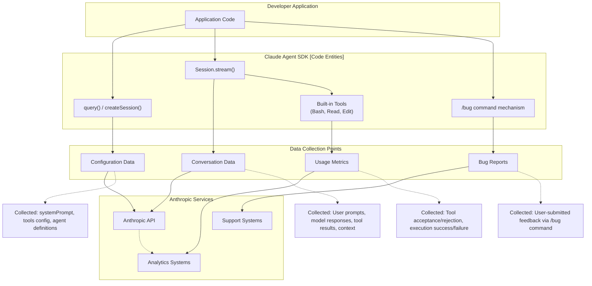
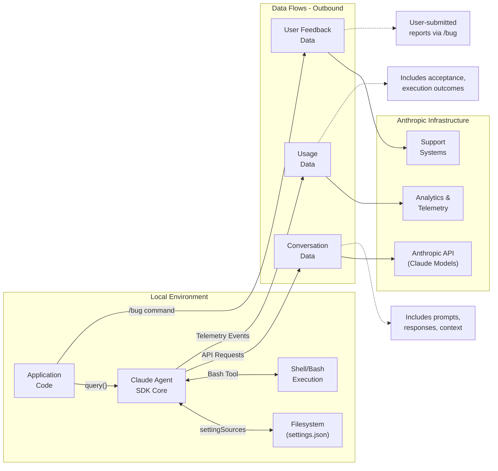

<!-- source: DeepWiki mcp.deepwiki.com · repo anthropics/claude-agent-sdk-typescript · page 8.1 Data Collection and Privacy · fetched 2026-10-26 -->

# Data Collection and Privacy

Relevant source files

The following files were used as context for generating this wiki page:

- [LICENSE.md](LICENSE.md)
- [README.md](README.md)

This document explains the data collection practices, privacy safeguards, and data usage policies when using the Claude Agent SDK. It covers what information is collected during SDK usage, how that data flows between systems, and the privacy protections in place.

For information about legal terms and licensing, see **8.2 Legal and Licensing**. For configuration options that affect data handling, see **7.1 Configuration Options Reference**.

## Purpose and Scope

The Claude Agent SDK collects specific types of data to improve service quality and provide functionality. This page documents:

- **What data is collected**: Usage patterns, conversation content, and explicit user feedback.
- **When collection occurs**: During session interactions, tool usage, and feedback submission.
- **Where data is transmitted**: To Anthropic's API and, optionally, to external integrations.
- **How data is protected**: Retention limits, access controls, and usage restrictions.

## Data Collection Overview

The SDK collects three primary categories of data when in use:

| Data Category | Description | Collection Trigger |
|---------------|-------------|-------------------|
| **Usage Data** | Code acceptance/rejection, tool invocations, session metrics | Automatic during session operations [README.md:31-34]() |
| **Conversation Data** | Prompts, responses, context, tool results | Automatic during `query()` or session streaming calls [README.md:31-34]() |
| **User Feedback** | Explicit bug reports and feedback | User-initiated via `/bug` command [README.md:31-34]() |

All data collection occurs in the context of active SDK sessions that communicate with the Anthropic API.

**Sources**: [README.md:31-43]()

## Data Collection Points in SDK Lifecycle

The following diagram maps data collection to specific SDK operations and API calls, associating system concepts with code entities.

### Data Flow to Code Entity Mapping

**Sources**: [README.md:7-9](), [README.md:31-43]()

## Types of Data Collected

### Usage Data

Usage data captures how developers and end-users interact with SDK capabilities. This includes:

- **Tool Usage**: Invocations of built-in tools (e.g., `Bash`, `Read`, `Edit`, `AskUserQuestion`) and MCP server tools.
- **Code Acceptance Patterns**: Whether generated code or suggestions are accepted or rejected (usage data such as code acceptance or rejections). [README.md:31-34]()
- **Session Metrics**: Session duration, number of turns, and task completion rates.
- **Tool Result Outcomes**: Success or failure of tool executions.

**Sources**: [README.md:31-34]()

### Conversation Data

Conversation data includes the complete interaction context between the application and Claude:

- **User Prompts**: Text submitted through `query()` or streaming session calls.
- **Model Responses**: Generated text and tool calls from Claude.
- **Tool Results**: Output from tool executions (file contents, command outputs, etc.) which are sent back to the model.
- **Session Context**: Previous conversation history maintained for multi-turn interactions.

**Sources**: [README.md:31-34]()

### User Feedback

User feedback is explicitly submitted data, distinct from automatic collection:

- **Bug Reports**: Issues reported via the `/bug` command mechanism. [README.md:31-34]()
- **Feedback Content**: User-provided descriptions of problems or suggestions.
- **Associated Conversation Data**: The conversation data associated with the feedback at the time of submission. [README.md:31-34]()

**Sources**: [README.md:31-34]()

## Data Flow Architecture

The following diagram shows how data flows between SDK components and external services, specifically highlighting the interaction between local configuration files and the remote API.

### Component Interaction Diagram

**Sources**: [README.md:31-43]()

## Privacy Safeguards

The SDK and Anthropic services implement multiple privacy protections to ensure data security:

### Data Retention and Access

- **Limited Retention**: Anthropic implements limited retention periods for sensitive information. [README.md:39-43]()
- **Restricted Access**: Access to user session data is strictly restricted. [README.md:39-43]()
- **Usage Restrictions**: Clear policies exist against using feedback for model training. [README.md:39-43]()

**Sources**: [README.md:39-43]()

### Training Data Restrictions

Anthropic maintains a **clear policy against using feedback for model training**. Data collected through the SDK (including usage data and conversation data) is used for service improvement and debugging but is **not used** for training AI models. [README.md:39-43]()

**Sources**: [README.md:39-43]()

### Local Data Protection

The SDK implements safeguards for local data:

- **Configuration Files**: Local settings files remain local unless their contents are explicitly read by a tool and included in a prompt.
- **Command Execution**: Bash tool outputs are transmitted only as part of the conversation context to the model.
- **File Operations**: `Read` and `Edit` tool operations send file contents to the API only when used to provide context or perform edits.

**Sources**: [README.md:31-43]()

## Data Usage Policies

Anthropic's data usage policies govern how collected data is processed and utilized. The SDK operates under these policies:

### Service Operation and Improvement

Data is used to:
- Process requests through Claude models.
- Maintain conversation context across turns.
- Execute tool operations and return results.
- Improve service quality (e.g., identifying why code suggestions are rejected). [README.md:31-34]()

For full details, users should review the [Commercial Terms of Service](https://www.anthropic.com/legal/commercial-terms) and [Privacy Policy](https://www.anthropic.com/legal/privacy). [README.md:43]()

**Sources**: [README.md:35-43]()

## Configuration and Data Control

Developers can control certain aspects of data collection through SDK configuration:

### Tool Restrictions

Control what data tools can access by using `disallowedTools` or specific `tools` selections in the session configuration. This affects what data is generated through tool usage and transmitted to the API.

### Setting Sources Control

Restrict configuration data sources using the `settingSources` option. This can prevent the SDK from reading local filesystem configuration files that might contain sensitive project information.

### MCP Server Management

Control external tool integrations via MCP server management APIs (e.g., `toggleMcpServer`). Disabling specific MCP servers prevents data transmission to those third-party tool providers.

**Sources**: [README.md:31-43]()

## Summary of Data Collection

| Collection Point | Data Type | Automatic | User Control |
|-----------------|-----------|-----------|--------------|
| `query()` / stream calls | Conversation data | Yes | Via `disallowedTools`, tool selection |
| Tool execution | Usage metrics, tool results | Yes | Via `tools`/`disallowedTools` config |
| `/bug` command | User feedback | No (opt-in) | Explicit user action required |
| Configuration loading | Settings and prompts | Yes | Via `settingSources` option |

**For complete privacy and legal terms, consult**:

- [Commercial Terms of Service](https://www.anthropic.com/legal/commercial-terms) [LICENSE.md:1]()
- [Privacy Policy](https://www.anthropic.com/legal/privacy) [README.md:43]()
- [Data Usage Policies](https://docs.anthropic.com/en/docs/claude-code/data-usage) [README.md:37]()

**Sources**: [README.md:31-48](), [LICENSE.md:1]()

---

