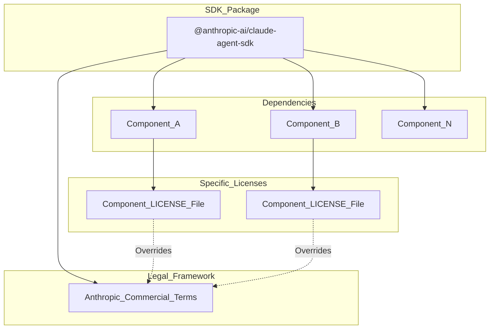
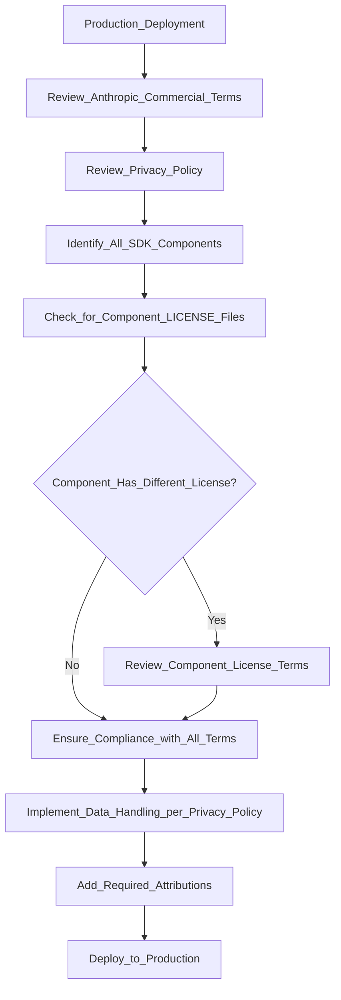
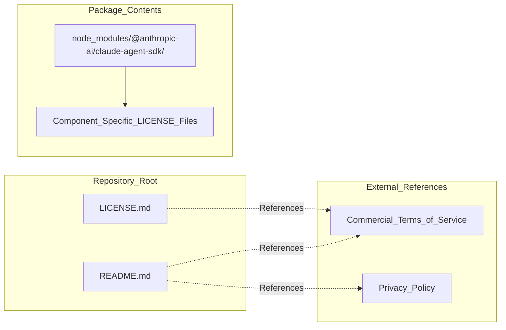

<!-- source: DeepWiki mcp.deepwiki.com · repo anthropics/claude-agent-sdk-typescript · page 8.2 Legal and Licensing · fetched 2026-10-26 -->

# Legal and Licensing

<details>
<summary>Relevant source files</summary>

The following files were used as context for generating this wiki page:

- [LICENSE.md](LICENSE.md)
- [README.md](README.md)

</details>


This page documents the legal framework and licensing terms governing use of the Claude Agent SDK. It covers the Commercial Terms of Service, Privacy Policy, and component-specific licensing information for both development and production deployments.

For information about data collection practices, retention policies, and privacy safeguards, see [Data Collection and Privacy](8.1).

## Overview

The Claude Agent SDK operates under a proprietary licensing framework governed by Anthropic PBC. While the package is distributed via npm, its use is subject to specific commercial restrictions. The licensing model is hierarchical, where a primary license applies to the SDK as a whole, while component-specific licenses may apply to individual dependencies [README.md:45-47](), [LICENSE.md:1-1]().

**Sources**: [README.md:45-47](), [LICENSE.md:1-1]()

## Primary License Framework

### Commercial Terms of Service

The Claude Agent SDK is governed by Anthropic's [Commercial Terms of Service](https://www.anthropic.com/legal/commercial-terms). This licensing model applies to all uses of the SDK, including:

- Development and testing environments [README.md:45-47]().
- Production deployments [README.md:45-47]().
- Products and services built with the SDK that are made available to end users [README.md:45-47]().
- Integration with third-party systems and platforms [README.md:45-47]().

The Commercial Terms of Service establish the legal relationship between developers using the SDK and Anthropic PBC, defining permitted uses, limitations, and responsibilities.

**Sources**: [README.md:45-47](), [LICENSE.md:1-1]()

### Copyright Notice

All rights to the Claude Agent SDK are reserved by Anthropic PBC. The copyright notice is documented in the repository root `LICENSE.md`:

```text
© Anthropic PBC. All rights reserved. Use is subject to Anthropic's Commercial Terms of Service.
```

This copyright applies to the SDK package (`@anthropic-ai/claude-agent-sdk`) and its source code [LICENSE.md:1-1]().

**Sources**: [LICENSE.md:1-1]()

## Privacy Policy

Anthropic's [Privacy Policy](https://www.anthropic.com/legal/privacy) governs the collection, use, and protection of data when using the Claude Agent SDK. The Privacy Policy works in conjunction with the Commercial Terms of Service to establish the complete legal framework.

Key aspects covered by the Privacy Policy include:
- Data collection practices during SDK usage (e.g., usage data, code acceptance/rejections, and `/bug` command feedback) [README.md:31-34]().
- Information sharing and third-party access [README.md:39-43]().
- User rights regarding personal data [README.md:39-43]().
- Data retention and deletion policies [README.md:39-41]().

For technical details on what data is collected and how it is used, see [Data Collection and Privacy](8.1).

**Sources**: [README.md:31-43]()

## Component-Specific Licensing

### License Variation by Component

While the Claude Agent SDK as a whole is governed by the Commercial Terms of Service, individual components or dependencies within the SDK may be covered by different licenses. These component-specific licenses take precedence over the primary license for those specific components [README.md:45-47]().

The SDK documentation notes:
> "except to the extent a specific component or dependency is covered by a different license as indicated in that component's LICENSE file." [README.md:47-47]()

This means developers must review individual component `LICENSE` files to ensure compliance with all applicable licenses when using the SDK [README.md:45-47]().

**Sources**: [README.md:45-47]()

### Component License Discovery

To identify components with different licensing terms:

1. Navigate to the dependency directories within `node_modules/@anthropic-ai/claude-agent-sdk/`.
2. Check for component-specific `LICENSE` files.
3. Review the licenses of all transitive dependencies.

**Title: Component Licensing Hierarchy**


**Sources**: [README.md:45-47]()

## Production Use and Customer-Facing Applications

### Licensing for Products and Services

The Commercial Terms of Service explicitly covers scenarios where developers use the SDK to build products and services for their own customers and end users [README.md:45-47](). This means:

- Commercial applications built with the SDK are permitted under the Commercial Terms [README.md:45-47]().
- The same Commercial Terms apply regardless of whether the SDK is used internally or in customer-facing products [README.md:45-47]().
- Developers retain the ability to monetize applications built with the SDK, provided they adhere to Anthropic's terms [README.md:45-47]().

The licensing framework from `README.md` states:
> "Use of this SDK is governed by Anthropic's Commercial Terms of Service, including when you use it to power products and services that you make available to your own customers and end users" [README.md:47-47]()

**Sources**: [README.md:45-47]()

### Compliance Flow for Production Deployments

When deploying SDK-based applications to production, developers must ensure compliance with both the primary license and any component-specific licenses.

**Title: License Compliance Flow for Production Deployment**


**Sources**: [README.md:45-47]()

## License Compliance Checklist

Developers should verify compliance with the following requirements before deploying SDK-based applications:

| Requirement | Description | Reference |
|:---|:---|:---|
| **Commercial Terms Acceptance** | Review and accept Anthropic's Commercial Terms of Service | [README.md:45-47]() |
| **Privacy Policy Review** | Understand data collection and privacy requirements | [README.md:43]() |
| **Component License Audit** | Identify and review all component-specific licenses | [README.md:47]() |
| **Data Handling Implementation** | Implement privacy safeguards and data collection policies | [README.md:31-41]() |
| **Attribution Requirements** | Add any required copyright notices or attributions | [LICENSE.md:1-1]() |
| **End-User Terms** | Establish terms for your own customers if building a product | [README.md:45-47]() |

**Sources**: [README.md:31-47](), [LICENSE.md:1-1]()

## Legal Documentation References

### Official Legal Documents

All legal terms are published on Anthropic's website and are incorporated by reference into the SDK:

- **Commercial Terms of Service**: [https://www.anthropic.com/legal/commercial-terms](https://www.anthropic.com/legal/commercial-terms) [README.md:43-47]()
- **Privacy Policy**: [https://www.anthropic.com/legal/privacy](https://www.anthropic.com/legal/privacy) [README.md:43-47]()
- **Data Usage Policies**: [https://docs.anthropic.com/en/docs/claude-code/data-usage](https://docs.anthropic.com/en/docs/claude-code/data-usage) [README.md:37-37]()

Developers are responsible for reviewing these documents and ensuring compliance with their terms.

**Sources**: [README.md:37-47]()

### Repository License Files

The SDK repository contains license information in the following locations:

**Title: License Documentation Structure**


**Sources**: [README.md:45-47](), [LICENSE.md:1-1]()

## Integration with External Services

When integrating the SDK with external services, additional legal considerations may apply:

- **Anthropic API**: Covered by Commercial Terms of Service [README.md:45-47]().
- **Microsoft Azure AI Foundry**: May require additional Azure terms [README.md:45-47]().
- **MCP Servers**: May have their own licensing terms (e.g., individual servers might have separate open-source licenses) [README.md:45-47]().

Developers are responsible for understanding and complying with the licensing terms of all integrated services and tools [README.md:45-47]().

**Sources**: [README.md:45-47]()

## Updates to Legal Terms

Anthropic may update the Commercial Terms of Service or Privacy Policy from time to time. Developers should:

1. Periodically review the official legal documents at the Anthropic legal portal [README.md:43-47]().
2. Monitor the SDK repository for updates to `LICENSE.md` or `README.md` [README.md:43-47]().
3. Assess the impact of any legal changes on their applications [README.md:43-47]().
4. Update their own customer-facing terms if necessary [README.md:43-47]().

**Sources**: [README.md:43-47]()

---

