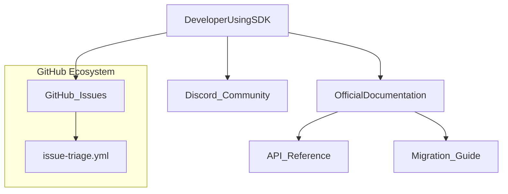
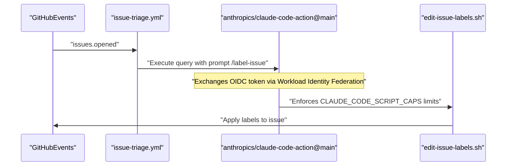

<!-- source: DeepWiki mcp.deepwiki.com · repo anthropics/claude-agent-sdk-typescript · page 9 Community and Support · fetched 2026-10-26 -->

# Community and Support

Relevant source files

The following files were used as context for generating this wiki page:

- [.github/workflows/issue-triage.yml](.github/workflows/issue-triage.yml)
- [LICENSE.md](LICENSE.md)
- [README.md](README.md)

This page details community resources, support channels, issue reporting mechanisms, and contribution guidance for the Claude Agent SDK, focusing on the automated issue triage infrastructure powered by GitHub Actions.

For data collection and privacy policies, see [Data Collection and Privacy](#8.1). For licensing and legal terms, see [Legal and Licensing](#8.2).

## Support Channels Overview

The SDK provides multiple channels for developer support, ranging from static documentation to automated GitHub workflows and community chat.

Sources: [README.md:1-29](), [.github/workflows/issue-triage.yml:1-38]()

## Official Documentation

The primary documentation resource is hosted at [docs.claude.com](https://docs.claude.com/en/api/agent-sdk/overview).

**Documentation Index:**
- **Overview**: Capabilities and high-level architecture [README.md:9-9]()
- **Migration Guide**: Breaking changes from legacy SDKs [README.md:21-21]()
- **Data Usage Policies**: Privacy and data retention specifications [README.md:37-37]()

Sources: [README.md:9-37]()

## GitHub Issues and Automated Triage

GitHub Issues serves as the formal channel for bug reports and feature requests. The repository implements an automated triage architecture using GitHub Actions and the Claude Agent SDK action.

### Automated Triage Architecture

When a new issue is opened, [.github/workflows/issue-triage.yml:1-38]() executes an automated workflow that invokes the SDK via the `anthropics/claude-code-action@main` action [.github/workflows/issue-triage.yml:25-25]().

Sources: [.github/workflows/issue-triage.yml:1-38]()

### Triage Workflow Configuration

The triage workflow configures security boundaries, workload identity federation, and execution caps:

- **Trigger**: Runs on `issues: types: [opened]` [.github/workflows/issue-triage.yml:3-5]()
- **Permissions**: Requires `contents: read`, `issues: write`, and `id-token: write` for OIDC Workload Identity Federation token exchange [.github/workflows/issue-triage.yml:11-16]()
- **Script Caps**: Restricts script executions via `CLAUDE_CODE_SCRIPT_CAPS: '{"edit-issue-labels.sh":2}'` [.github/workflows/issue-triage.yml:26-27]()
- **Federation**: Authenticates via `anthropic_federation_rule_id`, `anthropic_organization_id`, `anthropic_service_account_id`, and `anthropic_workspace_id` variables [.github/workflows/issue-triage.yml:33-36]()
- **User Permission Bypass**: Sets `allowed_non_write_users: "*"` to allow non-contributors to trigger triage [.github/workflows/issue-triage.yml:37-37]()

Sources: [.github/workflows/issue-triage.yml:1-38]()

## Discord Community

The Claude Developers Discord server provides real-time community interaction for developers building with the SDK [README.md:27-29]().

- **Access**: [anthropic.com/discord](https://anthropic.com/discord) [README.md:27-29]()
- **Scope**: General usage questions, design discussions, architectural patterns, and project sharing [README.md:27-29]()

Sources: [README.md:27-29]()

## Data Collection and Privacy

The SDK collects usage data and feedback to improve agent performance:
- **Usage Data**: Code acceptances and rejections [README.md:33-33]()
- **Conversation Data**: Associated transcripts [README.md:33-33]()
- **User Feedback**: Bug reports submitted via `/bug` [README.md:33-33]()

Safeguards include retention limits and strict restrictions against using feedback for model training [README.md:41-41]().

Sources: [README.md:31-43]()

---

