# Page: Overview

# Overview

<details>
<summary>Relevant source files</summary>

The following files were used as context for generating this wiki page:

- [CHANGELOG.md](CHANGELOG.md)
- [LICENSE.md](LICENSE.md)
- [README.md](README.md)

</details>


## Purpose and Scope

This page introduces the Claude Agent SDK (`@anthropic-ai/claude-agent-sdk`), a TypeScript library designed for building autonomous AI agents with Claude Code's native capabilities [README.md:1-7](). It covers the core value proposition, the underlying host-guest subprocess architecture, integration with the Claude Code binary, and high-level platform capabilities.

**Sources:** [README.md:1-7]()

## What is the Claude Agent SDK?

The Claude Agent SDK is a Node.js library published under `@anthropic-ai/claude-agent-sdk` that enables developers to programmatically instantiate AI agents, control tool execution, manage session persistence, and execute complex workflows [README.md:1-7](). The SDK relies on Node.js 18+ and spawns a native Claude Code binary subprocess via per-platform optional dependencies, communicating securely using a JSON-RPC control protocol over standard input/output streams [README.md:3]().

**Sources:** [README.md:1-17]()

## Relationship to Claude Code

The Claude Agent SDK maintains strict version parity with the Claude Code platform backend and CLI releases [CHANGELOG.md:3-5](). Each SDK release corresponds to a specific underlying Claude Code engine version to ensure cross-environment consistency [CHANGELOG.md:3-5]().

| SDK Version | Claude Code Version | Notable Features |
|-------------|---------------------|------------------|
| 0.3.278 | v2.1.278 | Parity update with Claude Code v2.1.278 [CHANGELOG.md:3-6]() |
| 0.3.277 | v2.1.277 | Added `builtin` slash commands, `pasted_content` in `SDKUserMessage`, and `userSettings` source in `updateSettings()` [CHANGELOG.md:7-16]() |
| 0.3.274 | v2.1.274 | Added `startup_failure_reason`, `CLAUDE_CODE_MCP_STARTUP_WAIT_MS`, and per-phase startup timing [CHANGELOG.md:30-41]() |
| 0.3.268 | v2.1.268 | Added `result_index`, `local_command`, `hold_on_cache_impact` reload control, and `canUseTool` prompt hints [CHANGELOG.md:76-89]() |

**Sources:** [CHANGELOG.md:3-16](), [CHANGELOG.md:30-41](), [CHANGELOG.md:76-89]()

### SDK-to-Platform Version Mapping

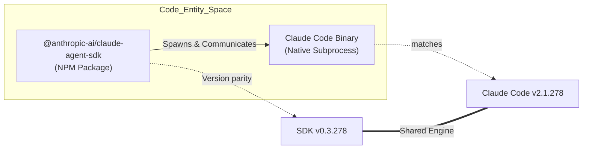

**Sources:** [README.md:3-7](), [CHANGELOG.md:3-6]()

## SDK Architecture

The SDK centers around the `query()` function and the `Session` interface, managing the agent lifecycle, streaming message queues, and bidirectional RPC communication [CHANGELOG.md:3-89]().

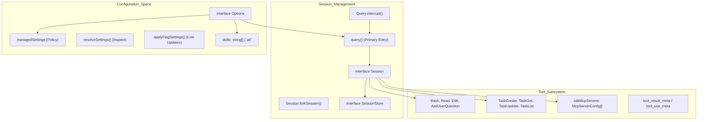

**Sources:** [CHANGELOG.md:3-89]()

## Core Agent Capabilities

### Modern Session Management
The SDK exposes robust session handling via `query()` and session control methods:
- **Session Persistence**: The `SessionStore` interface (supporting S3, Postgres, and Redis backends) mirrors session transcripts and message sequences.
- **Lifecycle Tracking**: `command_lifecycle` frames track message states across execution phases.
- **Interrupts and Cancellation**: `Query.interrupt()` handles session interruption, while `cancel_queued` allows clearing pending queued operations [CHANGELOG.md:3-89]().

**Sources:** [CHANGELOG.md:3-89]()

### Tool and Skill System
Agents interact with environments through a structured tool registry:
- **Task Tools**: Sessions utilize `TaskCreate`, `TaskGet`, `TaskUpdate`, and `TaskList` for managing task-based workflows [CHANGELOG.md:76-89]().
- **Sidecar Metadata**: `tool_result_meta` and `tool_use_meta` provide sidecar diagnostic payloads for tool execution [CHANGELOG.md:3-89]().
- **MCP Integration**: External Model Context Protocol (MCP) servers can be integrated with per-server timeouts and startup controls [CHANGELOG.md:30-41]().

**Sources:** [CHANGELOG.md:30-41](), [CHANGELOG.md:76-89]()

## Integration Ecosystem

This integration diagram bridges natural language configuration and invocation to the underlying TypeScript code entities and external runtime systems.

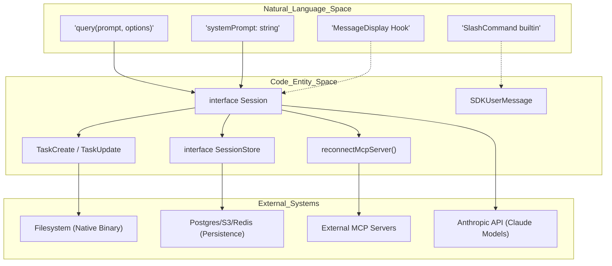

**Sources:** [README.md:1-7](), [CHANGELOG.md:3-16](), [CHANGELOG.md:30-41](), [CHANGELOG.md:76-89]()

## Data Collection and Privacy

The SDK operates under structured telemetry and data handling policies:
- **Usage Data**: Collection of code acceptance, rejections, and conversation logs [README.md:31-34]().
- **User Feedback**: Feedback submitted via `/bug` commands is gathered for platform improvement [README.md:31-34]().
- **Privacy Safeguards**: Enforces restricted access policies, limited retention periods, and guarantees that user data is not used for model training [README.md:39-43]().

**Sources:** [README.md:31-43]()

## Next Steps

- **Getting Started**: Set up the npm package and run a first query [README.md:11-17]().
- **Core Concepts**: Review system architecture, session management, and configuration [README.md:9]().
- **Advanced Features**: Explore session persistence adapters and structured outputs [README.md:9]().
- **Reference**: Consult the configuration options and API reference [README.md:9]().

**Sources:** [README.md:9-17]()

---

# Page: Getting Started

# Getting Started

<details>
<summary>Relevant source files</summary>

The following files were used as context for generating this wiki page:

- [CHANGELOG.md](CHANGELOG.md)
- [LICENSE.md](LICENSE.md)
- [README.md](README.md)

</details>


This page serves as the entry point for developers adopting the Claude Agent SDK. It provides a high-level overview of installation requirements, basic usage patterns through the `query()` API, and crucial migration paths from legacy versions. 

For detailed technical references, please consult the child pages:
- **[Installation](#2.1)** — npm package installation, runtime requirements, and environment setup.
- **[Quick Start](#2.2)** — Minimal working examples demonstrating `query()` usage, options, and event streaming.
- **[Migration Guide](#2.3)** — Comprehensive upgrade paths from the deprecated Claude Code SDK, `unstable_v2_*` session APIs, and legacy tool configurations.

Sources: [README.md:1-21]()

## Getting Started Workflow

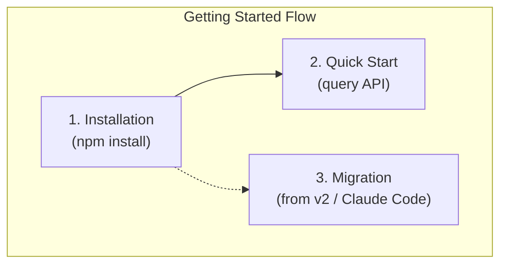

Sources: [README.md:11-21]()

## Installation Overview

The Claude Agent SDK is distributed via npm as `@anthropic-ai/claude-agent-sdk` [README.md:3](). It requires Node.js 18.0.0 or higher [README.md:3]() and manages a native subprocess under the hood to execute agent capabilities.

For full details on package installation, runtime considerations, and environment verification, see [Installation](#2.1).

Sources: [README.md:3](), [README.md:15-17]()

## Quick Start Overview

Agent execution is centered around the primary `query()` function. Developers supply a prompt and an optional configuration object to initialize a session and stream responses.

For minimal working code examples, event handling, and streaming output patterns, see [Quick Start](#2.2).

Sources: [README.md:7-9](), [CHANGELOG.md:97-98]()

## Migration Guide Overview

The SDK has evolved significantly, superseding the legacy Claude Code SDK [README.md:19-21](), replacing unstable session endpoints with `query()` [CHANGELOG.md:97-98](), and transitioning task management from `TodoWrite` to native `Task` tools [CHANGELOG.md:87-88](). 

For step-by-step instructions on updating your codebase, addressing breaking changes, and adapting configuration flags, see [Migration Guide](#2.3).

Sources: [README.md:19-21](), [CHANGELOG.md:87-88](), [CHANGELOG.md:97-98]()

---

# Page: Installation

# Installation

<details>
<summary>Relevant source files</summary>

The following files were used as context for generating this wiki page:

- [LICENSE.md](LICENSE.md)
- [README.md](README.md)

</details>


This page covers the installation process for the Claude Agent SDK, including package installation via npm, Node.js version requirements, and environment setup. For usage examples after installation, see **Quick Start (2.2)**. For migrating from the deprecated Claude Code SDK to the Claude Agent SDK, see **Migration Guide (2.3)**.

---

## Prerequisites

The Claude Agent SDK requires Node.js version 18 or higher to run. This version is required to support the modern asynchronous patterns and streaming capabilities used throughout the SDK.

| Requirement | Version | Notes |
|------------|---------|-------|
| Node.js | ≥18 | Required for runtime execution and ESM support |
| npm | Any compatible | Used for package installation |

**Sources:** [README.md:3-3]()

---

## Package Installation

The Claude Agent SDK is distributed as an npm package under the name `@anthropic-ai/claude-agent-sdk`.

```bash
npm install @anthropic-ai/claude-agent-sdk
```

### Installation Flow

The following diagram illustrates the relationship between the developer environment, the npm registry, and the installed SDK structure.

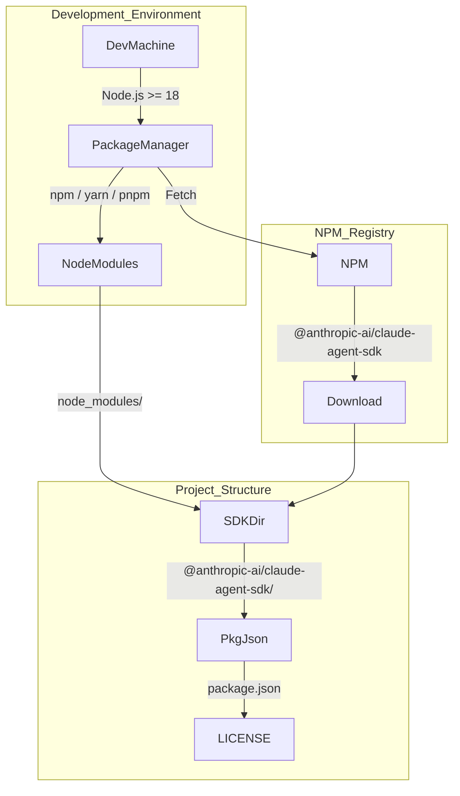

**Sources:** [README.md:13-17](), [LICENSE.md:1]()

---

## Implementation Details

The SDK is designed to provide a programmatic interface to Claude Code's capabilities. When installed, it provides access to core session management and tool execution subsystems.

### Package Entry Points
The package provides access to several critical namespaces and functions used to initialize the agent environment:
- **Session Management**: Primary interface for lifecycle control (e.g., `query()`).
- **Configuration**: Interfaces for `systemPrompt`, `tools`, and `agents`.

### Code Entity Mapping

The following diagram bridges the natural language concept of "Installation & Setup" to the actual code entities provided by the SDK package.

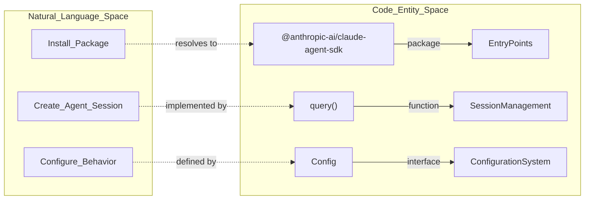

**Sources:** [README.md:1-17]()

---

## Versioning and Migration

The Claude Agent SDK was previously known as the **Claude Code SDK**. Users should ensure they are using the new package name to receive the latest updates and features.

### Migration Overview
If your project currently depends on the legacy Claude Code SDK, you must update your `package.json` and import statements.

| Legacy Package | New Package |
|----------------|-------------|
| `@anthropic-ai/claude-code-sdk` | `@anthropic-ai/claude-agent-sdk` |

**Sources:** [README.md:19-21]()

---

## Verification

To verify that the installation was successful and your environment meets the requirements, you can check the installed version.

```typescript
// Example verification check
import { version } from '@anthropic-ai/claude-agent-sdk/package.json';

console.log(`Claude Agent SDK version ${version} installed.`);
```

### Common Issues

| Symptom | Cause | Resolution |
|---------|-------|------------|
| `Unsupported engine` | Node.js version < 18 | Upgrade Node.js to 18.x or higher. |
| `Module not found` | Package not installed in local `node_modules` | Run `npm install` in your project root. |
| `Type '...' is not assignable` | Version mismatch | Ensure you are using the latest version of the SDK and TypeScript. |

**Sources:** [README.md:3-3](), [README.md:15-17]()

---

## Legal and Licensing

Use of this SDK is governed by Anthropic's Commercial Terms of Service.

*   **Copyright**: © Anthropic PBC. All rights reserved. [LICENSE.md:1-1]()
*   **License**: Anthropic Commercial Terms of Service. [README.md:45-48]()

**Sources:** [LICENSE.md:1](), [README.md:45-48]()

---

## Next Steps

Once installed, proceed to the following sections to begin building:
- **Quick Start (2.2)**: Create your first agent session using the `query()` function.
- **System Architecture (3.1)**: Understand how the Session, Tool, and Task subsystems interact.
- **Configuration System (3.3)**: Learn how to customize the agent's behavior and environment.

---

# Page: Quick Start

# Quick Start

<details>
<summary>Relevant source files</summary>

The following files were used as context for generating this wiki page:

- [LICENSE.md](LICENSE.md)
- [README.md](README.md)
- [examples/session-stores/postgres/demo.ts](examples/session-stores/postgres/demo.ts)

</details>


## Purpose and Scope

This page provides a minimal working example to help you start building with the Claude Agent SDK quickly. It demonstrates the basic pattern of creating a session and conducting a conversation using the `query()` API, which is the primary interface for interacting with the SDK [README.md:7-9]().

Sources: [README.md:7-9]()

## Minimal Working Example

The following example demonstrates how to import the `query()` function and execute a basic prompt. This pattern is commonly used across SDK integrations and demonstrations [examples/session-stores/postgres/demo.ts:13-39]().

```typescript
import { query } from '@anthropic-ai/claude-agent-sdk'

async function run() {
  for await (const message of query({
    prompt: 'Reply with exactly the word: pineapple',
    options: { maxTurns: 1 },
  })) {
    if (message.type === 'result') {
      console.log(message)
    }
  }
}

await run()
```

Sources: [examples/session-stores/postgres/demo.ts:13-39]()

## Data Flow and Execution Architecture

The following sequence diagram illustrates how application code invokes `query()` to initialize communication with the underlying runtime and process message streams.

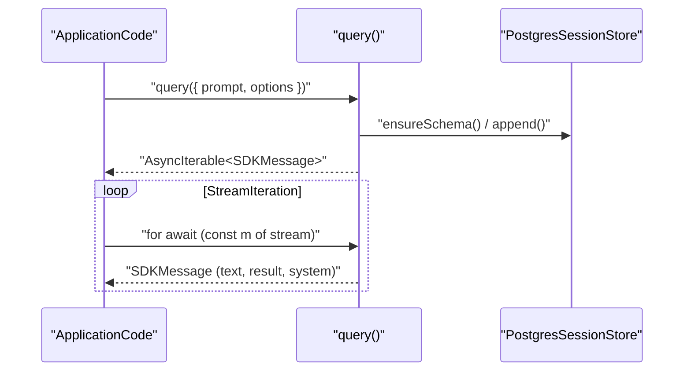

Sources: [examples/session-stores/postgres/demo.ts:23-39]()

## Configuration and Options

When calling `query()`, you can supply various options to configure session behavior, environment variables, or external storage integrations such as a `PostgresSessionStore` [examples/session-stores/postgres/demo.ts:13-31]().

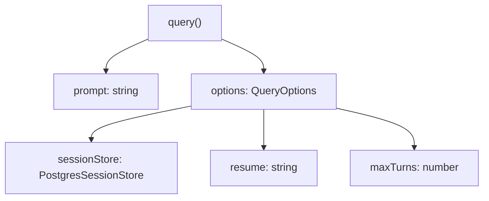

Sources: [examples/session-stores/postgres/demo.ts:27-31]()

## Multi-Turn Conversations and Session Resumption

To maintain conversational state across multiple turns, capture the session identifier emitted during initialization or pass a `resume` token alongside your `sessionStore` configuration [examples/session-stores/postgres/demo.ts:27-44]().

```typescript
import { query } from '@anthropic-ai/claude-agent-sdk'
import { PostgresSessionStore } from './src/PostgresSessionStore.ts'

// Session persistence and resumption flow
const store = new PostgresSessionStore({ pool })

// First turn captures session ID
let sessionId: string | undefined
for await (const m of query({
  prompt: 'Remember this number: 42',
  options: { sessionStore: store, maxTurns: 1 },
})) {
  if (m.type === 'system' && m.subtype === 'init') {
    sessionId = m.session_id
  }
}

// Subsequent turn resumes the session
for await (const m of query({
  prompt: 'What number did I ask you to remember?',
  options: { sessionStore: store, resume: sessionId, maxTurns: 1 },
})) {
  // Process streamed response
}
```

Sources: [examples/session-stores/postgres/demo.ts:13-45]()

---

# Page: Migration Guide

# Migration Guide

<details>
<summary>Relevant source files</summary>

The following files were used as context for generating this wiki page:

- [CHANGELOG.md](CHANGELOG.md)
- [LICENSE.md](LICENSE.md)
- [README.md](README.md)

</details>


This guide documents the breaking changes when migrating from the deprecated Claude Code SDK to the Claude Agent SDK, as well as transitions from deprecated internal APIs and tools. The SDK has been redesigned to provide explicit control over agent behavior, eliminate implicit filesystem dependencies, and improve predictability in production environments.

---

## Overview of Breaking Changes

The migration from Claude Code SDK to Claude Agent SDK introduces major architectural shifts. The SDK has moved from a bundled JavaScript model to spawning a native Claude Code binary via per-platform optional dependencies [README.md:19-22]().

Title: SDK Evolution: Implicit to Code Entities
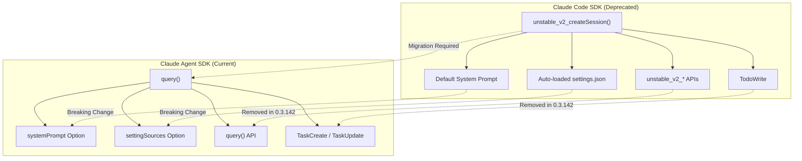

Sources: [README.md:19-22](), [CHANGELOG.md:88-92]()

---

## Migration 1: Removal of `unstable_v2_*` APIs

As of version **0.3.142**, the `unstable_v2_createSession`, `unstable_v2_resumeSession`, `unstable_v2_prompt`, `SDKSession`, and `SDKSessionOptions` APIs have been **removed** [CHANGELOG.md:88-92](). These were previously deprecated in 0.2.133.

Title: Migration from unstable_v2 to query() Data Flow
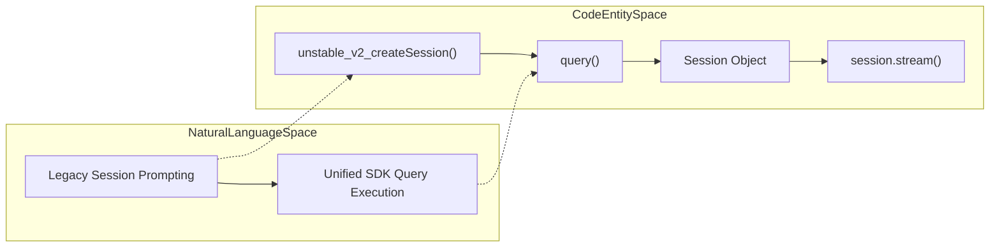

**Migration Example:**

```typescript
// REMOVED in 0.3.142
// import { unstable_v2_createSession } from '@anthropic-ai/claude-agent-sdk';

// RECOMMENDED
import { query } from '@anthropic-ai/claude-agent-sdk';

// For multi-turn or simple prompts:
const session = await query({
  prompt: "Hello",
  // Use options.resume to continue a session
});
```

Sources: [CHANGELOG.md:88-92]()

---

## Migration 2: Task Tools Replacing `TodoWrite`

The `TodoWrite` tool was deprecated in 0.2.136 and **removed** in version **0.3.142** for Headless and SDK sessions [CHANGELOG.md:88-92](). It is replaced by the Task toolset: `TaskCreate`, `TaskGet`, `TaskUpdate`, and `TaskList`.

Title: TodoWrite to Task Tools Mapping
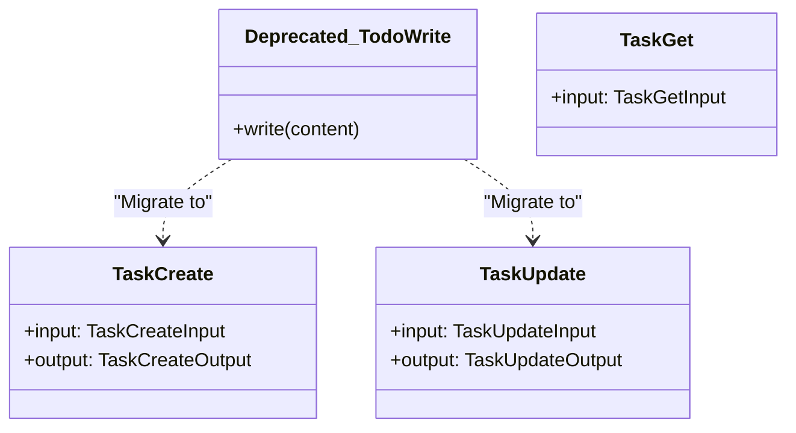

**Key Difference:** Tool consumers should now accumulate state by task ID instead of replacing a snapshot list [CHANGELOG.md:88-92](). Types for these tools are exported from `@anthropic-ai/claude-agent-sdk/sdk-tools` [CHANGELOG.md:85-88]().

Sources: [CHANGELOG.md:85-92]()

---

## Migration 3: MCP Connection Behavior

In version **0.3.142**, the default behavior for MCP server connections changed to be **non-blocking** [CHANGELOG.md:88-92]().

*   **New Default:** Sessions start immediately. Slow servers report `status: "pending"` in the `init` event until ready.
*   **Restoring Old Behavior:** Set the environment variable `MCP_CONNECTION_NONBLOCKING=0` to force the SDK to wait up to 5 seconds before the first query.
*   **Per-Server Override:** Mark a specific server with `alwaysLoad: true` in configuration to require it to be connected before Turn 1 begins.
*   **Timeouts:** The MCP tool-call timeout can be configured via the `MCP_TOOL_TIMEOUT` environment variable.

Sources: [CHANGELOG.md:78-80](), [CHANGELOG.md:88-92]()

---

## Migration 4: Environment and Settings Clarifications

### Environment Variable Behavior
Version **0.3.149** clarified that `options.env` **replaces** the subprocess environment rather than merging with the host's `process.env`. 

**Correct Migration Pattern:**
```typescript
const sdk = await query({
  prompt: "...",
  // Explicitly merge if host environment variables are needed
  env: { ...process.env, CUSTOM_VAR: "value" }
});
```

### Search Tool Defaults (Native Builds)
As of **0.3.162**, sessions on native builds default to fast embedded `find`/`grep` search within the `Bash` tool, matching the Claude Code CLI.
*   **Impact:** Dedicated `Grep` and `Glob` tools are no longer registered by default.
*   **Migration:** If you rely on intercepting these via `canUseTool` or hooks, you must explicitly name them in the `tools` option or `allowedTools`.

Sources: [README.md:1-25]()

---

## Summary of Version Milestones

| Version | Key Migration Impact |
|---------|----------------------|
| **0.2.113** | SDK spawns native binary. `options.env` replaces `process.env`. |
| **0.2.133** | Deprecated `unstable_v2_*` APIs in favor of `query()`. Deprecated `'Skill'` in `allowedTools`. |
| **0.3.142** | **Major Breaking**: Removed `unstable_v2_*` APIs. Removed `TodoWrite` in favor of Task tools. MCP connections now non-blocking by default [CHANGELOG.md:88-92](). |
| **0.3.149** | Clarified `options.env` replaces subprocess environment. |
| **0.3.162** | Native builds default to embedded search; `Grep`/`Glob` tools not registered by default. |

Sources: [CHANGELOG.md:88-92](), [README.md:1-25]()

---

# Page: Core Concepts

# Core Concepts

<details>
<summary>Relevant source files</summary>

The following files were used as context for generating this wiki page:

- [CHANGELOG.md](CHANGELOG.md)

</details>


This page provides a high-level introduction to the fundamental architectural concepts and subsystems of the Claude Agent SDK. It explains how major components interact and their roles in building autonomous AI agents.

For detailed information about specific subsystems:
- **System Architecture**: High-level architecture and subsystem interactions, including the Host-Guest subprocess model. See [System Architecture](#3.1).
- **Session Management**: Lifecycle, resumption, forking, and streaming. See [Session Management](#3.2).
- **Configuration System**: Hierarchical settings, `settingSources`, and resolved values. See [Configuration System](#3.3).
- **Agent Configuration**: Inline agent definitions, skills, and progress summaries. See [Agent Configuration](#3.4).
- **Tool System**: Tool registry, built-in tools, and MCP integration. See [Tool System](#3.5).
- **Hook System and Events**: Lifecycle hooks, event emitters, and exit reasons. See [Hook System and Events](#3.6).

Sources: [CHANGELOG.md:1-1611]()

---

## The SDK as a Coordination Layer

The Claude Agent SDK functions as a coordination layer that orchestrates interactions between application code and multiple external systems using unified interfaces:

- **Anthropic API**: Streaming conversations with Claude models (`query()`). [CHANGELOG.md:90-94]()
- **MCP Servers**: Dynamic tool discovery and execution via the Model Context Protocol. [CHANGELOG.md:33-38]()
- **Filesystem**: Configuration loading from multiple sources and file-based tool operations. [CHANGELOG.md:58-60]()
- **Native Binary**: Execution of a per-platform native Claude Code binary for core logic via a Host-Guest subprocess model. [CHANGELOG.md:82-88]()

Sources: [CHANGELOG.md:33-38](), [CHANGELOG.md:58-60](), [CHANGELOG.md:82-88](), [CHANGELOG.md:90-94]()

---

## Six Major Subsystems

The SDK architecture is organized into six semi-independent subsystems that share a common lifecycle:

| Subsystem | Core Responsibility | Key Types/Functions |
|-----------|-------------------|---------------------|
| **Session Management** | Conversation lifecycle and streaming | `query()`, `forkSession()`, `listSessions()`, `SessionStore` [CHANGELOG.md:24-28](), [CHANGELOG.md:58-60]() |
| **Tool System** | Tool registry and execution | `tools`, `disallowedTools`, `mcpServerStatus`, `TaskCreate` [CHANGELOG.md:33-33](), [CHANGELOG.md:87-87]() |
| **Configuration** | Hierarchical settings and prompts | `settingSources`, `systemPrompt`, `resolveSettings()`, `managedSettings` [CHANGELOG.md:105-106](), [CHANGELOG.md:119-119]() |
| **Hook System** | Event-driven lifecycle interception | `MessageDisplay`, `PermissionRequest`, `SessionStart`, `UserPromptSubmit` [CHANGELOG.md:46-47](), [CHANGELOG.md:208-208]() |
| **Task & Agent** | Multi-agent coordination | `task_started`, `task_progress`, `agentProgressSummaries`, `taskBudget` [CHANGELOG.md:39-39](), [CHANGELOG.md:72-72]() |
| **Model System** | AI capability discovery | `supportsEffort`, `supportedEffortLevels`, `supportsFastMode`, `EffortLevel` [CHANGELOG.md:12-12]() |

Sources: [CHANGELOG.md:12-12](), [CHANGELOG.md:24-28](), [CHANGELOG.md:33-33](), [CHANGELOG.md:39-39](), [CHANGELOG.md:46-47](), [CHANGELOG.md:58-60](), [CHANGELOG.md:72-72](), [CHANGELOG.md:87-87](), [CHANGELOG.md:105-106](), [CHANGELOG.md:119-119](), [CHANGELOG.md:208-208]()

---

## Subsystem Relationships

The following diagram bridges natural language subsystem descriptions to code entities like `query()`, `resolveSettings()`, and JSON-RPC streams.

Subsystem Interaction Diagram
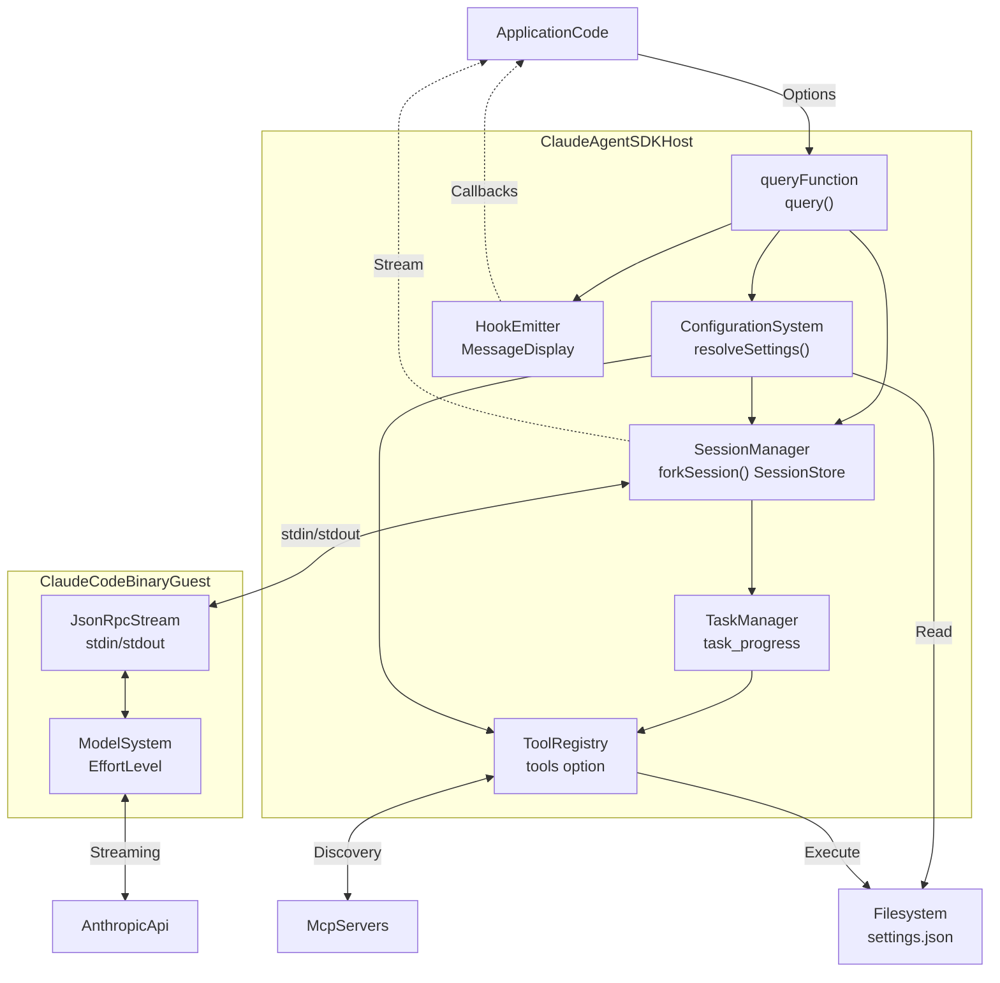
Sources: [CHANGELOG.md:33-38](), [CHANGELOG.md:58-60](), [CHANGELOG.md:82-88](), [CHANGELOG.md:90-94]()

---

## SDK Initialization and Data Flow

This sequence diagram details the initialization sequence using the `query()` API and data flow across internal code entities.

Initialization and Runtime Flow
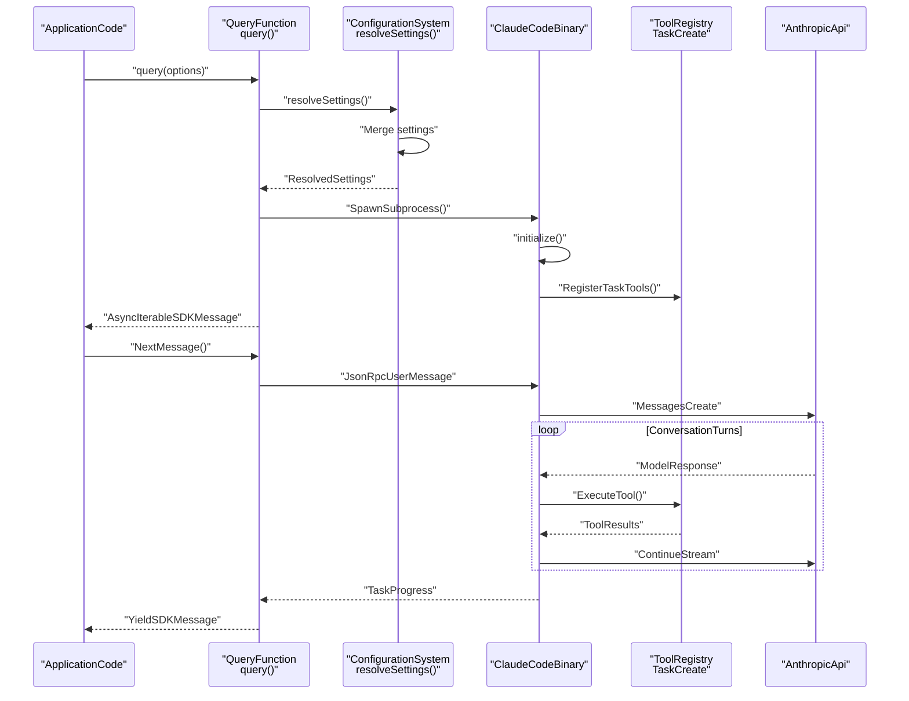
Sources: [CHANGELOG.md:39-39](), [CHANGELOG.md:82-88](), [CHANGELOG.md:90-94](), [CHANGELOG.md:119-119]()

---

## Session Management

The Session Management subsystem handles multi-turn conversations via `query()`, guest subprocess lifecycles, and `SessionStore` transcript mirroring. For details, see [Session Management](#3.2).

Sources: [CHANGELOG.md:24-28](), [CHANGELOG.md:90-94](), [CHANGELOG.md:126-127]()

---

## Tool System

The Tool System manages tool registration, execution, and MCP discovery. For details, see [Tool System](#3.5).

Sources: [CHANGELOG.md:33-38](), [CHANGELOG.md:87-87](), [CHANGELOG.md:162-162]()

---

## Configuration System

The Configuration System hierarchical model resolves settings via `resolveSettings()`. For details, see [Configuration System](#3.3).

Sources: [CHANGELOG.md:105-106](), [CHANGELOG.md:119-119]()

---

## Agent Configuration

Agent configuration covers inline agent definitions, skills options, and max turns. For details, see [Agent Configuration](#3.4).

Sources: [CHANGELOG.md:57-57]()

---

## Hook System and Events

The Hook System enables intercepting lifecycle events using event emitters. For details, see [Hook System and Events](#3.6).

Sources: [CHANGELOG.md:46-47](), [CHANGELOG.md:208-208]()

---

## Task System and Subagents

The Task System enables hierarchical coordination, depth/concurrency caps, and subagent history tracking. For details, see [Task System and Subagents](#4.1).

Sources: [CHANGELOG.md:72-72](), [CHANGELOG.md:141-141](), [CHANGELOG.md:217-217]()

---

## Key SDK Types and Interfaces

Type Mapping Diagram
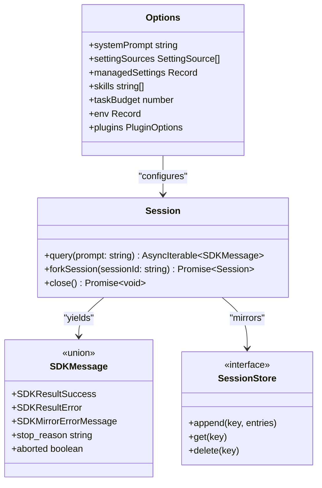
Sources: [CHANGELOG.md:90-94](), [CHANGELOG.md:126-127](), [CHANGELOG.md:172-172](), [CHANGELOG.md:214-214]()

---

# Page: System Architecture

# System Architecture

<details>
<summary>Relevant source files</summary>

The following files were used as context for generating this wiki page:

- [CHANGELOG.md](CHANGELOG.md)

</details>


## Purpose and Scope

This document describes the overall architecture of the Claude Agent SDK TypeScript (`@anthropic-ai/claude-agent-sdk`), including its relationship to the Claude Code CLI, external service integrations, and internal subsystem organization. It provides a technical overview of how the SDK orchestrates AI agent capabilities through a Host-Guest subprocess execution model.

For detailed information about specific subsystems, see:
- Configuration system design: [3.3 Configuration System]()
- Session lifecycle and APIs: [3.2 Session Management]()
- Tool architecture and execution: [3.5 Tool System]()
- MCP protocol details: [3.5.2 MCP Server Integration]()

Sources: [CHANGELOG.md:1-50]()

## System Overview

The SDK operates as a programmatic wrapper around the Claude Code CLI. The architecture utilizes a **Host-Guest subprocess model**, where the SDK spawns a native Claude Code binary (distributed via per-platform optional dependencies) and communicates with it via a JSON-RPC stream over standard input/output [CHANGELOG.md:3-15]().

### High-Level Component Architecture (Code Entity Space)

```mermaid
graph TB
    subgraph "ApplicationLayerHost"
        App["AppCode"]
        SDK["ClaudeAgentSDK<br/>query() / startup()"]
    end
    
    subgraph "SubprocessLayerGuest"
        NativeBinary["ClaudeCodeBinary<br/>child_process.spawn()"]
        RPC["JSONRPCStream<br/>stdin / stdout"]
        BunFs["extractFromBunfs()"]
    end
    
    subgraph "ExternalServices"
        AnthropicAPI["AnthropicAPI"]
        AzureFoundry["AzureAIFoundry"]
        FileSystem["FileSystem<br/>.claude.json / CLAUDE.md"]
        MCPServers["MCPServers<br/>stdio / sse"]
    end

    App -->|"invokes"| SDK
    SDK -->|"spawns & writes"| RPC
    RPC -->|"drives"| NativeBinary
    BunFs -.->|"extracts binary"| NativeBinary
    
    NativeBinary -->|"Inference"| AnthropicAPI
    NativeBinary -->|"Inference"| AzureFoundry
    NativeBinary -->|"Reads/Writes"| FileSystem
    NativeBinary -->|"Manages"| MCPServers
    
    NativeBinary -->>|"JSON-RPC Stream"| RPC
    RPC -->>|"SDKMessage Stream"| SDK
    SDK -->>|"AsyncIterable"| App
```

Sources: [CHANGELOG.md:3-40]()

### Version Parity Model

The SDK maintains strict version parity with the Claude Code CLI. Each SDK release corresponds to a specific Claude Code CLI version to ensure consistent behavior between programmatic usage and terminal usage.

| SDK Version | Claude Code CLI Version | Key Architectural Milestones |
|-------------|------------------------|------------------------------|
| 0.3.278 | 2.1.278 | Parity with Claude Code v2.1.278 [CHANGELOG.md:3-5]() |
| 0.3.274 | 2.1.274 | `startup_failure_reason`, `mcpServer` tracking, and startup timing metrics [CHANGELOG.md:32-35]() |
| 0.3.268 | 2.1.268 | `result_index`, `local_command`, `reload_plugins` control request, and model validation [CHANGELOG.md:78-84]() |
| 0.3.144 | 2.1.144 | `extractFromBunfs()` for Bun compiled binaries [CHANGELOG.md:440-444]() |

Sources: [CHANGELOG.md:1-91]()

## Subprocess Execution Model

The SDK acts as a controller for the Claude Code binary. This ensures that features like context management, tool orchestration, and multi-step reasoning are identical to the CLI experience.

### Communication and Lifecycle

1. **Spawn**: When `query()` or `startup()` is called, the SDK locates the native binary and spawns it using `child_process.spawn`. Spawn failure diagnostics include CLI stderr for libc mismatch detection [CHANGELOG.md:300-302]().
2. **Initialization**: The SDK sends an `initialize` control request, which is idempotent and sets up the session parameters [CHANGELOG.md:86-88]().
3. **Environment**: `options.env` controls the environment passed to the subprocess.
4. **Bun Integration**: For binaries bundled via `bun build --compile`, `extractFromBunfs(binPath)` extracts the binary out of the virtual filesystem into a temporary execution path [CHANGELOG.md:442-444]().
5. **JSON-RPC Control Protocol**: Commands and options are serialized into JSON-RPC and transmitted over `stdin`. Results and intermediate events stream back via `stdout` as newline-delimited JSON.

Sources: [CHANGELOG.md:3-40], [CHANGELOG.md:440-444]()

## Core Subsystems

The SDK architecture is organized into six interacting subsystems.

### Subsystem Interaction Map (Code Entity Space)

```mermaid
graph TD
    subgraph "ControlSubsystems"
        Session["SessionManager<br/>query() / forkSession()"]
        Config["ConfigResolver<br/>resolveSettings()"]
        Hook["HookEmitter<br/>UserPromptSubmit / DirectoryAdded"]
    end

    subgraph "ExecutionSubsystems"
        Task["TaskCoordinator<br/>TaskCreate / Subagents"]
        Tool["ToolRegistry<br/>canUseTool / MCP"]
        Model["ModelManager<br/>EffortLevel / stop_reason"]
    end

    Session -->|"initializesWith"| Config
    Session -->|"triggers"| Task
    Task -->|"executes"| Tool
    Tool -->|"interceptedBy"| Hook
    Task -->|"constrainedBy"| Model
    Session -->>|"emitsEvents"| Hook
```

Sources: [CHANGELOG.md:7-14], [CHANGELOG.md:87-89], [CHANGELOG.md:363-373]()

### 1. Session Management Subsystem
Responsible for conversation persistence, branching, and streaming query responses.
- **Remote Control**: Protocol for managing sessions across hosts, including worker lifecycle signals [CHANGELOG.md:303-305]() and conversation rewinds [CHANGELOG.md:255-257]().
- **State Tracking**: Uses `command_lifecycle` frames (`queued`/`started`/`completed`/`cancelled`/`discarded`) to track the state of uuid-stamped messages [CHANGELOG.md:87-89]().

Sources: [CHANGELOG.md:87-89], [CHANGELOG.md:303-305]()

### 2. Tool Subsystem
- **Permissions**: `canUseTool` callback includes a `requestId` and MCP server source tracking (`mcpServer: {name, source}`) for out-of-band permission responses [CHANGELOG.md:33-35]().
- **Metadata**: `tool_result_meta` sidecar classifies denied/interrupted/cancelled tool calls [CHANGELOG.md:30-32](). `tool_use_meta` provides display-friendly tool names.
- **Task Tools**: `TaskCreate`, `TaskGet`, `TaskUpdate`, and `TaskList` handle structured agent execution units [CHANGELOG.md:479-481]().

Sources: [CHANGELOG.md:30-35], [CHANGELOG.md:479-481]()

### 3. Configuration Subsystem
- **Plugins**: Supports the `plugins` option with configuration parameters such as `skipMcpDiscovery` to control automatic MCP server discovery [CHANGELOG.md:330-331]().
- **Advisory Guidelines**: Includes `workflowSizeGuideline` for setting advisory dynamic-workflow sizes [CHANGELOG.md:14]().
- **Settings Sources**: Supports dynamic sources like `userSettings` for effort level updates via `/effort` [CHANGELOG.md:12]().

Sources: [CHANGELOG.md:12-14], [CHANGELOG.md:330-331]()

### 4. Task and Subagent Subsystem
- **Hierarchy**: Uses `parent_agent_id` for building depth-2+ agent coordination trees [CHANGELOG.md:118-119]().
- **Constraints**: Enforces subagent depth caps via environment configuration and concurrency limits [CHANGELOG.md:24-25]().
- **Progress**: Reports background task state changes to track concurrent background activities [CHANGELOG.md:105-106]().

Sources: [CHANGELOG.md:24-25], [CHANGELOG.md:118-119]()

### 5. Hook Subsystem
- **Lifecycle Events**: `DirectoryAdded` event fires when a new working directory is registered mid-session [CHANGELOG.md:11]().
- **Correlation**: Hook input payloads include `prompt_id` for tracing and correlation [CHANGELOG.md:174-175]().
- **Timeouts**: Enforces strict timeout handling for `Stop`, `SubagentStop`, and `SessionStart` hooks, treating timeouts safely as neutral decisions [CHANGELOG.md:46-47]().

Sources: [CHANGELOG.md:11], [CHANGELOG.md:46-47], [CHANGELOG.md:174-175]()

### 6. Model Subsystem
- **Capability Discovery**: Detects fast mode and model capability states during initialization [CHANGELOG.md:10]().
- **Refusals**: Detects `stop_reason: 'refusal'` accurately across model generations [CHANGELOG.md:363-365]().
- **Usage Reporting**: Emits detailed `usage_report` structures containing session totals and plan usage rows [CHANGELOG.md:44]().

Sources: [CHANGELOG.md:10], [CHANGELOG.md:44], [CHANGELOG.md:363-365]()

## Remote Control Protocol and Command Lifecycle

The Remote Control protocol enables external or distributed control over SDK worker processes. It supports dynamic control messages such as `reloadPlugins` with options like `holdOnCacheImpact` to prevent prompt cache invalidation [CHANGELOG.md:80]().

Message execution and user prompts are orchestrated via `command_lifecycle` frames. These frames allow the host and guest to synchronize state across asynchronous boundaries, tracking each message from its initial queuing phase through execution, completion, or cancellation.

Sources: [CHANGELOG.md:80-89]()

---

# Page: Session Management

# Session Management

<details>
<summary>Relevant source files</summary>

The following files were used as context for generating this wiki page:

- [CHANGELOG.md](CHANGELOG.md)

</details>


## Purpose and Scope

The Session Management subsystem handles the lifecycle of agentic conversations within the SDK. This includes session initialization, persistence, resumption, forking, transcript retrieval, subagent history tracking, and performance pre-warming. The SDK utilizes a Host-Guest subprocess model where a native binary manages the agent's state, tool execution, and conversation history.

This page covers:
*   The `query()` API and its associated `Query` control methods (`interrupt()`, `cancel_queued`, `reinitialize()`, `reloadPlugins()`).
*   Session lifecycle operations: Creation, resumption, forking, and metadata management.
*   Subagent visibility, history retrieval (`getSessionMessages()`), and concurrency controls.
*   Performance optimizations via `startup()` and the `WarmQuery` API.
*   Remote Control protocols, signals, and message metadata (`command_lifecycle` frames, sidecars, and `resume_reason`).

Sources: [CHANGELOG.md:3-91]()

---

## Session Lifecycle and `query()`

The `query()` function serves as the primary execution entry point for agentic interactions. It manages the underlying session lifecycle automatically while returning a `Query` handle for real-time control.

### The `Query` Control Interface
The `Query` object exposes several methods for session manipulation and runtime signaling:
*   **`interrupt(options?)`**: Aborts the current turn. It returns a typed receipt containing `still_queued` UUIDs for asynchronous messages [CHANGELOG.md:93-94](). Passing the `cancel_queued: true` flag allows aborting pending-dispatch messages alongside the active turn [CHANGELOG.md:9-9]().
*   **`reinitialize()`**: Re-synchronizes the SDK state with the underlying native subprocess following transport gaps or network interruptions [CHANGELOG.md:126-126]().
*   **`reloadPlugins({ holdOnCacheImpact: true })`**: Triggers a plugin reload while optionally holding reloads that would invalidate the session's prompt cache [CHANGELOG.md:80-80]().

### Lifecycle State Machine

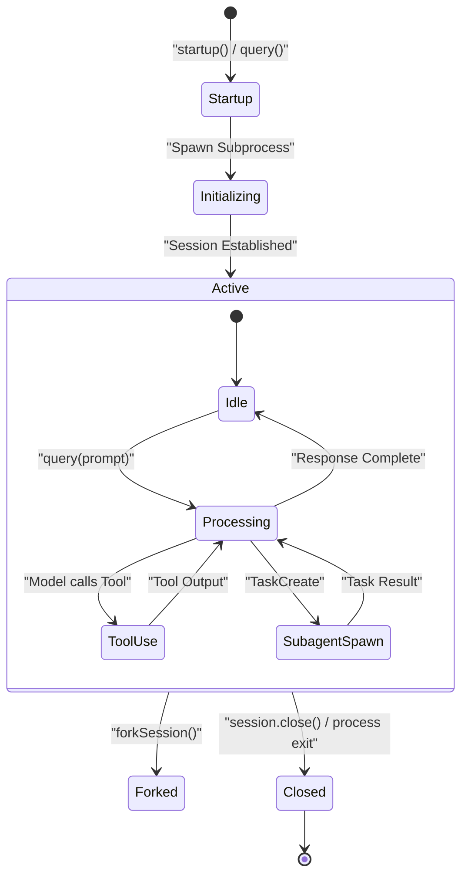
Sources: [CHANGELOG.md:9-9](), [CHANGELOG.md:80-80](), [CHANGELOG.md:93-94](), [CHANGELOG.md:126-126]()

---

## Session Operations: Resumption, Forking, and Metadata

Sessions can be persisted, resumed, and branched into child forks while retaining cumulative accounting metrics.

### Resumption and Forking Mechanics
*   **Resumption**: Passing an existing `sessionId` to `options.resume` in `query()` resumes conversation history. Resumed or forked sessions correctly maintain cumulative metrics such as `total_cost_usd` and `modelUsage` from earlier turns rather than resetting to zero [CHANGELOG.md:13-13]().
*   **Forking (`forkSession`)**: Creates a new session branched from a specific point in transcript history. `forkSession({ upToMessageId })` validates client-supplied UUIDs and ensures assistant messages and queued background notifications are preserved correctly without duplication [CHANGELOG.md:24-26]().

### Metadata and Transcript Management
Core methods available for session introspection and metadata operations include:
*   `listSessions()`: Enumerates stored sessions (robustly resolved across mapped network drives and SUBST volumes on Windows) [CHANGELOG.md:58-60]().
*   `getSessionMessages(sessionId)`: Retrieves transcript history, ensuring user messages sent during background tool execution are placed at the exact turn index where Claude read them [CHANGELOG.md:27-28]().
*   `getSessionInfo(id)`: Fetches metadata for a given session.
*   `tagSession(id, tag)` / `renameSession(id, title)` / `deleteSession(id)`: State and labeling utilities.

Sources: [CHANGELOG.md:13-13](), [CHANGELOG.md:24-28](), [CHANGELOG.md:58-60]()

---

## Subagent and Task Visibility

The SDK supports hierarchical agent coordination via the Task tool suite (`TaskCreate`, `TaskUpdate`, `TaskGet`, `TaskList`).

### History Retrieval and Concurrency
*   **Subagent Transcripts**: `listSubagents(sessionId)` and `getSubagentMessages(sessionId, subagentId)` provide isolation and inspection of nested agent runs.
*   **Parent-Child Linkage**: Messages carry `parent_agent_id` fields to maintain deep execution trees [CHANGELOG.md:105-105]().
*   **Concurrency Caps**: Subagent nesting depth defaults to a cap of 1 (`CLAUDE_CODE_MAX_SUBAGENT_SPAWN_DEPTH`), and concurrent subagents are capped at 20 (`CLAUDE_CODE_MAX_CONCURRENT_SUBAGENTS`) [CHANGELOG.md:24-25]().

Sources: [CHANGELOG.md:24-25](), [CHANGELOG.md:105-105]()

---

## Performance and Pre-warming (`startup()` / `WarmQuery`)

The `startup()` function initializes the background native process without immediately evaluating a prompt, returning a `WarmQuery` handle.

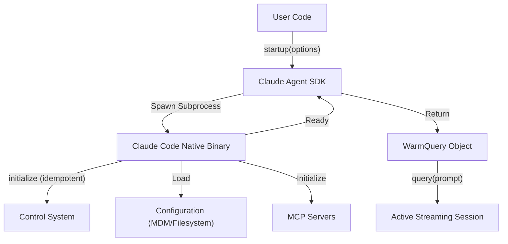
*   **Idempotency**: The `initialize` control handshake executed during startup is fully idempotent [CHANGELOG.md:10-11]().
*   **Startup Timing**: Setting `CLAUDE_CODE_EMIT_STARTUP_TIMING=1` causes the first `system/init` frame to emit per-phase timing breakdowns [CHANGELOG.md:35-35](). Known startup failures are caught and written to error streams via `startup_failure_reason` [CHANGELOG.md:32-32]().

Sources: [CHANGELOG.md:10-11](), [CHANGELOG.md:32-32](), [CHANGELOG.md:35-35]()

---

## Message Metadata, Sidecars, and `command_lifecycle`

Messages and execution frames incorporate detailed tracking metadata:
*   **`command_lifecycle` Frames**: Report terminal states for UUID-stamped messages (`queued`, `started`, `completed`, `cancelled`, or `discarded`) [CHANGELOG.md:88-89]().
*   **`resume_reason` and `user_message_uuid`**: Stamped on assistant messages, stream events, and results during automatic re-runs triggered by host restarts or interruptions [CHANGELOG.md:69-69](), [CHANGELOG.md:81-81]().
*   **`result_index`**: Indicates the result's position in delivery order within a run, starting from `0` [CHANGELOG.md:78-78]().
*   **Sidecars**: `tool_result_meta` captures execution sidecars such as non-execution kinds (e.g., denied, cancelled) without relying on prose parsing [CHANGELOG.md:31-31]().

Sources: [CHANGELOG.md:31-31](), [CHANGELOG.md:69-69](), [CHANGELOG.md:78-78](), [CHANGELOG.md:81-81](), [CHANGELOG.md:88-89]()

---

# Page: Configuration System

# Configuration System

<details>
<summary>Relevant source files</summary>

The following files were used as context for generating this wiki page:

- [CHANGELOG.md](CHANGELOG.md)

</details>


## Purpose and Scope

The Configuration System manages SDK initialization parameters, agent capabilities, and runtime behavior. It employs a hierarchical model that merges programmatic options, filesystem-based settings, and enterprise policy-tier configurations. This page documents the `Options` interface, the `settingSources` control model, and specialized functions like `resolveSettings()` and `applyFlagSettings()` for inspecting and overriding effective configurations.

Related pages: [3.5 Tool System]() for tool configuration, [3.2 Session Management]() for session APIs, [3.4 Agent Configuration]() for subagent definitions.

Sources: [CHANGELOG.md:11-12](), [CHANGELOG.md:103-106](), [CHANGELOG.md:138-139](), [CHANGELOG.md:470-473]()

## Hierarchical Configuration Model

The SDK resolves settings by merging multiple layers of configuration. Later layers in the resolution order override earlier ones.

| Layer | Source | Description |
|-------|--------|-------------|
| 1. Managed | `managedSettings` | Policy-tier settings for embedders, honored below IT-controlled managed sources [CHANGELOG.md:103-106](). |
| 2. Filesystem | `settingSources` | User, project, and local configuration files (e.g., `settings.json`, `CLAUDE.md`) [CHANGELOG.md:472-473](). |
| 3. Programmatic | `Options` | Explicit fields passed to `query()` or session creation functions [CHANGELOG.md:470-471](). |
| 4. Flags | `applyFlagSettings()` | Programmatic CLI flag overrides for specific runtime adjustments, including live agent switching [CHANGELOG.md:11-12](), [CHANGELOG.md:138-139](). |

Sources: [CHANGELOG.md:11-12](), [CHANGELOG.md:103-106](), [CHANGELOG.md:138-139](), [CHANGELOG.md:470-473]()

## Configuration Architecture

The following diagram illustrates how the `Options` object and filesystem sources are processed by the SDK to configure internal components.

```mermaid
graph TB
    subgraph "OptionsSpaceCodeEntities"
    Opts["OptionsquerySession"]
    Managed["managedSettings Recordstring, any"]
    Sources["settingSources 'user'project'local'[]"]
    Flags["applyFlagSettingsflags Recordstring, any"]
    Env["Options.env Recordstring, string"]
    Workflow["workflowSizeGuideline number"]
    end

    subgraph "FilesystemSpace"
    UserCfg "~/.claude/settings.json"
    ProjCfg ".claude/settings.json"
    LocalCfg "./settings.json"
    MDM "MDM plist/HKLM/HKCU"
    end

    subgraph "ProcessingLogic"
    resolveSettings "resolveSettings Alpha"
    ConfigMerger "ConfigurationMerger"
    end

    subgraph "RuntimeComponents"
    Subprocess "ClaudeCodeNativeBinary"
    SystemPrompt "SystemPromptBuilder"
    ToolRegistry "ToolRegistry"
    ModelCtrl "set_modelControlRequest"
    end

    Opts --> Managed
    Opts --> Sources
    Opts --> Env
    Opts --> Workflow
    Managed --> ConfigMerger
    Sources -->|"'user'"| UserCfg
    Sources -->|"'project'"| ProjCfg
    Sources -->|"'local'"| LocalCfg
    
    UserCfg --> ConfigMerger
    ProjCfg --> ConfigMerger
    LocalCfg --> ConfigMerger
    MDM --> resolveSettings
    
    ConfigMerger --> Subprocess
    Flags --> Subprocess
    Env -->|"(Replaces Environment)"| Subprocess
    SystemPrompt --> Subprocess
    ToolRegistry --> Subprocess
    ModelCtrl --> Subprocess
```

Sources: [CHANGELOG.md:11-12](), [CHANGELOG.md:14-14](), [CHANGELOG.md:61-62](), [CHANGELOG.md:103-106](), [CHANGELOG.md:119-121](), [CHANGELOG.md:472-473]()

## Core Configuration Options

### systemPrompt
The `systemPrompt` field provides the primary instructions for the agent. Unlike legacy versions, the SDK does not include a default prompt; it must be explicitly provided or loaded via `settingSources` [CHANGELOG.md:470-471]().

Sources: [CHANGELOG.md:470-471]()

### settingSources
Controls which filesystem configuration locations to load.
- `'user'`: Loads from `~/.claude/settings.json`.
- `'project'`: Loads from `.claude/settings.json`, `.mcp.json`, and `CLAUDE.md`.
- `'local'`: Loads from `./settings.json` in the current working directory.

Sources: [CHANGELOG.md:472-473](), [CHANGELOG.md:474-477]()

### managedSettings
Allows embedders to pass policy-tier settings to the spawned CLI in-memory. These are honored below IT-controlled managed sources (like MDM) but can be used to enforce organizational defaults without writing to the user's filesystem [CHANGELOG.md:103-106]().

Sources: [CHANGELOG.md:103-106]()

### Environment (`options.env`)
The `env` option allows consumers to provide a custom environment for the spawned subprocess.
- **Behavior:** This value **replaces** the subprocess environment entirely; it does not merge with `process.env` [CHANGELOG.md:61-62]().
- **Telemetry:** The SDK automatically ensures `CLAUDE_AGENT_SDK_VERSION` is preserved for User-Agent and telemetry purposes [CHANGELOG.md:61-62]().

Sources: [CHANGELOG.md:61-62]()

## Inspection and Overrides

### resolveSettings() (Alpha)
The `resolveSettings()` function allows developers to inspect the effective merged settings without spawning the Claude CLI subprocess. It reads from MDM sources (plist on macOS, HKLM/HKCU on Windows) for parity with the CLI startup sequence [CHANGELOG.md:119-121]().

Sources: [CHANGELOG.md:119-121]()

### applyFlagSettings()
This function provides a way to programmatically apply CLI flag overrides. 
- **Live Switching:** Since version 0.3.161, `applyFlagSettings` can live-apply `agent` changes. Switching the active agent (or passing `null` to reset) takes effect on the next turn in a running session [CHANGELOG.md:11-12]().
- **Clearing Overrides:** It supports passing `null` to top-level keys to clear existing flag-settings overrides [CHANGELOG.md:138-139]().
- **Effort Levels:** Supports setting `effortLevel` to `'max'` (added in 0.3.214) [CHANGELOG.md:42-42]().

Sources: [CHANGELOG.md:11-12](), [CHANGELOG.md:42-42](), [CHANGELOG.md:138-139]()

## Data Flow for Settings Loading

The SDK spawns a native Claude Code binary and communicates configuration via environment variables and JSON-RPC control requests.

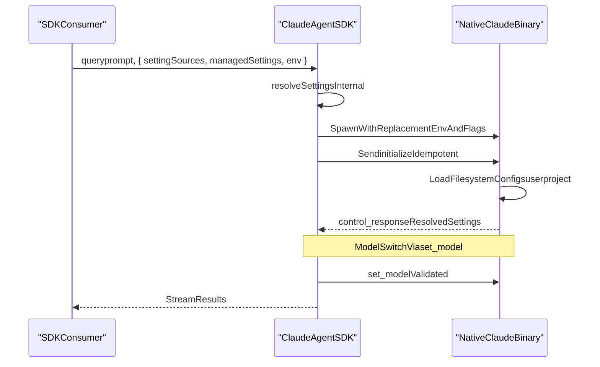

Sources: [CHANGELOG.md:10-11](), [CHANGELOG.md:61-62](), [CHANGELOG.md:103-106](), [CHANGELOG.md:119-121](), [CHANGELOG.md:100-100]()

## Key Configuration Fields

| Option | Type | Description |
|--------|------|-------------|
| `skills` | `string[] \| 'all'` | Controls which Skills (complex tool-use sequences) are loaded. Pass `'all'` to load all available [CHANGELOG.md:133-134](). |
| `env` | `Record<string, string>` | Replaces the subprocess environment (does not merge) [CHANGELOG.md:61-62](). |
| `taskBudget` | `number` | Sets a token-limit awareness for the model to pace tool usage [CHANGELOG.md:5-6](). |
| `forwardSubagentText` | `boolean` | If true, streams subagent text deltas to the SDK consumer [CHANGELOG.md:97-98](). |
| `agentProgressSummaries` | `boolean` | Enables periodic AI-generated progress summaries during long tasks. |
| `workflowSizeGuideline` | `number` | Sets the advisory dynamic-workflow size guideline (0.3.219) [CHANGELOG.md:14-14](). |
| `sandbox.network.strictAllowlist` | `boolean` | Deterministically denies non-allowlisted hosts in sandboxed commands (0.3.219) [CHANGELOG.md:13-13](). |

Sources: [CHANGELOG.md:5-6](), [CHANGELOG.md:13-14](), [CHANGELOG.md:61-62](), [CHANGELOG.md:97-98](), [CHANGELOG.md:133-134]()

---

# Page: Agent Configuration

# Agent Configuration

<details>
<summary>Relevant source files</summary>

The following files were used as context for generating this wiki page:

- [CHANGELOG.md](CHANGELOG.md)

</details>


## Purpose and Scope

This document details how agents, subagents, and specialized AI teammates are configured, structured, and initialized within the Claude Agent SDK. Agents provide isolated operational contexts with dedicated system prompts, custom capability loading, and turn limits.

Agent configuration encompasses:
- Programmatic agent definitions via the `agents` option containing `AgentDefinition` structures.
- Capability control via the `skills` option (`string[] | 'all'`).
- Turn-based execution boundaries (`maxTurns`).
- Periodic status reporting via `agentProgressSummaries`.
- Dynamic lifecycle hooks (`SessionStart` handling `reloadSkills` and `sessionTitle`).
- External plugin integration with MCP server isolation (`skipMcpDiscovery`).
- Subagent nesting depth and concurrency boundaries.

For broader configuration options, see [Configuration System](3.3). For subagent runtime behavior, see [Task System and Subagents](4.1).

---

## Agent Definition Architecture

The SDK supports defining agents through programmatic inline options or via filesystem-based discovery (`CLAUDE.md` and `settings.json` files).

### Diagram: Agent Definition to Code Entities

```mermaid
graph TB
    subgraph "NaturalLanguageSpace"
        NL_Inline["InlineAgentDefinition"]
        NL_Filesystem["FilesystemConfig"]
        NL_Plugin["PluginIntegration"]
    end
    
    subgraph "CodeEntitySpace"
        CE_AgentDefinition["AgentDefinition"]
        CE_Options["SDKOptions.agents"]
        CE_Loader["ConfigurationLoader"]
        CE_Registry["AgentRegistry"]
    end
    
    NL_Inline -->|"Configures"| CE_Options
    NL_Filesystem -->|"LoadedBy"| CE_Loader
    NL_Plugin -->|"Extends"| CE_Loader
    
    CE_Options --> CE_Registry
    CE_Loader --> CE_Registry
    CE_AgentDefinition -.->|"Defines structure"| CE_Registry
```

**Sources:** [CHANGELOG.md:131-133](), [CHANGELOG.md:405-407](), [CHANGELOG.md:473-474]()

---

## Programmatic Agent Definitions

Agents are configured via the `agents` option during initialization, mapping unique agent names to specialized behaviors.

### Agent Properties

| Property | Type | Description |
|----------|------|-------------|
| `name` | `string` | Unique identifier for the agent registry lookup. |
| `description` | `string` | Narrative overview utilized by the parent agent for task routing. |
| `systemPrompt` | `string` | Custom behavioral instructions overriding or extending the base prompt. |
| `skills` | `string[] \| 'all'` | Allowed capability set available to the agent context. |
| `maxTurns` | `number` | Hard stop limit on conversation turns before forced termination. |
| `omitClaudeMd` | `boolean` | When true, runs without user, project, and local `CLAUDE.md` files [CHANGELOG.md:57](). |

**Sources:** [CHANGELOG.md:57](), [CHANGELOG.md:93-95](), [CHANGELOG.md:473-474]()

---

## Plugins and MCP Discovery Isolation

When loading extensions via the `plugins` configuration option, individual plugins can restrict automated tool discovery.

- **`skipMcpDiscovery`**: Setting this flag on a plugin configuration prevents the SDK from scanning for Model Context Protocol (MCP) servers within that plugin's boundaries, optimizing startup performance and enforcing security boundaries [CHANGELOG.md:172-173]().

**Sources:** [CHANGELOG.md:172-173]()

---

## Dynamic Reconfiguration and Hooks

The SDK permits runtime modification of agent configurations and session metadata through specialized hook handlers.

### Diagram: Hook Lifecycle to Code Entities

```mermaid
graph TB
    subgraph "NaturalLanguageSpace"
        NL_Start["SessionInitialization"]
        NL_SkillScan["SkillRescan"]
        NL_Title["SetSessionTitle"]
    end
    
    subgraph "CodeEntitySpace"
        CE_SessionStart["SessionStartHook"]
        CE_ReloadSkills["reloadSkills: boolean"]
        CE_SessionTitle["hookSpecificOutput.sessionTitle"]
        CE_Source["source: 'fork' | 'resume'"]
    end
    
    NL_Start --> CE_SessionStart
    NL_SkillScan --> CE_ReloadSkills
    NL_Title --> CE_SessionTitle
    
    CE_SessionStart --> CE_Source
    CE_SessionStart --> CE_ReloadSkills
    CE_SessionStart --> CE_SessionTitle
```

**Sources:** [CHANGELOG.md:152-153](), [CHANGELOG.md:214-215]()

---

## Execution Constraints and Environment Limits

Subagent spawning is governed by strict structural and concurrency constraints to prevent resource exhaustion.

- **Subagent Depth Cap**: Configured via `CLAUDE_CODE_MAX_SUBAGENT_SPAWN_DEPTH` (default: `1`) [CHANGELOG.md:22-24]().
- **Concurrency Cap**: Governed by `CLAUDE_CODE_MAX_CONCURRENT_SUBAGENTS` (default: `20`) [CHANGELOG.md:25-26]().
- **Progress Summaries**: Enabled via `agentProgressSummaries`, emitting periodic status updates through `task_progress` events [CHANGELOG.md:258-259]().

**Sources:** [CHANGELOG.md:22-26](), [CHANGELOG.md:258-259]()

---

# Page: Tool System

# Tool System

<details>
<summary>Relevant source files</summary>

The following files were used as context for generating this wiki page:

- [CHANGELOG.md](CHANGELOG.md)

</details>


The Tool System is the primary mechanism for extending agent capabilities beyond text generation. It manages tools from multiple sources (built-in, custom, and MCP servers), enforces access controls through permission callbacks and hooks, and provides runtime introspection and control over tool availability.

For details on built-in tools and `askUserQuestion` configuration, see [Built-in Tools](#3.5.1). For MCP server management and elicitation hooks, see [MCP Server Integration](#3.5.2).

## Overview

The tool system provides a unified registry that aggregates tools from multiple sources, applies visibility filters based on configuration, and gates execution through permission callbacks. All tools—whether built-in, custom, or MCP-provided—flow through the same execution pipeline and are subject to timeout, deferred tool execution handling, and error management mechanisms [CHANGELOG.md:23-23](), [CHANGELOG.md:38-40]().

Starting in version 0.3.162, native builds default to fast embedded `find` and `grep` search functionality within the `Bash` tool, matching the interactive CLI behavior, rather than always registering dedicated `Grep`/`Glob` tools [CHANGELOG.md:144-145](). Furthermore, task-tracking tools (`TaskCreate`, `TaskGet`, `TaskUpdate`, `TaskList`, and `TodoWrite`) are default tools only on specific model versions such as Claude 3.x, Opus 4.0–4.7, Sonnet 4.0–4.6, and Haiku 4.5; elsewhere they are explicitly listed in `tools` or `allowedTools` [CHANGELOG.md:87-88]().

### Tool System Subsystem Architecture

```mermaid
graph TB
    subgraph "Natural Language Space"
        NaturalPrompt["User Prompt 'Run tests and inspect files'"]
    end
    
    subgraph "Code Entity Space"
        QueryFunc["query() Session Method"]
        UnifiedRegistry["Unified Tool Registry"]
        CanUseTool["canUseTool(requestId, agent_id, mcpServer)"]
        ToolExecutor["Tool Executor / MCP_TOOL_TIMEOUT"]
        ToolResultMeta["tool_result_meta & tool_use_meta Sidecars"]
    end
    
    NaturalPrompt --> QueryFunc
    QueryFunc --> UnifiedRegistry
    UnifiedRegistry --> CanUseTool
    CanUseTool --> ToolExecutor
    ToolExecutor --> ToolResultMeta
```
Sources: [CHANGELOG.md:23-23](), [CHANGELOG.md:33-33](), [CHANGELOG.md:117-119]()

## Tool Configuration Options

The tool system provides several mechanisms for controlling tool availability and behavior.

### `tools` and `disallowedTools`

The `tools` option defines the base set of available built-in tools (e.g., `['Bash', 'Read']`), while `disallowedTools` acts as a global blocklist. `disallowedTools` supports server-level specs (e.g., `mcp__server__*`) to remove all tools from a named MCP server [CHANGELOG.md:118-119]().

| Option | Description |
|--------|-------------|
| `tools` | Allowlist of built-in tools or presets. |
| `allowedTools` | Explicitly name tools (like `Grep` or `Glob`) to keep them registered on native builds [CHANGELOG.md:144-145](). |
| `disallowedTools` | Blocklist that removes tools from visibility, supporting wildcard server specs [CHANGELOG.md:118-119](). |
| `skills` | Controls which Skills (custom tool definitions) are loaded into the session [CHANGELOG.md:214-215](). |
| `taskBudget` | Allows the model to pace tool use within a token limit. |

Sources: [CHANGELOG.md:118-119](), [CHANGELOG.md:144-145](), [CHANGELOG.md:214-215]()

## Tool Execution Pipeline

### Permission Enforcement and `canUseTool`

The `canUseTool` callback is the primary mechanism for out-of-band permission responses. 
*   **`requestId`**: `canUseTool` receives a `requestId` to correlate out-of-band responses [CHANGELOG.md:82-84]().
*   **`agent_id`**: Includes an `agent_id` field for background agent permission forwarding [CHANGELOG.md:103-105]().
*   **`mcpServer`**: Includes `{name, source}` metadata in options, enabling hosts to key trust when `source === "sdk"` [CHANGELOG.md:33-33]().
*   **Permission Denials**: Path-scoped deny rules are properly tracked and reported in `result.permission_denials`, covering operations like `Read`, `Edit`, and `Write` [CHANGELOG.md:70-70]().

### Tool Execution and Sidecars

Deferred tool call results are correctly emitted with `tool_use_result` keys upon session resumption [CHANGELOG.md:23-23](). The SDK uses sidecar metadata to enhance tool observability:
*   **`tool_use_meta`**: Provides display-friendly tool names [CHANGELOG.md:117-117]().
*   **`tool_result_meta`**: Includes `non_execution_kind` and `user_feedback`, allowing consumers to classify denied, interrupted, or cancelled tool calls without string-matching result prose [CHANGELOG.md:30-32]().

### Tool Execution and Permission Flow

```mermaid
graph LR
    subgraph "Natural Language Space"
        UserIntent["Agent Tool Invocation Intent"]
    end

    subgraph "Code Entity Space"
        SessionRunner["query() Execution Loop"]
        PermissionGate["canUseTool Callback"]
        ResultHandler["tool_result_meta.non_execution_kind"]
        BashTool["BashToolOutput / Task Tools"]
    end

    UserIntent --> SessionRunner
    SessionRunner --> PermissionGate
    PermissionGate --> BashTool
    BashTool --> ResultHandler
```
Sources: [CHANGELOG.md:30-32](), [CHANGELOG.md:70-70](), [CHANGELOG.md:87-88]()

---

- For details on built-in tools and `askUserQuestion` configuration, see [Built-in Tools](#3.5.1).
- For details on MCP server lifecycle, status, reconnection, and elicitation, see [MCP Server Integration](#3.5.2).

---

# Page: Built-in Tools

# Built-in Tools

<details>
<summary>Relevant source files</summary>

The following files were used as context for generating this wiki page:

- [CHANGELOG.md](CHANGELOG.md)

</details>


This document describes the built-in tools provided by the Claude Agent SDK, their implementation details, and the configuration options that govern their availability and behavior. Built-in tools are native capabilities implemented within the SDK that enable agents to interact with the local environment, manage files, and coordinate tasks.

---

## Overview of Built-in Tools

Built-in tools are core capabilities that ship directly with the SDK. Unlike MCP tools, which require an external server, built-in tools are executed by the SDK's internal tool engine.

| Tool Name | Purpose | Key Feature |
|-----------|---------|-------------|
| `Bash` | Execute shell commands | Real-time command execution; supports auto-backgrounding with `timedOutAfterMs` [CHANGELOG.md:66-67](). |
| `Read` | Read file contents | Populates context with file data and tracks modification state. |
| `Edit` | Modify file contents | Supports precise manipulations with `seed_read_state` safety. |
| `NotebookEdit` | Modify notebook cells | Includes `old_source` field for inline diff generation [CHANGELOG.md:154-155](). |
| `AskUserQuestion` | Request user input | Enables interactive loops with configurable `previewFormat`. |
| `TaskCreate` | Create a new task | Modern task tracking tool replacing legacy `TodoWrite` [CHANGELOG.md:131-133](). |
| `TaskGet` | Retrieve task details | Provides structured access to task status and metadata. |
| `TaskUpdate` | Update task state | Allows agents to mark tasks as complete or modify descriptions. |
| `TaskList` | List all tasks | Enables oversight of the current task queue. |
| `ReadMcpResourceDir` | List MCP resources | Specialized tool for listing directory contents of MCP resources [CHANGELOG.md:164-165](). |

Sources: [CHANGELOG.md:66-67](), [CHANGELOG.md:131-133](), [CHANGELOG.md:154-155](), [CHANGELOG.md:164-165]()

---

## Detailed Tool Implementation

### Bash Tool
The `Bash` tool provides a bridge to the host operating system's shell. 
- **Embedded Search:** Native builds utilize fast embedded `find` and `grep` implementations within the `Bash` tool itself rather than registering separate `Grep` or `Glob` tools [CHANGELOG.md:213-214]().
- **Timeout & Backgrounding:** `BashToolOutput` includes a `timedOutAfterMs` field set when a command exceeds its execution threshold, automatically moving it to the background [CHANGELOG.md:66-67]().
- **Data Flow:** The agent sends a command string; the SDK executes it via a sub-process and returns `stdout`, `stderr`, and the exit code.

### Read and Edit State
The `Read` tool allows the agent to ingest file content, while `Edit` is used for rewriting or patching.
- **The Eviction Problem:** In long conversations, the original `Read` result might be evicted from the context window to save tokens.
- **The Solution:** The SDK uses a `seed_read_state` mechanism to persist `{path, mtime}` metadata even if the originating `Read` tool result is no longer in the active context, ensuring `Edit` remains functional by verifying the file hasn't changed since it was last "seen".
- **Notebooks:** The `NotebookEdit` tool includes an `old_source` field to facilitate the generation of inline diffs by comparing the new state against previous content [CHANGELOG.md:154-155]().

### AskUserQuestion Tool
This tool enables human-in-the-loop interactions.
- **Preview Formatting:** Using `toolConfig.askUserQuestion.previewFormat`, developers can set the format to `'markdown'` or `'html'`. This affects the `preview` field and `annotations` output exposed in the public SDK types.

### Task Management Tools
The SDK utilizes Task tools (`TaskCreate`, `TaskGet`, `TaskUpdate`, `TaskList`) for structured progress tracking. 
- **Model-Dependent Defaults:** Task-tracking tools are enabled by default only on Claude 3.x, Opus 4.0–4.7, Sonnet 4.0–4.6, and Haiku 4.5 models; for other models, they must be explicitly listed in `tools` or `allowedTools` [CHANGELOG.md:87-87]().
- **Types:** Input and Output types for these tools are exported from `@anthropic-ai/claude-agent-sdk/sdk-tools` [CHANGELOG.md:139-141]().
- **Agent Integration:** When a subagent completes a task, the result is communicated via the `AgentToolCompletedOutput` type [CHANGELOG.md:84-86]().

Sources: [CHANGELOG.md:66-67](), [CHANGELOG.md:84-86](), [CHANGELOG.md:87-87](), [CHANGELOG.md:131-133](), [CHANGELOG.md:139-141](), [CHANGELOG.md:154-155](), [CHANGELOG.md:213-214]()

---

## Tool System Architecture

The following diagram illustrates the flow from a tool request in Natural Language Space to the execution of code entities within the SDK.

```mermaid
graph TD
    subgraph "NaturalLanguageSpace"
        AgentRequest["Agent decides to use 'Edit' or 'TaskUpdate'"]
    end

    subgraph "CodeEntitySpace"
        QueryFunc["query() / Session.stream()"]
        ToolRegistry["ToolRegistry"]
        
        subgraph "BuiltinImplementation"
            EditImpl["Edit Tool Implementation"]
            TaskImpl["TaskCreate / TaskUpdate Logic"]
            BashImpl["BashTool with timedOutAfterMs"]
            McpResImpl["ReadMcpResourceDirTool"]
        end

        subgraph "SafetyAndMetadata"
            CanUseTool["canUseTool() Hook"]
            ToolResultMeta["tool_result_meta non_execution_kind"]
            ToolsConfig["toolConfig.askUserQuestion"]
            Disallowed["disallowedTools Filter"]
        end
    end

    AgentRequest --> QueryFunc
    QueryFunc --> CanUseTool
    CanUseTool --> ToolRegistry
    ToolRegistry --> Disallowed
    Disallowed --> EditImpl
    Disallowed --> TaskImpl
    Disallowed --> BashImpl
    Disallowed --> McpResImpl
    EditImpl --> ToolResultMeta
```

**Diagram: Tool Execution Data Flow**
This diagram maps the transition from an agent's intent to the SDK's internal validation and execution logic, including the `tool_result_meta` sidecar for classifying denied or cancelled tool calls.

Sources: [CHANGELOG.md:30-32](), [CHANGELOG.md:66-67](), [CHANGELOG.md:131-133](), [CHANGELOG.md:164-165]()

---

## Configuration and Filtering

The availability of built-in tools is governed by the `tools`, `allowedTools`, and `disallowedTools` options.

### The `tools` Option
This option supports three modes:
1.  **Allowlist (Array):** `['Bash', 'Read', 'TaskCreate']` — Only these tools are available.
2.  **Preset:** `{ type: 'preset', preset: 'claude_code' }` — Enables the standard suite of tools.
3.  **Empty:** `[]` — Disables all built-in tools.

### The `allowedTools` and Search Tools
Dedicated `Grep` and `Glob` search tools are omitted by default on native builds to favor embedded search in `Bash`. To keep dedicated search tools, they must be explicitly referenced in `allowedTools` [CHANGELOG.md:213-214]().

### The `disallowedTools` Option
Acts as a blocklist targeting specific tools or entire MCP servers (e.g., `mcp__server_name` or `mcp__server_name__*`) [CHANGELOG.md:185-187]().

```mermaid
graph LR
    subgraph "InputConfiguration"
        T_Opt["tools: string[] | Preset"]
        D_Opt["disallowedTools: string[]"]
        A_Opt["allowedTools: string[]"]
    end

    subgraph "ResolutionLogic"
        Registry["ToolRegistry.getAvailableTools()"]
        Filter["Filter Logic Blocklist"]
        Override["Override Logic Allowlist"]
    end

    subgraph "ResultSpace"
        Visible["Visible to Model"]
    end

    T_Opt --> Registry
    D_Opt --> Filter
    A_Opt --> Override
    Registry --> Filter
    Filter --> Override
    Override --> Visible
```

**Diagram: Tool Resolution Logic**
Visualizing how the SDK determines the final toolset sent to the model by intersecting `tools`, `allowedTools`, and `disallowedTools`.

Sources: [CHANGELOG.md:185-187](), [CHANGELOG.md:213-214]()

---

## Advanced Tool Configuration

### `toolConfig.askUserQuestion.previewFormat`
Allows customization of how questions are rendered for the user.
```typescript
const result = await query("...", {
  toolConfig: {
    askUserQuestion: {
      previewFormat: 'markdown' // 'markdown' | 'html'
    }
  }
});
```

### Exported Types
The SDK exports specific types for handling tool outputs and inputs:
- **`AgentToolCompletedOutput`**: The structured result emitted when an agent tool finishes its task [CHANGELOG.md:84-86]().
- **Task Tool Types**: `TaskCreateInput`, `TaskGetInput`, `TaskUpdateInput`, `TaskListInput` and their corresponding outputs [CHANGELOG.md:139-141]().

Sources: [CHANGELOG.md:84-86](), [CHANGELOG.md:139-141]()

---

# Page: MCP Server Integration

# MCP Server Integration

<details>
<summary>Relevant source files</summary>

The following files were used as context for generating this wiki page:

- [CHANGELOG.md](CHANGELOG.md)

</details>


This document details how the Claude Agent SDK integrates with Model Context Protocol (MCP) servers to expose external tools, resources, and prompts to agents. MCP servers run as standalone processes communicating via stdio, HTTP/SSE, or proxied transports.

For information on built-in tools (Bash, Read, Edit, AskUserQuestion), see [Built-in Tools](3.5.1). For broader tool system architecture including tool selection and registries, see [Tool System](3.5).

---

## MCP Server Overview and Architecture

MCP servers extend agent capabilities by providing dynamic tools. The SDK's internal MCP Manager handles process lifecycles, health monitoring, reconnection, and configuration scoping.

The following diagram bridges the configuration space to the SDK's internal code entities and runtime execution:

```mermaid
graph TB
    subgraph "SDK Core (Code Entity Space)"
        Session["Session"]
        Query["query()"]
        McpManager["McpManager"]
    end
    
    subgraph "External Processes"
        MCP1["MCPServerStdio"]
        MCP2["MCPServerSSE"]
    end
    
    subgraph "Configuration Space"
        sdkMcpServers["sdkMcpServers"]
        mcpJson[".mcp.json"]
        settingsJson["settings.json"]
        disallowedTools["disallowedTools"]
    end
    
    Query -->|"Initializes"| Session
    Session -->|"Manages"| McpManager
    sdkMcpServers -->|"Configures"| McpManager
    mcpJson -->|"Loads"| McpManager
    settingsJson -->|"Loads"| McpManager
    disallowedTools -->|"Filters"| McpManager
    
    McpManager <-->|"JSON-RPC (stdio)"| MCP1
    McpManager <-->|"SSE Transport"| MCP2
    
    MCP1 -.->|"Exposes"| Tools["MCP Tools"]
    Tools -.->|"Registered in"| Session
```

**Sources**: [CHANGELOG.md:125-126](), [CHANGELOG.md:140-141](), [CHANGELOG.md:33-38]()

---

## Server Management APIs and Startup Behavior

### Non-Blocking Connection Default and Startup Timing

By default, MCP servers connect asynchronously in the background to avoid blocking the initial agent query [CHANGELOG.md:90-91](). 
* **Non-Blocking Default**: Sessions start immediately. Slow or connecting servers report `status: "pending"` during the initial handshake [CHANGELOG.md:90-91]().
* **Deferred Tool Search**: Servers loaded from settings files or plugins defer tool search, avoiding startup delays, while servers defined in `options.mcpServers` are prioritized [CHANGELOG.md:38-38]().
* **Startup Bounds**: You can pass `CLAUDE_CODE_MCP_STARTUP_WAIT_MS` via `env` to bound or completely disable (`0`) the first-turn wait for connecting MCP servers [CHANGELOG.md:34-34](). Setting `MCP_CONNECTION_NONBLOCKING=0` restores the legacy synchronous connection behavior [CHANGELOG.md:91-91]().

### `mcpServerStatus()`

The SDK provides status inspection for all configured servers, returning records indicating their connection state, source, and available tools:

| Return Field | Type | Description |
|--------------|------|-------------|
| `name` | `string` | Server identifier |
| `status` | `string` | `'connected'`, `'pending'`, `'disconnected'`, `'disabled'`, `'error'` |
| `config` | `object` | Server process configuration (command, args, env) |
| `scope` | `string` | Configuration source (`'sdk'`, `'project'`, `'user'`) |
| `source` | `string` | Source identifier (e.g., `'sdk'`) enabling hosts to key trust [CHANGELOG.md:33-34]() |
| `tools` | `string[]` | Tool names exposed by the server |

**Sources**: [CHANGELOG.md:33-34](), [CHANGELOG.md:38-38](), [CHANGELOG.md:90-91]()

### Lifecycle State Machine

```mermaid
stateDiagram-v2
    [*] --> Connecting: "Session Init"
    Connecting --> Connected: "Handshake Success"
    Connecting --> Pending: "Non-blocking Start"
    Pending --> Connected: "Ready"
    Connected --> Disconnected: "Transport Abort"
    Disconnected --> Connecting: "Auto-reconnect / reconnectMcpServer()"
    Connected --> Disabled: "toggleMcpServer(false)"
    Disabled --> Connecting: "toggleMcpServer(true)"
```

**Sources**: [CHANGELOG.md:38-39](), [CHANGELOG.md:90-91](), [CHANGELOG.md:100-101]()

---

## Permissions and Tool Integration

### `canUseTool` and Security Policies

When an MCP tool is invoked, permission checks route through the `canUseTool` callback. The options object supplies an `mcpServer: {name, source}` property, and tool hook inputs receive `mcp_server`, allowing host applications to key trust policies based on whether a server originates from the SDK (`source === "sdk"`) or user configuration [CHANGELOG.md:33-34]().

### Tool Disallowance (`disallowedTools`)

The `disallowedTools` configuration supports server-level wildcard specs using the `mcp__server` or `mcp__server__*` format. This completely excludes tools originating from specified MCP servers from being registered or exposed to the agent [CHANGELOG.md:128-129]().

### Request Timeouts

* **Per-Server Timeouts**: The `mcp_set_servers` control request accepts a `request_timeout_ms` parameter to configure individual timeout thresholds per server [CHANGELOG.md:108-109]().
* **Global Timeout**: The `MCP_TOOL_TIMEOUT` environment variable enforces a ceiling on all MCP tool executions [CHANGELOG.md:79-79]().

**Sources**: [CHANGELOG.md:33-34](), [CHANGELOG.md:79-79](), [CHANGELOG.md:128-129]()

---

## MCP Elicitation and Annotations

### Elicitation Hooks

MCP servers can request supplemental user input or host configuration at runtime using elicitation. When triggered, the SDK handles `McpElicitation` events and emits an `SDKElicitationCompleteMessage` back into the control stream once input is collected.

### Tool Metadata Annotations

MCP tool definitions can declare semantic hints that modify execution and safety handling:
* `readOnlyHint`: Marks read-only actions (skipping destructive prompts).
* `destructiveHint`: Marks irreversible data mutations.
* `openWorldHint`: Designates interactions with external web APIs.

**Sources**: [CHANGELOG.md:141-142]()

---

## Configuration Scoping

MCP servers resolve across three precedence tiers:
1. **SDK Scope**: Programmatically supplied via `options.sdkMcpServers`.
2. **Project Scope**: Defined in project-level `.mcp.json` or `.claude/settings.json`.
3. **User Scope**: Global user settings directories.

```mermaid
graph LR
    subgraph "Scope Precedence"
        SDK["sdkMcpServers"] --> Registry["Tool Registry"]
        Project[".mcp.json"] --> Registry
        User["settings.json"] --> Registry
    end
    Registry --> Agent["Claude Agent"]
```

**Sources**: [CHANGELOG.md:125-126](), [CHANGELOG.md:141-142]()

---

# Page: Hook System and Events

# Hook System and Events

<details>
<summary>Relevant source files</summary>

The following files were used as context for generating this wiki page:

- [CHANGELOG.md](CHANGELOG.md)

</details>


This page documents the SDK's hook system and event emission architecture. The hook system provides extension points for observing configuration changes, task lifecycle events, permission requests, message display transformations, and tool execution results. Events are emitted through `Session.stream()` to notify applications of task state changes, including progress updates and session state transitions.

## Overview

The SDK implements an event-driven architecture with two primary mechanisms:

1.  **Hook System**: Callback functions that intercept lifecycle events. Some hooks are **blocking** (e.g., `PermissionRequest`, `UserPromptSubmit`) and can pause execution for approval or processing.
2.  **Event Emission**: System messages and state change notifications emitted through `Session.stream()`.

### Hook Categories

| Hook Type | Blocking | Purpose |
| :--- | :--- | :--- |
| `SessionStart` | Yes | Runs at session initialization; can trigger skill re-scans and set titles. |
| `ConfigChange` | No | Monitor configuration file changes for security auditing. |
| `TeammateIdle` | No | Observe when subagent tasks become idle. |
| `TaskCompleted` | No | Receive notification when subagent tasks complete. |
| `PermissionRequest` | Yes | Control tool execution through approval/denial. |
| `PostToolUse` | No | Inspect or replace tool outputs globally via `updatedToolOutput`. |
| `MessageDisplay` | Yes | Transform or hide assistant message text before display. |
| `UserPromptSubmit`| Yes | Intercept user prompts before they are sent to the model. |
| `DirectoryAdded` | No | Fired when a new working directory is registered mid-session. |

### Event Types

| Event Type | Format | Purpose |
| :--- | :--- | :--- |
| `task_started` | System message | Notify when a subagent task is registered. |
| `task_progress` | System message | Real-time progress with `summary`, usage, and tool counts. |
| `task_notification` | System message | Correlate task completions with originating tool calls. |
| `session_state_changed` | Opt-in Event | Notify when session metadata (tags, title) changes. |
| `hook_started` | Lifecycle Event | Opt-in notification that a hook has begun. |
| `hook_progress` | Lifecycle Event | Opt-in notification of hook execution progress. |
| `hook_response` | Lifecycle Event | Opt-in notification of the final hook result. |
| `command_lifecycle` | Lifecycle Event | Reports message terminal states (`queued`, `started`, `completed`, `cancelled`, `discarded`). |

Sources: [CHANGELOG.md:8-14](), [CHANGELOG.md:46-47](), [CHANGELOG.md:73-76](), [CHANGELOG.md:88-89]()

## Hook System Architecture

The following diagram illustrates how the SDK bridges the "Natural Language Space" (user intents and agent reasoning) to the "Code Entity Space" (specific hook handlers, `HookRegistry`, and `Session.stream()`).

**Diagram: Hook and Event System Architecture**

```mermaid
graph TB
    subgraph "NaturalLanguageSpace"
        UserIntent["User Intent & Prompts"]
        AgentReasoning["Agent Reasoning Loop"]
    end
    
    subgraph "CodeEntitySpace"
        App["Application Code"]
        Handlers["Hook Handlers"]
        S["Session.stream()"]
        HR["HookRegistry"]
        EE["EventEmitter"]
        AgentLoop["Agent Turn Loop"]
    end
    
    subgraph "HookTypes"
        PH["PermissionRequest"]
        CH["ConfigChange"]
        TH["Task Lifecycle Hooks"]
        PTH["PostToolUseHook"]
        MDH["MessageDisplayHook"]
        UPS["UserPromptSubmit"]
        DA["DirectoryAdded"]
        TE["task_progress / task_started"]
        SE["session_state_changed"]
        LE["hook_lifecycle_events"]
    end

    UserIntent --> AgentReasoning
    AgentReasoning --> AgentLoop
    App -->|"registers"| Handlers
    Handlers -->|"stored in"| HR
    S -->|"yields"| App
    
    AgentLoop -->|"triggers"| PH
    AgentLoop -->|"triggers"| CH
    AgentLoop -->|"triggers"| TH
    AgentLoop -->|"triggers"| PTH
    AgentLoop -->|"triggers"| MDH
    AgentLoop -->|"triggers"| UPS
    AgentLoop -->|"triggers"| DA
    
    PH -.->|"blocking callback"| Handlers
    CH -.->|"callback"| Handlers
    TH -.->|"callback"| Handlers
    PTH -.->|"callback"| Handlers
    MDH -.->|"blocking callback"| Handlers
    UPS -.->|"blocking callback"| Handlers
    DA -.->|"callback"| Handlers
    
    EE -->|"emits via stream"| TE
    EE -->|"emits via stream"| SE
    EE -->|"emits via stream"| LE
    TE --> S
    SE --> S
    LE --> S
```

Sources: [CHANGELOG.md:8-14](), [CHANGELOG.md:73-76](), [CHANGELOG.md:88-89]()

## Hook Types and Features

### SessionStart and Stop Hook Timeouts
The `SessionStart` hook executes when a session begins. 
*   **`reloadSkills: true`**: Triggers a re-scan of available skills.
*   **`hookSpecificOutput.sessionTitle`**: Programmatically sets the session title.
*   **Timeouts**: If a `Stop`, `SubagentStop`, or `SessionStart` hook callback exceeds its timeout, it counts as no decision rather than discarding other hooks' decisions or failing the session [CHANGELOG.md:46-47]().

### PermissionRequest and Tool Hooks
The `PermissionRequest` hook implements a blocking approval gate for tool invocations. Tool hook inputs now carry `mcp_server` metadata (`{name, source}`), allowing hosts to key trust verification accordingly [CHANGELOG.md:33-33]().

### Post-Tool Use Hook and Output Replacement
The `PostToolUse` hook allows developers to intercept the output of any tool before it is returned to the model.
*   **`PostToolUseHookSpecificOutput.updatedToolOutput`**: This field allows the hook to replace the tool output for all tools.
*   **Abort Signal Handling**: Hook callbacks correctly propagate abort signals during `PostToolUse`.

### MessageDisplay Hook
The `MessageDisplay` hook allows consumers to transform or hide assistant message text as it is being processed for display.

### UserPromptSubmit Hook
This hook intercepts user prompts before execution. If a callback exceeds its timeout, it blocks the prompt with a feedback message emitted to the SDK event stream while allowing the session to continue.

### DirectoryAdded Hook
Fired when a new working directory is registered mid-session, enabling dynamic context and project switching.

### Telemetry and Correlation
Hook input payloads include a `prompt_id` field to facilitate OpenTelemetry correlation across the agent lifecycle.

Sources: [CHANGELOG.md:33-33](), [CHANGELOG.md:46-47](), [CHANGELOG.md:73-76]()

## Event System

The SDK emits real-time updates through the `Session.stream()` generator.

### Task Progress and Notifications
*   **`task_progress`**: Emitted for real-time background agent progress. Includes retry states when agents wait out API rate-limit retries.
*   **`task_notification`**: Correlates background task completion with the originating tool call via `tool_use_id`.
*   **`origin`**: Result messages include an `origin` field to distinguish user-prompted results from task-notification followups.

### Session and System Events
*   **`session_state_changed`**: Opt-in events notified when session metadata (such as titles or tags) changes.
*   **`command_lifecycle`**: Reports message states: `queued`, `started`, `completed`, `cancelled`, or `discarded`.
*   **`result_index`**: Stamped on result messages to denote their exact delivery order position within the run starting from `0` [CHANGELOG.md:78-78]().

Sources: [CHANGELOG.md:78-78](), [CHANGELOG.md:88-89]()

## Data Flow: Task Execution to Event Emission

The following diagram traces the lifecycle of a subagent task and how events are propagated through the SDK's internal code entities (`TaskManager`, `EventEmitter`, and `Session.stream()`).

**Diagram: Task Lifecycle and Event Flow**

```mermaid
sequenceDiagram
    participant NaturalLanguage as "UserPrompt / Agent Intent"
    participant A as Agent (Main)
    participant TM as TaskManager
    participant S as Subagent
    participant EE as EventEmitter
    participant H as Hooks (TaskCompleted)

    NaturalLanguage->>A: "Execute Subtask"
    A->>TM: AgentToolInput (subagent_type)
    TM->>EE: emit "task_started"
    TM->>S: spawn()
    
    loop Execution
        S->>TM: Progress Update
        TM->>EE: emit "task_progress" (summary)
    end
    
    S->>TM: Task Finished (ExitReason)
    TM->>H: call TaskCompletedHook (prompt_id)
    TM->>EE: emit "task_notification" (tool_use_id, origin)
    TM->>EE: emit "command_lifecycle" (completed)
    
    Note over TM, EE: Result messages include SDKMessageOrigin and result_index
```

Sources: [CHANGELOG.md:44-45](), [CHANGELOG.md:78-78](), [CHANGELOG.md:88-89]()

## Summary of Hook and Event Metadata

| Field | Location | Description |
| :--- | :--- | :--- |
| `updatedToolOutput` | `PostToolUse` Hook | Replaces the result of a tool execution. |
| `origin` | `SDKResultSuccess/Error` | The `SDKMessageOrigin` of the message that triggered this result. |
| `result_index` | Result Message | Position of the result in delivery order within the run, from `0` [CHANGELOG.md:78-78](). |
| `reloadSkills` | `SessionStart` Hook | Triggers a re-scan of skills when true. |
| `prompt_id` | Hook Payloads | Used for OpenTelemetry correlation. |
| `ExitReason` | `TaskCompleted` | Reason for termination (e.g., `success`, `error`, `resume`). |
| `mcp_server` | Tool Hook Inputs | Carries `{name, source}` for MCP trust verification [CHANGELOG.md:33-33](). |

Sources: [CHANGELOG.md:33-33](), [CHANGELOG.md:78-78]()

---

# Page: Advanced Features

# Advanced Features

<details>
<summary>Relevant source files</summary>

The following files were used as context for generating this wiki page:

- [CHANGELOG.md](CHANGELOG.md)

</details>


## Purpose and Scope

The Claude Agent SDK provides advanced capabilities for building complex, autonomous agentic workflows. This page serves as a high-level entry point for sophisticated features that go beyond basic session management and tool usage.

The following specialized topics are covered in detail on their respective child pages:

*   **[Task System and Subagents](#4.1)**: Hierarchical agent coordination, task lifecycle events, background execution, `taskBudget`, depth/concurrency caps, `parent_agent_id`, and `command_lifecycle` frames.
*   **[Session Persistence with SessionStore](#4.2)**: `SessionStore` interface for mirroring transcripts to external storage (S3, Redis, PostgreSQL), types, `InMemorySessionStore`, `importSessionToStore()`, `mirror_error`, and retry behavior.
*   **[Structured Outputs](#4.3)**: JSON schema validation, empty message handling, validation error reporting, and `structured_output_retry_exhausted`.
*   **[Model Capabilities and Beta Features](#4.4)**: Model capability discovery, `EffortLevel`, fast mode, refusal `stop_reason`, rate limit info, model fallback, and extended context betas.
*   **[Performance and Debugging](#4.5)**: Startup pre-warming, memory behavior, debug options, budget control, `api_retry` messages, sandbox options, and Remote Control diagnostics.

Sources: [CHANGELOG.md:1-91]()

---

## Task System and Subagents

The SDK supports a sophisticated task management system that allows a primary agent to delegate work to specialized subagents. This system includes lifecycle events such as `task_started` and `task_progress`, enabling hierarchical coordination and real-time reporting.

Key features include origin tracking via `SDKMessageOrigin`, subagent depth and concurrency caps [CHANGELOG.md:24-25](), `command_lifecycle` frames tracking message states [CHANGELOG.md:88-89](), and background task execution.

For details, see **[Task System and Subagents](#4.1)**.

Sources: [CHANGELOG.md:24-25](), [CHANGELOG.md:88-89](), [CHANGELOG.md:162-163]()

---

## Session Persistence with SessionStore

To support high-availability deployments where session state must survive beyond local disk storage, the SDK provides the `SessionStore` interface. This allows mirroring session transcripts to external backends such as S3, Redis, or PostgreSQL.

The SDK implements automatic retry behavior on persistence failures and emits an `SDKMirrorErrorMessage` (`mirror_error`) if retries are exhausted. Existing local sessions can be migrated using `importSessionToStore()`.

For details, see **[Session Persistence with SessionStore](#4.2)**.

Sources: [CHANGELOG.md:89-90]()

---

## Structured Outputs

The SDK supports structured output generation, enforcing JSON schema validation on model responses. When structured outputs are configured, the system handles empty message responses, provides detailed validation error reporting, and manages fallback behavior when schema validation limits or `structured_output_retry_exhausted` states are reached.

For details, see **[Structured Outputs](#4.3)**.

Sources: [CHANGELOG.md:1-91]()

---

## Model Capabilities and Beta Features

Developers can programmatically discover and utilize advanced model features, including adaptive thinking and reasoning effort levels. The `EffortLevel` type defines the intensity of the model's reasoning process (such as `'low'`, `'medium'`, `'high'`, or `'max'`) [CHANGELOG.md:42-42](). 

Additional capabilities include fast mode execution, refusal detection via `stop_reason: 'refusal'` [CHANGELOG.md:139-140](), rate limit inspection, model fallback handling, and extended context window betas.

For details, see **[Model Capabilities and Beta Features](#4.4)**.

Sources: [CHANGELOG.md:42-42](), [CHANGELOG.md:139-140]()

---

## Performance and Debugging

For long-running or high-throughput production environments, the SDK provides comprehensive tools for performance optimization and debugging:
*   **Startup Optimization**: Pre-warming sessions using `startup()` and `WarmQuery` to reduce cold-start latency.
*   **Resource Management**: Budget enforcement via `maxBudgetUsd` and resident set size (RSS) memory safeguards.
*   **Resilience**: `api_retry` messaging distinguishing between server overload (529) and rate limit (429) errors [CHANGELOG.md:19-19]().
*   **Diagnostics**: Remote Control telemetry and strict sandbox network controls [CHANGELOG.md:13-13]().

For details, see **[Performance and Debugging](#4.5)**.

Sources: [CHANGELOG.md:13-13](), [CHANGELOG.md:19-19]()

---

## System Integration and Architecture

### Task and Model Coordination Architecture

```mermaid
graph TD
    subgraph "CodeEntitySpace"
        query["query()"]
        TaskSys["TaskCreate/TaskUpdate"]
        SStore["SessionStore.append()"]
        Lifecycle["command_lifecycle"]
    end

    subgraph "NaturalLanguageSpace"
        Subagent["SubagentTaskExecution"]
        Thinking["EffortLevelReasoning"]
        Refusal["StopReasonRefusal"]
    end

    query --> TaskSys
    query --> SStore
    TaskSys --> Subagent
    Subagent --> Thinking
    query --> Refusal
    query --> Lifecycle
```
**Caption:** Mapping SDK code entities (`query()`, `SessionStore`) to natural language execution spaces (subagent delegation, reasoning effort, and refusal handling).

Sources: [CHANGELOG.md:24-25](), [CHANGELOG.md:42-42](), [CHANGELOG.md:88-89](), [CHANGELOG.md:139-140]()

### Performance and Reliability Subsystems

```mermaid
graph LR
    subgraph "CodeEntitySpace"
        WarmQ["WarmQuery / startup()"]
        RetrySys["api_retry"]
        Interrupt["Query.interrupt()"]
    end

    subgraph "NaturalLanguageSpace"
        SystemLatency["ModelColdStartLatency"]
        ApiQuotas["RateLimitAndOverloadSignals"]
        QueueState["DispatchQueueState"]
    end

    WarmQ -->|"optimizes"| SystemLatency
    RetrySys -->|"handles"| ApiQuotas
    Interrupt -->|"manages"| QueueState
```
**Caption:** Associating performance code entities (`WarmQuery`, `api_retry`, `Query.interrupt()`) with runtime natural language processing constraints and queue states.

Sources: [CHANGELOG.md:9-9](), [CHANGELOG.md:19-19](), [CHANGELOG.md:81-82](), [CHANGELOG.md:93-93]()

---

# Page: Task System and Subagents

# Task System and Subagents

<details>
<summary>Relevant source files</summary>

The following files were used as context for generating this wiki page:

- [CHANGELOG.md](CHANGELOG.md)

</details>


## Purpose and Scope

This document explains the task system and hierarchical agent coordination capabilities in the Claude Agent SDK. It covers how the main agent spawns subagents to execute work asynchronously, task lifecycle events, background execution models, resource management through concurrency limits and `taskBudget`, parent-agent tracking via `parent_agent_id`, and `command_lifecycle` frames. It also details how to distinguish between user-prompted results and background task follow-ups using `SDKMessageOrigin`.

**Sources**: [CHANGELOG.md:37-37](), [CHANGELOG.md:45-45](), [CHANGELOG.md:72-72]()

---

## Overview

The task system implements **hierarchical agent coordination** where a main agent delegates work to subagents that execute asynchronously. Subagents can spawn their own subagents, creating agent trees of configurable depth.

Key capabilities:
- **Asynchronous Execution**: Subagents run in the background while the main agent continues or waits for results [CHANGELOG.md:37-37]().
- **Task Lifecycle Events**: `task_started`, `task_progress`, and `task_notification` events track execution states [CHANGELOG.md:72-72]().
- **Depth & Concurrency Caps**: Configurable limits on how deep subagent trees can go and how many run concurrently.
- **Progress Summaries**: AI-generated periodic summaries via `agentProgressSummaries`.
- **Result Hold-Back**: `Session.stream()` buffers responses until background tasks reach completion states.
- **Token Budgeting**: `taskBudget` allows the model to pace tool use within defined token limits.
- **Message Origin Tracking**: `SDKMessageOrigin` allows distinguishing between user-initiated turns and background task notifications [CHANGELOG.md:37-37]().

**Sources**: [CHANGELOG.md:37-37](), [CHANGELOG.md:45-45](), [CHANGELOG.md:72-72]()

---

## Task Lifecycle and Events

The SDK provides real-time visibility into subagent execution through system events and `command_lifecycle` frames.

### Task Event Flow

```mermaid
sequenceDiagram
    participant M as "MainAgent"
    participant TM as "TaskManager"
    participant S as "Subagent"
    participant SDK as "SDKStream"

    M->>TM: "TaskCreate / AgentToolInput"
    TM->>S: "Spawn Subagent"
    S->>SDK: "type: 'system', subtype: 'task_started'"
    Note over SDK: "command_lifecycle: 'started'"
    loop Execution
        S->>S: "Run Tool"
        S->>SDK: "type: 'system', subtype: 'task_progress'"
    end
    S->>TM: "Completion"
    TM->>SDK: "type: 'system', subtype: 'task_notification'"
    Note over SDK: "command_lifecycle: 'completed'"
```

### Event Definitions

1. **`task_started`**: Emitted when a subagent is registered and begins execution, carrying `tool_use_id` and metadata [CHANGELOG.md:72-72]().
2. **`task_progress`**: Emitted periodically to report progress and optional summaries.
3. **`task_notification`**: Emitted when a task finishes or encounters a worker restart (e.g., `reason: "worker_restart"`) [CHANGELOG.md:45-45]().
4. **`command_lifecycle`**: Frames reporting the terminal state of a message UUID: `queued`, `started`, `completed`, `cancelled`, or `discarded`.
5. **`background_tasks_changed`**: A system message used to track aggregate background activity levels.

**Sources**: [CHANGELOG.md:37-37](), [CHANGELOG.md:45-45](), [CHANGELOG.md:72-72]()

---

## Subagent Constraints and Configuration

The SDK enforces limits to prevent infinite agent spawning and resource exhaustion.

| Setting | Default | Description |
|---------|---------|-------------|
| `CLAUDE_CODE_MAX_SUBAGENT_SPAWN_DEPTH` | 1 | Maximum depth of the agent tree. |
| `CLAUDE_CODE_MAX_CONCURRENT_SUBAGENTS` | 20 | Maximum number of subagents running across the session. |

When spawning subagents, the `parent_agent_id` field tracks relationships in the hierarchy.

**Sources**: [CHANGELOG.md:45-45](), [CHANGELOG.md:72-72]()

---

## Message Origin and Result Correlation

The `SDKResultSuccess` and `SDKResultError` messages include an `origin` field of type `SDKMessageOrigin` to distinguish the trigger for the result.

### Natural Language to Code Entity Mapping

```mermaid
graph TD
    subgraph "NaturalLanguageSpace"
        UserPrompt[""Fix the bug in the subagent""]
        TaskDone[""Subagent finished research""]
        SchedTask[""Daily cleanup trigger""]
    end

    subgraph "CodeEntitySpace"
        SDKUserMsg["SDKUserMessage"]
        TaskNotif["task-notification"]
        Success["SDKResultSuccess / SDKResultError"]
        Origin["SDKMessageOrigin"]
    end

    UserPrompt --> SDKUserMsg
    TaskDone --> TaskNotif
    SchedTask --> TaskNotif
    SDKUserMsg --> Success
    TaskNotif --> Success
    Success --> Origin
    Origin -- "origin: 'user'" --> UserPrompt
    Origin -- "origin: 'task-notification'" --> TaskDone
```

**Sources**: [CHANGELOG.md:37-37](), [CHANGELOG.md:45-45]()

---

## Result Hold-Back Mechanism

The SDK ensures that applications do not receive a final response while background tasks are still active and might require immediate follow-up.

### Hold-Back Flow

```mermaid
graph TD
    subgraph "SDKInternals"
        A["Main Agent Turn Complete"] --> B{"Active Background Tasks?"}
        B -- "Yes" --> C["Buffer Result (Hold-Back)"]
        B -- "No" --> D["Emit SDKResultSuccess"]
        C --> E["Wait for task_notification"]
        E --> B
    end

    subgraph "CodeEntities"
        Query["query()"]
        Stream["Session.stream()"]
        TaskNotif["task_notification"]
        TerminalReason["terminal_reason"]
    end

    D --> Query
    D --> Stream
    TaskNotif --> E
```

**Sources**: [CHANGELOG.md:37-37](), [CHANGELOG.md:45-45]()

---

## Subagent Tools (Task API)

The SDK provides specialized Task tools for subagent management, exported from `@anthropic-ai/claude-agent-sdk/sdk-tools`. These replaced legacy todo mechanisms [CHANGELOG.md:87-87]().

| Tool | Purpose |
|------|---------|
| `TaskCreate` | Spawns a new subagent task [CHANGELOG.md:87-87](). |
| `TaskGet` | Retrieves status and output [CHANGELOG.md:87-87](). |
| `TaskUpdate` | Modifies instructions or state [CHANGELOG.md:87-87](). |
| `TaskList` | Lists tasks in the current session [CHANGELOG.md:87-87](). |

**Sources**: [CHANGELOG.md:72-72](), [CHANGELOG.md:87-87]()

---

## Task Budgeting and Token Awareness

The `taskBudget` configuration option provides token budget awareness, allowing models to pace tool usage. If a subagent exhausts its budget, it returns a `terminal_reason: 'budget_exhausted'`.

```typescript
// Example configuration with budget and progress summaries
const session = await query({
  prompt: "Perform extensive research",
  taskBudget: 50000, 
  agentProgressSummaries: true
});
```

**Sources**: [CHANGELOG.md:45-45](), [CHANGELOG.md:72-72]()

---

# Page: Session Persistence with SessionStore

# Session Persistence with SessionStore

<details>
<summary>Relevant source files</summary>

The following files were used as context for generating this wiki page:

- [CHANGELOG.md](CHANGELOG.md)
- [examples/session-stores/README.md](examples/session-stores/README.md)

</details>


The Claude Agent SDK provides a robust mechanism for mirroring session transcripts to external storage via the `SessionStore` interface. This allows developers to persist conversation history, tool outputs, and session metadata in centralized databases or object stores, enabling session resumption across different compute instances or long-term archival. As a parent page, this section introduces the core interfaces and types, while detailed backend configurations and conformance testing are covered in dedicated child pages.

---

### Architectural Overview

The `SessionStore` acts as a write-ahead mirror. When a session is active, the SDK asynchronously appends new transcript entries to the store. If a session is resumed using a `sessionId` that exists in the store, the SDK loads the historical transcript to reconstruct the agent's state.

**Session Mirroring Sequence**
```mermaid
sequenceDiagram
    participant App as "SDK Consumer"
    participant SDK as "query()"
    participant Store as "SessionStore"
    participant CLI as "Claude CLI Subprocess"

    App->>SDK: "query({ options: { sessionStore } })"
    SDK->>CLI: "spawn()"
    CLI-->>SDK: "session_id"
    SDK->>Store: "load(SessionKey)"
    Store-->>SDK: "SessionStoreEntry[]"
    
    loop "Assistant Turn"
        CLI-->>SDK: "transcript entries"
        SDK->>Store: "append(SessionKey, entries)"
        Note over Store: "3-retry backoff on mirror_error"
    end

    App->>SDK: "deleteSession(id, store)"
    SDK->>Store: "delete(SessionKey)"
```
Sources: [examples/session-stores/README.md:81-85]()

---

### Core Interfaces and Types

The persistence system is built around three primary types defined in the SDK:

| Type | Description |
| :--- | :--- |
| `SessionKey` | A composite identifier consisting of a `projectKey` (usually a hash of the CWD) and a `sessionId`. |
| `SessionStoreEntry` | A single unit of the transcript, containing the message content and an optional `subpath` for subagent history. |
| `SessionStore` | The interface that backends must implement, requiring `append`, `load`, `list`, and optionally `delete`. |

#### Error Handling and Retries
To ensure reliability against transient network issues, the SDK implements a **3-retry backoff behavior** for `append()` operations. If all retries fail, the SDK emits an error message containing a `mirror_error` subtype to the message stream so the consumer can monitor for gaps in the mirror. `append()` failures are logged but never block the conversation.

Sources: [examples/session-stores/README.md:81-85]()

---

### Reference Implementations

The SDK repository includes reference adapters for common backends. These are provided as source code in the `examples/` directory to avoid bloating the core SDK with heavy optional dependencies.

**Session Store Entity Map**
```mermaid
graph TD
    subgraph "SDK Core Space"
        SS["SessionStore"]
        SK["SessionKey"]
        SSE["SessionStoreEntry"]
    end

    subgraph "Implementation Space"
        IMSS["InMemorySessionStore"]
        S3SS["S3SessionStore"]
        RSS["RedisSessionStore"]
        PSS["PostgresSessionStore"]
    end

    SS --> IMSS
    SS --> S3SS
    SS --> RSS
    SS --> PSS
    SK -.-> SS
    SSE -.-> SS
```
Sources: [examples/session-stores/README.md:1-21]()

#### InMemorySessionStore
A built-in reference implementation that stores transcripts in a local JavaScript `Map`. This is useful for testing or short-lived processes but does not provide persistence across process restarts.

#### S3 Session Store
Stores transcripts as JSONL "part files" in Amazon S3 or MinIO. For details on configuration, path formatting, IAM considerations, and live tests, see [S3 Session Store](#4.2.1).

#### Redis Session Store
Backed by `ioredis`, this adapter uses Redis Lists for transcript entries and Sets/ZSets for session indexing. For details on key schemes, atomicity, and cluster compatibility, see [Redis Session Store](#4.2.2).

#### PostgreSQL Session Store
Uses the `pg` client to store entries in a `jsonb` column with idempotent table creation. For schema details and live tests, see [PostgreSQL Session Store](#4.2.3).

Sources: [examples/session-stores/README.md:1-21](), [examples/session-stores/README.md:93-120]()

---

### Utility Functions

*   `importSessionToStore()`: Used to migrate existing local sessions (stored on disk in the Claude config directory) into an external `SessionStore`. This is essential when moving from a local CLI-based workflow to a cloud-hosted SDK deployment.
*   `deleteSession()`: Removes a session's data. If a `SessionStore` is provided, it calls the store's `delete` method; otherwise, it removes the session from the local filesystem.

Sources: [CHANGELOG.md:131-132]()

---

### Validation and Conformance

When implementing a custom `SessionStore`, developers should use the **SessionStore Conformance Suite**. This is a shared test harness that runs behavioral contracts to ensure correct handling of isolation, ordering, subagent retrieval, and pagination.

For details, see [SessionStore Conformance Suite](#4.2.4).

Sources: [examples/session-stores/README.md:34-36](), [examples/session-stores/README.md:57-69]()

---

# Page: S3 Session Store

# S3 Session Store

<details>
<summary>Relevant source files</summary>

The following files were used as context for generating this wiki page:

- [examples/session-stores/s3/demo.ts](examples/session-stores/s3/demo.ts)
- [examples/session-stores/s3/package.json](examples/session-stores/s3/package.json)
- [examples/session-stores/s3/src/S3SessionStore.ts](examples/session-stores/s3/src/S3SessionStore.ts)
- [examples/session-stores/s3/src/index.ts](examples/session-stores/s3/src/index.ts)
- [examples/session-stores/s3/test/S3SessionStore.test.ts](examples/session-stores/s3/test/S3SessionStore.test.ts)
- [examples/session-stores/s3/tsconfig.json](examples/session-stores/s3/tsconfig.json)

</details>


The `S3SessionStore` is a reference implementation of the `SessionStore` interface that persists session transcripts as JSONL "part files" in Amazon S3 or S3-compatible APIs like MinIO [examples/session-stores/s3/src/S3SessionStore.ts:33-33](). It is designed to handle high-concurrency session mirroring by writing each `append()` call to a unique, timestamped object key, avoiding write-contention issues common in blob storage.

## Implementation Overview

The store organizes data hierarchically using S3 prefixes to represent `projectKey`, `sessionId`, and optional subagent `subpath` [examples/session-stores/s3/src/S3SessionStore.ts:47-53]().

### Data Flow: Appending Entries
When `append()` is called, the store generates a new object key using a fixed-width 13-digit epoch millisecond timestamp and a 6-character random suffix [examples/session-stores/s3/src/S3SessionStore.ts:64-70](). This ensures that objects sort lexicographically in chronological order. Each `append()` writes a new part; `load()` lists, sorts, and concatenates them.
Sources: [examples/session-stores/s3/src/S3SessionStore.ts:64-87]()

### Data Flow: Loading Sessions
When `load()` is called, the store performs a paginated `ListObjectsV2Command` operation to find all part files for the specific session [examples/session-stores/s3/src/S3SessionStore.ts:98-117](). It then performs bounded-parallel `GetObjectCommand` calls (controlled by `LOAD_CONCURRENCY`, defaulting to 16 concurrent requests) to retrieve and concatenate the JSONL entries [examples/session-stores/s3/src/S3SessionStore.ts:18-18](), [examples/session-stores/s3/src/S3SessionStore.ts:129-158]().
Sources: [examples/session-stores/s3/src/S3SessionStore.ts:89-161]()

### System Entity Mapping
The following diagram illustrates how the `S3SessionStore` class maps SDK session concepts to S3 API entities.

**S3 Session Store Architecture**
```mermaid
graph TD
    subgraph "SDKEntitySpace"
        A["query"] -- "uses" --> B["S3SessionStore"]
        B -- "SessionKey" --> C["projectKey"]
        B -- "SessionKey" --> D["sessionId"]
        B -- "SessionKey" --> E["subpath"]
    end

    subgraph "CodeEntities"
        B -- "calls" --> F["append"]
        B -- "calls" --> G["load"]
        B -- "calls" --> H["listSessions"]
        F -- "generates" --> I["nextPartName"]
    end

    subgraph "CloudSpace"
        I -- "maps to" --> J["s3ObjectKey"]
        G -- "executes" --> K["ListObjectsV2Command"]
        G -- "executes" --> L["GetObjectCommand"]
        H -- "filters by" --> M["projectPrefix"]
    end
```
Sources: [examples/session-stores/s3/src/S3SessionStore.ts:33-197](), [examples/session-stores/s3/demo.ts:33-40]()

## Configuration

The store is initialized with an `S3SessionStoreOptions` object [examples/session-stores/s3/src/S3SessionStore.ts:20-27]().

| Option | Type | Description |
| :--- | :--- | :--- |
| `bucket` | `string` | The target S3 bucket name [examples/session-stores/s3/src/S3SessionStore.ts:22-22](). |
| `prefix` | `string` | (Optional) A base prefix for all keys. Trailing slashes are normalized [examples/session-stores/s3/src/S3SessionStore.ts:24-24](). |
| `client` | `S3Client` | A pre-configured `@aws-sdk/client-s3` instance [examples/session-stores/s3/src/S3SessionStore.ts:26-26](). |

### Storage Path Format
Objects are stored using the following key pattern:
`s3://{bucket}/{prefix}{projectKey}/{sessionId}/part-{epochMs13}-{rand6}.jsonl`
Sources: [examples/session-stores/s3/src/S3SessionStore.ts:185-185]()

## Key Functions

### `append(key, entries)`
Writes a batch of `SessionStoreEntry` objects to a new S3 object. It uses `application/x-ndjson` as the Content-Type [examples/session-stores/s3/src/S3SessionStore.ts:84-84](). If the `entries` array is empty, the function returns early without making an S3 call [examples/session-stores/s3/test/S3SessionStore.test.ts:94-99]().
Sources: [examples/session-stores/s3/src/S3SessionStore.ts:72-87]()

### `load(key)`
Retrieves the full transcript. It uses a `Delimiter: '/'` in the `ListObjectsV2Command` to ensure it only retrieves part files for the specific session/subagent requested, preventing main-transcript loads from accidentally including subagent entries [examples/session-stores/s3/src/S3SessionStore.ts:93-105]().
Sources: [examples/session-stores/s3/src/S3SessionStore.ts:89-161]()

### `listSessions(projectKey)`
Lists all unique session IDs within a project. It derives the `mtime` (modification time) from the 13-digit timestamp embedded in the filenames rather than the S3 `LastModified` metadata, which ensures consistency even if objects are moved or touched [examples/session-stores/s3/src/S3SessionStore.ts:163-197]().
Sources: [examples/session-stores/s3/src/S3SessionStore.ts:163-197]()

## Production Considerations

### IAM Requirements
The following IAM actions are required on the target bucket and prefix:
* `s3:PutObject`
* `s3:GetObject`
* `s3:ListBucket`
* `s3:DeleteObject` (only if session deletion is used)
Sources: [examples/session-stores/s3/test/S3SessionStore.test.ts:42-48]()

### Clock Skew and Ordering
Because part-file ordering relies on the client-side wall clock, multiple writer instances with significant clock skew (>1s) may result in out-of-order transcripts during `load()`. It is recommended to use NTP or ensure only a single writer instance handles a specific session at any given time.
Sources: [examples/session-stores/s3/src/S3SessionStore.ts:64-70]()

### Performance at Scale
* **Latency**: For sessions exceeding 1,000 part files, `load()` latency grows linearly as it paginates through object listings. Periodic compaction (merging small part files into larger ones) is recommended for long-lived sessions.
* **Retention**: S3 does not automatically delete data. Implement S3 Lifecycle Policies to expire old transcripts according to compliance requirements.
Sources: [examples/session-stores/s3/src/S3SessionStore.ts:98-117]()

### Conformance Testing
The `S3SessionStore` is validated against a behavioral suite to ensure correctness in isolation, ordering, and retrieval [examples/session-stores/s3/test/S3SessionStore.test.ts:57-63](). Developers can run tests using the provided configuration [examples/session-stores/s3/package.json:9-10]().
Sources: [examples/session-stores/s3/test/S3SessionStore.test.ts:57-63]()

**Sequence: Session Resumption with S3**
```mermaid
sequenceDiagram
    participant App as "ConsumerApp"
    participant SDK as "ClaudeAgentSDK"
    participant S3S as "S3SessionStore"
    participant AWS as "AmazonS3"

    App->>SDK: query()
    SDK->>S3S: load()
    S3S->>AWS: ListObjectsV2Command
    AWS-->>S3S: partFiles
    S3S->>AWS: GetObjectCommand
    AWS-->>S3S: jsonlBody
    S3S-->>SDK: SessionStoreEntryList
    SDK->>SDK: ReconstituteState
    SDK-->>App: initMessage
```
Sources: [examples/session-stores/s3/src/S3SessionStore.ts:89-161](), [examples/session-stores/s3/demo.ts:35-47]()

---

# Page: Redis Session Store

# Redis Session Store

<details>
<summary>Relevant source files</summary>

The following files were used as context for generating this wiki page:

- [examples/session-stores/redis/demo.ts](examples/session-stores/redis/demo.ts)
- [examples/session-stores/redis/package.json](examples/session-stores/redis/package.json)
- [examples/session-stores/redis/src/RedisSessionStore.ts](examples/session-stores/redis/src/RedisSessionStore.ts)
- [examples/session-stores/redis/src/index.ts](examples/session-stores/redis/src/index.ts)
- [examples/session-stores/redis/test/RedisSessionStore.test.ts](examples/session-stores/redis/test/RedisSessionStore.test.ts)
- [examples/session-stores/redis/tsconfig.json](examples/session-stores/redis/tsconfig.json)

</details>


The `RedisSessionStore` is a reference implementation of the `SessionStore` interface [examples/session-stores/redis/src/RedisSessionStore.ts:36-36](), designed to mirror session transcripts to a Redis backend using the `ioredis` client [examples/session-stores/redis/src/RedisSessionStore.ts:1-1](). It provides a scalable, low-latency alternative to the default `InMemorySessionStore` for applications requiring persistence across process restarts or shared access across multiple application instances.

## Implementation Overview

The store manages session data using a combination of Redis Lists, Sets, and Sorted Sets. It ensures atomicity for updates using Redis `MULTI` transaction blocks [examples/session-stores/redis/src/RedisSessionStore.ts:65-75]().

### Data Flow and Key Entities

The following diagram illustrates how the `RedisSessionStore` class interacts with the `ioredis` client to persist session data during execution.

**Redis Session Store Architecture**
```mermaid
graph TD
    subgraph "SDK_Runtime"
        A["query()"] -- "uses" --> B["SessionStore"]
    end

    subgraph "Code_Entity:_RedisSessionStore"
        B -- "implements" --> C["RedisSessionStore"]
        C -- "append(key, entries)" --> D["client.multi()"]
        C -- "load(key)" --> E["client.lrange()"]
        C -- "delete(key)" --> F["delete_cascade"]
    end

    subgraph "Redis_Backend_ioredis"
        D -- "RPUSH_and_ZADD" --> G[("Redis_Instance")]
        E -- "Fetch_Entries" --> G
        F -- "DEL_and_ZREM" --> G
    end

    style C stroke-width:2px
    style G stroke-dasharray: 5 5
```
Sources: [examples/session-stores/redis/src/RedisSessionStore.ts:36-139](), [examples/session-stores/redis/demo.ts:22-25]()

### Key Scheme

The store uses a structured key scheme to isolate data by `projectKey` and `sessionId`, utilizing a `:` separator [examples/session-stores/redis/src/RedisSessionStore.ts:23-24]().

| Key Pattern | Redis Type | Purpose |
| :--- | :--- | :--- |
| `{prefix}:{projectKey}:{sessionId}` | **List** | Main transcript entries stored as JSON strings [examples/session-stores/redis/src/RedisSessionStore.ts:25-25](). |
| `{prefix}:{projectKey}:{sessionId}:{subpath}` | **List** | Transcript entries for subagents [examples/session-stores/redis/src/RedisSessionStore.ts:26-26](). |
| `{prefix}:{projectKey}:{sessionId}:__subkeys` | **Set** | Index of all subpaths (subagents) associated with a session [examples/session-stores/redis/src/RedisSessionStore.ts:27-27](). |
| `{prefix}:{projectKey}:__sessions` | **Sorted Set** | Project-level index mapping `sessionId` to its last modification time (`mtime`) [examples/session-stores/redis/src/RedisSessionStore.ts:28-28](). |

Sources: [examples/session-stores/redis/src/RedisSessionStore.ts:15-35]()

## Configuration

To use the store, you must provide a pre-configured `ioredis` client instance and optional prefix configuration.

### RedisSessionStoreOptions
The constructor accepts a `RedisSessionStoreOptions` object [examples/session-stores/redis/src/RedisSessionStore.ts:8-13]():
*   `client`: An instance of `Redis` from `ioredis` [examples/session-stores/redis/src/RedisSessionStore.ts:10-10]().
*   `prefix`: (Optional) A string prepended to all keys. Trailing colons are automatically normalized [examples/session-stores/redis/src/RedisSessionStore.ts:43-43]().

### Example Setup
```typescript
import Redis from 'ioredis'
import { query } from '@anthropic-ai/claude-agent-sdk'
import { RedisSessionStore } from './src/RedisSessionStore.ts'

const client = new Redis('redis://localhost:6379/0')
const store = new RedisSessionStore({ client, prefix: 'transcripts' })

for await (const m of query({
  prompt: 'Hello!',
  options: { sessionStore: store },
})) {
  // Process stream
}
```
Sources: [examples/session-stores/redis/demo.ts:12-25](), [examples/session-stores/redis/src/RedisSessionStore.ts:8-44]()

## Core Functions

### append()
Appends one or more `SessionStoreEntry` objects to the transcript list [examples/session-stores/redis/src/RedisSessionStore.ts:63-76]().
*   Uses `RPUSH` via `client.multi()` to add entries to the end of the list [examples/session-stores/redis/src/RedisSessionStore.ts:65-66]().
*   If it is a main transcript (no `subpath`), it updates the session index using `ZADD` with `Date.now()` as the score [examples/session-stores/redis/src/RedisSessionStore.ts:73-73]().
*   If it is a subagent transcript, it adds the `subpath` to the session's `__subkeys` set using `SADD` [examples/session-stores/redis/src/RedisSessionStore.ts:67-68]().

### load()
Retrieves the full transcript for a given `SessionKey` [examples/session-stores/redis/src/RedisSessionStore.ts:78-90]().
*   Uses `LRANGE 0 -1` to fetch all entries [examples/session-stores/redis/src/RedisSessionStore.ts:79-79]().
*   Parses the JSON strings back into objects, safely skipping any malformed entries for robustness [examples/session-stores/redis/src/RedisSessionStore.ts:82-88]().

### listSessions()
Queries the project-level sorted set (`__sessions`) to return an array of session identifiers and their modification timestamps [examples/session-stores/redis/src/RedisSessionStore.ts:92-106]().

### delete()
Performs a cascading or targeted deletion of session data [examples/session-stores/redis/src/RedisSessionStore.ts:108-131]().
*   If a `subpath` is provided, it deletes only that specific subagent list and removes the subpath from the subkeys set [examples/session-stores/redis/src/RedisSessionStore.ts:109-116]().
*   If no `subpath` is provided, it cascades to delete the main transcript, the `__subkeys` set, all associated subagent lists, and the session entry from the project index [examples/session-stores/redis/src/RedisSessionStore.ts:118-131]().

**Delete Logic Flow**
```mermaid
graph TD
    A["RedisSessionStore.delete(key)"] --> B{"key.subpath defined?"}
    B -- "Yes" --> C["client.multi().del(entryKey).srem(subkeysKey).exec()"]
    B -- "No" --> E["client.smembers(subkeysKey)"]
    E --> F["Collect all subagent keys"]
    F --> G["client.multi().del(...toDelete).zrem(sessionsKey, sessionId).exec()"]
```
Sources: [examples/session-stores/redis/src/RedisSessionStore.ts:108-131]()

### listSubkeys()
Retrieves all subagent subpaths registered under a session via `SMEMBERS` on the `__subkeys` set [examples/session-stores/redis/src/RedisSessionStore.ts:133-138]().

Sources: [examples/session-stores/redis/src/RedisSessionStore.ts:63-139]()

## Testing and Conformance

The adapter includes a dedicated unit test suite (`RedisSessionStore.test.ts`) that runs against both an in-process mock ioredis client and the shared session store conformance suite (`runSessionStoreConformance`) [examples/session-stores/redis/test/RedisSessionStore.test.ts:1-125]().

```typescript
describe('RedisSessionStore (mock conformance)', () => {
  let n = 0
  runSessionStoreConformance(
    () => new RedisSessionStore({ client: makeMockRedis(), prefix: `t${n++}` }),
  )
})
```
Sources: [examples/session-stores/redis/test/RedisSessionStore.test.ts:120-125]()

## Production Considerations

### MULTI Atomicity and Clusters
*   **Atomicity:** All compound operations (`append` and `delete`) execute inside a `client.multi()` transaction block to guarantee that transcript lists and index structures remain consistent [examples/session-stores/redis/src/RedisSessionStore.ts:65-75]().
*   **Redis Cluster Hash Tags:** When deploying in a Redis Cluster environment, ensure that keys for the same session hash to the same slot by using hash tags (e.g., wrapping the project and session ID portion in `{...}`).

### Retention and Memory
*   **No Auto-Expiry:** The adapter does not automatically set `EXPIRE` on keys [examples/session-stores/redis/src/RedisSessionStore.ts:33-34](); lists grow unbounded unless managed by Redis server-side eviction policies or explicit calls to `delete()`.
*   **Resilience:** Failures in session mirroring are designed not to crash the agent loop, bubbling up as storage errors or handled via SDK mirror monitoring mechanisms.

Sources: [examples/session-stores/redis/src/RedisSessionStore.ts:33-75]()

---

# Page: PostgreSQL Session Store

# PostgreSQL Session Store

<details>
<summary>Relevant source files</summary>

The following files were used as context for generating this wiki page:

- [examples/session-stores/postgres/demo.ts](examples/session-stores/postgres/demo.ts)
- [examples/session-stores/postgres/package.json](examples/session-stores/postgres/package.json)
- [examples/session-stores/postgres/src/PostgresSessionStore.ts](examples/session-stores/postgres/src/PostgresSessionStore.ts)
- [examples/session-stores/postgres/src/index.ts](examples/session-stores/postgres/src/index.ts)
- [examples/session-stores/postgres/test/PostgresSessionStore.test.ts](examples/session-stores/postgres/test/PostgresSessionStore.test.ts)
- [examples/session-stores/postgres/tsconfig.json](examples/session-stores/postgres/tsconfig.json)

</details>


The `PostgresSessionStore` is a reference implementation of the `SessionStore` interface, designed to mirror session transcripts to a PostgreSQL database using the `pg` client [examples/session-stores/postgres/src/PostgresSessionStore.ts:19-19](). It provides a persistent, queryable SQL backend for session history, suitable for environments where relational data integrity and standard SQL tooling are preferred.

Sources: [examples/session-stores/postgres/src/PostgresSessionStore.ts:19-19]()

## Architecture and Data Flow

The store maps the hierarchical session structure (`Project` > `Session` > `Subagent`) into a flat relational table where each `SessionStoreEntry` is stored as a single row [examples/session-stores/postgres/src/PostgresSessionStore.ts:16-16]().

### Data Entity Mapping

| SDK Concept | Postgres Implementation | SQL Column |
| :--- | :--- | :--- |
| **Ordering** | `BIGSERIAL` primary key | `id` |
| **Project** | `projectKey` string | `project_key` |
| **Session** | `sessionId` string | `session_id` |
| **Subagent** | `subpath` (optional string) | `subpath` |
| **Content** | `SessionStoreEntry` object | `entry` (JSONB) |
| **Timestamp** | Wall clock time | `created_at` |

Sources: [examples/session-stores/postgres/src/PostgresSessionStore.ts:34-43]()

### System Component Diagram

This diagram illustrates how `PostgresSessionStore` bridges the SDK's session management with the physical PostgreSQL database using concrete class and method identifiers.

**PostgreSQL Persistence Flow**
```mermaid
graph TD
    subgraph "SDK_Runtime"
        A["query()"] -- "invokes" --> B["Session"]
        B -- "emits entries" --> C["PostgresSessionStore"]
    end

    subgraph "PostgreSQL_Database"
        C -- "append()" --> D[("claude_session_entries")]
        C -- "load()" --> D
        D -.-> E["BIGSERIAL id"]
        D -.-> F["JSONB entry"]
    end

    subgraph "Initialization"
        G["ensureSchema()"] -- "CREATE TABLE" --> D
    end
```
Sources: [examples/session-stores/postgres/src/PostgresSessionStore.ts:19-50](), [examples/session-stores/postgres/demo.ts:25-32]()

## Implementation Details

### Schema Management
The store includes an idempotent `ensureSchema()` method that creates the necessary table and a composite covering index [examples/session-stores/postgres/src/PostgresSessionStore.ts:33-48]().

*   **Table**: Defaults to `claude_session_entries` and validates table names using regex to prevent SQL injection [examples/session-stores/postgres/src/PostgresSessionStore.ts:25-29]().
*   **Indexing**: A composite index `${this.table}_key_idx` is created on `(project_key, session_id, subpath, id)` to optimize for the `load()` operation, which requires strict ordering by the auto-incrementing `id` [examples/session-stores/postgres/src/PostgresSessionStore.ts:44-47]().

### The JSONB Column
The `entry` column uses the `JSONB` data type [examples/session-stores/postgres/src/PostgresSessionStore.ts:40-40](). 
*   **Key Ordering**: PostgreSQL's `JSONB` does not preserve the original key ordering of input objects, but this is fully compatible with the Claude Agent SDK since entries are processed via structural lookup rather than byte-level comparisons [examples/session-stores/postgres/src/PostgresSessionStore.ts:40-40]().

### Query Logic
The implementation uses the `IS NOT DISTINCT FROM` operator when querying the `subpath` column [examples/session-stores/postgres/src/PostgresSessionStore.ts:73-73](). This is critical because the main session transcript has a `NULL` subpath, and standard SQL equality (`= NULL`) evaluates to unknown, whereas `IS NOT DISTINCT FROM` correctly matches `NULL`-to-`NULL` [examples/session-stores/postgres/src/PostgresSessionStore.ts:70-73]().

**SQL to Code Mapping**
```mermaid
sequenceDiagram
    participant SDK as "SessionStore Interface"
    participant PSS as "PostgresSessionStore"
    participant DB as "pg.Pool"

    Note over SDK, DB: "Loading a Session via load()"
    SDK->>PSS: load(key: SessionKey)
    PSS->>DB: SELECT entry FROM claude_session_entries WHERE project_key = $1 AND session_id = $2 AND subpath IS NOT DISTINCT FROM $3 ORDER BY id
    DB-->>PSS: rows[]
    PSS-->>SDK: SessionStoreEntry[] | null

    Note over SDK, DB: "Appending Entries via append()"
    SDK->>PSS: append(key: SessionKey, entries: SessionStoreEntry[])
    PSS->>DB: INSERT INTO claude_session_entries (project_key, session_id, subpath, entry) VALUES ...
    DB-->>PSS: void
    PSS-->>SDK: void
```
Sources: [examples/session-stores/postgres/src/PostgresSessionStore.ts:50-78]()

## Configuration

The store is initialized with a `pg.Pool` instance via `PostgresSessionStoreOptions`, allowing the consumer to manage connection pooling, TLS settings, and authentication externally [examples/session-stores/postgres/src/PostgresSessionStore.ts:8-13]().

```typescript
import { Pool } from 'pg'
import { PostgresSessionStore } from './PostgresSessionStore.ts'

const pool = new Pool({ connectionString: process.env.DATABASE_URL })
const store = new PostgresSessionStore({ 
  pool,
  tableName: 'my_custom_session_table' // Optional
})

// Ensure table exists before use
await store.ensureSchema()
```
Sources: [examples/session-stores/postgres/src/PostgresSessionStore.ts:23-30](), [examples/session-stores/postgres/demo.ts:23-25]()

## Production Checklist

Before deploying the PostgreSQL adapter in a production environment, consider the following technical constraints:

1.  **Connection Sizing**: Size the `pg.Pool` appropriately for expected concurrent active sessions. Avoid sharing long-lived query pools across unrelated services [examples/session-stores/postgres/src/PostgresSessionStore.ts:8-13]().
2.  **Table Growth & Retention**: The `claude_session_entries` table grows unbounded with session length. Implement a periodic background retention query (e.g., deleting records older than a retention threshold based on `created_at`) [examples/session-stores/postgres/src/PostgresSessionStore.ts:41-41]().
3.  **Identifier Validation**: The constructor validates `tableName` against the regex `/^[A-Za-z_][A-Za-z0-9_]*$/` to prevent SQL injection vulnerabilities when interpolating table names [examples/session-stores/postgres/src/PostgresSessionStore.ts:26-29]().
4.  **Error Handling**: Failures during `append()` operations are propagated back through the SDK session runtime or handled via internal mirror error logging [examples/session-stores/postgres/src/PostgresSessionStore.ts:50-67]().

Sources: [examples/session-stores/postgres/src/PostgresSessionStore.ts:8-41]()

---

# Page: SessionStore Conformance Suite

# SessionStore Conformance Suite

<details>
<summary>Relevant source files</summary>

The following files were used as context for generating this wiki page:

- [examples/.gitignore](examples/.gitignore)
- [examples/session-stores/postgres/test/conformance.live.test.ts](examples/session-stores/postgres/test/conformance.live.test.ts)
- [examples/session-stores/redis/test/conformance.live.test.ts](examples/session-stores/redis/test/conformance.live.test.ts)
- [examples/session-stores/s3/test/conformance.live.test.ts](examples/session-stores/s3/test/conformance.live.test.ts)
- [examples/session-stores/shared/conformance.ts](examples/session-stores/shared/conformance.ts)

</details>


The **SessionStore Conformance Suite** is a standardized behavioral test suite consisting of 13 contract checks designed to validate any `SessionStore` implementation. Because the Claude Agent SDK relies on these adapters for critical tasks like transcript mirroring and session resumption, this suite ensures that custom or third-party adapters (e.g., S3, Redis, Postgres) adhere to the required semantics for data isolation, ordering, and retrieval [examples/session-stores/shared/conformance.ts:1-7]().

Sources: [examples/session-stores/shared/conformance.ts:1-7]()

## Overview

The suite is vendored within the SDK examples to allow adapters to be tested standalone without requiring a full SDK installation [examples/session-stores/shared/conformance.ts:5-7](). It uses structural typing for `SessionKey` and `SessionStoreEntry` to maintain zero install-time dependencies while remaining fully compatible with the SDK types [examples/session-stores/shared/conformance.ts:20-25]().

### Key Verification Areas
*   **Ordering**: Ensures `append()` calls preserve the sequence of entries [examples/session-stores/shared/conformance.ts:82-88]().
*   **Isolation**: Validates that data is partitioned correctly by `projectKey` and `sessionId` [examples/session-stores/shared/conformance.ts:109-117]().
*   **Subagent Handling**: Checks that subpath keys (used for subagents) are stored independently of the main transcript [examples/session-stores/shared/conformance.ts:99-107]().
*   **Lifecycle**: Validates cascading deletions where deleting a main session also removes associated subagent subkeys [examples/session-stores/shared/conformance.ts:152-175]().

Sources: [examples/session-stores/shared/conformance.ts:1-175]()

## Usage and Implementation Pattern

To validate a custom adapter, use the `runSessionStoreConformance` function [examples/session-stores/shared/conformance.ts:68-68]() within a test runner like `bun:test` [examples/session-stores/shared/conformance.ts:9-18]().

The test suite requires a `ConformanceFactory`, which must return a fresh, isolated instance of the store for every test case to prevent state leakage between runs [examples/session-stores/shared/conformance.ts:39-40]().

```typescript
import { describe } from 'bun:test';
import { runSessionStoreConformance } from './shared/conformance.ts';
import { MyCustomStore } from './MyCustomStore.ts';

describe('MyCustomStore Conformance', () => {
  runSessionStoreConformance(async () => {
    return new MyCustomStore({
      namespace: `test-${Math.random().toString(36).slice(2)}`
    });
  });
});
```

Sources: [examples/session-stores/shared/conformance.ts:9-40](), [examples/session-stores/shared/conformance.ts:68-68]()

## The 13 Behavioral Contracts

The suite validates the following specific behaviors via `runSessionStoreConformance()` [examples/session-stores/shared/conformance.ts:68-213]():

| Contract | Description | Code Reference |
| :--- | :--- | :--- |
| **Append/Load Accuracy** | `append` then `load` returns the same entries in the same order. | [examples/session-stores/shared/conformance.ts:69-74]() |
| **Unknown Key Handling** | `load` on a key that has never been written returns `null`. | [examples/session-stores/shared/conformance.ts:76-80]() |
| **Call Order Persistence** | Multiple sequential `append` calls result in a concatenated list. | [examples/session-stores/shared/conformance.ts:82-88]() |
| **Empty Append** | Calling `append` with an empty array `[]` is a no-op. | [examples/session-stores/shared/conformance.ts:90-97]() |
| **Subpath Independence** | Entries with a `subpath` do not leak into the main transcript. | [examples/session-stores/shared/conformance.ts:99-107]() |
| **Project Isolation** | Data with the same `sessionId` but different `projectKey` remain isolated. | [examples/session-stores/shared/conformance.ts:109-117]() |
| **Session Listing** | `listSessions` returns correct IDs and `mtime` for a specific project. | [examples/session-stores/shared/conformance.ts:119-130]() |
| **Listing Filter** | `listSessions` excludes subagent subpaths from the results. | [examples/session-stores/shared/conformance.ts:132-141]() |
| **Deletion Accuracy** | Deleting a key makes subsequent `load` calls return `null`. | [examples/session-stores/shared/conformance.ts:143-150]() |
| **Cascading Delete** | Deleting a main session key removes all associated subagent subkeys. | [examples/session-stores/shared/conformance.ts:152-175]() |
| **Targeted Delete** | Deleting a specific subpath removes only that subkey. | [examples/session-stores/shared/conformance.ts:177-187]() |
| **Subkey Discovery** | `listSubkeys` correctly identifies all subpaths under a session. | [examples/session-stores/shared/conformance.ts:189-200]() |
| **Metadata Accuracy** | Updating a subagent entry updates the `mtime` of the parent session. | [examples/session-stores/shared/conformance.ts:202-213]() |

Sources: [examples/session-stores/shared/conformance.ts:68-213]()

## Data Flow and Validation Logic

The conformance suite acts as a bridge between the abstract `SessionStore` interface and concrete backend adapters [examples/session-stores/shared/conformance.ts:26-37]().

### SessionStore Entity Mapping

**Diagram: Conformance Suite Entity Mapping**
```mermaid
graph TD
    subgraph "NaturalLanguageSpace"
        NL1["Session Identity"]
        NL2["Transcript Entry"]
        NL3["Storage Adapter"]
    end

    subgraph "CodeEntitySpace"
        CE1["SessionKey"]
        CE2["SessionStoreEntry"]
        CE3["SessionStore"]
        CE4["runSessionStoreConformance"]
    end

    NL1 --> CE1
    NL2 --> CE2
    NL3 --> CE3
    CE4 -- "validates" --> CE3
    CE1 -- "identifies" --> CE2
```
Sources: [examples/session-stores/shared/conformance.ts:24-37](), [examples/session-stores/shared/conformance.ts:68-68]()

### Validation Logic: Canonicalization

To ensure compatibility with databases that might reorder JSON object keys (such as PostgreSQL `jsonb`), the suite uses the `canon()` helper function to stringify objects with recursively sorted keys before performing deep equality checks [examples/session-stores/shared/conformance.ts:47-61]().

**Diagram: Entry Validation Flow**
```mermaid
sequenceDiagram
    participant T as TestRunner
    participant C as runSessionStoreConformance
    participant S as SessionStore
    
    T->>C: invoke(makeStore)
    C->>S: append(SessionKey, entries)
    S-->>C: Promise<void>
    C->>S: load(SessionKey)
    S-->>C: actualEntries
    C->>C: canon(actualEntries)
    C->>C: canon(expectedEntries)
    C->>T: expect(canon_actual).toBe(canon_expected)
```
Sources: [examples/session-stores/shared/conformance.ts:47-61](), [examples/session-stores/shared/conformance.ts:69-74]()

## Live Backend Testing

The conformance suite is designed not only for mock-based testing but also for integration testing against real backend servers via environment-gated live test runners [examples/session-stores/postgres/test/conformance.live.test.ts:1-29](), [examples/session-stores/redis/test/conformance.live.test.ts:1-22](), [examples/session-stores/s3/test/conformance.live.test.ts:1-38]().

*   **Postgres**: Enabled via `SESSION_STORE_POSTGRES_URL` [examples/session-stores/postgres/test/conformance.live.test.ts:14-16]()
*   **Redis**: Enabled via `SESSION_STORE_REDIS_URL` [examples/session-stores/redis/test/conformance.live.test.ts:13-15]()
*   **S3 / MinIO**: Enabled via `SESSION_STORE_S3_ENDPOINT` and `SESSION_STORE_S3_BUCKET` [examples/session-stores/s3/test/conformance.live.test.ts:11-18]()

Sources: [examples/session-stores/postgres/test/conformance.live.test.ts:1-29](), [examples/session-stores/redis/test/conformance.live.test.ts:1-22](), [examples/session-stores/s3/test/conformance.live.test.ts:1-38]()

---

# Page: Structured Outputs

# Structured Outputs

<details>
<summary>Relevant source files</summary>

The following files were used as context for generating this wiki page:

- [CHANGELOG.md](CHANGELOG.md)

</details>


## Purpose and Scope

This page documents the structured outputs feature of the Claude Agent SDK, which enables agents to return validated JSON responses that conform to a specified schema. This capability ensures type-safe, predictable outputs from agent interactions, with automatic validation and error reporting. It specifically covers the handling of schema validation, empty message handling, validation error reporting, and terminal states such as `structured_output_retry_exhausted`.

For information about general session management and streaming responses, see [3.2 Session Management](). For details on tool system integration, see [3.5 Tool System]().

Sources: [CHANGELOG.md:1-91]()

---

## Overview

Structured outputs allow SDK consumers to define a JSON schema for agent responses and receive validated, type-safe data structures. The SDK handles schema validation, empty message edge cases, and provides detailed error reporting when validation fails.

**Key Capabilities:**
- **JSON Schema Validation**: Validation of agent responses against a provided schema.
- **Empty Message Handling**: Automatic handling of empty assistant messages to prevent validation crashes.
- **Validation Error Reporting**: Detailed reporting surfacing actual error text and API status codes.
- **Terminal State Tracking**: Specific `terminal_reason` values like `structured_output_retry_exhausted` identify when the agent fails to produce valid JSON after repeated attempts. [CHANGELOG.md:1-91]()
- **Refusal Detection**: Refusals are explicitly flagged with `stop_reason: "refusal"` and `stop_details`, allowing consumers to distinguish between validation errors and model refusals. [CHANGELOG.md:1-91]()

Sources: [CHANGELOG.md:1-91]()

---

## Architecture and Data Flow

The following diagram illustrates how structured outputs integrate into the SDK's session streaming architecture, specifically highlighting the interaction between the `query()` function and the underlying native Claude Code binary.

### Structured Output Pipeline

```mermaid
graph TB
    subgraph "Code Entity Space: SDK Consumer"
        App["query()"]
        Schema["JSON Schema Definition"]
    end

    subgraph "Code Entity Space: Claude Agent SDK"
        Session["query() / stream()"]
        Validator["JSON Schema Validator"]
        ErrorHandler["Error Reporter"]
    end

    subgraph "System Space: Claude Code Subprocess"
        ClaudeBinary["Native Claude Code Binary"]
        ModelResponse["Model JSON Output"]
    end
    
    App -->|"query(messages, {options})"| Session
    Schema -->|"Constraint"| Session
    
    Session -->|"JSON-RPC Control Request"| ClaudeBinary
    ClaudeBinary -->|"Raw JSON String"| ModelResponse
    ModelResponse -->|"Stream Events"| Validator
    
    Validator -->|"Check Content"| EmptyCheck{"Is Content Empty?"}
    
    EmptyCheck -->|"Yes"| EmptyHandler["Empty Message Handler"]
    EmptyCheck -->|"No"| SchemaCheck{"Matches Schema?"}
    
    SchemaCheck -->|"Valid"| ValidOutput["Validated JSON Object"]
    SchemaCheck -->|"Invalid"| ErrorHandler
    
    ErrorHandler -->|"Surface Error Text"| App
    ValidOutput --> App
```

Sources: [CHANGELOG.md:1-91]()

---

## JSON Schema Validation

The structured outputs feature uses JSON schema specifications to validate agent responses. When a schema is provided, the SDK ensures that all returned data conforms to the specified structure.

### Validation Process

```mermaid
sequenceDiagram
    participant App as "Application"
    participant Session as "query()"
    participant Subprocess as "Claude Code Binary"
    participant Validator as "JSON Validator"
    
    App->>Session: query() with schema constraints
    Session->>Subprocess: Send JSON-RPC control request
    Subprocess->>Session: Emit 'result' event with JSON string
    Session->>Validator: Parse and Validate JSON
    
    alt Validation Success
        Validator->>App: Return Typed Object
    else Model Refusal
        Subprocess->>Session: stop_reason: "refusal"
        Session->>App: Surface stop_details
    else Validation Failure
        Validator->>Session: Catch Error
        Session->>App: Surface actual error text & api_error_status
    end
```

### Validation Error Reporting

The SDK surfaces specific error metadata and terminal reasons to help consumers diagnose issues with structured outputs.

| Error Component | Description |
|----------------|-------------|
| **Actual Error Text** | The specific validation failure message from the subprocess validation layer. |
| **api_error_status** | Surfaced in result messages (e.g., 529 for overloaded, 429 for rate limit). [CHANGELOG.md:1-91]() |
| **stop_reason: "refusal"** | Explicitly indicates the model refused the request, accompanied by `stop_details`. [CHANGELOG.md:1-91]() |
| **terminal_reason** | Includes `structured_output_retry_exhausted` when retries fail. [CHANGELOG.md:1-91]() |

Sources: [CHANGELOG.md:1-91]()

---

## Terminal Reasons and Lifecycle

The SDK provides granular `terminal_reason` values for structured outputs. This allows the `command_lifecycle` tracking system to accurately report the state of messages that fail validation.

### Terminal Reason: `structured_output_retry_exhausted`
When an agent is asked to provide a structured output but fails to generate a valid JSON response after the internal retry limit is reached, the turn concludes with `terminal_reason: "structured_output_retry_exhausted"`. [CHANGELOG.md:1-91]()

### Message State Tracking
Messages that terminate due to exhaustion or setup failures are reported in the `command_lifecycle` frames with a state of `cancelled` or `discarded` depending on where the failure occurred in the batch. [CHANGELOG.md:1-91]()

Sources: [CHANGELOG.md:1-91]()

---

## Integration with Task System

Structured outputs are often the final result of subagent tasks. The SDK tracks these via `task_progress` and `task_notification` events.

1.  **Task Tool Types**: Types such as `TaskCreateInput`, `TaskGetOutput`, `TaskUpdateInput`, and `TaskListOutput` are exported to assist in defining structured tool interactions.
2.  **Agent Tool Output**: The Agent tool's structured result uses the published output types matching the emitted object exactly. [CHANGELOG.md:1-91]()
3.  **Subagent Metadata**: `tool_progress` messages include subagent metadata fields, allowing clients to show when a subagent is waiting out a rate-limit retry while attempting to generate a result. [CHANGELOG.md:1-91]()

Sources: [CHANGELOG.md:1-91]()

---

## Error Handling Best Practices

### Handling Validation and API Failures
The SDK provides comprehensive error handling for structured output generation.

1.  **Detect Refusals**: Check for `stop_reason: "refusal"` in the assistant message or session transcript to handle cases where the model refuses to generate the requested JSON. [CHANGELOG.md:1-91]()
2.  **Monitor Status Codes**: Use `api_error_status` (reporting 429/529 even for mid-stream errors) to implement custom backoff. [CHANGELOG.md:1-91]()
3.  **Check Terminal Reasons**: Inspect the `terminal_reason` field in the final result. If it is `structured_output_retry_exhausted`, the model was unable to meet the schema constraints. [CHANGELOG.md:1-91]()

Sources: [CHANGELOG.md:1-91]()

---

# Page: Model Capabilities and Beta Features

# Model Capabilities and Beta Features

<details>
<summary>Relevant source files</summary>

The following files were used as context for generating this wiki page:

- [CHANGELOG.md](CHANGELOG.md)

</details>


This document explains how to discover and use model-specific capabilities, handle model refusals programmatically, configure effort levels and reasoning options, and opt into beta features (such as extended context windows) in the Claude Agent SDK. Model capability discovery allows applications to query what features a particular Claude model supports (such as effort levels and adaptive thinking), while beta features provide access to experimental functionality.

---

## Model Capability Discovery

The SDK exposes model capabilities through metadata fields that enable runtime detection of available features. This allows applications to adapt their behavior based on model-specific features without hardcoding model names. Furthermore, `setModel()` handles model confirmation with the API when a model ID is not locally cached [CHANGELOG.md:84-84]().

### Capability Fields

The SDK model information includes primary capability fields that describe the feature set of the active model:

| Field | Type | Description |
|-------|------|-------------|
| `supportsEffort` | `boolean` | Indicates whether the model supports effort level configuration. |
| `supportedEffortLevels` | `EffortLevel[]` | Array of effort level values: `'low' \| 'medium' \| 'high' \| 'max'`. |
| `supportsAdaptiveThinking` | `boolean` | Indicates whether the model supports adaptive thinking mode. |
| `supportsFastMode` | `boolean` | Indicates whether the model supports "fast mode" for lower latency. |

Sources: [CHANGELOG.md:5-7](), [CHANGELOG.md:139-139]()

### Fast Mode and Usage Metadata

The SDK provides transparency into why fast mode might be unavailable via `fast_mode_disabled_reason` on result and init messages. Additionally, `modelUsage` entries include `canonicalModel` and `provider` fields to facilitate accurate billing rate lookups and cost tracking.

Sources: [CHANGELOG.md:8-10](), [CHANGELOG.md:16-20]()

### Capability Detection Architecture

The following diagram illustrates how model capabilities, settings, and billing metadata flow through SDK code entities.

```mermaid
graph TB
    subgraph "Natural_Language_Space"
        "UserPrompt"
        "ModelResponse"
    end

    subgraph "Code_Entity_Space"
        SessionInstance["Session Instance"]
        AppliedSettings["Applied Settings"]
        ModelUsageEntry["modelUsage Entry"]
        FastModeReason["fast_mode_disabled_reason"]
        SetModel["setModel()"]
        
        SessionInstance --> AppliedSettings
        AppliedSettings -->|"supportsEffort"| EffortLevelType["EffortLevel"]
        SessionInstance -->|"SDKResultSuccess"| ModelUsageEntry
        ModelUsageEntry -->|"canonicalModel"| BillingLookup["Billing Lookup"]
        ModelUsageEntry -->|"provider"| BillingLookup
        SetModel -->|"API Confirmation"| SessionInstance
    end

    UserPrompt --> SessionInstance
    SessionInstance --> ModelResponse
    ModelResponse -.-> FastModeReason
```

**Diagram: Model Capability and Usage Mapping**

Sources: [CHANGELOG.md:8-10](), [CHANGELOG.md:16-20](), [CHANGELOG.md:84-84](), [CHANGELOG.md:139-139]()

---

## Programmatic Refusal Detection

The SDK provides a robust way to detect when a model refuses to perform a task (e.g., due to safety guardrails) without resorting to fragile string matching on message content.

### Refusal Metadata

When a refusal occurs, the `SDKAssistantMessage` is populated with specific machine-readable fields:

| Field | Value | Description |
|-------|-------|-------------|
| `stop_reason` | `'refusal'` | Explicit indicator that the model stopped due to a refusal. |
| `stop_details` | `object` | Detailed information about why the refusal occurred. |

Sources: [CHANGELOG.md:162-162]()

---

## Rate Limits and Usage Windows

The SDK includes enhanced metadata for managing usage limits, rate limiting states, and billing.

### SDKRateLimitInfo
`SDKRateLimitInfo` provides detailed state for rate-limited sessions:
- `errorCode`: Specific error code for the limit hit.
- `canUserPurchaseCredits`: Boolean indicating if the user can resolve the limit via purchase.
- `hasChargeableSavedPaymentMethod`: Indicates if a payment method is already on file.

### Model-Scoped Limits
The SDK supports a `model_scoped` array in limit messages, allowing for per-model weekly limit windows. Developers can use the `@alpha` export `USAGE_LIMIT_ERROR_PREFIXES` to classify rate-limit messages programmatically.

Sources: [CHANGELOG.md:58-61](), [CHANGELOG.md:152-153](), [CHANGELOG.md:180-182]()

---

## Beta Features

Beta features are experimental functionalities opted into via the `betas` configuration array.

| Beta Feature ID | Description |
|----------------|-------------|
| `context-1m-2025-08-07` | Extended 1M token context window for supported models. |

### Configuration and Fallbacks
Beta features can be configured in `SDKOptions` or via `managedSettings`. If a model fails or a beta feature is unavailable, the SDK emits a `system/model_fallback` message which covers all fallback triggers.

```mermaid
graph TD
    subgraph "Code_Entity_Space"
        SDKOptionsBetas["SDKOptions.betas"]
        ManagedSettings["managedSettings"]
        SystemModelFallback["system/model_fallback"]
        SetModelControl["set_model Control Request"]
        SessionInit["Session Initialization"]
        SessionRuntime["Session Runtime"]
        
        SDKOptionsBetas --> SessionInit
        ManagedSettings --> SessionInit
        SessionInit -->|"Validation Fail"| SystemModelFallback
        SetModelControl -->|"Validation"| SessionRuntime
    end
```

**Diagram: Beta and Model Control Flow**

Sources: [CHANGELOG.md:129-129](), [CHANGELOG.md:139-141](), [CHANGELOG.md:169-169]()

---

## Model Effort and Thinking

The SDK provides control over reasoning depth through the `effort` setting and `updateSettings()`.

### Effort Levels and User Settings
The `EffortLevel` type defines reasoning depth:
- `low`: Minimal reasoning, optimized for speed.
- `medium`: Balanced reasoning.
- `high`: Deep reasoning.
- `max`: Maximum reasoning depth.

Additionally, `'userSettings'` is supported as an `updateSettings()` source, accepting `effortLevel` which is saved for the session's current model as `/effort` saves it.

### Dynamic Workflow Size
The `workflowSizeGuideline` property in SDK settings provides an advisory dynamic-workflow size guideline to help the model manage complex tasks within context and performance constraints.

Sources: [CHANGELOG.md:12-12](), [CHANGELOG.md:39-42](), [CHANGELOG.md:139-141]()

---

## Version History (Capabilities & Beta)

| Version | Key Feature |
|---------|-------------|
| 0.3.277 | Added `'userSettings'` as an `updateSettings()` source for `effortLevel`. |
| 0.3.268 | Changed `setModel()` to confirm unrecognized local model IDs with the API. |
| 0.3.219 | Added `fast_mode_disabled_reason` and `workflowSizeGuideline`. |
| 0.3.218 | Added `canonicalModel` and `provider` to `modelUsage`. |
| 0.3.211 | Exported `USAGE_LIMIT_ERROR_PREFIXES`. |
| 0.3.191 | Added `model_scoped` array for per-model weekly limits. |
| 0.3.181 | Enhanced `SDKRateLimitInfo` with payment/credit metadata. |
| 0.3.174 | Added `system/model_fallback` message for all fallback triggers. |
| 0.3.162 | Added `stop_reason: 'refusal'`. |

Sources: [CHANGELOG.md:12-12](), [CHANGELOG.md:16-20](), [CHANGELOG.md:39-42](), [CHANGELOG.md:58-61](), [CHANGELOG.md:84-84](), [CHANGELOG.md:129-129](), [CHANGELOG.md:139-141](), [CHANGELOG.md:152-153](), [CHANGELOG.md:162-162](), [CHANGELOG.md:180-182]()

---

# Page: Performance and Debugging

# Performance and Debugging

<details>
<summary>Relevant source files</summary>

The following files were used as context for generating this wiki page:

- [CHANGELOG.md](CHANGELOG.md)

</details>


This page documents performance optimizations, debugging capabilities, memory management strategies, budget controls, sandbox options, and Remote Control diagnostics implemented in the Claude Agent SDK.

## Debugging and Diagnostic Options

The SDK provides programmatic control over diagnostic logging, error classification, and runtime tracing to assist in isolating issues within the Host-Guest subprocess model.

### Debug Logging Configuration

Diagnostic verbosity and output destinations are configured via options passed to the session or query runners.

| Option | Type | Description |
| :--- | :--- | :--- |
| `debug` | `boolean` | If true, enables comprehensive debug logging directed to `stderr`. |
| `debugFile` | `string` | Redirects debug logs to the specified file path for persistent auditing. |

**Sources**: [CHANGELOG.md:213-214]()

### API Retry Mechanics and System Messages

When transient network partitions or upstream provider errors occur, the SDK manages retries transparently while emitting structured telemetry.

*   **`api_retry` System Messages**: Emitted upon encountering recoverable upstream errors, detailing the current attempt, maximum allowable retries, and error context.
*   **Error Classification**: Differentiates between transient server load (`api_error_status: 'overloaded'` for HTTP 529) and quota exhaustion (`'rate_limit'` for HTTP 429).
*   **Startup Timing Telemetry**: Setting `CLAUDE_CODE_EMIT_STARTUP_TIMING=1` forces the initial `system/init` frame to carry phase-by-phase startup latency breakdowns (`startup_timing`).

```mermaid
graph TD
    subgraph "Natural Language Space"
        N1["'Transient API Failure'"]
        N2["'Startup Latency Analysis'"]
    end

    subgraph "Code Entity Space"
        E1["SDKSystemMessage subtype api_retry"]
        E2["CLAUDE_CODE_EMIT_STARTUP_TIMING=1"]
        E3["system/init startup_timing"]
    end

    N1 -->|"Triggers"| E1
    N2 -->|"Enabled by"| E2
    E2 -->|"Emits breakdown in"| E3

    style E1 stroke-width:2px
    style E2 stroke-width:2px
    style E3 stroke-width:2px
```

**Sources**: [CHANGELOG.md:34-35](), [CHANGELOG.md:163-165]()

---

## Performance Optimizations

The SDK employs several architectural strategies to reduce time-to-first-token, minimize Resident Set Size (RSS) memory bloat, and streamline initialization.

### Startup Pre-warming and MCP Concurrency

*   **`startup()` and `WarmQuery`**: Initializes the underlying Claude Code binary subprocess ahead of user interaction, pre-populating model caches and warming tool registries.
*   **MCP Startup Bounding**: The SDK parallelizes MCP server capability discovery and honors `CLAUDE_CODE_MCP_STARTUP_WAIT_MS` to bound or disable the first-turn wait interval for connecting servers.

### Memory Behavior and State Seeding

*   **UUID Tracking Eviction**: Implements eviction policies for message UUID tracking structures to prevent unbounded memory growth during long-lived agent interactions.
*   **History Compaction**: Optimizes `getSessionMessages()` by compacting history buffers for massive sessions.
*   **Context State Seeding (`seed_read_state`)**: Persists metadata such as file paths and modification timestamps (`mtime`) even when file content is evicted from the context window, preserving differential update capabilities for the `Edit` tool.

**Sources**: [CHANGELOG.md:34-38](), [CHANGELOG.md:141-142](), [CHANGELOG.md:219-220](), [CHANGELOG.md:274-275]()

---

## Budget and Resource Control

Hard ceilings prevent runaway operational costs and execution loops.

| Configuration | Type | Description |
| :--- | :--- | :--- |
| `maxBudgetUsd` | `number` | A hard monetary ceiling in USD; session terminates immediately if exceeded. |
| `taskBudget` | `number` | Token-limit awareness indicator passed to the model to pace tool usage. |
| `workflowSizeGuideline` | `number` | Advisory guideline informing dynamic workflow sizing. |

### Subagent Depth and Concurrency Caps

Subagent execution is bounded by default thresholds:
*   **Depth Cap**: Defaults to `1`, adjustable via `CLAUDE_CODE_MAX_SUBAGENT_SPAWN_DEPTH`.
*   **Concurrency Cap**: Defaults to `20`, adjustable via `CLAUDE_CODE_MAX_CONCURRENT_SUBAGENTS`.

**Sources**: [CHANGELOG.md:14-14](), [CHANGELOG.md:24-25](), [CHANGELOG.md:127-128](), [CHANGELOG.md:501]()

---

## Sandbox and Security Options

Execution sandboxes isolate tool invocations from the host environment.

*   **`failIfUnavailable`**: Defaults to `true`, ensuring the SDK fails fast if the containerized or restricted execution sandbox cannot be provisioned.
*   **`sandbox.credentials`**: Enforces masking (`mask`) mode to strip sensitive environment variables and credentials from sandboxed commands.
*   **`sandbox.network.strictAllowlist`**: Deterministically blocks network hosts not explicitly enumerated in the strict outbound allowlist.

**Sources**: [CHANGELOG.md:13-13](), [CHANGELOG.md:110-111](), [CHANGELOG.md:119-120](), [CHANGELOG.md:218-219]()

---

## Remote Control and Session Diagnostics

Remote Control diagnostics manage cross-host coordination, process lifecycles, and recovery states.

*   **`worker_shutting_down`**: A control signal emitted when a host worker is terminating, prompting immediate cleanup routines.
*   **`Query.reinitialize()`**: Resyncs local SDK state with the remote subprocess following transport drops or network interruptions.
*   **Interrupt with Queue Cancellation**: The `interrupt()` method accepts `cancel_queued: true` to purge pending messages and returns a typed receipt containing `still_queued` UUIDs.

**Sources**: [CHANGELOG.md:9-9](), [CHANGELOG.md:93-93](), [CHANGELOG.md:113-113](), [CHANGELOG.md:129-130]()

### Performance & Lifecycle Architecture

```mermaid
graph TD
    subgraph "Natural Language Space"
        N3["'Abort Session & Drop Queue'"]
        N4["'Recover Lost Transport State'"]
    end

    subgraph "Code Entity Space"
        E4["Query.interrupt({cancel_queued: true})"]
        E5["Query.reinitialize()"]
        E6["WorkerShuttingDownSignal"]
    end

    N3 -->|"Invokes"| E4
    N4 -->|"Triggers"| E5
    E6 -->|"Handles"| E5

    style E4 stroke-width:2px
    style E5 stroke-width:2px
    style E6 stroke-width:2px
```

**Sources**: [CHANGELOG.md:9-9](), [CHANGELOG.md:113-113](), [CHANGELOG.md:129-130]()

---

# Page: Platform Integration

# Platform Integration

<details>
<summary>Relevant source files</summary>

The following files were used as context for generating this wiki page:

- [CHANGELOG.md](CHANGELOG.md)
- [LICENSE.md](LICENSE.md)
- [README.md](README.md)

</details>


This document serves as a parent overview for integrating the Claude Agent SDK with external AI platforms and services. The SDK abstracts underlying platform protocols while offering flexible configuration options for authentication, model selection, and execution environments.

For detailed information, see the child pages:
- [Anthropic API](#5.1) — Integration with the Claude Code backend, API authentication, and supported models.
- [Microsoft Azure AI Foundry](#5.2) — Azure AI Foundry support for SDK deployment.

---

## Overview and Architecture

The Claude Agent SDK acts as a client-side coordination framework. It spawns a native execution backend and communicates via JSON-RPC streaming, translating platform responses into unified `SDKMessage` events [CHANGELOG.md:118-120]().

```mermaid
graph TB
    subgraph "NaturalLanguageSpace"
        NL_Anthropic["Anthropic Cloud API"]
        NL_Azure["Azure AI Foundry Deployment"]
    end
    
    subgraph "CodeEntitySpace"
        SDK["query()"]
        Config["resolveSettings()"]
        Session["Session Class"]
        Stream["Session.stream()"]
    end
    
    NL_Anthropic -->|"HTTP/JSON-RPC"| SDK
    NL_Azure -->|"HTTP/JSON-RPC"| SDK
    SDK --> Config
    SDK --> Session
    Session --> Stream
```
Sources: [CHANGELOG.md:118-120]()

---

## Anthropic API Integration

The default execution pathway uses the Anthropic API backend. The SDK manages authentication credentials via environment variables such as `ANTHROPIC_API_KEY` and handles rate-limiting and service overloads automatically through built-in retry logic and `api_retry` messages.

For exhaustive details on authentication flows, API versions, and native model support, see [Anthropic API](#5.1).

Sources: [CHANGELOG.md:81-83]()

---

## Microsoft Azure AI Foundry Integration

For enterprise environments requiring Azure-hosted infrastructure, the SDK supports deployment via Azure AI Foundry. Configuration involves setting Azure-specific endpoints and authentication parameters within the execution environment.

For detailed configuration steps and enterprise deployment patterns, see [Microsoft Azure AI Foundry](#5.2).

Sources: [CHANGELOG.md:3-5]()

---

## Platform Configuration and Settings

Platform selection, environment isolation, and operational policies are governed by the configuration subsystem. The `options.env` parameter replaces the subprocess environment rather than merging with `process.env`, ensuring clean boundary isolation between host applications and the agent runtime.

```mermaid
graph LR
    subgraph "NaturalLanguageSpace"
        Policy["Enterprise Security Policy"]
        Environment["Cloud Environment Variables"]
    end
    
    subgraph "CodeEntitySpace"
        Managed["managedSettings"]
        Env["options.env"]
        Resolve["resolveSettings()"]
    end
    
    Policy --> Managed
    Environment --> Env
    Managed --> Resolve
    Env --> Resolve
```
Sources: [CHANGELOG.md:59-61](), [CHANGELOG.md:137-138]()

---

## Next Steps

- [Anthropic API](#5.1) — Claude Code backend integration, model support, and API patterns.
- [Microsoft Azure AI Foundry](#5.2) — Azure deployment configuration and enterprise features.

---

# Page: Anthropic API

# Anthropic API

<details>
<summary>Relevant source files</summary>

The following files were used as context for generating this wiki page:

- [CHANGELOG.md](CHANGELOG.md)

</details>


## Purpose and Scope

This page documents how the Claude Agent SDK integrates with Anthropic's API to provide Claude model access. It covers the native subprocess architecture, API authentication, model support, session cost continuity, and advanced API controls like task budgeting, retry visibility, and model verification.

The SDK serves as a programmatic wrapper around the Claude Code backend, ensuring that agentic behaviors, tool use, and safety guardrails remain consistent between the Claude Code CLI and the SDK.

Sources: [CHANGELOG.md:1-15]()

## Architecture Overview

The SDK utilizes a "Host-Guest" subprocess model. Instead of making direct HTTP calls to `api.anthropic.com`, the SDK spawns a native Claude Code binary as a guest process and communicates with it via JSON-RPC over standard input/output streams [CHANGELOG.md:1-15]().

### Subprocess Communication Model

```mermaid
flowchart TB
    subgraph "NodeJS_Host_Process" ["Node.js Host Process"]
        AppCode["Application Code"]
        SDKClient["SDK Client (@anthropic-ai/claude-agent-sdk)"]
        SessionStore["SessionStore (Postgres/S3/Redis)"]
    end
    
    subgraph "Guest_Process_Boundary" ["Guest Process Boundary"]
        NativeBinary["Native Claude Code Binary (spawned)"]
        StdioChannel["JSON-RPC via stdin/stdout"]
    end
    
    subgraph "External_Services" ["External Services"]
        AnthropicAPI["Anthropic API (api.anthropic.com)"]
        Models["Claude Models"]
    end
    
    AppCode -->|"calls query()"| SDKClient
    SDKClient -->|"spawns & manages"| NativeBinary
    SDKClient <-->|"JSON-RPC streams"| StdioChannel
    StdioChannel <-->|"bidirectional"| NativeBinary
    NativeBinary -->|"HTTPS/REST"| AnthropicAPI
    AnthropicAPI <-->|"inference"| Models
    
    SDKClient -.->|"mirrors transcript"| SessionStore
    NativeBinary -.->|"tool execution"| Tools["Bash, Read, Edit, Task tools"]
```

Sources: [CHANGELOG.md:1-15]()

### API Call Flow and Persistence

The SDK provides a high-level `query()` API that abstracts the lifecycle of the subprocess, maintaining state across resumed and forked sessions [CHANGELOG.md:13-13]().

```mermaid
sequenceDiagram
    participant App as "Application"
    participant SDK as "SDK query()"
    participant Sub as "Claude Native Binary"
    participant Store as "SessionStore"
    participant API as "Anthropic API"
    
    App->>SDK: query(prompt, options)
    SDK->>Sub: spawn binary with trace context
    SDK->>Sub: send JSON-RPC prompt
    
    Sub->>API: POST /v1/messages
    API-->>Sub: stream chunk
    Sub-->>SDK: SDKMessage text_delta
    SDK->>Store: append() chunk to mirror
    SDK-->>App: yield message
    
    Note over Sub,API: Subprocess handles retries,<br/>auth, and tool execution.
    
    API-->>Sub: final response
    Sub-->>SDK: SDKResultSuccess origin user
    SDK-->>App: final result
```

Sources: [CHANGELOG.md:13-13]()

## Version Parity and Compatibility

The SDK maintains strict version alignment with the Claude Code CLI, reflecting backend API updates and protocol extensions [CHANGELOG.md:1-15]().

### Notable Milestone Parity

| SDK Version | Key API/Model Update |
|------------|----------------------|
| **0.3.277** | Added `'userSettings'` update source for `effortLevel` [CHANGELOG.md:12-12](); fixed resumed/forked session usage totals to continue from prior turns [CHANGELOG.md:13-13](); added `severity` and `is_active` to `SDKUsageReport` rows [CHANGELOG.md:14-14](). |
| **0.3.268** | Added `setModel()` model auto-confirmation against the API for unrecognized local IDs [CHANGELOG.md:84-84](). |

Sources: [CHANGELOG.md:1-15](), [CHANGELOG.md:84-84]()

## Authentication and Configuration

The SDK handles authentication by passing credentials and configuration contexts to the native subprocess.

### Configuration Hierarchy
The SDK resolves settings across multiple sources, allowing session-level overrides (such as updating `effortLevel` via `userSettings`) while maintaining environment isolation [CHANGELOG.md:12-12]().

### Key Authentication Variables
*   `ANTHROPIC_API_KEY`: The primary key for Anthropic API access.
*   `CLAUDE_AGENT_SDK_VERSION`: Used for `User-Agent` headers and telemetry.

Sources: [CHANGELOG.md:12-12]()

## Model Support, Cost Tracking, and Capabilities

The SDK integrates deeply with Claude's specialized model capabilities, offering programmatic tracking of usage, cost, and effort levels.

### Model Discovery and Effort
The SDK supports configurable effort levels. Updates via `updateSettings()` accept a `'userSettings'` source specifically for saving `effortLevel` per session, mirroring `/effort` CLI commands [CHANGELOG.md:12-12](). When a session uses a model ID not locally recognized by the CLI, `setModel()` verifies and confirms the model with the API upon first use [CHANGELOG.md:84-84]().

### Cost and Usage Continuity
When resuming or forking sessions, metrics such as `total_cost_usd`, `modelUsage`, and `get_usage` totals properly continue accumulating from earlier turns rather than resetting to zero [CHANGELOG.md:13-13](). Furthermore, `SDKUsageReport` includes session totals and live usage rows carrying `severity` and `is_active` states as reported by the server [CHANGELOG.md:14-14]().

Sources: [CHANGELOG.md:12-14](), [CHANGELOG.md:84-84]()

## Error Handling and Resilience

The SDK subprocess implements robust error detection and recovery mechanisms for API interactions.

### Model Availability and Failures
If a model switch fails or a custom model ID requires API confirmation, the CLI validates the model parameters against the backend during initialization or via `setModel()` [CHANGELOG.md:84-84](). Usage reporting ensures that inactive or failing telemetry rows do not pollute usage calculations by enforcing `is_active` and `severity` metadata fields on `SDKUsageReport` [CHANGELOG.md:14-14]().

Sources: [CHANGELOG.md:12-15](), [CHANGELOG.md:84-84]()

---

# Page: Microsoft Azure AI Foundry

# Microsoft Azure AI Foundry

<details>
<summary>Relevant source files</summary>

The following files were used as context for generating this wiki page:

- [CHANGELOG.md](CHANGELOG.md)

</details>


## Purpose and Scope

This document covers the Claude Agent SDK's integration with Microsoft Azure AI Foundry for cloud-based deployment scenarios. This integration allows developers to leverage Claude models within the Azure ecosystem, utilizing Azure's infrastructure, security, and compliance frameworks.

Sources: [CHANGELOG.md:3-6]()

## Overview

Microsoft Azure AI Foundry integration enables the deployment of Claude Agent SDK applications within Microsoft's cloud environment. This integration serves as an alternative to direct Anthropic API usage, specifically targeting organizations with existing Azure infrastructure or specific regulatory requirements that necessitate Azure-hosted model endpoints.

The integration is implemented as a platform-specific provider within the SDK's internal architecture, allowing the `Session` and `query()` interfaces to interact with Claude models hosted on Azure AI Foundry.

Sources: [CHANGELOG.md:3-15](), [CHANGELOG.md:80-88]()

## Integration Architecture

The SDK abstracts the underlying model provider, allowing the core agent logic to remain consistent regardless of whether it is communicating with Anthropic's API or Azure AI Foundry. The SDK utilizes a host-guest subprocess model where the TypeScript SDK communicates with a native Claude binary that handles the low-level protocol details.

### System Entity Mapping

The following diagram bridges the natural language concepts of Azure integration to the specific code entities and files that implement them.

```mermaid
graph TD
    subgraph "Natural Language Space"
        AzureFoundry["Azure AI Foundry"]
        ModelConfig["Model & Effort Configuration"]
        SessionLife["Session Lifecycle"]
    end

    subgraph "Code Entity Space"
        SessionClass["Session"]
        QueryFn["query"]
        ResolveSettings["resolveSettings"]
        AppliedSettings["Applied Settings"]
        TaskBudget["taskBudget"]
    end

    AzureFoundry -- "Configured via" --> ResolveSettings
    ModelConfig -- "Resolved in" --> AppliedSettings
    SessionLife -- "Managed by" --> SessionClass
    SessionLife -- "Controlled via" --> QueryFn
    ModelConfig -- "Limits usage via" --> TaskBudget

    style SessionClass stroke-dasharray: 5 5
    style QueryFn stroke-dasharray: 5 5
```

Sources: [CHANGELOG.md:10-15](), [CHANGELOG.md:80-88]()

### Execution and Routing Flow

When configured for Azure AI Foundry, the SDK routes requests through Azure-specific endpoints. The following diagram bridges natural language execution concepts to the underlying code entities.

```mermaid
graph TD
    subgraph "Natural Language Space"
        UserQuery["User Query Submission"]
        TokenBudgeting["Token Budget Control"]
        CloudRouting["Cloud Endpoint Routing"]
    end

    subgraph "Code Entity Space"
        QueryFunc["query()"]
        ConfigResolver["resolveSettings()"]
        SubprocessHost["Native Binary Subprocess"]
        AzureEndpoint["Azure AI Foundry API"]
    end

    UserQuery --> QueryFunc
    TokenBudgeting --> ConfigResolver
    QueryFunc --> SubprocessHost
    ConfigResolver --> SubprocessHost
    SubprocessHost --> AzureEndpoint

    style QueryFunc stroke-dasharray: 5 5
    style ConfigResolver stroke-dasharray: 5 5
```

Sources: [CHANGELOG.md:32-40](), [CHANGELOG.md:80-88]()

## Key Implementation Features

### Runtime Configuration Resolution
The SDK provides configuration resolution methods that allow developers to inspect effective merged settings without spawning the Claude CLI. This is critical for Azure deployments where settings might be controlled via system-level policies.

- **MDM/Registry Support**: Reads from configuration stores for parity with CLI startup [CHANGELOG.md:12-12]().
- **`model`**: The specific deployment name or model ID on Azure.
- **`effort`**: The `EffortLevel` applied to the request [CHANGELOG.md:12-12]().

Sources: [CHANGELOG.md:10-15](), [CHANGELOG.md:80-88]()

### Token Budgeting and Management
For Azure deployments where cost management and rate limiting are managed via Azure policies, the SDK respects model usage and budgeting structures. This allows the model to be aware of its token consumption on the API side, enabling it to pace tool usage and subagent calls effectively within Azure's resource constraints.

Sources: [CHANGELOG.md:13-15](), [CHANGELOG.md:44-44]()

### Session Persistence and Resumption
Azure-based sessions support the full lifecycle of the SDK, including:
- **`query()`**: The unified entry point for initiating or resuming sessions [CHANGELOG.md:86-88]().
- **`sessionStore`**: A mechanism for mirroring session transcripts to external storage while running on Azure.
- **`getSessionMessages()` & `forkSession()`**: Managing conversation forks and retrieving session history reliably [CHANGELOG.md:24-26]().

Sources: [CHANGELOG.md:24-28](), [CHANGELOG.md:86-88]()

### Error Handling and Refusals
On Azure deployments, the SDK provides structured error reporting. Refusal error messages carry stop reasons and details on assistant messages, allowing SDK consumers to detect refusals programmatically. Additionally, system messages report overloads and rate limits, which is critical for managing Azure AI Foundry throughput limits.

Sources: [CHANGELOG.md:32-35](), [CHANGELOG.md:80-88]()

## Deployment Considerations

| Feature | Azure AI Foundry Implementation |
| :--- | :--- |
| **Authentication** | Managed via Azure-specific credentials passed through `options.env` or system settings. |
| **Model Availability** | Supports Claude model variants available on Azure AI Foundry. |
| **Effort Levels** | Supports configurable `effortLevel` settings per session [CHANGELOG.md:12-12](). |
| **Billing Correlation** | Usage records include canonical model and provider fields for downstream rate table lookups [CHANGELOG.md:14-14](). |
| **Tracing** | Supports OpenTelemetry trace context propagation across SDK boundaries. |

Sources: [CHANGELOG.md:12-14](), [CHANGELOG.md:32-40]()

## Version History

| SDK Version | Changes Related to Azure/Platform Support |
| :--- | :--- |
| **0.3.278** | Parity updates with Claude Code v2.1.278 [CHANGELOG.md:3-6](). |
| **0.3.277** | Added `'userSettings'` source for `updateSettings()` targeting `effortLevel` [CHANGELOG.md:12-12](). |
| **0.3.274** | Added `startup_failure_reason` and startup timing diagnostics [CHANGELOG.md:32-35](). |
| **0.3.268** | Added `reloadPlugins` control request and refined permission handling [CHANGELOG.md:80-88](). |

Sources: [CHANGELOG.md:3-6](), [CHANGELOG.md:12-14](), [CHANGELOG.md:32-35](), [CHANGELOG.md:80-88]()

---

# Page: Examples and Tutorials

# Examples and Tutorials

<details>
<summary>Relevant source files</summary>

The following files were used as context for generating this wiki page:

- [.claude/commands/label-issue.md](.claude/commands/label-issue.md)
- [.github/workflows/issue-triage.yml](.github/workflows/issue-triage.yml)
- [scripts/gh.sh](scripts/gh.sh)

</details>


This page provides an overview of real-world automation examples implemented in this repository using the Claude Agent SDK TypeScript. It covers high-level integration patterns, tool restrictions, and production workflows. 

For deep technical details on specific implementations, see the child pages:
- **[GitHub Issue Triage Automation](#6.1)**
- **[Slack Integration for Notifications](#6.2)**

---

## Common Integration Patterns

The SDK enables programmatic control of Claude agents for various automation tasks. Applications typically follow structured lifecycles from initialization to session termination, supporting both single-turn execution (such as automated CI/CD jobs) and multi-turn interactive chat sessions.

| Stage | Code Entity / Action | Purpose |
| :--- | :--- | :--- |
| **Initialization** | `createAgent` | Define system prompts, tools, and capabilities. |
| **Session Creation** | `query()` | Initialize a stateful conversation context and send the first prompt. |
| **Execution** | `Session.stream()` | Process streaming text and tool call events. |
| **Termination** | `Session.close()` | Clean up resources and finalize logs. |

Sources: [.github/workflows/issue-triage.yml:1-38](), [.claude/commands/label-issue.md:1-61]()

---

## Tool Integration Patterns

In production environments, powerful built-in tools like `Bash`, `Read`, and `Edit` are restricted using explicit allowlists inside command definitions to maintain security and focus.

### Natural Language to Code Entity Mapping

```mermaid
graph LR
    subgraph "Natural Language Space"
        NL_Label[""Apply labels to issue""]
        NL_View[""Show me issue #123""]
    end

    subgraph "Code Entity Space"
        CMD_Label[".claude/commands/label-issue.md"]
        Tool_GH["scripts/gh.sh"]
        Tool_Edit["scripts/edit-issue-labels.sh"]
    end

    NL_Label --> CMD_Label
    NL_View --> CMD_Label
    CMD_Label -- "restricts to" --> Tool_GH
    CMD_Label -- "restricts to" --> Tool_Edit
```

Sources: [.claude/commands/label-issue.md:1-4](), [.claude/commands/label-issue.md:17-28]()

---

## Production Examples

### GitHub Issue Triage Automation

The repository provides an automated issue triage workflow triggered when new GitHub issues are opened [.github/workflows/issue-triage.yml:3-5](). The workflow invokes Claude via `anthropics/claude-code-action` [.github/workflows/issue-triage.yml:25]() and executes the `/label-issue` command [.claude/commands/label-issue.md:1-4]() using a secure `gh` CLI wrapper [scripts/gh.sh:1-36]().

For complete implementation details, workflow configuration using Workload Identity Federation, and wrapper security, see **[GitHub Issue Triage Automation](#6.1)**.

Sources: [.github/workflows/issue-triage.yml:1-38](), [.claude/commands/label-issue.md:1-61](), [scripts/gh.sh:1-96]()

### Slack Integration for Notifications

GitHub events can be bridged to Slack channels to deliver real-time notifications of agent actions and repository events. This pattern emphasizes secure payload construction using `jq` escaping and authentication via `SLACK_BOT_TOKEN`.

For details on Block Kit payload construction, self-tests, and security audit workflows, see **[Slack Integration for Notifications](#6.2)**.

Sources: [.github/workflows/issue-triage.yml:1-38]()

---

## Integration Points Summary

| System | Integration Method | Purpose |
| :--- | :--- | :--- |
| **GitHub Actions** | `claude-code-action` | Automated execution environment for agents [.github/workflows/issue-triage.yml:25](). |
| **GitHub CLI (`gh`)** | `Bash` Tool | Allows agents to read issues and manage labels via `gh.sh` [.claude/commands/label-issue.md:17-27](). |
| **Custom Scripts** | `Bash` Tool | Domain-specific logic like `edit-issue-labels.sh` [.claude/commands/label-issue.md:28](). |

Sources: [.github/workflows/issue-triage.yml:25](), [.claude/commands/label-issue.md:2-28](), [scripts/gh.sh:29-36]()

---

# Page: GitHub Issue Triage Automation

# GitHub Issue Triage Automation

<details>
<summary>Relevant source files</summary>

The following files were used as context for generating this wiki page:

- [.claude/commands/label-issue.md](.claude/commands/label-issue.md)
- [.github/workflows/issue-triage.yml](.github/workflows/issue-triage.yml)
- [scripts/edit-issue-labels.sh](scripts/edit-issue-labels.sh)
- [scripts/gh.sh](scripts/gh.sh)

</details>


## Purpose and Scope

This page demonstrates a complete automation workflow that uses the Claude Agent SDK to automatically triage and label GitHub issues. The example consists of a Claude command file that defines the triage task ([.claude/commands/label-issue.md:1-61]()), a GitHub Actions workflow that triggers the automation ([.github/workflows/issue-triage.yml:1-38]()), and supporting shell scripts that wrap the GitHub CLI ([scripts/gh.sh:1-96](); [scripts/edit-issue-labels.sh:1-83]()). This example illustrates practical SDK usage including tool restrictions, command-based prompting, and integration with GitHub's API through the `gh` CLI.

For information about the SDK's core configuration system used in this example, see [Configuration System](3.3). For details on the built-in Bash tool used here, see [Built-in Tools](3.5.1).

Sources: [.github/workflows/issue-triage.yml:1-38](), [.claude/commands/label-issue.md:1-61](), [scripts/gh.sh:1-96](), [scripts/edit-issue-labels.sh:1-83]()

## System Overview

The GitHub Issue Triage Automation is a self-contained system that runs as a GitHub Action whenever a new issue is opened in a repository. It uses the Claude Agent SDK (via the `anthropics/claude-code-action` wrapper) to analyze the issue, search for similar issues, determine appropriate labels, and apply them automatically without posting any comments.

### Component Architecture: Natural Language Space to Code Entity Space

```mermaid
graph TB
    subgraph NaturalLanguageSpace["Natural Language / Prompt Space"]
        Prompt[".claude/commands/label-issue.md"]
        Frontmatter["YAML Frontmatter allowed-tools"]
        Instructions["Markdown Triage Instructions"]
    end

    subgraph ActionSpace["GitHub Actions Workflow"]
        Workflow[".github/workflows/issue-triage.yml"]
        Action["anthropics/claude-code-action@main"]
    end

    subgraph CodeEntitySpace["Code Entity Space (Scripts & CLI Wrappers)"]
        GHScript["scripts/gh.sh"]
        EditScript["scripts/edit-issue-labels.sh"]
        GHCLI["gh CLI"]
    end

    Workflow --> Action
    Action --> Prompt
    Prompt --> Frontmatter
    Prompt --> Instructions
    Frontmatter --> GHScript
    Frontmatter --> EditScript
    Instructions --> GHScript
    Instructions --> EditScript
    GHScript --> GHCLI
    EditScript --> GHCLI
```

Sources: [.github/workflows/issue-triage.yml:1-38](), [.claude/commands/label-issue.md:1-61](), [scripts/gh.sh:1-96](), [scripts/edit-issue-labels.sh:1-83]()

### Workflow Execution Flow

```mermaid
sequenceDiagram
    participant User as "User"
    participant GitHub as "GitHub Platform"
    participant Action as "GitHub Actions Workflow (.github/workflows/issue-triage.yml)"
    participant SDK as "Claude Agent SDK"
    participant GHScript as "scripts/gh.sh"
    participant EditScript as "scripts/edit-issue-labels.sh"
    
    User->>GitHub: "Create Issue"
    GitHub->>Action: "Trigger issue-triage.yml"
    Action->>SDK: "/label-issue REPO: ... ISSUE_NUMBER: ..."
    
    Note over SDK: "Load .claude/commands/label-issue.md"
    
    SDK->>GHScript: "./scripts/gh.sh label list"
    GHScript-->>SDK: "Available labels"
    
    SDK->>GHScript: "./scripts/gh.sh issue view <number>"
    GHScript-->>SDK: "Issue details"
    
    SDK->>GHScript: "./scripts/gh.sh search issues <query>"
    GHScript-->>SDK: "Similar issues"
    
    Note over SDK: "Analyze and select labels"
    
    SDK->>EditScript: "./scripts/edit-issue-labels.sh --add-label <label>"
    EditScript->>GitHub: "gh issue edit ..."
    GitHub-->>User: "Issue labeled (no comment)"
```

Sources: [.github/workflows/issue-triage.yml:18-38](), [.claude/commands/label-issue.md:15-52]()

## Workflow Configuration

The GitHub Actions workflow file defines when and how the automation runs.

### Workflow File Structure

| Configuration | Value | Purpose |
|--------------|-------|---------|
| **Trigger** | `issues.types: [opened]` | Runs only when new issues are created ([.github/workflows/issue-triage.yml:3-5]()) |
| **Runner** | `ubuntu-latest` | Execution environment ([.github/workflows/issue-triage.yml:9]()) |
| **Timeout** | `10 minutes` | Maximum execution time ([.github/workflows/issue-triage.yml:10]()) |
| **Permissions** | `contents: read`, `issues: write`, `id-token: write` | Required permissions for GitHub API and OIDC authentication ([.github/workflows/issue-triage.yml:11-16]()) |

Sources: [.github/workflows/issue-triage.yml:3-16]()

### Claude Code Action Configuration

The workflow invokes the Claude Agent SDK through the `anthropics/claude-code-action@main` wrapper:

```yaml
- name: Run Claude Code for Issue Triage
  uses: anthropics/claude-code-action@main
  env:
    CLAUDE_CODE_SCRIPT_CAPS: '{"edit-issue-labels.sh":2}'
  with:
    prompt: "/label-issue REPO: ${{ github.repository }} ISSUE_NUMBER: ${{ github.event.issue.number }}"
    anthropic_federation_rule_id: ${{ vars.ANTHROPIC_FEDERATION_RULE_ID }}
    anthropic_organization_id: ${{ vars.ANTHROPIC_ORGANIZATION_ID }}
    anthropic_service_account_id: ${{ vars.ANTHROPIC_SERVICE_ACCOUNT_ID }}
    anthropic_workspace_id: ${{ vars.ANTHROPIC_WORKSPACE_ID }}
    allowed_non_write_users: "*" 
    github_token: ${{ secrets.GITHUB_TOKEN }}
```

**Action Parameters**:

| Parameter | Description |
|-----------|-------------|
| `CLAUDE_CODE_SCRIPT_CAPS` | Environment variable defining script capabilities (level 2) for the agent ([.github/workflows/issue-triage.yml:27]()) |
| `prompt` | Invokes the `/label-issue` command with repository and issue context ([.github/workflows/issue-triage.yml:29]()) |
| `anthropic_federation_*` | Authenticates via Workload Identity Federation (OIDC) instead of static keys ([.github/workflows/issue-triage.yml:33-36]()) |
| `allowed_non_write_users` | Set to `"*"` to allow triage of issues from any user ([.github/workflows/issue-triage.yml:37]()) |
| `github_token` | Provides `gh` CLI authentication for GitHub API calls ([.github/workflows/issue-triage.yml:38]()) |

Sources: [.github/workflows/issue-triage.yml:24-38]()

## Command File Structure

The command file ([.claude/commands/label-issue.md:1-61]()) defines the agent's behavior using a structured format with frontmatter configuration and markdown instructions.

### Frontmatter Configuration

The YAML frontmatter configures SDK behavior, specifically tool restrictions:

```yaml
---
allowed-tools: Bash(./scripts/gh.sh:*),Bash(./scripts/edit-issue-labels.sh:*)
description: Apply labels to GitHub issues
---
```

**Tool Restriction Patterns**:

| Pattern | Allowed Commands | Purpose |
|---------|-----------------|---------|
| `Bash(./scripts/gh.sh:*)` | Any call to the `gh.sh` wrapper | Fetch labels, view issues, search issues ([.claude/commands/label-issue.md:2]()) |
| `Bash(./scripts/edit-issue-labels.sh:*)` | Any call to the label editor script | Apply selected labels ([.claude/commands/label-issue.md:2]()) |

Sources: [.claude/commands/label-issue.md:1-4]()

### Task Instructions

The markdown content provides a 5-step process that becomes the agent's objective:

1.  **Fetch Labels**: Run `./scripts/gh.sh label list` ([.claude/commands/label-issue.md:17]()).
2.  **Get Context**: Use `issue view` and `search issues` to understand the current issue and history ([.claude/commands/label-issue.md:19-27]()).
3.  **Analyze Content**: Consider title, type, technical areas, severity, and impact ([.claude/commands/label-issue.md:30-37]()).
4.  **Select Labels**: Choose specific labels, including a required priority label (P1, P2, or P3) based on descriptions ([.claude/commands/label-issue.md:39-45]()).
5.  **Apply Labels**: Execute `./scripts/edit-issue-labels.sh` ([.claude/commands/label-issue.md:47-52]()).

Sources: [.claude/commands/label-issue.md:15-52]()

## Supporting Scripts

The automation uses two shell scripts to provide a secure and controlled interface for the agent to interact with GitHub.

### `scripts/gh.sh`: Security Wrapper

This script acts as a gatekeeper for the `gh` CLI, enforcing strict subcommand and flag validation.

- **Environment Validation**: Ensures `GH_REPO` or `GITHUB_REPOSITORY` is set in `owner/repo` format ([scripts/gh.sh:16-21]()).
- **Subcommand Whitelist**: Only allows `issue view`, `issue list`, `search issues`, and `label list` ([scripts/gh.sh:29-36]()).
- **Flag Whitelist**: Only allows `--comments`, `--state`, `--limit`, and `--label` ([scripts/gh.sh:23]()).
- **Search Sanitization**: Prevents the agent from searching outside the target repository by blocking `repo:`, `org:`, or `user:` qualifiers in search queries ([scripts/gh.sh:76-82]()).

Sources: [scripts/gh.sh:1-96]()

### `scripts/edit-issue-labels.sh`: Label Logic

This script handles the actual modification of issue labels.

- **Event Context**: Automatically reads the issue number from the GitHub Actions event payload file at `GITHUB_EVENT_PATH` ([scripts/edit-issue-labels.sh:12-16]()).
- **Argument Parsing**: Supports `--add-label` and `--remove-label` ([scripts/edit-issue-labels.sh:21-37]()).
- **Validation**:
    - Fetches the current valid labels from the repository using `gh label list --json name` ([scripts/edit-issue-labels.sh:44]()).
    - **Filters labels**: It cross-references requested labels against valid repository labels, silently ignoring any that do not exist ([scripts/edit-issue-labels.sh:47-59]()).
- **Execution**: Constructs and runs the `gh issue edit` command with the filtered list of labels ([scripts/edit-issue-labels.sh:66-76]()).

Sources: [scripts/edit-issue-labels.sh:1-83]()

## Safety Guidelines and Constraints

The command file includes explicit behavioral constraints to ensure the agent acts purely as a triager:

| Constraint | Implementation | Line Reference |
|------------|---------------|----------------|
| **No Comments** | `IMPORTANT: Don't post any comments or messages to the issue.` | [.claude/commands/label-issue.md:8]() |
| **No Direct Communication** | `DO NOT communicate directly with users` | [.claude/commands/label-issue.md:50]() |
| **Tool Limitation** | `Your ONLY action should be to apply labels using ./scripts/edit-issue-labels.sh` | [.claude/commands/label-issue.md:58]() |
| **Label Source** | `Only select labels from the provided list above` | [.claude/commands/label-issue.md:56]() |
| **Duplicate Logic** | Only use "duplicate" label if the other issue is **OPEN** | [.claude/commands/label-issue.md:45]() |

Sources: [.claude/commands/label-issue.md:8-59]()

---

# Page: Slack Integration for Notifications

# Slack Integration for Notifications

<details>
<summary>Relevant source files</summary>

The following files were used as context for generating this wiki page:

- [.github/workflows/non-write-users-check.yml](.github/workflows/non-write-users-check.yml)
- [.github/workflows/slack-issue-notification.yml](.github/workflows/slack-issue-notification.yml)

</details>


## Purpose

This document describes the GitHub Actions workflow that automatically posts notifications to Slack when new issues are opened in the `claude-agent-sdk-typescript` repository. This integration demonstrates how to bridge GitHub events with external communication platforms using Block Kit payloads, robust data escaping, and secure secret management.

This is a deployment automation example. For SDK-based automation examples involving the Claude Agent SDK directly, see [6.1 GitHub Issue Triage Automation]().

Sources: [.github/workflows/slack-issue-notification.yml:1-69]()

## Architecture Overview

The notification system uses GitHub Actions as an event listener for repository activity, specifically focusing on the `issues` event. It employs a two-step process: first constructing a sanitized JSON payload using `jq`, and then dispatching it via the Slack API.

### Notification Flow

The following diagram illustrates the lifecycle of a notification from the initial GitHub event to the final Slack message delivery, mapping GitHub event data to the Slack `chat.postMessage` API.

```mermaid
sequenceDiagram
    participant User as "Issue Reporter"
    participant GH as "GitHub (Event Source)"
    participant Workflow as "slack-issue-notification.yml"
    participant JQ as "jq (Sanitization)"
    participant SlackAction as "slackapi/slack-github-action@v2.1.1"
    participant SlackAPI as "Slack API (chat.postMessage)"

    User->>GH: "Open new issue"
    GH->>Workflow: "Trigger: issues.opened event"
    Note over Workflow: "Map variables to ENV"
    Workflow->>JQ: "Execute ESC (gsub) & build JSON"
    JQ-->>Workflow: "payload (sanitized mrkdwn)"
    Workflow->>SlackAction: "Invoke with payload & SLACK_BOT_TOKEN"
    SlackAction->>SlackAPI: "POST request"
```

Sources: [.github/workflows/slack-issue-notification.yml:1-69]()

### Security Audit Workflow

Because GitHub Actions can be sensitive, the repository includes a security check to monitor changes to workflow permissions. This workflow uses the `gh` CLI to inspect PR diffs for high-risk configuration changes.

```mermaid
graph TD
    PR["Pull Request Created"]
    Check["Workflow: non-write-users-check.yml"]
    Diff["gh pr diff $PR_NUMBER"]
    Detect["Detect 'allowed_non_write_users' in DIFF"]
    CheckComment["Check for existing <!-- non-write-users-check -->"]
    Comment["gh pr comment (Warning)"]

    PR --> Check
    Check --> Diff
    Diff --> Detect
    Detect -- "Match Found" --> CheckComment
    CheckComment -- "No Existing Comment" --> Comment
```

Sources: [.github/workflows/non-write-users-check.yml:1-47]()

## Workflow Implementation

### Trigger Mechanism
The workflow is configured to trigger specifically when an issue is first created using the `opened` type. To minimize the attack surface, the job explicitly sets `permissions: {}` as it does not require a `GITHUB_TOKEN`.

Sources: [.github/workflows/slack-issue-notification.yml:3-9]()

### Payload Construction and Escaping
To prevent injection attacks and ensure message rendering, the workflow uses `jq` to perform `mrkdwn` escaping.

*   **Escaping Logic**: The workflow defines a `jq` function `esc` that handles HTML entities (`&`, `<`, `>`) and removes control characters [.github/workflows/slack-issue-notification.yml:34-38]().
*   **Self-Test**: Before building the final payload, a "probe" test is executed to verify that the escaping logic correctly transforms `<&>` to `&lt;&amp;&gt;`. If this fails, the job terminates to prevent posting malformed or unescaped content [.github/workflows/slack-issue-notification.yml:40-46]().
*   **Environment Injection**: Attacker-controlled values (issue title, author) are passed to the `run` step via environment variables rather than direct `${{ }}` interpolation to prevent shell injection [.github/workflows/slack-issue-notification.yml:17-23]().

Sources: [.github/workflows/slack-issue-notification.yml:15-62]()

## Slack API Integration

The integration utilizes the `chat.postMessage` method via `slackapi/slack-github-action@v2.1.1` [.github/workflows/slack-issue-notification.yml:64-69]().

### Configuration Parameters

| Parameter | Value / Source | Description |
| :--- | :--- | :--- |
| `method` | `chat.postMessage` | The Slack Web API method to invoke [.github/workflows/slack-issue-notification.yml:67]() |
| `token` | `${{ secrets.SLACK_BOT_TOKEN }}` | Authenticates the bot via GitHub Secrets [.github/workflows/slack-issue-notification.yml:68]() |
| `payload` | `${{ steps.build.outputs.payload }}` | The sanitized Block Kit JSON [.github/workflows/slack-issue-notification.yml:69]() |

Sources: [.github/workflows/slack-issue-notification.yml:64-69]()

### Block Kit Payload Structure
The payload is generated as a single-line JSON string using `jq -c` to ensure safety when writing to `$GITHUB_OUTPUT`.

1.  **Issue Link Section**: Combines the repository name, issue number, and escaped title into a markdown link [.github/workflows/slack-issue-notification.yml:50-57]().
2.  **Author Section**: Displays the escaped `ISSUE_AUTHOR` [.github/workflows/slack-issue-notification.yml:58-59]().

Sources: [.github/workflows/slack-issue-notification.yml:50-69]()

## Security and Audit Controls

### Secret Management
The `SLACK_BOT_TOKEN` is managed as a GitHub Secret. The workflow is designed so that no step uses the default `GITHUB_TOKEN`, reducing the risk of token leakage [.github/workflows/slack-issue-notification.yml:7-9]().

Sources: [.github/workflows/slack-issue-notification.yml:7-9]()

### Non-write Users Check
The `non-write-users-check.yml` workflow monitors modifications to `.github/` YAML files. It specifically flags the addition of `allowed_non_write_users`, a configuration that permits users without write access to trigger Claude Code workflows.

*   **Diff Analysis**: Uses `gh pr diff` and `grep` to detect the sensitive string in the PR changes [.github/workflows/non-write-users-check.yml:18-24]().
*   **Idempotency**: Before commenting, it queries existing PR comments for the `<!-- non-write-users-check -->` hidden tag to avoid spamming the PR [.github/workflows/non-write-users-check.yml:30-35]().
*   **Warning Message**: Alerts the developer that modifying these permissions may introduce security risks and suggests contacting the AppSec team [.github/workflows/non-write-users-check.yml:37-44]().

Sources: [.github/workflows/non-write-users-check.yml:1-47]()

## GitHub Context Variables Reference

| Variable | Mapping in Workflow | Purpose |
| :--- | :--- | :--- |
| `github.event.issue.title` | `ISSUE_TITLE` | Subject of the Slack notification [.github/workflows/slack-issue-notification.yml:20]() |
| `github.event.issue.user.login` | `ISSUE_AUTHOR` | Crediting the reporter [.github/workflows/slack-issue-notification.yml:21]() |
| `github.event.issue.html_url` | `ISSUE_URL` | Link to the issue on GitHub [.github/workflows/slack-issue-notification.yml:22]() |
| `github.event.issue.number` | `ISSUE_NUMBER` | Unique identifier for the issue [.github/workflows/slack-issue-notification.yml:23]() |

Sources: [.github/workflows/slack-issue-notification.yml:20-23]()

---

# Page: Reference

# Reference

<details>
<summary>Relevant source files</summary>

The following files were used as context for generating this wiki page:

- [CHANGELOG.md](CHANGELOG.md)

</details>


This page provides an overview of the reference documentation for the Claude Agent SDK TypeScript. It outlines the scope of the configuration options, core API endpoints, and version history, linking directly to the exhaustive child pages for detailed technical specs.

For conceptual explanations, see [Core Concepts](#3). For practical usage examples, see [Examples and Tutorials](#6).

## Reference Page Navigation

The reference documentation is organized into three child pages, covering configuration, API interfaces, and release histories.

```mermaid
graph TB
    subgraph "Reference Parent Page"
        Ref["Reference Root"]
    end
    
    subgraph "Child Pages"
        ConfigRef["7.1 Configuration Options Reference"]
        ApiRef["7.2 API Reference"]
        Changelog["7.3 Version History and Changelog"]
    end
    
    Ref --> ConfigRef
    Ref --> ApiRef
    Ref --> Changelog
```

**Sources:** [CHANGELOG.md:1-5]()

---

## 1. Configuration Options Reference

The configuration system provides hierarchical control over SDK behavior, environment isolation, agent definitions, and security policies. Options can be passed programmatically to `query()` or managed via setting sources [CHANGELOG.md:11-12](). Key subsystems include `systemPrompt`, `settingSources`, tool registries, subagents, and environment definitions [CHANGELOG.md:57-61]().

For exhaustive details on all parameters, defaults, and type definitions, see [Configuration Options Reference](#7.1).

```mermaid
graph TB
    subgraph "Configuration Space"
        Opts["Options Interface"]
        SysOpts["systemPrompt & settingSources"]
        ToolOpts["tools & disallowedTools"]
        AgentOpts["agents & skills"]
        EnvOpts["env & sandbox Options"]
    end
    
    Opts --> SysOpts
    Opts --> ToolOpts
    Opts --> AgentOpts
    Opts --> EnvOpts
```

**Sources:** [CHANGELOG.md:11-12](), [CHANGELOG.md:57-61]()

---

## 2. API Reference

The SDK exposes core execution primitives, session management functions, MCP management utilities, and hook definitions. The primary entry point is the `query()` function, which interfaces with the native Claude Code binary over a JSON-RPC control protocol [CHANGELOG.md:123-125](). Auxiliary functions include `startup()`, `resolveSettings()`, and `SessionStore` integration adapters.

For complete method signatures, type definitions, and interface contracts, see [API Reference](#7.2).

```mermaid
graph TB
    subgraph "API Code Entities"
        QueryFn["query()"]
        StartupFn["startup() / WarmQuery"]
        SessionInterface["Session Interface"]
        SessionStoreInterface["SessionStore Interface"]
        MCPUtils["mcpServerStatus()"]
    end
    
    subgraph "Protocol Layer"
        JSONRPC["JSON-RPC Control Protocol"]
        Binary["Native Claude Code Binary"]
    end
    
    QueryFn --> JSONRPC
    StartupFn --> JSONRPC
    JSONRPC --> Binary
    SessionInterface -.-> QueryFn
```

**Sources:** [CHANGELOG.md:123-125](), [CHANGELOG.md:131-135]()

---

## 3. Version History and Changelog

The SDK maintains strict version parity with the Claude Code CLI. Release versions track breaking changes, feature additions (such as `fast_mode_disabled_reason` or usage reporting), bug fixes, and deprecations across the `0.2.x` and `0.3.x` release series [CHANGELOG.md:3-15]().

For a full chronological log of changes, breaking updates, and version migrations, see [Version History and Changelog](#7.3).

```mermaid
graph TB
    subgraph "Version Control Space"
        V02["SDK 0.2.x Series"]
        V03["SDK 0.3.x Series"]
        Parity["Claude Code CLI Parity"]
    end
    
    V02 --> V03
    V03 --> Parity
```

**Sources:** [CHANGELOG.md:3-15]()

---

# Page: Configuration Options Reference

# Configuration Options Reference

<details>
<summary>Relevant source files</summary>

The following files were used as context for generating this wiki page:

- [CHANGELOG.md](CHANGELOG.md)

</details>


This page provides an exhaustive technical reference for all configuration options available in the Claude Agent SDK. It documents the `Options` type and related configuration interfaces used when invoking `query()` or initializing sessions.

The SDK's configuration system uses a hierarchical model where programmatic options can override or complement settings loaded from the filesystem and managed policy sources [CHANGELOG.md:118-121]().

## Configuration System Overview

The following diagram maps the relationship between natural language configuration concepts and the specific code entities defined in the SDK.

### Configuration Entity Mapping
```mermaid
graph TB
    subgraph "Natural Language Concepts"
        Config["Configuration Settings"]
        SessionInit["Session Initialization"]
        ToolRules["Tool Permissions"]
        EnvContext["Environment & Sources"]
    end

    subgraph "Code Entity Space (TypeScript)"
        Options["type Options"]
        SettingSource["type SettingSource"]
        ToolConfig["type ToolConfig"]
        AgentOptions["type AgentOptions"]
        TaskBudget["type TaskBudget"]
        ManagedSettings["Options.managedSettings"]
        WorkflowSize["workflowSizeGuideline"]
    end

    Config --> Options
    SessionInit --> Options
    ToolRules --> ToolConfig
    EnvContext --> SettingSource

    Options -->|"contains"| SettingSource
    Options -->|"contains"| ToolConfig
    Options -->|"contains"| AgentOptions
    Options -->|"contains"| TaskBudget
    Options -->|"contains"| ManagedSettings
    Options -->|"contains"| WorkflowSize

    style Options stroke-width:2px
    style SettingSource stroke-width:2px
    style ToolConfig stroke-width:2px
```
**Sources:** [CHANGELOG.md:14-14](), [CHANGELOG.md:118-121]()

## Core Configuration Options

### `tools`
Controls which built-in tools are available to the agent.

**Type:** `string[] | { type: 'preset', preset: string } | undefined`

**Behavior:**
- **Allowlist mode** (`string[]`): Only specified tools are available (e.g., `['Bash', 'Read', 'Edit']`) [CHANGELOG.md:3-6]().
- **Native Search Optimization**: On native builds, the SDK defaults to fast embedded `find`/`grep` search in `Bash`. To keep dedicated `Grep`/`Glob` tools (e.g., for interception via `canUseTool`), they must be explicitly named in `tools` or `allowedTools` [CHANGELOG.md:3-6]().
- **Task Tools**: Headless and SDK sessions now use Task tools (`TaskCreate`, `TaskUpdate`, `TaskGet`, `TaskList`) as default tools on supported model tiers, replacing legacy `TodoWrite` [CHANGELOG.md:87-88]().

### `settingSources`
Specifies which filesystem configuration locations to load.

**Type:** `Array<'user' | 'project' | 'local'> | undefined`

**Source Locations:**
- `'user'`: User-level config directory (`~/.claude/settings.json`).
- `'project'`: Project `.claude/` directory.

### `managedSettings`
Allows embedders to pass policy-tier settings to the spawned CLI in-memory. These are honored below IT-controlled managed sources (like MDM) but above user settings [CHANGELOG.md:118-121]().

### `systemPrompt`
Unified system prompt configuration.

**Behavior:**
- When specified, this is the complete system prompt sent to the agent.
- The SDK provides `resolveSettings()` (alpha) to inspect how these settings merge with MDM (plist/HKLM/HKCU) without spawning the CLI [CHANGELOG.md:118-121]().

### `taskBudget`
Provides API-side token budget awareness to the model.

**Type:** `TaskBudget | undefined`

**Behavior:**
- Allows the model to pace tool use within a specific token limit.
- Prevents runaway loops by providing the agent with "remaining budget" context.

### `workflowSizeGuideline`
Sets the advisory dynamic-workflow size guideline for the agent's internal planning [CHANGELOG.md:14-14]().

**Sources:** [CHANGELOG.md:3-6](), [CHANGELOG.md:14-14](), [CHANGELOG.md:87-88](), [CHANGELOG.md:118-121]()

## Agent & Subagent Configuration

### `agents`
Programmatic subagent definition. Enables defining subagents inline without filesystem dependencies. 

- **`omitClaudeMd`**: Subagents defined in `agents` can specify optional `omitClaudeMd` to run without user, project, and local `CLAUDE.md` files, while managed policy files still load [CHANGELOG.md:57-58]().

### `skills`
Controls which Skills (slash commands) are loaded into the main session.

**Type:** `string[] | 'all'` [CHANGELOG.md:131-133]()

**Behavior:**
- Replaces the deprecated practice of passing `'Skill'` in `allowedTools` [CHANGELOG.md:131-133]().
- `SessionStart` hooks can return `reloadSkills: true` to trigger a re-scan of available skills [CHANGELOG.md:46-47]().

### `agentProgressSummaries`
Enables periodic AI-generated progress summaries for running subagents.

**Type:** `boolean | undefined`

**Behavior:**
- Emitted on `task_progress` events via the `summary` field [CHANGELOG.md:41-43]().

### `forwardSubagentText`
When enabled, streams subagent text deltas directly to SDK consumers.

**Sources:** [CHANGELOG.md:41-43](), [CHANGELOG.md:46-47](), [CHANGELOG.md:57-58](), [CHANGELOG.md:131-133]()

## Tool & MCP Configuration

### `toolConfig`
Advanced configuration for specific tool behaviors.

**Sub-options:**
- `askUserQuestion.previewFormat`: Configures the content format (`'markdown'` or `'html'`) for the `preview` field.

### `sdkMcpServers`
Registration for SDK-mode MCP servers.

**Behavior:**
- **Background Connection**: By default, MCP servers now connect in the background. Use `alwaysLoad: true` on a server entry to require it to be ready before the first turn [CHANGELOG.md:91-91]().
- **Persistence**: Supports automatic reconnection of `claude.ai`-proxied MCP servers after transport-stream aborts.
- **Remote Policy**: Remote entries can carry per-tool `permission_policy` values via `mcp_set_servers`.

### `plugins`
Configuration for SDK plugins. Supports `skipMcpDiscovery: true` per plugin to optimize startup when MCP capabilities are not needed from a specific plugin [CHANGELOG.md:45-45]().

### `sandbox`
Configures the environment for tool execution. Defaults to `failIfUnavailable: true`.

**Advanced Sandbox Settings:**
- `sandbox.credentials`: Configures credential file and environment variable denial in sandboxed commands. Supports "mask" mode.
- `sandbox.network.strictAllowlist`: Deterministically denies access to any host not explicitly allowlisted in sandboxed commands [CHANGELOG.md:13-13]().

**Sources:** [CHANGELOG.md:13-13](), [CHANGELOG.md:45-45](), [CHANGELOG.md:91-91]()

## Session Control Options

### `title`
Sets the session title and skips auto-generation. Can also be set dynamically via `SessionStart` hooks using `hookSpecificOutput.sessionTitle` [CHANGELOG.md:46-47]().

### `shouldQuery`
Optional field on `SDKUserMessage`. Set to `false` to append a user message without triggering an assistant turn.

### `includeHookEvents`
Opt-in to receive hook lifecycle messages (`hook_started`, `hook_progress`, `hook_response`).

**Sources:** [CHANGELOG.md:46-47]()

## Data Flow and Configuration Resolution

The following diagram illustrates how configuration options flow from the SDK user into the core Agent system and interact with external MCP servers, mapping natural language specifications to code entities.

### Configuration Data Flow
```mermaid
graph LR
    subgraph "Input Space"
        UserOpts["Options Object"]
        Managed["managedSettings"]
        EnvVars["Options.env"]
        FSConfig["MDM / settings.json"]
    end

    subgraph "Processing (Code Entities)"
        Resolve["resolveSettings()"]
        ApplyFlags["applyFlagSettings()"]
        McpManager["McpServerStatus"]
    end

    subgraph "Execution"
        Agent["Agent Subsystem"]
        McpServer["MCP Server"]
    end

    UserOpts --> Resolve
    Managed --> Resolve
    FSConfig --> Resolve
    
    Resolve --> Agent
    ApplyFlags --> Agent
    
    UserOpts -->|"sdkMcpServers"| McpManager
    McpManager --> McpServer
    
    Agent -->|"taskBudget"| McpServer
```
**Sources:** [CHANGELOG.md:10-11](), [CHANGELOG.md:118-121](), [CHANGELOG.md:137-138]()

## Advanced Options Reference Table

| Option | Type | Description | Added/Updated |
| :--- | :--- | :--- | :--- |
| `betas` | `string[]` | Enables experimental features (e.g., extended context). | |
| `env` | `Record<string, string>` | Environment variables for the CLI subprocess. **Replaces** the subprocess environment (does not merge with `process.env`). | [CHANGELOG.md:59-62]() |
| `sessionStore` | `SessionStore` | Interface for mirroring session transcripts to external storage. | |
| `taskBudget` | `object` | Token limit for the task to prevent excessive usage. | |
| `agentProgressSummaries` | `boolean` | Enables the `summary` field in `task_progress` events. | [CHANGELOG.md:41-43]() |
| `forwardSubagentText` | `boolean` | Streams subagent text deltas to SDK consumers. | |
| `includeHookEvents` | `boolean` | Enables hook lifecycle event messages in the stream. | |
| `workflowSizeGuideline` | `number` | Advisory dynamic-workflow size guideline. | [CHANGELOG.md:14-14]() |
| `sandbox.network.strictAllowlist` | `string[]` | Deterministic network denial for non-allowlisted hosts. | [CHANGELOG.md:13-13]() |

**Sources:** [CHANGELOG.md:13-13](), [CHANGELOG.md:14-14](), [CHANGELOG.md:41-43](), [CHANGELOG.md:59-62]()

## Environment Variables
The SDK behavior can also be modified via environment variables passed in `options.env`. Note that `options.env` replaces the environment of the spawned process entirely [CHANGELOG.md:59-62]().

- `CLAUDE_CODE_MCP_STARTUP_WAIT_MS`: Pass via `env` to bound or disable (`0`) the first-turn wait for connecting MCP servers [CHANGELOG.md:34-34]().
- `CLAUDE_CODE_EMIT_STARTUP_TIMING`: Set to `1` for stream-json hosts to emit per-phase `startup_timing` breakdown in `system/init` [CHANGELOG.md:35-35]().
- `MCP_CONNECTION_NONBLOCKING`: Set to `0` to restore the old behavior of waiting up to 5s for MCP connections before the first query [CHANGELOG.md:91-91]().
- `CLAUDE_CODE_EMIT_SESSION_STATE_EVENTS`: Set to `1` to opt-in to `session_state_changed` events.
- `CLAUDE_CODE_MAX_SUBAGENT_SPAWN_DEPTH`: Sets the cap for nested subagents (default 1).
- `CLAUDE_CODE_MAX_CONCURRENT_SUBAGENTS`: Sets the cap on concurrent subagents (default 20).
- `MCP_TOOL_TIMEOUT`: Configures the timeout for MCP tool calls [CHANGELOG.md:79-79]().

**Sources:**
- [CHANGELOG.md:34-35]()
- [CHANGELOG.md:59-62]()
- [CHANGELOG.md:79-79]()
- [CHANGELOG.md:91-91]()

---

# Page: API Reference

# API Reference

<details>
<summary>Relevant source files</summary>

The following files were used as context for generating this wiki page:

- [CHANGELOG.md](CHANGELOG.md)
- [examples/session-stores/README.md](examples/session-stores/README.md)

</details>


This document provides a comprehensive technical reference for the Claude Agent SDK TypeScript. It details the programmatic API surface including `query()`, startup pre-warming, session management methods, subagent APIs, MCP server management, hook specifications, the `SessionStore` interface, query turn controllers, and alpha/utility exports.

Sources: [CHANGELOG.md:123-156](), [examples/session-stores/README.md:1-15]()

---

## Core Entry Points

### query()

The `query()` function is the primary entry point for starting or resuming a session and interacting with the agent. It replaces the deprecated `unstable_v2_*` APIs [CHANGELOG.md:89-90]().

```typescript
function query(options: QueryOptions): Session
```

**Key Configuration Options:**
- `shouldQuery`: Set to `false` to append a user message without triggering an assistant turn [CHANGELOG.md:146-148]().
- `title`: Sets the session title and skips auto-generation [CHANGELOG.md:130-130]().
- `sessionStore`: Interface for mirroring session transcripts to external storage [CHANGELOG.md:126-126]().
- `forwardSubagentText`: Enables streaming of subagent text deltas to the consumer [CHANGELOG.md:98-98]().
- `env`: Replaces the subprocess environment without merging with `process.env` [CHANGELOG.md:61-62]().
- `workflowSizeGuideline`: Sets the advisory dynamic-workflow size guideline [CHANGELOG.md:14-14]().

### Pre-warming: startup() and WarmQuery

The `startup()` and `WarmQuery` APIs pre-warm the agent environment by initializing the native binary and pre-loading configurations to reduce first-turn latency [CHANGELOG.md:141-141]().

Sources: [CHANGELOG.md:14-148](), [examples/session-stores/README.md:1-15]()

---

## Session Methods

The `Session` object returned by `query()` exposes lifecycle and state-management methods.

| Method | Description |
| :--- | :--- |
| `stream()` | Returns a `Query` object conforming to `AsyncIterableIterator<SDKMessage>` [CHANGELOG.md:151-152](). |
| `close()` | Terminates the active session and cleans up the underlying subprocess [CHANGELOG.md:155-156](). |
| `forkSession()` | Branches a new session from a specified historical message ID [CHANGELOG.md:46-46](). |
| `listSessions()` | Discovers past sessions with associated metadata [CHANGELOG.md:142-143](). |
| `getSessionInfo()` | Retrieves metadata for a specific session [CHANGELOG.md:55-56](). |
| `tagSession()` | Applies a searchable tag to the session [CHANGELOG.md:58-58](). |
| `renameSession()` | Updates the display title of the session [CHANGELOG.md:64-64](). |
| `deleteSession()` | Removes a session from local disk and the configured `SessionStore` [CHANGELOG.md:127-127](). |
| `listSubagents()` | Enumerates all subagents spawned during the session execution. |
| `getSubagentMessages()` | Retrieves the complete conversation transcript for a given subagent [CHANGELOG.md:93-93](). |
| `getContextUsage()` | Returns current context window token consumption metrics. |

Sources: [CHANGELOG.md:46-156]()

---

## Query Object Methods (Turn Controller)

The `Query` object controls an active execution turn.

| Method | Description |
| :--- | :--- |
| `interrupt(options?)` | Aborts the current turn. Returns a receipt containing `still_queued` UUIDs for asynchronous messages that continue running [CHANGELOG.md:93-94](). Supports `cancel_queued: true` to purge pending-dispatch messages [CHANGELOG.md:9-9](). |
| `reinitialize()` | Recovers from transport desynchronization by re-syncing host-guest state [CHANGELOG.md:112-113](). |
| `promptSuggestion()` | Requests contextual AI-generated prompt suggestions [CHANGELOG.md:115-115](). |
| `supportedAgents()` | Introspects available agent definitions. |
| `supportedCommands()` | Lists supported slash commands from the underlying binary. |

Sources: [CHANGELOG.md:9-115]()

---

## Subagent APIs

Subagents operate hierarchically beneath parent sessions with strict resource and depth governance:
- `listSubagents()`: Queries the active subagent registry.
- `getSubagentMessages()`: Fetches message history per subagent [CHANGELOG.md:93-93]().
- Depth and Concurrency Caps: Governed by environment configuration settings such as `CLAUDE_CODE_MAX_SUBAGENT_SPAWN_DEPTH` and `CLAUDE_CODE_MAX_CONCURRENT_SUBAGENTS`.

Sources: [CHANGELOG.md:93-93](), [examples/session-stores/README.md:1-15]()

---

## MCP Management

Model Context Protocol (MCP) servers are dynamically managed via SDK control APIs:
- `mcpServerStatus()`: Returns `McpServerStatus` including active capabilities (prompts, resources, tools) [CHANGELOG.md:6-6]().
- `reconnectMcpServer(name)`: Attempts reconnection to a disconnected MCP server [CHANGELOG.md:100-101]().
- `toggleMcpServer(name, enabled)`: Dynamically enables or disables an MCP server's tool registrations [CHANGELOG.md:30-33]().
- `enableChannel(name, channel)`: Activates specific MCP capabilities [CHANGELOG.md:6-6]().

Sources: [CHANGELOG.md:6-101]()

---

## Hook Types and Events

Hooks intercept execution milestones and modify behavior:

| Hook Type | Description |
| :--- | :--- |
| `PermissionRequest` | Intercepts tool calls to evaluate user authorization. |
| `TaskCompleted` | Triggered when a Task reaches a terminal state. |
| `SessionStart` | Can return `reloadSkills: true` to trigger skill re-scans [CHANGELOG.md:47-47](). Reports initialization source (`"fork"` or `"resume"`) [CHANGELOG.md:46-46](). |
| `MessageDisplay` | Allows hooks to transform or suppress assistant output text [CHANGELOG.md:48-48](). |
| `UserPromptSubmit` | Fired upon user prompt submission; capable of blocking prompts and emitting feedback to the event stream [CHANGELOG.md:76-76](). |
| `DirectoryAdded` | Lifecycle notification fired when a working directory is registered mid-session [CHANGELOG.md:11-11](). |

Sources: [CHANGELOG.md:11-76]()

---

## SessionStore Interface

The `SessionStore` interface defines the storage contract for mirroring session transcripts to external persistence backends:

```typescript
interface SessionStore {
  append(projectKey: string, sessionId: string, entries: any[]): Promise<void>
  load(projectKey: string, sessionId: string): Promise<any[]>
  deleteSession?(projectKey: string, sessionId: string): Promise<void>
}
```

Reference adapters are available for `S3SessionStore`, `RedisSessionStore`, and `PostgresSessionStore`, all adhering to the 13-contract conformance test suite [examples/session-stores/README.md:1-14]().

Sources: [examples/session-stores/README.md:1-69]()

---

## Utility and Alpha Exports

- `extractFromBunfs(binPath)`: Moves the native binary out of the virtual filesystem for `bun build --compile` deployments [CHANGELOG.md:81-83]().
- `USAGE_LIMIT_ERROR_PREFIXES`: Constant buckets for classifying rate-limit messages without maintaining hand-mirrored lists [CHANGELOG.md:61-61]().

Sources: [CHANGELOG.md:61-83]()

---

## Data Flow and Architecture Diagrams

### Natural Language Space to Code Entity Space: query() Execution

```mermaid
graph TD
    UserPrompt["UserPromptString"] -->|["query()"]| SessionInstance["SessionObject"]
    SessionInstance -->|["stream()"]| QueryIterator["QueryObjectAsyncIterable"]
    
    subgraph SDKSubprocessModel
        QueryIterator -->|["JSONRPCStreamStdinStdout"]| BinaryProcess["ClaudeCodeBinaryProcess"]
        BinaryProcess -->|["command_lifecycle"]| StateMachine["MessageStateTracker"]
        BinaryProcess -->|["ToolUse"]| ToolRegistry["ToolSystemRegistry"]
        ToolRegistry -->|["canUseTool(requestId)"]| PermissionAuth["PermissionCheckCallback"]
    end
    
    subgraph PersistenceLayer
        BinaryProcess -->|["Mirroring"]| StoreInterface["SessionStoreInterface"]
        StoreInterface -->|["append()"]| BackendAdapter["S3RedisPostgresAdapter"]
    end
```

Sources: [CHANGELOG.md:89-131](), [examples/session-stores/README.md:1-15]()

### Natural Language Space to Code Entity Space: Subagent and Store Coordination

```mermaid
graph TD
    ParentQuery["ParentQueryTurn"] -->|["AgentToolUse"]| SubagentInstance["SubagentEntity"]
    
    subgraph GovernanceLimits
        SubagentInstance -->|["DepthCap"]| MaxDepth["CLAUDE_CODE_MAX_SUBAGENT_SPAWN_DEPTH"]
        SubagentInstance -->|["ConcurrencyCap"]| MaxConcurrency["CLAUDE_CODE_MAX_CONCURRENT_SUBAGENTS"]
    end
    
    ParentQuery -->|["listSubagents()"]| SubagentRegistry["SubagentRegistry"]
    SubagentRegistry -->|["getSubagentMessages()"]| TranscriptHistory["SubagentHistoryStream"]
    TranscriptHistory -->|["mirroring"]| StoreMirror["SessionStoreAppend"]
```

Sources: [CHANGELOG.md:24-93](), [examples/session-stores/README.md:1-15]()

---

# Page: Version History and Changelog

# Version History and Changelog

<details>
<summary>Relevant source files</summary>

The following files were used as context for generating this wiki page:

- [CHANGELOG.md](CHANGELOG.md)

</details>


This page documents the Claude Agent SDK's version history, including feature additions, bug fixes, breaking changes, and deprecations across all releases. This reference tracks parity with Claude Code CLI versions and helps developers plan migrations.

---

## Versioning Scheme and Parity

The SDK follows semantic versioning principles with a `0.x.y` version scheme. As the project is in a pre-1.0 state, minor versions (x) may introduce breaking changes, while patch versions (y) typically contain bug fixes and parity updates with the Claude Code backend.

| SDK Version Range | Claude Code CLI Parity | Focus |
|:---|:---|:---|
| `0.1.x` | `v2.0.x` | Initial release, configuration overhaul, basic MCP support. |
| `0.2.x` | `v2.1.x` | Native binary migration, SessionStore persistence, and Task system. |
| `0.3.x` | `v2.1.x` | Major API cleanup, removal of legacy session APIs, and Task tool migration. |

Most releases include parity updates with the primary CLI tool [CHANGELOG.md:5](). This ensures that the SDK's internal logic for tool handling, context management, and model interaction stays aligned with the underlying engine.

Sources: [CHANGELOG.md:1-15]()

---

## Recent Releases and Milestones (0.3.268 – 0.3.278)

### Version 0.3.278
- **Parity**: Updated to parity with Claude Code v2.1.278 [CHANGELOG.md:3-5]().

### Version 0.3.277
- **Slash Commands**: Added an optional `builtin` field to `SlashCommand`, set when a command is built into Claude Code [CHANGELOG.md:9]().
- **User Messages**: Added `pasted_content` to `SDKUserMessage` for text the user pasted rather than typed [CHANGELOG.md:10]().
- **Remote Telemetry**: Added remote-session latency fields (`first_text_post_ms`, `first_text_post_wall_ms`, `first_stream_post_queue_wait_ms`, `first_stream_post_queued_behind`) to success result messages [CHANGELOG.md:11]().
- **Settings**: Added `'userSettings'` as an `updateSettings()` source, accepting `effortLevel` [CHANGELOG.md:12]().
- **Bug Fixes**: Fixed resumed or forked session totals (`total_cost_usd`, `modelUsage`, `get_usage`) starting at zero instead of continuing from earlier turns [CHANGELOG.md:13](). Updated `SDKUsageReport` usage rows to always carry `severity` and `is_active` [CHANGELOG.md:14]().

### Version 0.3.275
- **Tool Results**: Fixed deferred tool call results emitting internal keys (`toolUseResult`) instead of `tool_use_result` when re-running at turn start [CHANGELOG.md:23]().
- **Session APIs**: Fixed `getSessionMessages()` and `forkSession()` message omission bugs and UUID validation [CHANGELOG.md:24-26]().

### Version 0.3.274
- **Startup Diagnostics**: Added `startup_failure_reason` to error results and `CLAUDE_CODE_EMIT_STARTUP_TIMING=1` for stream-json hosts [CHANGELOG.md:32-35]().
- **MCP Security**: Added `mcpServer: {name, source}` to `canUseTool` options and `mcp_server` to tool hook inputs, allowing hosts to verify `source === "sdk"` [CHANGELOG.md:33](). Added `CLAUDE_CODE_MCP_STARTUP_WAIT_MS` to bound or disable first-turn MCP wait times [CHANGELOG.md:34]().

### Version 0.3.273
- **Usage Reporting**: Added a `usage_report` sibling (`SDKUsageReport`) on assistant messages delivering headless `/usage` results [CHANGELOG.md:44]().
- **Task Notifications**: Added `reason: "worker_restart"` to `task_notification` messages when background tasks are interrupted by worker restarts [CHANGELOG.md:45]().
- **Hook Timeouts**: Added transcript notices and graceful timeout handling for `Stop`, `SubagentStop`, and `SessionStart` hook callbacks [CHANGELOG.md:46-47]().

### Version 0.3.271
- **Agent Options**: Added optional `omitClaudeMd` to `AgentDefinition` in the `agents` option to run subagents without user, project, or local `CLAUDE.md` files [CHANGELOG.md:57]().
- **Session Store**: Fixed `sessionStore` resume losing global configuration stored under legacy names [CHANGELOG.md:59]().

### Version 0.3.268
- **Control Requests**: Added `hold_on_cache_impact` to `Query.reloadPlugins()` control requests to protect prompt caches [CHANGELOG.md:80]().
- **Context Usage**: Added `kind` (`used`, `free`, `buffer`, `deferred`) to `get_context_usage` control responses [CHANGELOG.md:82]().
- **Tool Configuration**: Added `defaultToNo` and `suppressAlwaysAllowRule` hints to `canUseTool` options [CHANGELOG.md:83]().

Sources: [CHANGELOG.md:3-88]()

---

## Feature Evolution Diagrams

### Message Lifecycle and State Tracking (Code Entity Space)
The SDK maps abstract prompt states to specific control protocol frames and method calls like `Query.interrupt()` and `Query.reloadPlugins()`.

```mermaid
graph TD
    subgraph "NaturalLanguageSpace"
        A1["PromptQueued"] --> A2["ExecutionStarted"]
        A2 --> A3["TaskCompleted"]
        A2 --> A4["ExecutionCancelled"]
    end

    subgraph "CodeEntitySpace"
        B1["command_lifecycle: queued"] --> B2["command_lifecycle: started"]
        B2 --> B3["Query.interrupt()"]
        B3 --> B4["command_lifecycle: cancelled"]
        B2 --> B5["Query.reloadPlugin({holdOnCacheImpact:true})"]
    end

    A1 -.-> B1
    A2 -.-> B2
    A3 -.-> B3
    A4 -.-> B4
```
Sources: [CHANGELOG.md:80](), [CHANGELOG.md:89]()

### Tool Result Classification and MCP Trust
Transitioning from unstructured error prose to structured metadata (`tool_result_meta`) and verified MCP server sources (`canUseTool`).

```mermaid
graph LR
    subgraph "NaturalLanguageSpace"
        NL1["ToolDeniedOrInterrupted"]
        NL2["MCPServerTrustVerification"]
    end

    subgraph "CodeEntitySpace"
        CE1["SDKUserMessage.tool_result_meta"]
        CE2["canUseTool({mcpServer:{name,source}})"]
        CE3["source === 'sdk'"]
    end

    NL1 -.-> CE1
    NL2 -.-> CE2
    CE2 --> CE3
```
Sources: [CHANGELOG.md:31](), [CHANGELOG.md:33]()

---

## Notable Bug Fixes and Improvements

| Version | Category | Description |
|:---|:---|:---|
| `0.3.275` | Session | Fixed `getSessionMessages()` and `forkSession()` omitting assistant turns right after results [CHANGELOG.md:24](). |
| `0.3.269` | Permissions | Fixed `result.permission_denials` omitting Read, Edit, and Write calls blocked by path-scoped deny rules [CHANGELOG.md:70](). |
| `0.3.268` | Model Resolution | Changed `setModel()` to confirm unknown local model IDs directly with the API [CHANGELOG.md:84](). |
| `0.3.218` | Performance | Fixed `api_error_status` reporting null for mid-stream rate limits [CHANGELOG.md:19](). |
| `0.3.208` | Reliability | Fixed abort-listener leak where `AbortController` accumulated listeners [CHANGELOG.md:78](). |

Sources: [CHANGELOG.md:19](), [CHANGELOG.md:24](), [CHANGELOG.md:70](), [CHANGELOG.md:78](), [CHANGELOG.md:84]()

---

## Deprecations and Breaking Changes

### Breaking Changes
- **Subagent Depth (0.3.217)**: Depth cap lowered from 5 to 1 by default [CHANGELOG.md:24]().
- **Permission Validation (0.3.214)**: `set_permission_mode` now rejects unrecognized modes with an error [CHANGELOG.md:40]().
- **V2 Session API Removal (0.3.142)**: Legacy `unstable_v2_*` functions are removed in favor of `query()` [CHANGELOG.md:282]().
- **Environment Handling (0.3.149)**: `options.env` replaces the subprocess environment rather than merging [CHANGELOG.md:253]().

### Deprecations
- **TodoWrite (0.2.136)**: Deprecated in favor of the Task toolset (`TaskCreate`, `TaskUpdate`, `TaskGet`, `TaskList`) [CHANGELOG.md:312]().
- **Skill Tool Option (0.2.133)**: Passing `'Skill'` in `allowedTools` is deprecated in favor of the `skills` option [CHANGELOG.md:325]().

Sources: [CHANGELOG.md:24](), [CHANGELOG.md:40](), [CHANGELOG.md:253](), [CHANGELOG.md:282-325]()

---

# Page: Privacy and Legal

# Privacy and Legal

<details>
<summary>Relevant source files</summary>

The following files were used as context for generating this wiki page:

- [LICENSE.md](LICENSE.md)
- [README.md](README.md)

</details>


This section documents the privacy practices, data collection policies, and legal terms governing the use of the Claude Agent SDK. It covers what data is collected during SDK usage, how that data is processed and protected, and the licensing terms that apply to the SDK and its components.

For detailed API configuration options that affect data handling, see [Configuration Options Reference](#7.1). For information about SDK integration with external services, see [Platform Integration](#5).

## Overview

The Claude Agent SDK operates under Anthropic's legal framework while implementing specific privacy safeguards for developer data. Understanding these policies is essential for compliance, especially when building production applications that serve end users.

Sources: [README.md:31-48]()

## Data Collection Framework

The SDK collects three primary categories of data during operation to improve the service and provide support. For details, see [Data Collection and Privacy](#8.1).

| Data Category | Description | Collection Points |
|--------------|-------------|-------------------|
| **Usage Data** | Code acceptance/rejection events, tool invocations | Session streaming, tool execution |
| **Conversation Data** | Prompts, responses, agent interactions | Session messages, task events |
| **User Feedback** | Bug reports, feature requests | `/bug` command submissions |

### Data Flow Architecture

This diagram bridges high-level user actions to the SDK's internal mechanisms and the Anthropic backend.

```mermaid
graph TB
    subgraph "Natural Language & User Space"
        UserPrompt["UserPrompt"]
        UserFeedback["UserFeedback"]
        Acceptance["CodeAcceptance"]
    end

    subgraph "Code Entity Space"
        SessionStream["query()"]
        ToolExec["BuiltinTools"]
        BugHandler["BugCommandHandler"]
    end
    
    subgraph "Anthropic Services"
        API["ClaudeAPI"]
        FeedbackSys["FeedbackSystem"]
        Analytics["UsageAnalytics"]
    end
    
    UserPrompt --> SessionStream
    SessionStream -->|"prompts/responses"| API
    SessionStream --> ToolExec
    
    Acceptance -->|"usage metrics"| Analytics
    UserFeedback --> BugHandler
    BugHandler --> FeedbackSys
    
    subgraph "Privacy Controls"
        Retention["LimitedRetention"]
        NoTraining["NoModelTraining"]
    end
    
    FeedbackSys --> NoTraining
    Analytics --> Retention
```

Sources: [README.md:31-34](), [README.md:39-42]()

### Collection Trigger Points

Data collection occurs at specific SDK lifecycle events, primarily during session interaction and feedback submission.

```mermaid
sequenceDiagram
    participant App as "ApplicationCode"
    participant SDK as "ClaudeAgentSDK"
    participant API as "AnthropicAPI"
    
    App->>SDK: query(prompt)
    Note right of SDK: Captures Conversation Data
    SDK->>API: POST /messages
    
    API-->>SDK: tool_use
    SDK->>App: Request Permission
    
    App->>SDK: Accept Changes
    Note right of SDK: Captures Usage Data
    
    App->>SDK: Submit /bug
    Note right of SDK: Captures User Feedback
    SDK->>API: Submit Feedback Report
```

Sources: [README.md:31-34]()

## Privacy Safeguards

The SDK implements multiple layers of privacy protection to ensure developer and user data is handled securely. For details, see [Data Collection and Privacy](#8.1).

### 1. Retention and Access
* **Limited Retention:** Sensitive information is subject to limited retention periods [README.md:39-42]().
* **Restricted Access:** Access to user session data is strictly controlled within Anthropic [README.md:39-42]().

### 2. Usage Restrictions
* **No Model Training:** Anthropic maintains clear policies against using feedback data for model training [README.md:39-42]().
* **Service Improvement:** Data is primarily used for service improvement and analytics as defined in the data usage policies [README.md:35-37]().

Sources: [README.md:35-43]()

## Legal Framework

The legal structure of the SDK is built on Anthropic's commercial licensing model. For details, see [Legal and Licensing](#8.2).

### Commercial Terms of Service
Use of the SDK is governed by Anthropic's Commercial Terms of Service. This applies even when the SDK powers products or services made available to third-party customers [README.md:45-48]().

### Component Licensing
The SDK and its core files are proprietary and copyrighted by Anthropic PBC [LICENSE.md:1](). Individual components or dependencies may be covered by different licenses if indicated in a specific `LICENSE` file within those components [README.md:45-48]().

| Entity | License Type | Citation |
|--------|--------------|----------|
| **Claude Agent SDK** | Anthropic Commercial Terms | [LICENSE.md:1]() |
| **Third-party Deps** | Per-component LICENSE | [README.md:45-48]() |

Sources: [README.md:45-48](), [LICENSE.md:1]()

## Developer Responsibilities

When deploying applications built with the Claude Agent SDK, developers must:
1. **Comply with Terms:** Ensure usage adheres to the Commercial Terms of Service [README.md:45-48]().
2. **User Disclosure:** Maintain transparency with end users regarding data collection if the SDK is embedded in a customer-facing product [README.md:45-48]().
3. **Monitor Feedback:** Be aware that user feedback submitted via the SDK (e.g., `/bug`) is transmitted to Anthropic [README.md:31-34]().

Sources: [README.md:31-48]()

## Copyright Notice

```text
© Anthropic PBC. All rights reserved. 
Use is subject to Anthropic's Commercial Terms of Service.
```
Sources: [LICENSE.md:1]()

---

For detailed information on specific privacy and legal topics, see:
- [Data Collection and Privacy](#8.1) — Detailed data collection practices and privacy safeguards.
- [Legal and Licensing](#8.2) — Comprehensive licensing information and Commercial Terms of Service.

---

# Page: Data Collection and Privacy

# Data Collection and Privacy

<details>
<summary>Relevant source files</summary>

The following files were used as context for generating this wiki page:

- [LICENSE.md](LICENSE.md)
- [README.md](README.md)

</details>


This document explains the data collection practices, privacy safeguards, and data usage policies when using the Claude Agent SDK. It covers what information is collected during SDK usage, how that data flows between systems, and the privacy protections in place.

For information about legal terms and licensing, see **8.2 Legal and Licensing**. For configuration options that affect data handling, see **7.1 Configuration Options Reference**.

## Purpose and Scope

The Claude Agent SDK collects specific types of data to improve service quality and provide functionality. This page documents:

- **What data is collected**: Usage patterns, conversation content, and explicit user feedback.
- **When collection occurs**: During session interactions, tool usage, and feedback submission.
- **Where data is transmitted**: To Anthropic's API and, optionally, to external integrations.
- **How data is protected**: Retention limits, access controls, and usage restrictions.

## Data Collection Overview

The SDK collects three primary categories of data when in use:

| Data Category | Description | Collection Trigger |
|---------------|-------------|-------------------|
| **Usage Data** | Code acceptance/rejection, tool invocations, session metrics | Automatic during session operations [README.md:31-34]() |
| **Conversation Data** | Prompts, responses, context, tool results | Automatic during `query()` or session streaming calls [README.md:31-34]() |
| **User Feedback** | Explicit bug reports and feedback | User-initiated via `/bug` command [README.md:31-34]() |

All data collection occurs in the context of active SDK sessions that communicate with the Anthropic API.

**Sources**: [README.md:31-43]()

## Data Collection Points in SDK Lifecycle

The following diagram maps data collection to specific SDK operations and API calls, associating system concepts with code entities.

### Data Flow to Code Entity Mapping

```mermaid
graph TB
    subgraph "Developer Application"
        App["Application Code"]
    end
    
    subgraph "Claude Agent SDK [Code Entities]"
        Init["query() / createSession()"]
        Stream["Session.stream()"]
        Tools["Built-in Tools<br/>(Bash, Read, Edit)"]
        Feedback["/bug command mechanism"]
    end
    
    subgraph "Data Collection Points"
        Config["Configuration Data"]
        Conversation["Conversation Data"]
        Usage["Usage Metrics"]
        Bugs["Bug Reports"]
    end
    
    subgraph "Anthropic Services"
        API["Anthropic API"]
        Analytics["Analytics Systems"]
        Support["Support Systems"]
    end
    
    App --> Init
    Init --> Config
    Config --> API
    
    App --> Stream
    Stream --> Conversation
    Conversation --> API
    
    Stream --> Tools
    Tools --> Usage
    Usage --> Analytics
    
    App --> Feedback
    Feedback --> Bugs
    Bugs --> Support
    
    API -.-> Analytics
    
    note1["Collected: systemPrompt, tools config, agent definitions"]
    note2["Collected: User prompts, model responses, tool results, context"]
    note3["Collected: Tool acceptance/rejection, execution success/failure"]
    note4["Collected: User-submitted feedback via /bug command"]
    
    Config -.-> note1
    Conversation -.-> note2
    Usage -.-> note3
    Bugs -.-> note4
```

**Sources**: [README.md:7-9](), [README.md:31-43]()

## Types of Data Collected

### Usage Data

Usage data captures how developers and end-users interact with SDK capabilities. This includes:

- **Tool Usage**: Invocations of built-in tools (e.g., `Bash`, `Read`, `Edit`, `AskUserQuestion`) and MCP server tools.
- **Code Acceptance Patterns**: Whether generated code or suggestions are accepted or rejected (usage data such as code acceptance or rejections). [README.md:31-34]()
- **Session Metrics**: Session duration, number of turns, and task completion rates.
- **Tool Result Outcomes**: Success or failure of tool executions.

**Sources**: [README.md:31-34]()

### Conversation Data

Conversation data includes the complete interaction context between the application and Claude:

- **User Prompts**: Text submitted through `query()` or streaming session calls.
- **Model Responses**: Generated text and tool calls from Claude.
- **Tool Results**: Output from tool executions (file contents, command outputs, etc.) which are sent back to the model.
- **Session Context**: Previous conversation history maintained for multi-turn interactions.

**Sources**: [README.md:31-34]()

### User Feedback

User feedback is explicitly submitted data, distinct from automatic collection:

- **Bug Reports**: Issues reported via the `/bug` command mechanism. [README.md:31-34]()
- **Feedback Content**: User-provided descriptions of problems or suggestions.
- **Associated Conversation Data**: The conversation data associated with the feedback at the time of submission. [README.md:31-34]()

**Sources**: [README.md:31-34]()

## Data Flow Architecture

The following diagram shows how data flows between SDK components and external services, specifically highlighting the interaction between local configuration files and the remote API.

### Component Interaction Diagram

```mermaid
graph LR
    subgraph "Local Environment"
        App["Application<br/>Code"]
        SDK["Claude Agent<br/>SDK Core"]
        FS["Filesystem<br/>(settings.json)"]
        Shell["Shell/Bash<br/>Execution"]
    end
    
    subgraph "Data Flows - Outbound"
        Conv["Conversation<br/>Data"]
        Tool["Usage<br/>Data"]
        FB["User Feedback<br/>Data"]
    end
    
    subgraph "Anthropic Infrastructure"
        API["Anthropic API<br/>(Claude Models)"]
        Telem["Analytics &<br/>Telemetry"]
        Supp["Support<br/>Systems"]
    end
    
    App -->|"query()"| SDK
    SDK <-->|"settingSources"| FS
    SDK <-->|"Bash Tool"| Shell
    
    SDK -->|"API Requests"| Conv
    SDK -->|"Telemetry Events"| Tool
    App -->|"/bug command"| FB
    
    Conv --> API
    Tool --> Telem
    FB --> Supp
    
    note1["Includes prompts,<br/>responses, context"]
    note2["Includes acceptance,<br/>execution outcomes"]
    note3["User-submitted<br/>reports via /bug"]
    
    Conv -.-> note1
    Tool -.-> note2
    FB -.-> note3
```

**Sources**: [README.md:31-43]()

## Privacy Safeguards

The SDK and Anthropic services implement multiple privacy protections to ensure data security:

### Data Retention and Access

- **Limited Retention**: Anthropic implements limited retention periods for sensitive information. [README.md:39-43]()
- **Restricted Access**: Access to user session data is strictly restricted. [README.md:39-43]()
- **Usage Restrictions**: Clear policies exist against using feedback for model training. [README.md:39-43]()

**Sources**: [README.md:39-43]()

### Training Data Restrictions

Anthropic maintains a **clear policy against using feedback for model training**. Data collected through the SDK (including usage data and conversation data) is used for service improvement and debugging but is **not used** for training AI models. [README.md:39-43]()

**Sources**: [README.md:39-43]()

### Local Data Protection

The SDK implements safeguards for local data:

- **Configuration Files**: Local settings files remain local unless their contents are explicitly read by a tool and included in a prompt.
- **Command Execution**: Bash tool outputs are transmitted only as part of the conversation context to the model.
- **File Operations**: `Read` and `Edit` tool operations send file contents to the API only when used to provide context or perform edits.

**Sources**: [README.md:31-43]()

## Data Usage Policies

Anthropic's data usage policies govern how collected data is processed and utilized. The SDK operates under these policies:

### Service Operation and Improvement

Data is used to:
- Process requests through Claude models.
- Maintain conversation context across turns.
- Execute tool operations and return results.
- Improve service quality (e.g., identifying why code suggestions are rejected). [README.md:31-34]()

For full details, users should review the [Commercial Terms of Service](https://www.anthropic.com/legal/commercial-terms) and [Privacy Policy](https://www.anthropic.com/legal/privacy). [README.md:43]()

**Sources**: [README.md:35-43]()

## Configuration and Data Control

Developers can control certain aspects of data collection through SDK configuration:

### Tool Restrictions

Control what data tools can access by using `disallowedTools` or specific `tools` selections in the session configuration. This affects what data is generated through tool usage and transmitted to the API.

### Setting Sources Control

Restrict configuration data sources using the `settingSources` option. This can prevent the SDK from reading local filesystem configuration files that might contain sensitive project information.

### MCP Server Management

Control external tool integrations via MCP server management APIs (e.g., `toggleMcpServer`). Disabling specific MCP servers prevents data transmission to those third-party tool providers.

**Sources**: [README.md:31-43]()

## Summary of Data Collection

| Collection Point | Data Type | Automatic | User Control |
|-----------------|-----------|-----------|--------------|
| `query()` / stream calls | Conversation data | Yes | Via `disallowedTools`, tool selection |
| Tool execution | Usage metrics, tool results | Yes | Via `tools`/`disallowedTools` config |
| `/bug` command | User feedback | No (opt-in) | Explicit user action required |
| Configuration loading | Settings and prompts | Yes | Via `settingSources` option |

**For complete privacy and legal terms, consult**:

- [Commercial Terms of Service](https://www.anthropic.com/legal/commercial-terms) [LICENSE.md:1]()
- [Privacy Policy](https://www.anthropic.com/legal/privacy) [README.md:43]()
- [Data Usage Policies](https://docs.anthropic.com/en/docs/claude-code/data-usage) [README.md:37]()

**Sources**: [README.md:31-48](), [LICENSE.md:1]()

---

# Page: Legal and Licensing

# Legal and Licensing

<details>
<summary>Relevant source files</summary>

The following files were used as context for generating this wiki page:

- [LICENSE.md](LICENSE.md)
- [README.md](README.md)

</details>


This page documents the legal framework and licensing terms governing use of the Claude Agent SDK. It covers the Commercial Terms of Service, Privacy Policy, and component-specific licensing information for both development and production deployments.

For information about data collection practices, retention policies, and privacy safeguards, see [Data Collection and Privacy](8.1).

## Overview

The Claude Agent SDK operates under a proprietary licensing framework governed by Anthropic PBC. While the package is distributed via npm, its use is subject to specific commercial restrictions. The licensing model is hierarchical, where a primary license applies to the SDK as a whole, while component-specific licenses may apply to individual dependencies [README.md:45-47](), [LICENSE.md:1-1]().

**Sources**: [README.md:45-47](), [LICENSE.md:1-1]()

## Primary License Framework

### Commercial Terms of Service

The Claude Agent SDK is governed by Anthropic's [Commercial Terms of Service](https://www.anthropic.com/legal/commercial-terms). This licensing model applies to all uses of the SDK, including:

- Development and testing environments [README.md:45-47]().
- Production deployments [README.md:45-47]().
- Products and services built with the SDK that are made available to end users [README.md:45-47]().
- Integration with third-party systems and platforms [README.md:45-47]().

The Commercial Terms of Service establish the legal relationship between developers using the SDK and Anthropic PBC, defining permitted uses, limitations, and responsibilities.

**Sources**: [README.md:45-47](), [LICENSE.md:1-1]()

### Copyright Notice

All rights to the Claude Agent SDK are reserved by Anthropic PBC. The copyright notice is documented in the repository root `LICENSE.md`:

```text
© Anthropic PBC. All rights reserved. Use is subject to Anthropic's Commercial Terms of Service.
```

This copyright applies to the SDK package (`@anthropic-ai/claude-agent-sdk`) and its source code [LICENSE.md:1-1]().

**Sources**: [LICENSE.md:1-1]()

## Privacy Policy

Anthropic's [Privacy Policy](https://www.anthropic.com/legal/privacy) governs the collection, use, and protection of data when using the Claude Agent SDK. The Privacy Policy works in conjunction with the Commercial Terms of Service to establish the complete legal framework.

Key aspects covered by the Privacy Policy include:
- Data collection practices during SDK usage (e.g., usage data, code acceptance/rejections, and `/bug` command feedback) [README.md:31-34]().
- Information sharing and third-party access [README.md:39-43]().
- User rights regarding personal data [README.md:39-43]().
- Data retention and deletion policies [README.md:39-41]().

For technical details on what data is collected and how it is used, see [Data Collection and Privacy](8.1).

**Sources**: [README.md:31-43]()

## Component-Specific Licensing

### License Variation by Component

While the Claude Agent SDK as a whole is governed by the Commercial Terms of Service, individual components or dependencies within the SDK may be covered by different licenses. These component-specific licenses take precedence over the primary license for those specific components [README.md:45-47]().

The SDK documentation notes:
> "except to the extent a specific component or dependency is covered by a different license as indicated in that component's LICENSE file." [README.md:47-47]()

This means developers must review individual component `LICENSE` files to ensure compliance with all applicable licenses when using the SDK [README.md:45-47]().

**Sources**: [README.md:45-47]()

### Component License Discovery

To identify components with different licensing terms:

1. Navigate to the dependency directories within `node_modules/@anthropic-ai/claude-agent-sdk/`.
2. Check for component-specific `LICENSE` files.
3. Review the licenses of all transitive dependencies.

**Title: Component Licensing Hierarchy**
```mermaid
graph TB
    subgraph "SDK_Package"
        SDK["@anthropic-ai/claude-agent-sdk"]
    end
    
    subgraph "Legal_Framework"
        PrimaryLicense["Anthropic_Commercial_Terms"]
    end
    
    subgraph "Dependencies"
        Component1["Component_A"]
        Component2["Component_B"]
        Component3["Component_N"]
    end
    
    subgraph "Specific_Licenses"
        CompLicense1["Component_LICENSE_File"]
        CompLicense2["Component_LICENSE_File"]
    end
    
    SDK --> PrimaryLicense
    SDK --> Component1
    SDK --> Component2
    SDK --> Component3
    
    Component1 --> CompLicense1
    Component2 --> CompLicense2
    
    CompLicense1 -.->|"Overrides"| PrimaryLicense
    CompLicense2 -.->|"Overrides"| PrimaryLicense
```

**Sources**: [README.md:45-47]()

## Production Use and Customer-Facing Applications

### Licensing for Products and Services

The Commercial Terms of Service explicitly covers scenarios where developers use the SDK to build products and services for their own customers and end users [README.md:45-47](). This means:

- Commercial applications built with the SDK are permitted under the Commercial Terms [README.md:45-47]().
- The same Commercial Terms apply regardless of whether the SDK is used internally or in customer-facing products [README.md:45-47]().
- Developers retain the ability to monetize applications built with the SDK, provided they adhere to Anthropic's terms [README.md:45-47]().

The licensing framework from `README.md` states:
> "Use of this SDK is governed by Anthropic's Commercial Terms of Service, including when you use it to power products and services that you make available to your own customers and end users" [README.md:47-47]()

**Sources**: [README.md:45-47]()

### Compliance Flow for Production Deployments

When deploying SDK-based applications to production, developers must ensure compliance with both the primary license and any component-specific licenses.

**Title: License Compliance Flow for Production Deployment**
```mermaid
flowchart TD
    Start["Production_Deployment"]
    
    ReviewPrimary["Review_Anthropic_Commercial_Terms"]
    ReviewPrivacy["Review_Privacy_Policy"]
    
    IdentifyComponents["Identify_All_SDK_Components"]
    CheckComponentLicenses["Check_for_Component_LICENSE_Files"]
    
    ComponentLicense{"Component_Has_Different_License?"}
    
    ReviewComponentTerms["Review_Component_License_Terms"]
    
    EnsureCompliance["Ensure_Compliance_with_All_Terms"]
    
    DataHandling["Implement_Data_Handling_per_Privacy_Policy"]
    Attribution["Add_Required_Attributions"]
    
    Deploy["Deploy_to_Production"]
    
    Start --> ReviewPrimary
    ReviewPrimary --> ReviewPrivacy
    ReviewPrivacy --> IdentifyComponents
    
    IdentifyComponents --> CheckComponentLicenses
    CheckComponentLicenses --> ComponentLicense
    
    ComponentLicense -->|"Yes"| ReviewComponentTerms
    ComponentLicense -->|"No"| EnsureCompliance
    
    ReviewComponentTerms --> EnsureCompliance
    
    EnsureCompliance --> DataHandling
    DataHandling --> Attribution
    Attribution --> Deploy
```

**Sources**: [README.md:45-47]()

## License Compliance Checklist

Developers should verify compliance with the following requirements before deploying SDK-based applications:

| Requirement | Description | Reference |
|:---|:---|:---|
| **Commercial Terms Acceptance** | Review and accept Anthropic's Commercial Terms of Service | [README.md:45-47]() |
| **Privacy Policy Review** | Understand data collection and privacy requirements | [README.md:43]() |
| **Component License Audit** | Identify and review all component-specific licenses | [README.md:47]() |
| **Data Handling Implementation** | Implement privacy safeguards and data collection policies | [README.md:31-41]() |
| **Attribution Requirements** | Add any required copyright notices or attributions | [LICENSE.md:1-1]() |
| **End-User Terms** | Establish terms for your own customers if building a product | [README.md:45-47]() |

**Sources**: [README.md:31-47](), [LICENSE.md:1-1]()

## Legal Documentation References

### Official Legal Documents

All legal terms are published on Anthropic's website and are incorporated by reference into the SDK:

- **Commercial Terms of Service**: [https://www.anthropic.com/legal/commercial-terms](https://www.anthropic.com/legal/commercial-terms) [README.md:43-47]()
- **Privacy Policy**: [https://www.anthropic.com/legal/privacy](https://www.anthropic.com/legal/privacy) [README.md:43-47]()
- **Data Usage Policies**: [https://docs.anthropic.com/en/docs/claude-code/data-usage](https://docs.anthropic.com/en/docs/claude-code/data-usage) [README.md:37-37]()

Developers are responsible for reviewing these documents and ensuring compliance with their terms.

**Sources**: [README.md:37-47]()

### Repository License Files

The SDK repository contains license information in the following locations:

**Title: License Documentation Structure**
```mermaid
graph LR
    subgraph "Repository_Root"
        RootLicense["LICENSE.md"]
        ReadmeLegal["README.md"]
    end
    
    subgraph "External_References"
        CommercialTerms["Commercial_Terms_of_Service"]
        PrivacyPolicy["Privacy_Policy"]
    end
    
    subgraph "Package_Contents"
        ComponentDir["node_modules/@anthropic-ai/claude-agent-sdk/"]
        ComponentLicenses["Component_Specific_LICENSE_Files"]
    end
    
    RootLicense -.->|"References"| CommercialTerms
    ReadmeLegal -.->|"References"| CommercialTerms
    ReadmeLegal -.->|"References"| PrivacyPolicy
    
    ComponentDir --> ComponentLicenses
```

**Sources**: [README.md:45-47](), [LICENSE.md:1-1]()

## Integration with External Services

When integrating the SDK with external services, additional legal considerations may apply:

- **Anthropic API**: Covered by Commercial Terms of Service [README.md:45-47]().
- **Microsoft Azure AI Foundry**: May require additional Azure terms [README.md:45-47]().
- **MCP Servers**: May have their own licensing terms (e.g., individual servers might have separate open-source licenses) [README.md:45-47]().

Developers are responsible for understanding and complying with the licensing terms of all integrated services and tools [README.md:45-47]().

**Sources**: [README.md:45-47]()

## Updates to Legal Terms

Anthropic may update the Commercial Terms of Service or Privacy Policy from time to time. Developers should:

1. Periodically review the official legal documents at the Anthropic legal portal [README.md:43-47]().
2. Monitor the SDK repository for updates to `LICENSE.md` or `README.md` [README.md:43-47]().
3. Assess the impact of any legal changes on their applications [README.md:43-47]().
4. Update their own customer-facing terms if necessary [README.md:43-47]().

**Sources**: [README.md:43-47]()

---

# Page: Community and Support

# Community and Support

<details>
<summary>Relevant source files</summary>

The following files were used as context for generating this wiki page:

- [.github/workflows/issue-triage.yml](.github/workflows/issue-triage.yml)
- [LICENSE.md](LICENSE.md)
- [README.md](README.md)

</details>


This page details community resources, support channels, issue reporting mechanisms, and contribution guidance for the Claude Agent SDK, focusing on the automated issue triage infrastructure powered by GitHub Actions.

For data collection and privacy policies, see [Data Collection and Privacy](#8.1). For licensing and legal terms, see [Legal and Licensing](#8.2).

## Support Channels Overview

The SDK provides multiple channels for developer support, ranging from static documentation to automated GitHub workflows and community chat.

```mermaid
graph TB
    Developer["DeveloperUsingSDK"] --> Docs["OfficialDocumentation"]
    Developer --> Issues["GitHub_Issues"]
    Developer --> Discord["Discord_Community"]
    
    subgraph "GitHub Ecosystem"
        Issues --> TriageWorkflow["issue-triage.yml"]
    end
    
    Docs --> API["API_Reference"]
    Docs --> Migration["Migration_Guide"]
```
Sources: [README.md:1-29](), [.github/workflows/issue-triage.yml:1-38]()

## Official Documentation

The primary documentation resource is hosted at [docs.claude.com](https://docs.claude.com/en/api/agent-sdk/overview).

**Documentation Index:**
- **Overview**: Capabilities and high-level architecture [README.md:9-9]()
- **Migration Guide**: Breaking changes from legacy SDKs [README.md:21-21]()
- **Data Usage Policies**: Privacy and data retention specifications [README.md:37-37]()

Sources: [README.md:9-37]()

## GitHub Issues and Automated Triage

GitHub Issues serves as the formal channel for bug reports and feature requests. The repository implements an automated triage architecture using GitHub Actions and the Claude Agent SDK action.

### Automated Triage Architecture

When a new issue is opened, [.github/workflows/issue-triage.yml:1-38]() executes an automated workflow that invokes the SDK via the `anthropics/claude-code-action@main` action [.github/workflows/issue-triage.yml:25-25]().

```mermaid
sequenceDiagram
    participant GH as "GitHubEvents"
    participant Workflow as "issue-triage.yml"
    participant Action as "anthropics/claude-code-action@main"
    participant Script as "edit-issue-labels.sh"

    GH->>Workflow: "issues.opened"
    Workflow->>Action: "Execute query with prompt /label-issue"
    Note over Action: "Exchanges OIDC token via Workload Identity Federation"
    Action->>Script: "Enforces CLAUDE_CODE_SCRIPT_CAPS limits"
    Script->>GH: "Apply labels to issue"
```
Sources: [.github/workflows/issue-triage.yml:1-38]()

### Triage Workflow Configuration

The triage workflow configures security boundaries, workload identity federation, and execution caps:

- **Trigger**: Runs on `issues: types: [opened]` [.github/workflows/issue-triage.yml:3-5]()
- **Permissions**: Requires `contents: read`, `issues: write`, and `id-token: write` for OIDC Workload Identity Federation token exchange [.github/workflows/issue-triage.yml:11-16]()
- **Script Caps**: Restricts script executions via `CLAUDE_CODE_SCRIPT_CAPS: '{"edit-issue-labels.sh":2}'` [.github/workflows/issue-triage.yml:26-27]()
- **Federation**: Authenticates via `anthropic_federation_rule_id`, `anthropic_organization_id`, `anthropic_service_account_id`, and `anthropic_workspace_id` variables [.github/workflows/issue-triage.yml:33-36]()
- **User Permission Bypass**: Sets `allowed_non_write_users: "*"` to allow non-contributors to trigger triage [.github/workflows/issue-triage.yml:37-37]()

Sources: [.github/workflows/issue-triage.yml:1-38]()

## Discord Community

The Claude Developers Discord server provides real-time community interaction for developers building with the SDK [README.md:27-29]().

- **Access**: [anthropic.com/discord](https://anthropic.com/discord) [README.md:27-29]()
- **Scope**: General usage questions, design discussions, architectural patterns, and project sharing [README.md:27-29]()

Sources: [README.md:27-29]()

## Data Collection and Privacy

The SDK collects usage data and feedback to improve agent performance:
- **Usage Data**: Code acceptances and rejections [README.md:33-33]()
- **Conversation Data**: Associated transcripts [README.md:33-33]()
- **User Feedback**: Bug reports submitted via `/bug` [README.md:33-33]()

Safeguards include retention limits and strict restrictions against using feedback for model training [README.md:41-41]().

Sources: [README.md:31-43]()

---

# Page: Glossary

# Glossary

<details>
<summary>Relevant source files</summary>

The following files were used as context for generating this wiki page:

- [CHANGELOG.md](CHANGELOG.md)
- [examples/session-stores/README.md](examples/session-stores/README.md)

</details>


This page defines codebase-specific terms, jargon, abbreviations, and domain concepts used throughout the Claude Agent SDK. It serves as a comprehensive technical reference for understanding the underlying implementation, data flow, and architectural terminology of the system.

## Core Entities and Subsystems

### query()
The modern primary entry point for interacting with the SDK, replacing legacy `unstable_v2_*` session APIs [CHANGELOG.md:90-90](). 
* **Implementation**: Invoked as an asynchronous generator `query({ prompt, options })` that yields a stream of `SDKMessage` objects.
* **Key Capabilities**: Manages subprocess communication with the native Claude Code binary, stream buffering, error recovery via `reinitialize()`, and interrupt handling [CHANGELOG.md:108-108]().

### SessionStore
An interface for mirroring session transcripts and state to external persistent storage systems.
* **Implementation**: Defines contracts for loading, appending, and deleting session data (`SessionKey`, `SessionStoreEntry`).
* **Adapters**: Reference implementations are provided for S3, Redis, and PostgreSQL (`S3SessionStore`, `RedisSessionStore`, `PostgresSessionStore`) under `examples/session-stores/` [examples/session-stores/README.md:5-8]().

### Subagent
A specialized, isolated agent instance spawned by the primary agent or user prompt to execute focused workflows.
* **Implementation**: Controlled via internal task-tracking mechanisms, supporting execution limits like depth caps (`CLAUDE_CODE_MAX_SUBAGENT_SPAWN_DEPTH`) and concurrency caps (`CLAUDE_CODE_MAX_CONCURRENT_SUBAGENTS`) [CHANGELOG.md:24-25]().
* **Streaming**: Supports real-time text streaming to consumers via options like `forwardSubagentText` [CHANGELOG.md:48-48]().

Sources: [CHANGELOG.md:24-90](), [examples/session-stores/README.md:5-8]().

---

## Configuration and Tool Jargon

### settingSources
An array or configuration specifier that determines the precedence and source layers for loading user, project, and managed settings (e.g., `'userSettings'`, project-level configuration files).
* **Implementation**: Governs how properties like `effortLevel` and environment variables are resolved at session startup.

### taskBudget
A token-limit and turn-budget awareness control option passed during task execution to prevent runaway subagent loops or excessive resource utilization.

### Task tools
A suite of structured task-management tools (`TaskCreate`, `TaskGet`, `TaskUpdate`, `TaskList`) that replaced the legacy `TodoWrite` tool for tracking objective completion [CHANGELOG.md:87-87]().

### canUseTool
A security and authorization callback hook invoked prior to tool execution.
* **Implementation**: Allows hosts to inspect tool arguments, apply path-scoped rules, or trigger out-of-band approvals using a unique `requestId`. Supports flags like `defaultToNo` and `suppressAlwaysAllowRule` [CHANGELOG.md:83-83]().

### sandbox options
Configuration parameters that isolate tool execution (such as Bash commands or file edits) within restricted process or filesystem environments, ensuring secure multi-tenant or containerized operation.

Sources: [CHANGELOG.md:83-87](), [CHANGELOG.md:92-92]().

---

## Protocol, Persistence, and Execution Concepts

### MCP (Model Context Protocol)
A standardized client-server protocol enabling the agent to interface with external tool providers and data sources.
* **Implementation**: Managed via the `mcpServers` configuration option, supporting non-blocking background connection defaults, per-server timeouts, and elicitation flows (`SDKElicitationCompleteMessage`).

### Remote Control
A control protocol and channel enabling distributed or cross-host session management, telemetry reporting, and worker lifecycle signaling (e.g., `worker_shutting_down`) [CHANGELOG.md:178-178]().

### part-file
The storage format utilized by `S3SessionStore` where transcripts are written as individual JSONL part files named using a timestamp and random suffix pattern:
```
s3://{bucket}/{prefix}{projectKey}/{sessionId}/part-{epochMs13}-{rand6}.jsonl
```
[examples/session-stores/README.md:128-129]()

### conformance suite
A shared behavioral test suite (`shared/conformance.ts`) containing 13 mandatory contracts that validate the correctness of any `SessionStore` storage adapter implementation [examples/session-stores/README.md:13-14]().

### terminal_reason
A field on `SDKResult` messages that describes why a turn or session terminated (e.g., `api_error`, `budget_exhausted`, `tool_deferred_unavailable`) [CHANGELOG.md:98-101]().

Sources: [CHANGELOG.md:98-101](), [examples/session-stores/README.md:13-129]().

---

## Architectural Diagrams

### Natural Language to Code Entity Mapping (Configuration and Persistence)
Maps user intents and system configuration requests to concrete SDK classes, functions, and configuration properties.

```mermaid
graph TD
    subgraph "Natural Language Space"
        A["'Save my chats to S3'"] 
        B["'Configure token limits for subagents'"]
        C["'Load settings from multiple layers'"]
        D["'Isolate tool execution'"]
    end

    subgraph "Code Entity Space"
        A --> E["class S3SessionStore"]
        B --> F["property taskBudget"]
        C --> G["parameter settingSources"]
        D --> H["type sandboxOptions"]
    end

    E --> I["examples/session-stores/s3/"]
    F --> J["query() options"]
    G --> K["resolveSettings()"]
    H --> L["tool execution guard"]
```
Sources: [CHANGELOG.md:90-91](), [examples/session-stores/README.md:123-124]().

### Natural Language to Code Entity Mapping (Execution and Tools)
Relates runtime observations and security requests to code primitives.

```mermaid
graph TD
    subgraph "Natural Language Space"
        N1["'Connect to an external MCP server'"]
        N2["'Authorize this tool call'"]
        N3["'Why did this turn end?'"]
        N4["'Track tasks instead of todos'"]
    end

    subgraph "Code Entity Space"
        N1 --> E1["subsystem MCP"]
        N2 --> E2["callback canUseTool"]
        N3 --> E3["field terminal_reason"]
        N4 --> E4["tool TaskCreate / TaskList"]
    end

    E1 --> I1["mcpServers config"]
    E2 --> I2["SDKPermissionRequest"]
    E3 --> I3["SDKResultSuccess / Error"]
    E4 --> I4["Task tools registry"]
```
Sources: [CHANGELOG.md:83-87](), [CHANGELOG.md:98-101]().

### Session Control and Lifecycle
Illustrates command state tracking, interruption signaling, and queued message management.

```mermaid
sequenceDiagram
    participant App as "SDK Host"
    participant Q as "Query Object"
    participant CLI as "Claude Code Process"

    App->>Q: interrupt({ cancel_queued: true })
    Q->>CLI: Control Request (interrupt_cancel_queued_v1)
    CLI-->>Q: { still_queued: [uuid1, uuid2] }
    Q-->>App: Typed Receipt

    Note over CLI: command_lifecycle update
    CLI-->>App: { type: "command_lifecycle", state: "cancelled" }
```
Sources: [CHANGELOG.md:9-9](), [CHANGELOG.md:89-89](), [CHANGELOG.md:93-93]().

---

## Key Terms Reference Table

| Term | Reference Symbol | Description |
| :--- | :--- | :--- |
| **query()** | `function query()` | Primary asynchronous generator entry point for executing SDK sessions. |
| **SessionStore** | `interface SessionStore` | Storage abstraction interface for transcript mirroring and resumption. |
| **MCP** | `subsystem MCP` | Model Context Protocol integration for external tools and servers. |
| **subagent** | `class Subagent` | Isolated background or nested agent instance. |
| **taskBudget** | `property taskBudget` | Resource and token usage limits assigned to agent tasks. |
| **settingSources** | `type SettingSource` | Priority layers for resolving configuration (e.g., user, project). |
| **terminal_reason** | `SDKResult.terminal_reason` | Explicit classification of why a execution turn concluded. |
| **Task tools** | `tools: TaskCreate/Get/Update/List` | Structured task-tracking suite replacing legacy todo lists. |
| **part-file** | `S3SessionStore` | JSONL part file storage format used in S3 transcript adapters. |
| **conformance suite** | `file shared/conformance.ts` | 13-contract behavioral suite validating `SessionStore` correctness. |
| **Remote Control** | `subsystem RemoteControl` | Protocol governing multi-host session coordination and telemetry. |
| **canUseTool** | `callback canUseTool` | Security authorization hook evaluated prior to tool execution. |
| **sandbox options** | `type SandboxOptions` | Configuration governing process and filesystem isolation boundaries. |
| **command_lifecycle** | `frame command_lifecycle` | Frame reporting state transitions (`queued`, `started`, `cancelled`). |

Sources: [CHANGELOG.md:5-220](), [examples/session-stores/README.md:13-201]().